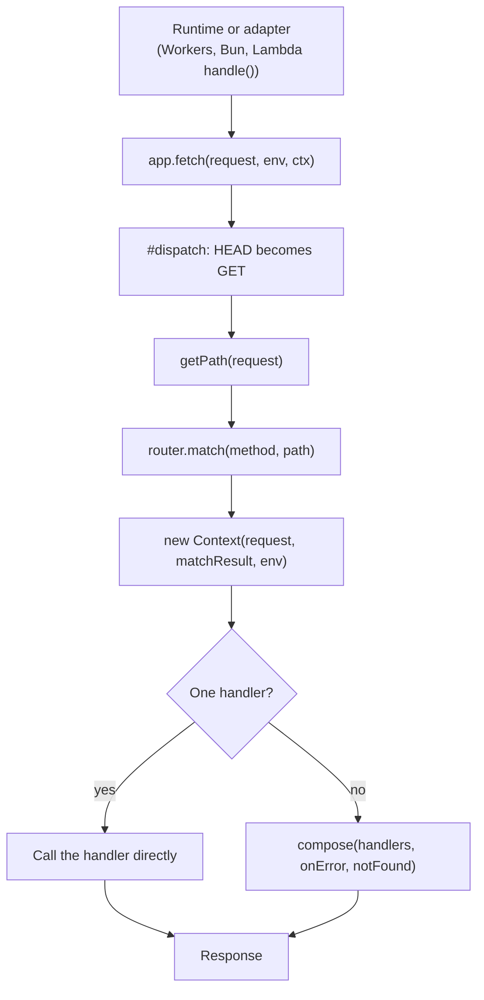

## Overview

Hono is a small web framework built only on Web Standards: an application is an object whose `fetch(request, env, executionCtx)` takes a standard `Request` and returns a standard `Response`. Because nothing in the core depends on a particular server, the same app runs on Cloudflare Workers, Deno, Bun, Fastly, Vercel, Netlify, AWS Lambda, Lambda@Edge and Node.js; only a thin adapter changes per runtime. The package entry exports the `Hono` class, the `Context` class and the types an application needs.

Sources: [README.md:22-33](repo://README.md#L22-L33), [src/index.ts:17-53](repo://src/index.ts#L17-L53)

The repository holds the framework (`src/`), its build script (`build/`), per-runtime test suites (`runtime-tests/`) and benchmarks. Everything in `src/` ships in one npm package, `hono`, with one subpath export per module so that an app only bundles the parts it imports.

Sources: [package.json:38-70](repo://package.json#L38-L70)

## Parts of the framework

| Area | What it does | Page |
| --- | --- | --- |
| Application | Registers routes, groups sub-apps, dispatches each request | [[Hono Application]] |
| Middleware chain | Runs matched handlers as an onion, turns errors into responses | [[Middleware Composition and Error Handling]] |
| Context | The `c` object: env, variables, response builders | [[Context and Responses]] |
| Request | `c.req`: params, query, headers, cached body readers | [[Reading Requests]] |
| Routers | Path syntax, the `Router` interface, `SmartRouter` | [[Routing and Router Selection]] |
| Default router | One compiled regular expression per method | [[RegExpRouter]] |
| Other routers | `TrieRouter`, `LinearRouter`, `PatternRouter` | [[Trie, Linear and Pattern Routers]] |
| Types | `Env`, `Schema`, typed responses carried in generics | [[Type System: Env, Schema and Handlers]] |
| Validation | `validator()` and `c.req.valid()` | [[Validation]] |
| RPC client | `hc()` typed client generated from an app's type | [[RPC Client]] |
| Authentication | Basic, bearer, JWT and JWK middleware | [[Basic and Bearer Authentication]], [[JWT and JWK]] |
| Security | CORS, CSRF, secure headers, IP restriction | [[CORS, CSRF and Secure Headers]], [[IP Restriction and Connection Info]] |
| Response middleware | ETag, cache, compression, pretty JSON | [[ETag, Cache and Compression]] |
| Request middleware | Body limit, timeout, method override, trailing slash | [[Body Limit, Timeout and Request Rewriting]] |
| Observability | Logger, Server-Timing, request IDs | [[Logging, Timing and Request IDs]] |
| Negotiation | `Accept` parsing and language detection | [[Content Negotiation and Language]] |
| Static files | `serveStatic` and its runtime back ends | [[Static Files]] |
| JSX | Server rendering, streaming, browser runtime, CSS | [[JSX Server Rendering]], [[Streaming and Suspense]], [[JSX DOM and Hooks]], [[CSS Helper]] |
| Runtimes | Adapters per platform, AWS Lambda, WebSocket | [[Runtime Adapters]], [[AWS Lambda and Lambda@Edge]], [[WebSocket]] |
| Helpers | Cookies, static site generation, proxying | [[Cookies]], [[Static Site Generation]], [[Proxy Helper]] |
| Repository | Build, tests, benchmarks | [[Building and Testing Hono]] |

Sources: [src/index.ts:17-53](repo://src/index.ts#L17-L53), [package.json:38-70](repo://package.json#L38-L70)

## How a request flows

Sources: [src/hono-base.ts:406-485](repo://src/hono-base.ts#L406-L485)

1. A runtime calls `app.fetch` directly (Workers, Bun and Deno accept an object with a `fetch` method) or through an adapter that first converts its own event into a `Request`; see [[Runtime Adapters]] and [[AWS Lambda and Lambda@Edge]].
2. `fetch` hands the request to the private `#dispatch`, which answers `HEAD` by dispatching a `GET` and dropping the body; see [[Hono Application]].
3. `getPath` extracts the path, honouring the `strict` option; see [[Reading Requests]].
4. The router returns every handler and middleware whose method and path match, in registration order; see [[Routing and Router Selection]].
5. A `Context` is built around the request and the match result; see [[Context and Responses]].
6. A lone handler is called without composition; several are chained by `compose`, which also routes thrown errors to `onError`; see [[Middleware Composition and Error Handling]].

Sources: [src/hono-base.ts:406-485](repo://src/hono-base.ts#L406-L485)

## Design decisions

### Web Standards as the only interface

The application never touches a runtime-specific request or socket. `fetch` takes a `Request`, optional bindings and an `ExecutionContext`, and returns a `Response` or a promise of one. This is why the core needs no adapter on runtimes that already speak `fetch`, and why `app.request()` can test an app by building a `Request` in memory.

Sources: [src/hono-base.ts:479-517](repo://src/hono-base.ts#L479-L517)

### Pluggable routers and presets

`HonoBase` declares a `router` but never creates one; each entry class picks it. The default `Hono` uses a `SmartRouter` that tries `RegExpRouter` and falls back to `TrieRouter`, `hono/quick` pairs `LinearRouter` with `TrieRouter` for apps that start often and route little, and `hono/tiny` uses `PatternRouter` for the smallest bundle. Any object implementing the `Router` interface can be passed as `options.router`.

Sources: [src/hono-base.ts:114-118](repo://src/hono-base.ts#L114-L118), [src/hono.ts:16-34](repo://src/hono.ts#L16-L34), [src/preset/quick.ts:13-24](repo://src/preset/quick.ts#L13-L24), [src/preset/tiny.ts:11-19](repo://src/preset/tiny.ts#L11-L19)

### Types carried in generics

`Hono<E, S, BasePath>` carries the environment (`Bindings` and `Variables`), the accumulated route `Schema` and the base path as type parameters. Each `get`, `post` or `route` call returns the app with a widened `Schema`, so the type of the final app describes every route, its inputs and its typed responses. The RPC client reads that type; nothing is generated at build time. See [[Type System: Env, Schema and Handlers]] and [[RPC Client]].

Sources: [src/hono.ts:16-20](repo://src/hono.ts#L16-L20), [src/hono-base.ts:98-112](repo://src/hono-base.ts#L98-L112), [src/types.ts:26-35](repo://src/types.ts#L26-L35)

### Zero dependencies, many entry points

The package declares only `devDependencies`: every middleware, helper and adapter is written against Web APIs such as Web Crypto, `CompressionStream` and the Cache API. Each lives behind its own subpath (`hono/cors`, `hono/jsx`, `hono/client`, and so on), so importing one middleware does not pull in the others.

Sources: [package.json:668-699](repo://package.json#L668-L699), [package.json:38-70](repo://package.json#L38-L70)

### Short paths for the common case

Dispatch avoids work when it can: a route with a single handler skips `compose` entirely, and the `Context` builds its `Response` and `HonoRequest` lazily. [[Context and Responses]] and [[Middleware Composition and Error Handling]] show how these shortcuts keep the same observable behaviour as the full chain.

Sources: [src/hono-base.ts:429-448](repo://src/hono-base.ts#L429-L448)
