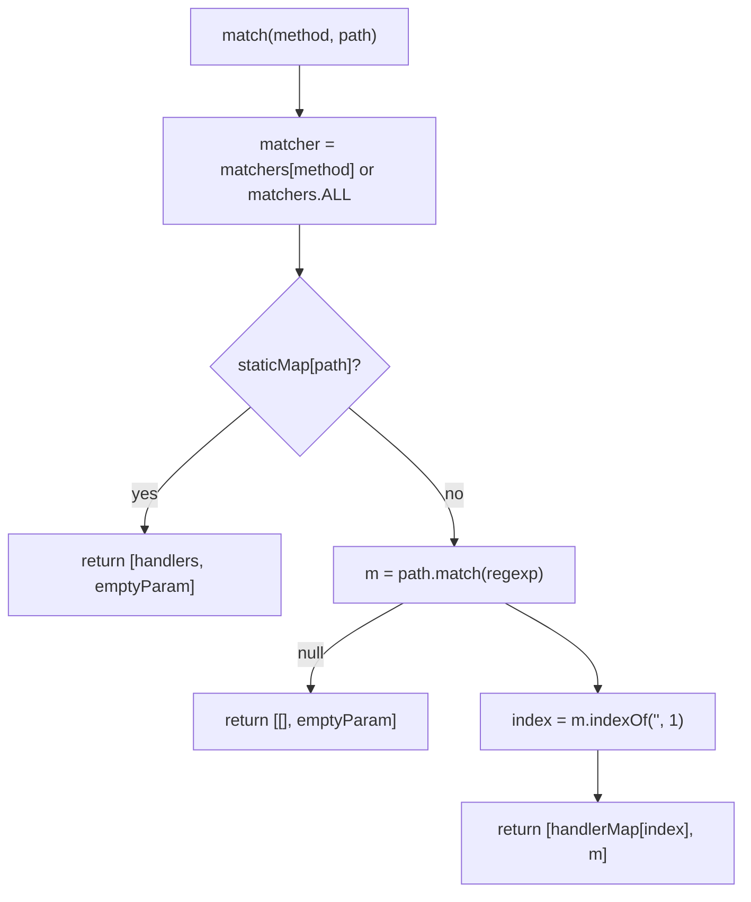

## Overview

`RegExpRouter` is the first router the default `Hono` tries. Instead of walking a tree on every request, it compiles all the routes of a method into one regular expression on the first match, plus a table of static paths. A request then costs one hash lookup for a static path, or one `RegExp` execution followed by an index lookup. The trade-off is that some combinations of routes cannot be expressed in a single regular expression; for those it throws `UnsupportedPathError` and `SmartRouter` falls back to `TrieRouter` (see [[Routing and Router Selection]]).

Sources: [src/router/reg-exp-router/router.ts:122-130](repo://src/router/reg-exp-router/router.ts#L122-L130), [src/router/reg-exp-router/matcher.ts:10-33](repo://src/router/reg-exp-router/matcher.ts#L10-L33)

The code is split into four files: `router.ts` collects routes and merges middleware, `trie.ts` and `node.ts` build the expression, and `matcher.ts` runs it. `prepared-router.ts` lets the compiled matchers be generated ahead of time.

Sources: [src/router/reg-exp-router/index.ts:1-7](repo://src/router/reg-exp-router/index.ts#L1-L7)

## Collecting routes

### Pre-merged handler lists

Hono runs every matching handler, so a match must return the full ordered list of middleware and handlers for a path. A single regular expression can only report one winning alternative, so `RegExpRouter` builds that list at registration time. It keeps two maps per method, `#middleware` for wildcard paths and `#routes` for everything else, each from path to an ordered list of `[handler, paramCount]`.

Sources: [src/router/reg-exp-router/router.ts:14-14](repo://src/router/reg-exp-router/router.ts#L14-L14), [src/router/reg-exp-router/router.ts:122-130](repo://src/router/reg-exp-router/router.ts#L122-L130)

`add(method, path, handler)` works as follows:

Sources: [src/router/reg-exp-router/router.ts:132-204](repo://src/router/reg-exp-router/router.ts#L132-L204)

1. The first route for a new method copies every `ALL` entry into that method's maps, so `GET` lists start with what `app.use` registered.
2. `/*` is normalized to `*`.
3. A path ending in `*` is a wildcard. It gets an entry in the middleware map seeded with any broader wildcard's handlers, and the handler is appended to every existing middleware and route list whose path the wildcard matches.
4. Any other path is expanded for optional parameters. Each variant's route list starts with a copy of the middleware whose wildcard matches it, longest wildcard first, and the handler is appended.

Sources: [src/router/reg-exp-router/router.ts:140-203](repo://src/router/reg-exp-router/router.ts#L140-L203), [src/router/reg-exp-router/router.ts:105-120](repo://src/router/reg-exp-router/router.ts#L105-L120)

Wildcards are tested with `buildWildcardRegExp`, which escapes the path and turns a trailing `/*` into `(?:|/.*)`, so `/api/*` also covers `/api`. The compiled expressions are cached during registration and the cache is cleared once matchers are built.

Sources: [src/router/reg-exp-router/router.ts:19-32](repo://src/router/reg-exp-router/router.ts#L19-L32)

### Parameter counts

Each list entry records how many parameters its own route pattern has. Later, `buildMatcherFromPreprocessedRoutes` uses that count to take only the first N parameters of the path when it builds that handler's `ParamIndexMap`, so a middleware on `/posts/:id/*` sees `id` while a handler on `/posts/:id/comments/:cid` sees both. For an optional-parameter variant the count is reduced by the parameters the shorter variant omits.

Sources: [src/router/reg-exp-router/router.ts:153-153](repo://src/router/reg-exp-router/router.ts#L153-L153), [src/router/reg-exp-router/router.ts:189-203](repo://src/router/reg-exp-router/router.ts#L189-L203), [src/router/reg-exp-router/router.ts:71-79](repo://src/router/reg-exp-router/router.ts#L71-L79)

## Building the matcher

### One expression per method

The first call to `match` is the module-level `match` function. It calls `buildAllMatchers`, which builds one matcher per method (methods without their own routes reuse `ALL`), releases the route maps and wildcard cache, and then replaces `this.match` with a closure over the matchers. After that, `add` throws `MESSAGE_MATCHER_IS_ALREADY_BUILT`.

Sources: [src/router/reg-exp-router/matcher.ts:10-33](repo://src/router/reg-exp-router/matcher.ts#L10-L33), [src/router/reg-exp-router/router.ts:206-251](repo://src/router/reg-exp-router/router.ts#L206-L251)

A `Matcher` is `[regexp, handlerData[], staticMap]`. `buildMatcherFromPreprocessedRoutes` sorts the paths so dynamic routes come first, shortest first, and static routes last. Static paths go straight into `staticMap` with their handler lists and empty parameters; they are still inserted into the trie, in check-only mode, so a conflict with a dynamic route is detected. Dynamic paths get a sequential index `j` and are inserted for real.

Sources: [src/router/reg-exp-router/matcher.ts:4-7](repo://src/router/reg-exp-router/matcher.ts#L4-L7), [src/router/reg-exp-router/router.ts:34-80](repo://src/router/reg-exp-router/router.ts#L34-L80)

### The trie

`Trie.insert` tokenizes a path into single characters, `:label` or `:label{regex}` patterns, and a trailing `/*`, protecting `{...}` groups from the tokenizer with temporary marks. Each `Node` has children keyed by a literal character or by a pattern's regular-expression source (`[^/]+` for a plain label). A node created for a named parameter gets the next capture number from the shared context, and the insert records `[name, captureNumber]` for the route.

Sources: [src/router/reg-exp-router/trie.ts:6-47](repo://src/router/reg-exp-router/trie.ts#L6-L47), [src/router/reg-exp-router/node.ts:45-133](repo://src/router/reg-exp-router/node.ts#L45-L133)

`buildRegExpStr` walks the tree, sorting children so that literals come first, then custom patterns (longest first), then plain labels, then wildcards. A parameter node emits `(pattern)@n`, a route end emits `#index`, and siblings are joined as `(?:a|b)`.

Sources: [src/router/reg-exp-router/node.ts:13-43](repo://src/router/reg-exp-router/node.ts#L13-L43), [src/router/reg-exp-router/node.ts:135-161](repo://src/router/reg-exp-router/node.ts#L135-L161)

`Trie.buildRegExp` then rewrites the markers. Each `#index` becomes an empty capture group `$()`, and `indexReplacementMap` records which capture group stands for which route. Each `@n` is removed, and `paramReplacementMap` records which capture group holds parameter `n`. The router then rewrites every handler's parameter map from parameter numbers to capture-group numbers, and reorders the handler lists so `handlerMap[captureGroup]` is the list for the route that group marks.

Sources: [src/router/reg-exp-router/trie.ts:49-73](repo://src/router/reg-exp-router/trie.ts#L49-L73), [src/router/reg-exp-router/router.ts:82-102](repo://src/router/reg-exp-router/router.ts#L82-L102)

## Matching a request

Sources: [src/router/reg-exp-router/matcher.ts:14-29](repo://src/router/reg-exp-router/matcher.ts#L14-L29)

The empty capture group of the route that matched is the first element of the match array equal to `''` after index 0, so `indexOf('', 1)` finds the route without any loop over routes. The match array itself is returned as the parameter stash: every handler's `ParamIndexMap` points into it, which is the index form of `Result` that [[Reading Requests]] decodes.

Sources: [src/router/reg-exp-router/matcher.ts:22-28](repo://src/router/reg-exp-router/matcher.ts#L22-L28), [src/router.ts:66-98](repo://src/router.ts#L66-L98)

## Unsupported routes

`Node.insert` throws the internal `PATH_ERROR`, re-thrown as `UnsupportedPathError`, whenever a path would need two different alternatives of the expression to match the same request:

Sources: [src/router/reg-exp-router/node.ts:57-131](repo://src/router/reg-exp-router/node.ts#L57-L131), [src/router/reg-exp-router/router.ts:60-65](repo://src/router/reg-exp-router/router.ts#L60-L65)

| Case | Example |
| --- | --- |
| The same route end twice | Two patterns that normalize to the same path |
| A pattern next to other non-wildcard children | `/users/:id` with `/users/:id{[0-9]+}`, or `/:a/x` with `/b/:c` |
| A literal next to a pattern | `/users/:id` with `/users/new` |
| A custom pattern of `.*` | `/:path{.*}` |
| A capturing group inside a custom pattern | `/:id{a(b|c)}`; a whole-pattern group `(a|b)` is rewritten to `(?:a|b)` |

Sources: [src/router/reg-exp-router/node.ts:57-131](repo://src/router/reg-exp-router/node.ts#L57-L131)

> [!NOTE]
> A common pair such as `GET /users/new` and `GET /users/:id` is unsupported, because `/users/new` must run both handlers. With the default `Hono`, `getRouterName(app)` then reports `SmartRouter + TrieRouter`. The app works the same; only the matching algorithm changes. Routes that differ by a wildcard are fine, since wildcard handlers are merged into the lists ahead of time.

Sources: [src/router/reg-exp-router/node.ts:114-129](repo://src/router/reg-exp-router/node.ts#L114-L129), [src/router/smart-router/router.ts:32-50](repo://src/router/smart-router/router.ts#L32-L50)

## PreparedRegExpRouter

On platforms where start-up time matters, the compilation can be moved to build time. `buildInitParams({ paths })` registers each path under `ALL` with the path itself as the handler, builds the matchers, and derives a `relocateMap` that records where each path's handlers sit in the handler table or the static map. It then empties the handler lists. `serializeInitParams` turns the result into JavaScript source, embedding the regular expressions as literals so a build tool can write it to a file.

Sources: [src/router/reg-exp-router/prepared-router.ts:95-165](repo://src/router/reg-exp-router/prepared-router.ts#L95-L165)

At run time `new PreparedRegExpRouter(matchers, relocateMap)` starts with the compiled matchers. `add` only places the handler into the slots `relocateMap` names (wildcards `*` and `/*` are appended to every list), copying the `ALL` matcher for a method seen for the first time. A path missing from the map throws `Path ... is not registered`. `buildAllMatchers` returns the stored matchers, so the shared `match` function runs with no compile step.

Sources: [src/router/reg-exp-router/prepared-router.ts:9-93](repo://src/router/reg-exp-router/prepared-router.ts#L9-L93)
