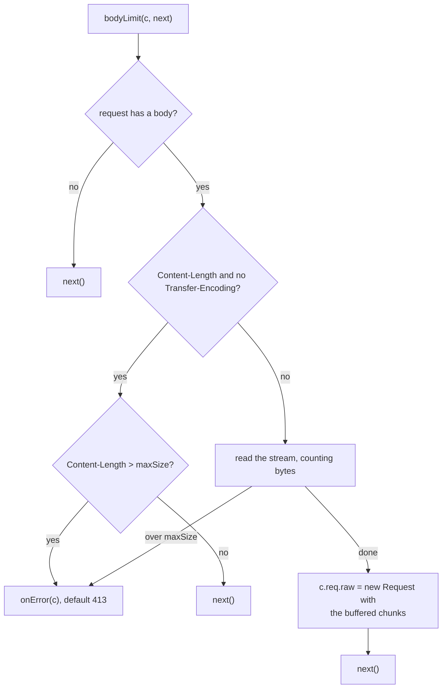

## Overview

These middleware act on the request before a handler sees it. `bodyLimit` rejects bodies that are too large, `timeout` puts a deadline on the rest of the chain, `methodOverride` lets HTML forms use methods other than `GET` and `POST`, and `trimTrailingSlash`/`appendTrailingSlash` redirect between `/path` and `/path/`. Each one either answers early, rewrites the request, or wraps `next()`, using the chain described on [[Middleware Composition and Error Handling]].

Sources: [src/middleware/body-limit/index.ts:50-111](repo://src/middleware/body-limit/index.ts#L50-L111), [src/middleware/timeout/index.ts:38-58](repo://src/middleware/timeout/index.ts#L38-L58), [src/middleware/method-override/index.ts:60-138](repo://src/middleware/method-override/index.ts#L60-L138), [src/middleware/trailing-slash/index.ts:44-158](repo://src/middleware/trailing-slash/index.ts#L44-L158)

## bodyLimit

### How the size is measured

`bodyLimit({ maxSize, onError })` from `hono/body-limit` limits the request body to `maxSize` bytes. A request without a body (typically `GET` or `HEAD`) passes immediately.

Sources: [src/middleware/body-limit/index.ts:13-16](repo://src/middleware/body-limit/index.ts#L13-L16), [src/middleware/body-limit/index.ts:61-65](repo://src/middleware/body-limit/index.ts#L61-L65)

Sources: [src/middleware/body-limit/index.ts:61-110](repo://src/middleware/body-limit/index.ts#L61-L110)

When only `Content-Length` is present, it is trusted: the runtime's HTTP layer rejects a body longer than its declared length. With `Transfer-Encoding` (chunked) or no length header, the body is read in full before the handler runs, stopping as soon as the count passes `maxSize`. The buffered chunks are then put back into a new `Request` that replaces `c.req.raw`, so the handler reads the body normally (see [[Reading Requests]]). Following RFC 7230, `Content-Length` is ignored when `Transfer-Encoding` is also present.

Sources: [src/middleware/body-limit/index.ts:67-109](repo://src/middleware/body-limit/index.ts#L67-L109)

### When the limit is exceeded

The default is an `HTTPException(413)` whose response body is `Payload Too Large`. `onError(c)` may return a custom response instead.

Sources: [src/middleware/body-limit/index.ts:10-10](repo://src/middleware/body-limit/index.ts#L10-L10), [src/middleware/body-limit/index.ts:50-58](repo://src/middleware/body-limit/index.ts#L50-L58)

## timeout

`timeout(duration, exception)` from `hono/timeout` races `next()` against a timer. If the timer fires first, the promise rejects with the exception, by default `HTTPException(504, { message: 'Gateway Timeout' })`, or the result of a function of the context. The rejection travels through the chain to the error handler. The timer is cleared in `finally` either way.

Sources: [src/middleware/timeout/index.ts:10-58](repo://src/middleware/timeout/index.ts#L10-L58)

> [!WARNING]
> The timeout only stops waiting; it does not cancel the handler, which keeps running in the background and may still have side effects. To stop work, pass `c.req.raw.signal` or your own `AbortController` to the operations the handler starts. Streaming responses return before their body is written, so the timeout does not cover the stream.

Sources: [src/middleware/timeout/index.ts:42-57](repo://src/middleware/timeout/index.ts#L42-L57)

## methodOverride

### Sources of the method

HTML forms can only send `GET` and `POST`. `methodOverride({ app, form | header | query })` from `hono/method-override` reads the intended method from one of three places:

Sources: [src/middleware/method-override/index.ts:11-33](repo://src/middleware/method-override/index.ts#L11-L33)

| Option | Reads | Default |
| --- | --- | --- |
| `form` | A field of a `multipart/form-data` or `application/x-www-form-urlencoded` body | `_method` |
| `header` | A request header, for example `X-HTTP-Method-Override` | none |
| `query` | A query parameter | none |

Sources: [src/middleware/method-override/index.ts:11-33](repo://src/middleware/method-override/index.ts#L11-L33)

### Re-dispatching

When a method is found, the middleware builds a new `Request` with that method, with the override field, header or parameter removed, and calls `app.fetch(request, c.env, executionCtx)` on the app passed in the options. Its response becomes the response of the original request. The form variant clones the raw request twice, one copy to read the field and one to rebuild the body, so the original stream is not consumed.

Sources: [src/middleware/method-override/index.ts:66-136](repo://src/middleware/method-override/index.ts#L66-L136)

`GET` requests and requests without an override go on with `next()`. The execution context is fetched inside `try` because not every runtime has one.

Sources: [src/middleware/method-override/index.ts:62-64](repo://src/middleware/method-override/index.ts#L62-L64), [src/middleware/method-override/index.ts:137-148](repo://src/middleware/method-override/index.ts#L137-L148)

> [!IMPORTANT]
> Because the overridden request goes through `app.fetch` from the top, every middleware registered on the app runs again for it, including `methodOverride` itself (which then finds nothing to override). Register it on the paths that need it and pass the app whose routes should handle the new method.

Sources: [src/middleware/method-override/index.ts:88-88](repo://src/middleware/method-override/index.ts#L88-L88), [src/hono-base.ts:479-485](repo://src/hono-base.ts#L479-L485)

## Trailing slashes

### Two middleware

`hono/trailing-slash` exports two middleware that make `/path` and `/path/` equivalent through a `301` redirect. They complement the `strict` option on [[Hono Application]], which instead strips the slash before routing without telling the client.

Sources: [src/middleware/trailing-slash/index.ts:44-158](repo://src/middleware/trailing-slash/index.ts#L44-L158), [src/hono-base.ts:170-173](repo://src/hono-base.ts#L170-L173)

| Middleware | Redirects | Never redirects |
| --- | --- | --- |
| `trimTrailingSlash()` | `/about/` to `/about` | `/` |
| `appendTrailingSlash()` | `/about` to `/about/` | paths for which `skip(path)` returns true, for example files with an extension |

Sources: [src/middleware/trailing-slash/index.ts:44-74](repo://src/middleware/trailing-slash/index.ts#L44-L74), [src/middleware/trailing-slash/index.ts:128-158](repo://src/middleware/trailing-slash/index.ts#L128-L158)

### When they redirect

By default both act only after the handler, and only when the response is a `404` for a `GET` or `HEAD`: an existing route is never redirected away from. With `alwaysRedirect: true` they redirect before running the chain, which avoids the cost of the first lookup but also redirects paths a route would have matched. In both modes the query string is kept, since only `pathname` changes.

Sources: [src/middleware/trailing-slash/index.ts:45-73](repo://src/middleware/trailing-slash/index.ts#L45-L73), [src/middleware/trailing-slash/index.ts:129-157](repo://src/middleware/trailing-slash/index.ts#L129-L157)
