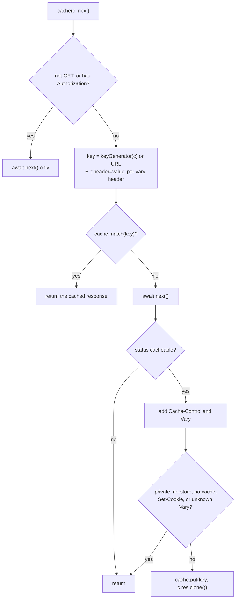

## Overview

Some middleware do nothing before the handler and all their work after it: they call `await next()`, read `c.res`, and replace or annotate it. This page covers the ones that shape the outgoing response for caches and bandwidth: `etag`, `cache`, `compress`, `prettyJSON` and `poweredBy`. They rely on two rules from [[Middleware Composition and Error Handling]] and [[Context and Responses]]: middleware registered earlier wraps middleware registered later, and assigning `c.res` replaces the response while keeping headers set earlier.

Sources: [src/middleware/etag/index.ts:84-128](repo://src/middleware/etag/index.ts#L84-L128), [src/middleware/compress/index.ts:86-121](repo://src/middleware/compress/index.ts#L86-L121), [src/context.ts:414-434](repo://src/context.ts#L414-L434)

Order matters when combining them. `compress` should run outside `etag` (registered before it) so the ETag is computed on the uncompressed body; `compress` then weakens it. `cache` should be outermost so a cached hit skips the others entirely.

Sources: [src/middleware/compress/index.ts:116-120](repo://src/middleware/compress/index.ts#L116-L120), [src/middleware/cache/index.ts:158-164](repo://src/middleware/cache/index.ts#L158-L164)

## etag

### Computing the tag

`etag()` reads `If-None-Match` before `next()` and inspects the response afterwards. If the handler already set an `ETag` header, that value is used. Otherwise it hashes a clone of the body with `generateDigest`, by default SHA-1 through `crypto.subtle`, and wraps the hex digest in quotes, prefixed with `W/` when `weak: true`.

Sources: [src/middleware/etag/index.ts:79-105](repo://src/middleware/etag/index.ts#L79-L105), [src/middleware/etag/index.ts:38-54](repo://src/middleware/etag/index.ts#L38-L54)

`generateDigest` reads the body stream chunk by chunk and feeds the generator the previous digest concatenated with the next chunk, so memory stays bounded by one chunk plus one digest for large or streamed bodies. A response without a body, or a runtime without Web Crypto and no custom `generateDigest`, gets no ETag.

Sources: [src/middleware/etag/digest.ts:1-43](repo://src/middleware/etag/digest.ts#L1-L43), [src/middleware/etag/index.ts:92-103](repo://src/middleware/etag/index.ts#L92-L103)

### Answering 304

The request matches when one of the comma-separated `If-None-Match` values equals the tag after stripping any `W/` (weak comparison), or when it is `*` on a successful `GET` or `HEAD`. A match replaces the response with `304 Not Modified` carrying the ETag and only the headers in `retainedHeaders`, which defaults to `RETAINED_304_HEADERS`: `Cache-Control`, `Content-Location`, `Date`, `ETag`, `Expires` and `Vary`. Otherwise the ETag is set on the response.

Sources: [src/middleware/etag/index.ts:21-36](repo://src/middleware/etag/index.ts#L21-L36), [src/middleware/etag/index.ts:107-127](repo://src/middleware/etag/index.ts#L107-L127)

> [!NOTE]
> The handler still runs on a 304: the middleware needs the body to compute the tag. ETags save bandwidth, not server work. Set the `ETag` header in the handler, from a version number for example, to avoid hashing.

Sources: [src/middleware/etag/index.ts:87-105](repo://src/middleware/etag/index.ts#L87-L105)

## cache

### Setup

`cache({ cacheName, ... })` stores responses in the Web Cache API (`caches.open`). On runtimes without `globalThis.caches` it becomes a pass-through and logs that it is disabled; `onCacheNotAvailable` replaces the log or, set to `false`, silences it.

Sources: [src/middleware/cache/index.ts:64-82](repo://src/middleware/cache/index.ts#L64-L82)

| Option | Effect |
| --- | --- |
| `cacheName` | Cache to open, or a function of the context |
| `wait` | `true` awaits `cache.put`; the default hands it to `c.executionCtx.waitUntil` |
| `cacheControl` | Directives appended to `Cache-Control` unless the handler set the same directive |
| `vary` | Request headers that are part of the cache key and added to `Vary`; `*` throws at setup |
| `keyGenerator` | Custom cache key instead of the URL |
| `cacheableStatusCodes` | Statuses to store; default `[200]` |

Sources: [src/middleware/cache/index.ts:64-139](repo://src/middleware/cache/index.ts#L64-L139)

### Per request

Sources: [src/middleware/cache/index.ts:141-183](repo://src/middleware/cache/index.ts#L141-L183)

The skip rules keep personal data out of a shared cache. Requests with `Authorization` bypass it, and responses that set a cookie or have `Cache-Control: private`, `no-store` or `no-cache` are never stored. A response that varies on a header not listed in the `vary` option is also skipped, since the key would not distinguish its variants.

Sources: [src/middleware/cache/index.ts:13-35](repo://src/middleware/cache/index.ts#L13-L35), [src/middleware/cache/index.ts:142-145](repo://src/middleware/cache/index.ts#L142-L145)

> [!WARNING]
> Without `wait: true`, storing uses `c.executionCtx.waitUntil`, which throws on runtimes that pass no execution context (see [[Context and Responses]]). Deno's cache also needs `wait: true`.

Sources: [src/middleware/cache/index.ts:44-44](repo://src/middleware/cache/index.ts#L44-L44), [src/middleware/cache/index.ts:177-182](repo://src/middleware/cache/index.ts#L177-L182), [src/context.ts:391-399](repo://src/context.ts#L391-L399)

## compress

### When it compresses

`compress({ encoding, threshold, contentTypeFilter })` compresses after the handler with the standard `CompressionStream`. It leaves the response alone when any of these hold:

Sources: [src/middleware/compress/index.ts:70-102](repo://src/middleware/compress/index.ts#L70-L102)

- the status is 206 (a range of the uncompressed bytes);
- `Content-Encoding` or `Transfer-Encoding` is already set;
- the request is `HEAD`;
- `Content-Length` is below `threshold` (1024 bytes by default);
- the content type is not compressible;
- `Cache-Control` contains `no-transform`.

Sources: [src/middleware/compress/index.ts:86-102](repo://src/middleware/compress/index.ts#L86-L102), [src/middleware/compress/index.ts:124-129](repo://src/middleware/compress/index.ts#L124-L129)

The default filter, `COMPRESSIBLE_CONTENT_TYPE_REGEX`, matches all `text/*` types except `text/event-stream` (so server-sent events keep flowing), common `application/*` types such as JSON, JavaScript and XML, `+json`/`+xml` suffix types, and a few font and image types. `contentTypeFilter` replaces it with a `RegExp` or a function.

Sources: [src/utils/compress.ts:9-10](repo://src/utils/compress.ts#L9-L10), [src/middleware/compress/index.ts:74-84](repo://src/middleware/compress/index.ts#L74-L84)

### Choosing the encoding

`selectEncoding` parses `Accept-Encoding` with the shared `parseAccept` (see [[Content Negotiation and Language]]) and picks `gzip` or `deflate` (only the configured `encoding` if set) by quality. An explicit `q=1` wins at once, a wildcard `*` supplies the quality for encodings not listed, and `q=0` excludes one.

Sources: [src/middleware/compress/index.ts:12-44](repo://src/middleware/compress/index.ts#L12-L44)

The body is piped through the stream, `Content-Length` is removed because the size is no longer known, and `Content-Encoding` is set. A strong ETag becomes weak, since the compressed bytes differ from the ones it was computed on.

Sources: [src/middleware/compress/index.ts:104-121](repo://src/middleware/compress/index.ts#L104-L121)

## prettyJSON and poweredBy

`prettyJSON({ space = 2, query = 'pretty', force })` re-serializes a JSON response with indentation when the request has `?pretty` (with or without a value) or `force` is set. It checks for `application/json` after the handler, parses the body, and builds a new response with the same status and headers.

Sources: [src/middleware/pretty-json/index.ts:8-56](repo://src/middleware/pretty-json/index.ts#L8-L56)

`poweredBy({ serverName = 'Hono' })` sets `X-Powered-By` after the handler. `secureHeaders` removes that header by default, so the order of the two decides whether it survives (see [[CORS, CSRF and Secure Headers]]).

Sources: [src/middleware/powered-by/index.ts:7-35](repo://src/middleware/powered-by/index.ts#L7-L35), [src/middleware/secure-headers/secure-headers.ts:225-227](repo://src/middleware/secure-headers/secure-headers.ts#L225-L227)
