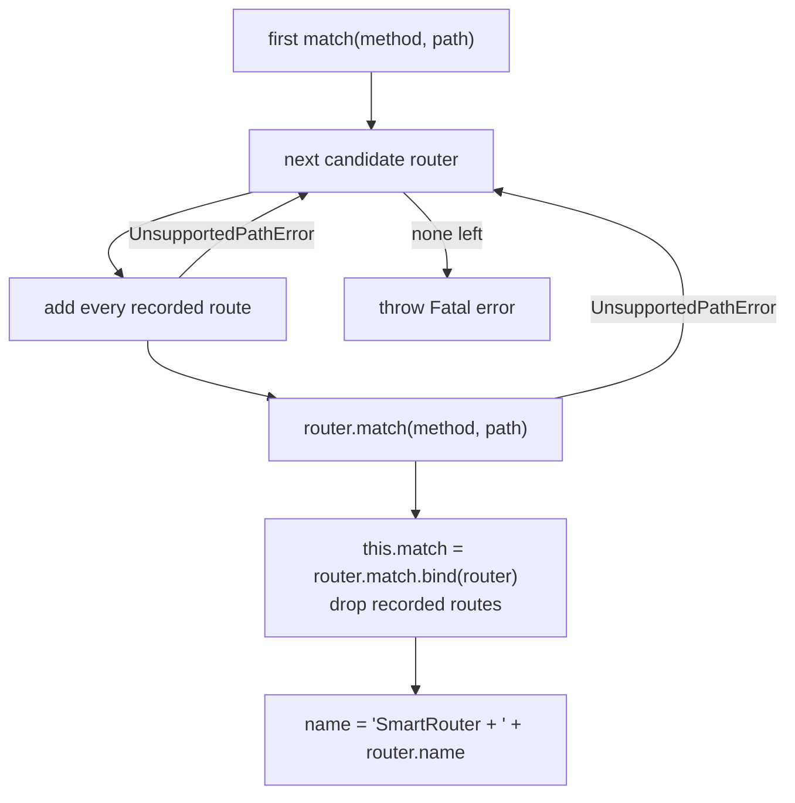

## Overview

A router answers one question for every request: which registered handlers apply to this method and path, in which order, and with which parameters. Hono defines that contract as the small `Router` interface in `src/router.ts` and ships five implementations, so an app can trade matching speed, start-up cost and bundle size without changing any route. [[Hono Application]] feeds the router through `add` at registration time and calls `match` once per request.

Sources: [src/router.ts:24-52](repo://src/router.ts#L24-L52), [src/hono-base.ts:385-397](repo://src/hono-base.ts#L385-L397), [src/hono-base.ts:418-419](repo://src/hono-base.ts#L418-L419)

This page covers the shared contract, the path syntax every router accepts, how `SmartRouter` chooses among routers, and the helpers that inspect routes. The algorithms are on [[RegExpRouter]] and [[Trie, Linear and Pattern Routers]].

Sources: [src/router.ts:6-22](repo://src/router.ts#L6-L22)

## The Router interface

```ts
export interface Router<T> {
  name: string
  add(method: string, path: string, handler: T): void
  match(method: string, path: string): Result<T>
}
```

Sources: [src/router.ts:29-52](repo://src/router.ts#L29-L52)

The app stores `[handler, routerRoute]` as `T`. `match` returns every matching entry, middleware and handlers together, in registration order. The `Result` takes one of two shapes:

Sources: [src/router.ts:66-98](repo://src/router.ts#L66-L98), [src/hono-base.ts:395-395](repo://src/hono-base.ts#L395-L395)

| Shape | Params per entry | Used by |
| --- | --- | --- |
| `[[T, ParamIndexMap][], ParamStash]` | name → index into the shared `ParamStash` array of captured strings | `RegExpRouter` |
| `[[T, Params][]]` | name → value | `TrieRouter`, `LinearRouter`, `PatternRouter` |

Sources: [src/router.ts:54-98](repo://src/router.ts#L54-L98)

The index form lets one regular-expression match fill a single array that every matched handler shares, instead of building a parameter object per handler. `HonoRequest` reads both shapes the same way (see [[Reading Requests]]).

Sources: [src/router.ts:66-98](repo://src/router.ts#L66-L98), [src/request.ts:126-128](repo://src/request.ts#L126-L128)

Method `ALL` (`METHOD_NAME_ALL`) matches any method; `app.use` and `app.all` register under it. A router throws `UnsupportedPathError` when it cannot represent a route, and the `MESSAGE_MATCHER_IS_ALREADY_BUILT` error when a route is added after the first match compiled the routes.

Sources: [src/router.ts:6-22](repo://src/router.ts#L6-L22), [src/router.ts:100-103](repo://src/router.ts#L100-L103)

## Path syntax

| Pattern | Matches | Parameters |
| --- | --- | --- |
| `/posts` | exactly `/posts` | none |
| `/posts/:id` | one segment | `id` |
| `/posts/:id{[0-9]+}` | one segment matching the regex | `id` |
| `/js/:file{[a-z0-9/]+.js}` | a regex that may span `/` | `file` = `chunk/123.js` |
| `/api/animals/:type?` | `/api/animals` and `/api/animals/dog` | `type` or undefined |
| `/x/*` | `/x`, `/x/a`, `/x/a/b` | none |
| `*` or `/*` | everything | none |

Sources: [src/utils/url.ts:50-78](repo://src/utils/url.ts#L50-L78), [src/router/common.case.test.ts:345-412](repo://src/router/common.case.test.ts#L345-L412), [src/router/common.case.test.ts:496-525](repo://src/router/common.case.test.ts#L496-L525)

`getPattern` turns a label into a pattern and caches it: `*` is a wildcard, `:name` is any segment, and `:name{re}` becomes an anchored regex. When the regex label is followed by a literal segment, the regex gets a lookahead for `/next`, so a pattern like `/:dirs{.+}/file.html` captures `foo/bar` from `/foo/bar/file.html`.

Sources: [src/utils/url.ts:51-78](repo://src/utils/url.ts#L51-L78), [src/router/common.case.test.ts:527-538](repo://src/router/common.case.test.ts#L527-L538)

`splitRoutingPath` splits a route into segments while protecting `{...}` groups, which may contain `/`, by swapping them for `@index` marks before splitting and restoring them after.

Sources: [src/utils/url.ts:16-48](repo://src/utils/url.ts#L16-L48)

Optional parameters are expanded at registration: `checkOptionalParameter('/v1/:version?/:platform?')` returns `/v1`, `/v1/:version` and `/v1/:version/:platform`, and the router adds the handler under each. `RegExpRouter`, `TrieRouter` and `LinearRouter` call it in their `add`.

Sources: [src/utils/url.ts:171-206](repo://src/utils/url.ts#L171-L206), [src/router/trie-router/router.ts:13-20](repo://src/router/trie-router/router.ts#L13-L20)

> [!NOTE]
> All matching entries run, not just the most specific one. With `GET /*`, `GET *` and `GET /x` registered, a request for `/x` runs all three in registration order. A handler that should run only when nothing else answered must be registered last and the earlier ones must call `next()`.

Sources: [src/router/common.case.test.ts:345-371](repo://src/router/common.case.test.ts#L345-L371)

## SmartRouter

`SmartRouter` holds a list of candidate routers and defers the choice to the first request. `add` only records `[method, path, handler]`. The first `match` replays every recorded route into the first candidate and tries to match; if the candidate throws `UnsupportedPathError` while adding or matching, it moves to the next one.

Sources: [src/router/smart-router/router.ts:4-50](repo://src/router/smart-router/router.ts#L4-L50)



Sources: [src/router/smart-router/router.ts:21-61](repo://src/router/smart-router/router.ts#L21-L61)

Once a router succeeds, `SmartRouter` replaces its own `match` with the chosen router's bound `match`, so later requests pay no indirection, and discards the recorded routes. From then on `add` throws, because there is nowhere to put new routes; `activeRouter` exposes the winner.

Sources: [src/router/smart-router/router.ts:13-19](repo://src/router/smart-router/router.ts#L13-L19), [src/router/smart-router/router.ts:46-69](repo://src/router/smart-router/router.ts#L46-L69)

> [!IMPORTANT]
> Register every route before the app serves its first request. With the default router, a route added afterwards throws `Can not add a route since the matcher is already built.`

Sources: [src/router.ts:21-22](repo://src/router.ts#L21-L22), [src/router/smart-router/router.ts:13-19](repo://src/router/smart-router/router.ts#L13-L19)

## Choosing a router

| Router | Strength | Cost | Default in |
| --- | --- | --- | --- |
| `RegExpRouter` | One regex per method; fastest matching | Compiles on first match; rejects some ambiguous routes | `hono` (first choice) |
| `TrieRouter` | Supports every pattern | Walks a tree per request | `hono` and `hono/quick` (fallback) |
| `LinearRouter` | No build step at all | Scans every route per request | `hono/quick` (first choice) |
| `PatternRouter` | Smallest code | One regex test per route | `hono/tiny` |

Sources: [src/hono.ts:26-33](repo://src/hono.ts#L26-L33), [src/preset/quick.ts:13-24](repo://src/preset/quick.ts#L13-L24), [src/preset/tiny.ts:11-19](repo://src/preset/tiny.ts#L11-L19)

A router can also be passed directly, `new Hono({ router: new TrieRouter() })`, which skips `SmartRouter` and allows routes to be added at any time if that router supports it.

Sources: [src/hono-base.ts:55-65](repo://src/hono-base.ts#L55-L65), [src/hono.ts:28-32](repo://src/hono.ts#L28-L32)

## Inspecting routes

### hono/route

These helpers read the match result of the current request through the `GET_MATCH_RESULT` symbol on `c.req`:

Sources: [src/helper/route/index.ts:1-4](repo://src/helper/route/index.ts#L1-L4)

| Function | Returns |
| --- | --- |
| `matchedRoutes(c)` | Every matched `RouterRoute` (method, path, basePath, handler) |
| `routePath(c, index?)` | Registered path of the running handler, e.g. `/posts/:id`; a negative index counts from the end |
| `baseRoutePath(c, index?)` | Base path the route was registered under, e.g. `/:sub` |
| `basePath(c, index?)` | That base path with parameters filled from the request, e.g. `/foo` |

Sources: [src/helper/route/index.ts:32-84](repo://src/helper/route/index.ts#L32-L84)

`basePath` resolves a parameterized base path by walking its segments with `getPattern` against `c.req.path` and measuring how much of the request path each segment consumes. It caches the result per context and index in a `WeakMap`.

Sources: [src/helper/route/index.ts:106-141](repo://src/helper/route/index.ts#L106-L141)

### hono/dev

`inspectRoutes(app)` lists `app.routes` with each handler's name and whether it is middleware, where middleware means a function declared with two or more parameters (`(c, next)`). Handlers wrapped by `route()` for a sub-app error handler are unwrapped through `COMPOSED_HANDLER` first. `showRoutes(app, { verbose, colorize })` prints them, and `getRouterName(app)` triggers a match so that `SmartRouter` reports its chosen router, such as `SmartRouter + RegExpRouter`.

Sources: [src/helper/dev/index.ts:27-79](repo://src/helper/dev/index.ts#L27-L79), [src/utils/handler.ts:8-15](repo://src/utils/handler.ts#L8-L15)
