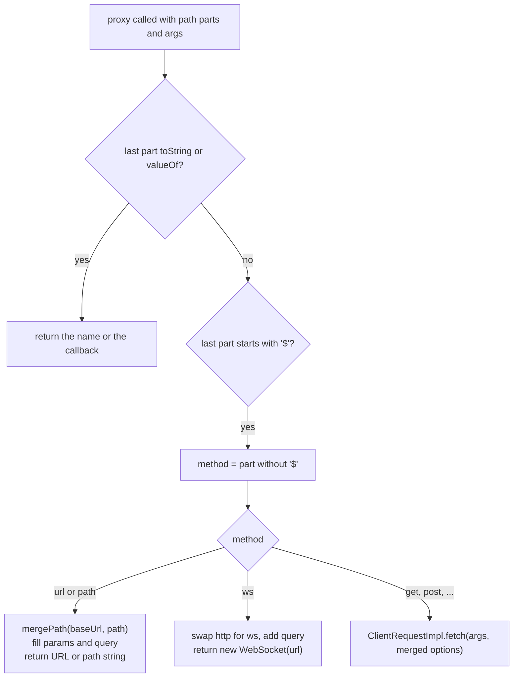

## Overview

`hc` from `hono/client` turns the type of a Hono app into a typed HTTP client. The server exports `typeof app`, the client imports only that type, and each route becomes a property chain ending in a method call: `client.posts[':id'].$get({ param: { id: '1' } })`. Nothing is generated. At run time the client is a `Proxy` that records property names and turns the final call into a `fetch`; at compile time the `Client` type walks the app's `Schema` (see [[Type System: Env, Schema and Handlers]]) to type each call's arguments and response.

Sources: [src/client/client.ts:133-232](repo://src/client/client.ts#L133-L232), [src/client/types.ts:294-318](repo://src/client/types.ts#L294-L318)

```ts
// server.ts
const app = new Hono()
  .get('/posts/:id', (c) => c.json({ id: c.req.param('id'), title: 'Hello' }))
export type AppType = typeof app

// client.ts
import { hc } from 'hono/client'
import type { AppType } from './server'

const client = hc<AppType>('http://localhost:8787')
const res = await client.posts[':id'].$get({ param: { id: '1' } })
if (res.ok) {
  const post = await res.json() // { id: string; title: string }
}
```

Sources: [src/client/client.ts:133-136](repo://src/client/client.ts#L133-L136), [src/client/index.ts:6-17](repo://src/client/index.ts#L6-L17)

## From a type to a property chain

`Client<T, Prefix>` takes the schema of `T` and, for every path key, builds a nested object with `PathToChain`: each `/`-separated segment becomes a property, and the root path `/` becomes `index`. The last segment holds a `ClientRequest`, an object with one function per method in the schema (`$get`, `$post`, and so on, with `$all` expanded to every standard method) plus `$url` and `$path`. `$ws` is added when the `GET` endpoint's output format is `ws`, which `upgradeWebSocket` sets (see [[WebSocket]]).

Sources: [src/client/types.ts:11-27](repo://src/client/types.ts#L11-L27), [src/client/types.ts:67-118](repo://src/client/types.ts#L67-L118), [src/client/types.ts:294-318](repo://src/client/types.ts#L294-L318)

A method's first argument is the endpoint's `input` type: `param`, `query`, `json`, `form`, `header` and `cookie` as the route's validators declared them (see [[Validation]]). The argument is required when the input has required keys and optional otherwise.

Sources: [src/client/types.ts:67-80](repo://src/client/types.ts#L67-L80)

## The runtime proxy

`createProxy` wraps an empty function in a `Proxy`. Every string property access returns a new proxy with the key appended to the recorded path, and `then` returns `undefined` so the proxy is not mistaken for a promise. Calling the proxy runs the callback with the recorded path and the call arguments.

Sources: [src/client/client.ts:15-31](repo://src/client/client.ts#L15-L31)

The `hc` callback then decides what the call means:

Sources: [src/client/client.ts:137-232](repo://src/client/client.ts#L137-L232)



Sources: [src/client/client.ts:137-232](repo://src/client/client.ts#L137-L232)

The joined path keeps the `:id` segments as written. `replaceUrlParam` replaces each `/:name`, with any `{regex}` suffix or `?`, by the given value, or removes the segment when the value is empty. `removeIndexString` turns a trailing `/index` back into the root path.

Sources: [src/client/utils.ts:11-24](repo://src/client/utils.ts#L11-L24), [src/client/utils.ts:55-60](repo://src/client/utils.ts#L55-L60)

## Building the request

### Request arguments

`ClientRequestImpl.fetch` turns the argument object into a `fetch` call:

Sources: [src/client/client.ts:53-129](repo://src/client/client.ts#L53-L129)

| Argument | Becomes |
| --- | --- |
| `query` | A query string from `buildSearchParams`; arrays repeat the key (`tag=a&tag=b`) and `undefined` values are skipped |
| `form` | A `FormData` body; arrays append each item |
| `json` | A `JSON.stringify` body with `Content-Type: application/json` |
| `param` | Values substituted into the path |
| `header` | Request headers, overridden by the `headers` option |
| `cookie` | A `Cookie` header of serialized `name=value` pairs |

Sources: [src/client/client.ts:59-108](repo://src/client/client.ts#L59-L108), [src/client/utils.ts:26-44](repo://src/client/utils.ts#L26-L44)

A body is only attached for methods other than `GET` and `HEAD`. The URL is passed to `fetch` as a string, which keeps the client compatible with mocking tools such as MSW and with `node-fetch`.

Sources: [src/client/client.ts:119-128](repo://src/client/client.ts#L119-L128)

### Options

`hc(baseUrl, options)` sets defaults for every call, and a method's second argument overrides them per call. The two are combined with `deepMerge`; when both define `headers`, they are merged into one async function so that either side may be a function returning headers.

Sources: [src/client/client.ts:217-230](repo://src/client/client.ts#L217-L230), [src/client/utils.ts:66-82](repo://src/client/utils.ts#L66-L82)

| Option | Use |
| --- | --- |
| `fetch` | A replacement `fetch`, or `app.request` to call an app in memory |
| `headers` | A record, or a sync or async function returning one, evaluated per call |
| `init` | Raw `RequestInit` merged last; it can overwrite `method`, `body` and `headers` |
| `buildSearchParams` | Custom query serializer, for example bracket notation |
| `webSocket` | Factory used by `$ws` instead of `new WebSocket` |

Sources: [src/client/types.ts:32-65](repo://src/client/types.ts#L32-L65)

## Responses

### Typed results

Each call returns `Promise<ClientResponse<Output, Status, Format>>`, a `Response`-like interface whose `json()` is typed with the endpoint's output and whose `ok` is narrowed by status. When a route can answer with several statuses, the result is a union, so checking `res.ok` or `res.status === 404` narrows the body type.

Sources: [src/client/types.ts:120-154](repo://src/client/types.ts#L120-L154)

`InferResponseType<typeof client.posts.$get, 200>` and `InferRequestType<...>` extract those types for use elsewhere. `PickResponseByStatusCode` and `ApplyGlobalResponse` reshape an app type, for example to add a 401 response that a global middleware may return to every endpoint.

Sources: [src/client/types.ts:251-282](repo://src/client/types.ts#L251-L282), [src/client/types.ts:332-393](repo://src/client/types.ts#L332-L393)

### parseResponse

`parseResponse(client.posts.$get())` awaits the response and returns its parsed body directly. It reads the body as JSON when the `Content-Type` is JSON (including `+json` types) and as text otherwise, and skips bodies of 101, 204, 205 and 304. A non-OK status throws `DetailedError` with `statusCode` and `detail.data` holding the parsed error body. Its return type keeps only the success responses of the union.

Sources: [src/client/utils.ts:91-114](repo://src/client/utils.ts#L91-L114), [src/client/fetch-result-please.ts:7-95](repo://src/client/fetch-result-please.ts#L7-L95)

## URLs without a request

`$url(args)` returns a `URL` and `$path(args)` returns the path relative to the base URL, both with params and query applied. Their types compute the literal URL when the base URL and arguments are literals.

Sources: [src/client/client.ts:171-186](repo://src/client/client.ts#L171-L186), [src/client/types.ts:156-230](repo://src/client/types.ts#L156-L230)

## Testing with testClient

`testClient(app, env, executionCtx, options)` from `hono/testing` is `hc` with the base URL `http://localhost` and a `fetch` that calls `app.request(input, init, env, executionCtx)`. Tests get the typed client against the app in memory, with bindings, and no server.

Sources: [src/helper/testing/index.ts:13-27](repo://src/helper/testing/index.ts#L13-L27)

```ts
import { testClient } from 'hono/testing'

const client = testClient(app)
const res = await client.posts[':id'].$get({ param: { id: '1' } })
expect(await res.json()).toEqual({ id: '1', title: 'Hello' })
```

Sources: [src/helper/testing/index.ts:16-27](repo://src/helper/testing/index.ts#L16-L27)
