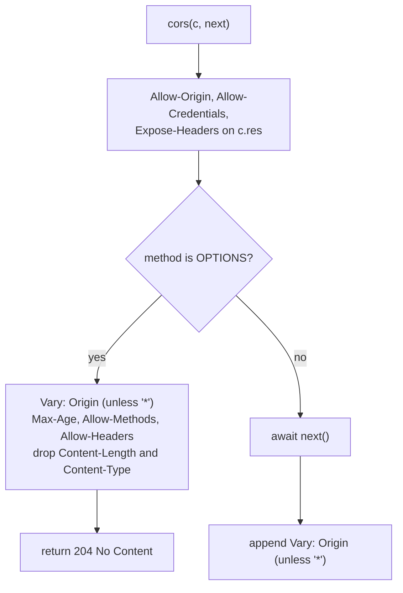

## Overview

Three middleware deal with what browsers do with an app's responses. `cors` (`hono/cors`) tells browsers which other origins may call the API. `csrf` (`hono/csrf`) refuses form-style submissions that come from another site. `secureHeaders` (`hono/secure-headers`) adds the response headers that restrict framing, sniffing, referrers and script sources. None of them authenticates anyone; they are usually combined with the middleware on [[Basic and Bearer Authentication]] or [[JWT and JWK]].

Sources: [src/middleware/cors/index.ts:63-157](repo://src/middleware/cors/index.ts#L63-L157), [src/middleware/csrf/index.ts:94-151](repo://src/middleware/csrf/index.ts#L94-L151), [src/middleware/secure-headers/secure-headers.ts:179-229](repo://src/middleware/secure-headers/secure-headers.ts#L179-L229)

```ts
import { cors } from 'hono/cors'
import { csrf } from 'hono/csrf'
import { secureHeaders } from 'hono/secure-headers'

app.use(secureHeaders())
app.use('/api/*', cors({ origin: ['https://app.example.com'], credentials: true }))
app.use('/forms/*', csrf())
```

Sources: [src/middleware/cors/index.ts:63-70](repo://src/middleware/cors/index.ts#L63-L70), [src/middleware/csrf/index.ts:94-94](repo://src/middleware/csrf/index.ts#L94-L94), [src/middleware/secure-headers/secure-headers.ts:179-181](repo://src/middleware/secure-headers/secure-headers.ts#L179-L181)

## cors

### CORS options

| Option | Default | Effect |
| --- | --- | --- |
| `origin` | `'*'` | A single origin, a list, or `(origin, c) => allowedOrigin \| null` |
| `allowMethods` | `GET, HEAD, PUT, POST, DELETE, PATCH` | A list, or `(origin, c) => string[]`; sent on preflight |
| `allowHeaders` | `[]` | Sent on preflight; when empty, the request's `Access-Control-Request-Headers` is echoed |
| `exposeHeaders` | `[]` | `Access-Control-Expose-Headers` |
| `maxAge` | none | `Access-Control-Max-Age` on preflight |
| `credentials` | `false` | `Access-Control-Allow-Credentials: true` |

Sources: [src/middleware/cors/index.ts:9-22](repo://src/middleware/cors/index.ts#L9-L22), [src/middleware/cors/index.ts:63-70](repo://src/middleware/cors/index.ts#L63-L70)

The `origin` and `allowMethods` options are normalized once into functions. A string other than `*` allows only that exact origin, and a list allows exact members. A function can compute the allowed origin per request, for example to allow every subdomain, and returning `null` or `undefined` leaves the header out so the browser blocks the response.

Sources: [src/middleware/cors/index.ts:72-94](repo://src/middleware/cors/index.ts#L72-L94)

### Request flow



Sources: [src/middleware/cors/index.ts:96-156](repo://src/middleware/cors/index.ts#L96-L156)

The headers are written to `c.res` before `next()`. Reading `c.res` at that point creates the context's placeholder response, and the headers on it are carried into whatever response the handler builds, as described on [[Context and Responses]]. This is why `cors` must be registered before the routes it covers.

Sources: [src/middleware/cors/index.ts:97-99](repo://src/middleware/cors/index.ts#L97-L99), [src/context.ts:403-434](repo://src/context.ts#L403-L434)

> [!NOTE]
> Every `OPTIONS` request on a path covered by `cors` is answered as a preflight with 204, whether or not it carries `Access-Control-Request-Method`, so route handlers registered for `OPTIONS` on those paths never run.

Sources: [src/middleware/cors/index.ts:114-148](repo://src/middleware/cors/index.ts#L114-L148)

With an explicit origin, the response varies by the request's `Origin`, so `Vary: Origin` is added for caches. When `allowHeaders` is empty the requested headers are reflected, and `Vary: Access-Control-Request-Headers` is appended as well.

Sources: [src/middleware/cors/index.ts:114-138](repo://src/middleware/cors/index.ts#L114-L138), [src/middleware/cors/index.ts:151-155](repo://src/middleware/cors/index.ts#L151-L155)

## csrf

### What it blocks

Browsers send cross-site `POST` requests from plain HTML forms without a CORS preflight. `csrf` blocks exactly those "simple" requests: a request is refused with `403 Forbidden` (thrown as an `HTTPException`) when all of the following hold:

Sources: [src/middleware/csrf/index.ts:138-147](repo://src/middleware/csrf/index.ts#L138-L147)

1. The method is not `GET` or `HEAD`.
2. The `Content-Type` is `application/x-www-form-urlencoded`, `multipart/form-data` or `text/plain`; a missing header counts as `text/plain`.
3. `Sec-Fetch-Site` is missing, unknown, or not allowed.
4. `Origin` is missing or not allowed.

Sources: [src/middleware/csrf/index.ts:28-30](repo://src/middleware/csrf/index.ts#L28-L30), [src/middleware/csrf/index.ts:138-147](repo://src/middleware/csrf/index.ts#L138-L147)

A JSON request is never blocked, because a browser cannot send `application/json` cross-site without a preflight that CORS would refuse. Passing either check (fetch metadata or origin) is enough to let a request through.

Sources: [src/middleware/csrf/index.ts:139-144](repo://src/middleware/csrf/index.ts#L139-L144)

### CSRF options

| Option | Default | Accepts |
| --- | --- | --- |
| `origin` | The request URL's own origin | A string, a list, or `(origin, c) => boolean` |
| `secFetchSite` | `same-origin` only | One of `same-origin`, `same-site`, `none`, `cross-site`, a list, or `(value, c) => boolean` |

Sources: [src/middleware/csrf/index.ts:10-26](repo://src/middleware/csrf/index.ts#L10-L26), [src/middleware/csrf/index.ts:95-136](repo://src/middleware/csrf/index.ts#L95-L136)

Behind a proxy that rewrites the host, the request URL may not reflect the public origin; set `origin` explicitly in that case.

Sources: [src/middleware/csrf/index.ts:95-98](repo://src/middleware/csrf/index.ts#L95-L98)

## secureHeaders

### Default headers

`secureHeaders(options)` merges the options over `DEFAULT_OPTIONS` and computes the header list once, at setup. Each boolean option turns a header on or off, and a string replaces its default value.

Sources: [src/middleware/secure-headers/secure-headers.ts:179-181](repo://src/middleware/secure-headers/secure-headers.ts#L179-L181), [src/middleware/secure-headers/secure-headers.ts:231-238](repo://src/middleware/secure-headers/secure-headers.ts#L231-L238)

| Header | Default value | On by default |
| --- | --- | --- |
| `Cross-Origin-Resource-Policy` | `same-origin` | yes |
| `Cross-Origin-Opener-Policy` | `same-origin` | yes |
| `Cross-Origin-Embedder-Policy` | `require-corp` | no |
| `Origin-Agent-Cluster` | `?1` | yes |
| `Referrer-Policy` | `no-referrer` | yes |
| `Strict-Transport-Security` | `max-age=15552000; includeSubDomains` | yes |
| `X-Content-Type-Options` | `nosniff` | yes |
| `X-DNS-Prefetch-Control` | `off` | yes |
| `X-Download-Options` | `noopen` | yes |
| `X-Frame-Options` | `SAMEORIGIN` | yes |
| `X-Permitted-Cross-Domain-Policies` | `none` | yes |
| `X-XSS-Protection` | `0` | yes |

Sources: [src/middleware/secure-headers/secure-headers.ts:94-124](repo://src/middleware/secure-headers/secure-headers.ts#L94-L124)

The headers are set on `c.res` after `next()`, so they override the same headers set by the handler, and `X-Powered-By` is removed unless `removePoweredBy: false`.

Sources: [src/middleware/secure-headers/secure-headers.ts:215-229](repo://src/middleware/secure-headers/secure-headers.ts#L215-L229), [src/middleware/secure-headers/secure-headers.ts:330-334](repo://src/middleware/secure-headers/secure-headers.ts#L330-L334)

### Content-Security-Policy and nonces

`contentSecurityPolicy` and `contentSecurityPolicyReportOnly` take camel-case directive names (`scriptSrc`, `frameAncestors`) whose values are lists of sources. `getCSPDirectives` converts names to kebab case and joins them into one header value.

Sources: [src/middleware/secure-headers/secure-headers.ts:18-44](repo://src/middleware/secure-headers/secure-headers.ts#L18-L44), [src/middleware/secure-headers/secure-headers.ts:240-266](repo://src/middleware/secure-headers/secure-headers.ts#L240-L266)

A value may also be a function `(c, directive) => string`, evaluated per request. The built-in `NONCE` is one: it generates 16 random bytes, stores their base64 form in `c.var.secureHeadersNonce`, and returns `'nonce-...'`. Because these functions run before `next()`, a handler or JSX layout can read the nonce and put it on its `<script nonce>` tags.

Sources: [src/middleware/secure-headers/secure-headers.ts:131-145](repo://src/middleware/secure-headers/secure-headers.ts#L131-L145), [src/middleware/secure-headers/secure-headers.ts:215-222](repo://src/middleware/secure-headers/secure-headers.ts#L215-L222)

```ts
import { secureHeaders, NONCE } from 'hono/secure-headers'

app.use(secureHeaders({ contentSecurityPolicy: { scriptSrc: [NONCE] } }))
app.get('/', (c) =>
  c.html(`<script nonce="${c.get('secureHeadersNonce')}">hello()</script>`)
)
```

Sources: [src/middleware/secure-headers/secure-headers.ts:137-145](repo://src/middleware/secure-headers/secure-headers.ts#L137-L145)

To keep the per-request work small, the static parts of the policy are joined once at setup and each function records its slot index in the value array. Per request, only those slots are filled in on a copy of the array.

Sources: [src/middleware/secure-headers/secure-headers.ts:246-288](repo://src/middleware/secure-headers/secure-headers.ts#L246-L288)

### Permissions-Policy and reporting

`permissionsPolicy` maps directives from the list in `permissions-policy.ts` (camera, geolocation, payment and others) to `true` (`*`), `false` (`none`), or a list of origins in which `self` and `src` stay bare and other values are quoted. An empty list gives `()`, which disables the feature.

Sources: [src/middleware/secure-headers/secure-headers.ts:290-318](repo://src/middleware/secure-headers/secure-headers.ts#L290-L318), [src/middleware/secure-headers/permissions-policy.ts:1-86](repo://src/middleware/secure-headers/permissions-policy.ts#L1-L86)

`reportingEndpoints` produces `Reporting-Endpoints: name="url"` pairs and `reportTo` the older `Report-To` JSON groups, for use with the CSP `reportTo` and `reportUri` directives.

Sources: [src/middleware/secure-headers/secure-headers.ts:46-59](repo://src/middleware/secure-headers/secure-headers.ts#L46-L59), [src/middleware/secure-headers/secure-headers.ts:320-328](repo://src/middleware/secure-headers/secure-headers.ts#L320-L328)
