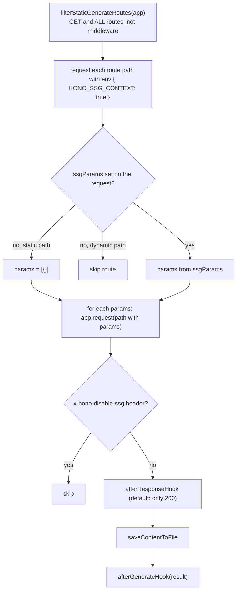

## Overview

`toSSG` turns a Hono app into a folder of static files. It does not crawl links: it reads the app's registered routes, requests each `GET` route through `app.request` in memory, and writes every successful response to a file named after its path. Because the pages come from the app's own handlers, the same app can serve requests dynamically and also be pre-rendered for a static host. The core is runtime-neutral (`hono/ssg`); writing files goes through a small `FileSystemModule` that the Bun and Deno adapters provide, and Node.js can pass `fs/promises` directly.

Sources: [src/helper/ssg/ssg.ts:34-37](repo://src/helper/ssg/ssg.ts#L34-L37), [src/helper/ssg/ssg.ts:368-470](repo://src/helper/ssg/ssg.ts#L368-L470)

```ts
import { Hono } from 'hono'
import { ssgParams } from 'hono/ssg'
import { toSSG } from 'hono/bun' // or 'hono/deno'; with Node.js: toSSG(app, fs) from 'hono/ssg'

const app = new Hono()
app.get('/', (c) => c.html('<h1>Home</h1>'))
app.get('/posts/:id', ssgParams(() => [{ id: '1' }, { id: '2' }]), (c) =>
  c.html(`<h1>Post ${c.req.param('id')}</h1>`)
)

const result = await toSSG(app, { dir: './dist' })
```

Sources: [src/adapter/bun/ssg.ts:25-27](repo://src/adapter/bun/ssg.ts#L25-L27), [src/helper/ssg/middleware.ts:43-49](repo://src/helper/ssg/middleware.ts#L43-L49)

## The generation flow

### Steps



Sources: [src/helper/ssg/ssg.ts:205-302](repo://src/helper/ssg/ssg.ts#L205-L302), [src/helper/ssg/ssg.ts:420-468](repo://src/helper/ssg/ssg.ts#L420-L468)

`filterStaticGenerateRoutes` keeps `GET` and `ALL` routes whose handler is not middleware, where middleware means a function declared with two parameters, as in [[Routing and Router Selection]]. Every request runs with `{ HONO_SSG_CONTEXT: true }` as the env, which is how middleware can tell a generation request from a live one.

Sources: [src/helper/ssg/utils.ts:61-75](repo://src/helper/ssg/utils.ts#L61-L75), [src/helper/ssg/middleware.ts:5-6](repo://src/helper/ssg/middleware.ts#L5-L6)

### Discovering parameters

For each route, a first request to the raw route path (for example `/posts/:id`) collects parameters. `ssgParams(params)` (a list, or a function of the context, possibly async) detects that the request path is still a pattern. It stores the list on the raw request as `ssgParams` and answers `notFound` so the real handler does not run with a literal `:id`. A dynamic route without `ssgParams` is skipped; a static route gets one empty parameter set.

Sources: [src/helper/ssg/middleware.ts:24-49](repo://src/helper/ssg/middleware.ts#L24-L49), [src/helper/ssg/ssg.ts:225-251](repo://src/helper/ssg/ssg.ts#L225-L251)

Each parameter set is then substituted into the path with the same `replaceUrlParam` as the [[RPC Client]], and the page is requested with the method and headers of the first request.

Sources: [src/helper/ssg/ssg.ts:253-269](repo://src/helper/ssg/ssg.ts#L253-L269), [src/client/utils.ts:18-24](repo://src/client/utils.ts#L18-L24)

### Concurrency

All `app.fetch` and `app.request` calls go through a pool from `utils/concurrent` limited by `concurrency` (default 2), so a site with many pages does not start every handler at once. Route discovery and page fetching are generators that yield promises as they go, and files are written as soon as each page resolves.

Sources: [src/helper/ssg/ssg.ts:17-17](repo://src/helper/ssg/ssg.ts#L17-L17), [src/helper/ssg/ssg.ts:222-224](repo://src/helper/ssg/ssg.ts#L222-L224), [src/helper/ssg/ssg.ts:436-449](repo://src/helper/ssg/ssg.ts#L436-L449)

## Writing files

### File names

The file name comes from the route path and the response's content type. The extension is looked up in `extensionMap` (default: `text/html` to `html`, XML and RSS types to `xml`, `application/yaml` to `yaml`), then in the MIME table, falling back to `html`. A response with no `Content-Type` is treated as `text/plain`, which matches `c.text()` on runtimes that omit the header.

Sources: [src/helper/ssg/ssg.ts:19-25](repo://src/helper/ssg/ssg.ts#L19-L25), [src/helper/ssg/ssg.ts:90-108](repo://src/helper/ssg/ssg.ts#L90-L108), [src/helper/ssg/ssg.ts:282-284](repo://src/helper/ssg/ssg.ts#L282-L284)

| Route path | File |
| --- | --- |
| `/` | `dir/index.html` |
| `/about` | `dir/about.html` |
| `/blog/` | `dir/blog/index.html` |
| `/feed.xml` (XML response) | `dir/feed.xml` |

Sources: [src/helper/ssg/ssg.ts:50-72](repo://src/helper/ssg/ssg.ts#L50-L72)

Text and JSON bodies are written as strings, everything else as bytes. `ensureWithinOutDir` resolves the final path and throws `Path traversal detected` if a parameter value such as `../../etc` would place the file outside the output directory.

Sources: [src/helper/ssg/ssg.ts:74-88](repo://src/helper/ssg/ssg.ts#L74-L88), [src/helper/ssg/utils.ts:50-55](repo://src/helper/ssg/utils.ts#L50-L55), [src/helper/ssg/utils.ts:77-87](repo://src/helper/ssg/utils.ts#L77-L87)

### File system modules

`saveContentToFile` creates each directory once (remembered in a module-level set) and writes through the given module.

Sources: [src/helper/ssg/ssg.ts:309-334](repo://src/helper/ssg/ssg.ts#L309-L334)

| Module | `writeFile` | `mkdir` |
| --- | --- | --- |
| `bunFileSystemModule` (`hono/bun`) | `Bun.write`, which creates directories itself | no-op |
| `denoFileSystemModule` (`hono/deno`) | `Deno.writeFile` with the data as bytes | `Deno.mkdir` |
| Node.js `fs/promises` | `writeFile` | `mkdir` |

Sources: [src/adapter/bun/ssg.ts:5-27](repo://src/adapter/bun/ssg.ts#L5-L27), [src/adapter/deno/ssg.ts:9-27](repo://src/adapter/deno/ssg.ts#L9-L27)

### The result

`toSSG` resolves to `{ success, files, error? }`. Any error while generating or writing is caught and reported as `success: false` with no files, rather than thrown.

Sources: [src/helper/ssg/ssg.ts:44-48](repo://src/helper/ssg/ssg.ts#L44-L48), [src/helper/ssg/ssg.ts:450-469](repo://src/helper/ssg/ssg.ts#L450-L469)

## Hooks and plugins

### Hook types

Three hooks shape generation, each passed as one function or an array that runs in order:

Sources: [src/helper/ssg/ssg.ts:110-198](repo://src/helper/ssg/ssg.ts#L110-L198)

| Hook | Receives | Returning `false` |
| --- | --- | --- |
| `beforeRequestHook` | The `Request` before discovery; may return a modified one | Skips the route |
| `afterResponseHook` | Each page `Response`; may return a replacement | Skips the page |
| `afterGenerateHook` | The final result, the file system module and the options | n/a; runs once at the end, even on failure |

Sources: [src/helper/ssg/ssg.ts:118-173](repo://src/helper/ssg/ssg.ts#L118-L173), [src/helper/ssg/ssg.ts:465-468](repo://src/helper/ssg/ssg.ts#L465-L468)

### Plugins

A plugin is an object with any of the three hooks. Option hooks run first, then plugin hooks in plugin order. Without a `plugins` option, `defaultPlugin()` is used, which drops every response that is not 200.

Sources: [src/helper/ssg/ssg.ts:175-179](repo://src/helper/ssg/ssg.ts#L175-L179), [src/helper/ssg/ssg.ts:372-419](repo://src/helper/ssg/ssg.ts#L372-L419), [src/helper/ssg/plugins.ts:11-20](repo://src/helper/ssg/plugins.ts#L11-L20)

> [!IMPORTANT]
> Passing `plugins` replaces the default plugin. Include `defaultPlugin()` in the list to keep skipping 404s and errors.

Sources: [src/helper/ssg/ssg.ts:372-372](repo://src/helper/ssg/ssg.ts#L372-L372)

`redirectPlugin()` turns 301, 302, 303, 307 and 308 responses into an HTML page with a `meta refresh`, a canonical link and `noindex`, so redirects keep working on hosts that only serve files. The `Location` is escaped by the `html` template ([[JSX Server Rendering]]).

Sources: [src/helper/ssg/plugins.ts:22-72](repo://src/helper/ssg/plugins.ts#L22-L72)

## Routes that differ between modes

`disableSSG()` marks a route as dynamic-only: during generation it sets the `x-hono-disable-ssg` header and answers 404, and `toSSG` skips responses with that header. `onlySSG()` does the opposite: it answers 404 to live requests and lets generation through, for pages that should exist only as files. `isSSGContext(c)` tells handlers which mode they run in.

Sources: [src/helper/ssg/middleware.ts:56-83](repo://src/helper/ssg/middleware.ts#L56-L83), [src/helper/ssg/ssg.ts:270-273](repo://src/helper/ssg/ssg.ts#L270-L273)

The output folder can be served by any static host or by the app itself with `serveStatic` ([[Static Files]]).

Sources: [src/helper/ssg/ssg.ts:27-27](repo://src/helper/ssg/ssg.ts#L27-L27)
