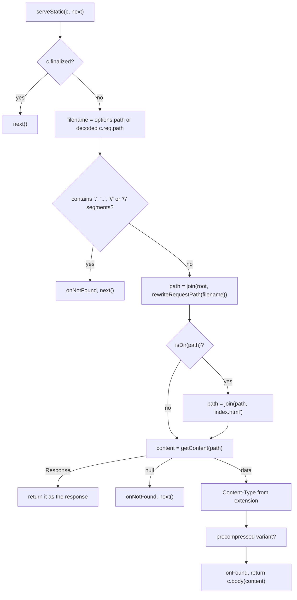

## Overview

Serving a file needs a file system, and each runtime has a different one: Bun has `Bun.file`, Deno has `Deno.open`, Cloudflare Workers Sites keep assets in a KV namespace. Hono therefore splits `serveStatic` in two. The runtime-neutral core in `hono/serve-static` turns the request path into a safe file path, picks a content type, chooses a precompressed variant, and decides whether to answer or fall through. Each adapter supplies only the I/O: a `getContent(path)` function and, where directories exist, `isDir(path)`.

Sources: [src/middleware/serve-static/index.ts:35-49](repo://src/middleware/serve-static/index.ts#L35-L49), [src/adapter/bun/serve-static.ts:8-32](repo://src/adapter/bun/serve-static.ts#L8-L32)

```ts
import { serveStatic } from 'hono/bun' // or 'hono/deno', 'hono/cloudflare-workers'

app.use('/static/*', serveStatic({ root: './' }))
app.get('/favicon.ico', serveStatic({ path: './public/favicon.ico' }))
```

Sources: [src/adapter/bun/index.ts:6-6](repo://src/adapter/bun/index.ts#L6-L6), [src/adapter/deno/index.ts:6-6](repo://src/adapter/deno/index.ts#L6-L6), [src/adapter/cloudflare-workers/index.ts:6-6](repo://src/adapter/cloudflare-workers/index.ts#L6-L6)

## Options

| Option | Default | Effect |
| --- | --- | --- |
| `root` | `./` | Directory joined in front of the request path |
| `path` | none | Serve this one file for every request, ignoring the request path |
| `rewriteRequestPath(path)` | none | Change the request path before joining, e.g. strip `/static` |
| `mimes` | built-in table | Extra extension-to-type entries, checked first |
| `precompressed` | `false` | Look for `.br`, `.zst`, `.gz` siblings |
| `onFound(path, c)` | none | Called before a file is sent, e.g. to set `Cache-Control` |
| `onNotFound(path, c)` | none | Called on a miss or a rejected path |

Sources: [src/middleware/serve-static/index.ts:13-21](repo://src/middleware/serve-static/index.ts#L13-L21)

## Serving a request

### The flow



Sources: [src/middleware/serve-static/index.ts:54-125](repo://src/middleware/serve-static/index.ts#L54-L125)

A miss calls `next()`, so `serveStatic` can sit in front of routes and let them answer what is not a file. If an earlier middleware already finalized the response, it does nothing.

Sources: [src/middleware/serve-static/index.ts:55-58](repo://src/middleware/serve-static/index.ts#L55-L58), [src/middleware/serve-static/index.ts:122-124](repo://src/middleware/serve-static/index.ts#L122-L124)

### Path safety

The request path is decoded with `tryDecodeURI` and then rejected if any segment is `.` or `..`, if it contains two or more slashes in a row, or if it contains a backslash. Encoded traversal attempts such as `%2e%2e/` are decoded before the check, so they are rejected too. A rejected path is treated as not found and falls through.

Sources: [src/middleware/serve-static/index.ts:60-74](repo://src/middleware/serve-static/index.ts#L60-L74)

The path is then joined to `root`. The default `defaultJoin` joins non-empty parts with `/`, collapses repeated slashes and resolves `.` and `..` segments; the Bun and Deno adapters pass `node:path`'s `join` instead. When `isDir` reports a directory, `index.html` is appended.

Sources: [src/middleware/serve-static/index.ts:76-83](repo://src/middleware/serve-static/index.ts#L76-L83), [src/middleware/serve-static/path.ts:5-25](repo://src/middleware/serve-static/path.ts#L5-L25)

### Content type

`getMimeType` takes the extension after the last dot, lower-cased, and looks it up first in `options.mimes`, then in the built-in table, falling back to `application/octet-stream`. Text types in the table carry `charset=utf-8`.

Sources: [src/middleware/serve-static/index.ts:92-94](repo://src/middleware/serve-static/index.ts#L92-L94), [src/utils/mime.ts:6-45](repo://src/utils/mime.ts#L6-L45)

### Precompressed variants

With `precompressed: true` and a compressible type (the same regular expression the compress middleware uses, see [[ETag, Cache and Compression]]), the middleware checks the request's `Accept-Encoding` for `br`, then `zstd`, then `gzip`. For each one listed, it asks `getContent` for `path.br`, `path.zst` or `path.gz`. The first that exists replaces the content, and `Content-Encoding` is set and `Vary: Accept-Encoding` appended. The `Content-Type` stays that of the original file.

Sources: [src/middleware/serve-static/index.ts:23-28](repo://src/middleware/serve-static/index.ts#L23-L28), [src/middleware/serve-static/index.ts:96-117](repo://src/middleware/serve-static/index.ts#L96-L117)

The `Accept-Encoding` header is split on commas without parsing quality values, so `gzip;q=0` is not recognized as `gzip` and will not trigger the variant.

Sources: [src/middleware/serve-static/index.ts:97-107](repo://src/middleware/serve-static/index.ts#L97-L107)

## Runtime back ends

| Adapter | `getContent` | `isDir` | `join` |
| --- | --- | --- | --- |
| `hono/bun` | `Bun.file(path)` if it exists | `stat(path).isDirectory()` from `node:fs/promises` | `node:path` |
| `hono/deno` | `Deno.open(path).readable`; directories return `null`, errors other than `NotFound` are logged | `Deno.lstatSync(path).isDirectory` | `node:path` |
| `hono/cloudflare-workers` | KV lookup through the asset manifest | none | `defaultJoin` |

Sources: [src/adapter/bun/serve-static.ts:8-32](repo://src/adapter/bun/serve-static.ts#L8-L32), [src/adapter/deno/serve-static.ts:6-42](repo://src/adapter/deno/serve-static.ts#L6-L42), [src/adapter/cloudflare-workers/serve-static.ts:21-42](repo://src/adapter/cloudflare-workers/serve-static.ts#L21-L42)

For Workers Sites, `getContentFromKVAsset` maps the path to a hashed KV key through the manifest (the `manifest` option, or the `__STATIC_CONTENT_MANIFEST` global that Wrangler injects) and reads it as a stream from the `namespace` option, `c.env.__STATIC_CONTENT`, or the `__STATIC_CONTENT` global. A path not in the manifest is a miss. The module-worker export, `serveStatic` from `hono/cloudflare-workers`, omits the `namespace` option and relies on the binding.

Sources: [src/adapter/cloudflare-workers/utils.ts:1-50](repo://src/adapter/cloudflare-workers/utils.ts#L1-L50), [src/adapter/cloudflare-workers/serve-static-module.ts:1-12](repo://src/adapter/cloudflare-workers/serve-static-module.ts#L1-L12)

A custom back end only needs `getContent`. It may return data, `null` for a miss, or a whole `Response`, which is passed through as is (for example a response from an asset binding that already set its own headers).

Sources: [src/middleware/serve-static/index.ts:35-49](repo://src/middleware/serve-static/index.ts#L35-L49), [src/middleware/serve-static/index.ts:85-90](repo://src/middleware/serve-static/index.ts#L85-L90)

## File path helpers

`hono/utils/filepath` exports `getFilePath` and `getFilePathWithoutDefaultDocument`, an older path resolver: it appends `index.html` to paths ending in `/` or lacking an extension, rejects any `..` segment by returning `undefined`, normalizes backslashes and leading `./`, and joins with `root`. The `serveStatic` core above does not use it.

Sources: [src/utils/filepath.ts:6-60](repo://src/utils/filepath.ts#L6-L60), [package.json:319-323](repo://package.json#L319-L323)
