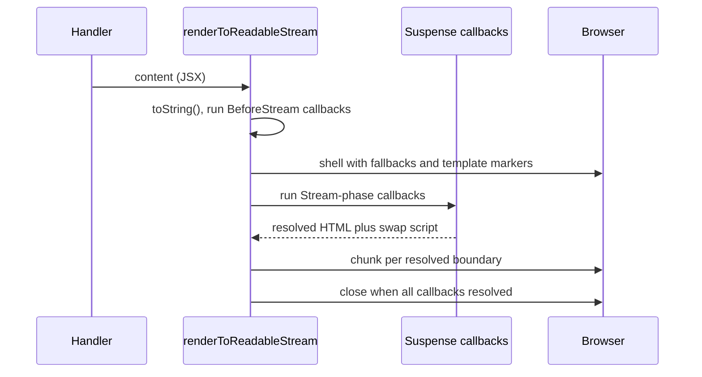

## Overview

Hono streams in two ways. The streaming helpers in `hono/streaming` (`stream`, `streamText`, `streamSSE`) return a `Response` at once and let a callback write to its body over time, for progress output, chat tokens or server-sent events. JSX streaming (`renderToReadableStream`, `Suspense`, `ErrorBoundary`) sends the parts of a page that are ready and then patches in slower parts as their promises resolve. Both are built on standard `ReadableStream`s, so they work on every runtime. The rendering model they extend is on [[JSX Server Rendering]].

Sources: [src/helper/streaming/stream.ts:7-45](repo://src/helper/streaming/stream.ts#L7-L45), [src/jsx/streaming.ts:146-220](repo://src/jsx/streaming.ts#L146-L220)

## StreamingApi

### Writing

`StreamingApi` in `utils/stream.ts` wraps the writable side of a `TransformStream`. The response body is `responseReadable`, a stream that pulls from the readable side.

Sources: [src/utils/stream.ts:6-46](repo://src/utils/stream.ts#L6-L46)

| Method | Effect |
| --- | --- |
| `write(data)` | Writes a string (UTF-8 encoded) or bytes; write errors are swallowed |
| `writeln(text)` | `write(text + '\n')` |
| `sleep(ms)` | A `setTimeout` promise |
| `pipe(readable)` | Pipes another stream into the body without closing it |
| `close()` | Closes the writer and marks the stream `closed` |
| `onAbort(fn)` | Registers a listener for client disconnect |
| `abort()` | Runs the abort listeners once and marks the stream `aborted` |

Sources: [src/utils/stream.ts:48-97](repo://src/utils/stream.ts#L48-L97)

### Disconnects

When the client goes away, the runtime cancels `responseReadable`. Its `cancel` hook calls `abort()` unless the stream was already closed normally; the first abort listener cancels the inner reader so pending writes stop blocking, and the user's `onAbort` listeners run. Check `stream.aborted` in long loops to stop work for a client that has left.

Sources: [src/utils/stream.ts:26-46](repo://src/utils/stream.ts#L26-L46), [src/utils/stream.ts:84-97](repo://src/utils/stream.ts#L84-L97)

Bun before 1.1.27 did not call `cancel` on response streams. For those versions the helpers also listen to the request's `abort` signal; `isOldBunVersion` checks `Bun.version` once and caches the answer.

Sources: [src/helper/streaming/stream.ts:15-22](repo://src/helper/streaming/stream.ts#L15-L22), [src/helper/streaming/utils.ts:1-11](repo://src/helper/streaming/utils.ts#L1-L11)

## Streaming helpers

### stream and streamText

`stream(c, cb, onError)` creates the `StreamingApi`, starts `cb(stream)` without awaiting it, and returns `c.newResponse(stream.responseReadable)` immediately, so headers set on the context before the call are sent. When `cb` finishes or throws, the stream is closed. An `Error` goes to `onError(e, stream)` if given, which can still write a final message; anything else is logged. A rejection with `undefined`, which a cancelled `pipe` produces, is ignored.

Sources: [src/helper/streaming/stream.ts:7-45](repo://src/helper/streaming/stream.ts#L7-L45)

```ts
import { streamText } from 'hono/streaming'

app.get('/count', (c) =>
  streamText(c, async (stream) => {
    for (let i = 1; i <= 3 && !stream.aborted; i++) {
      await stream.writeln(String(i))
      await stream.sleep(1000)
    }
  })
)
```

Sources: [src/helper/streaming/text.ts:6-15](repo://src/helper/streaming/text.ts#L6-L15)

`streamText` sets `Content-Type: text/plain; charset=UTF-8`, `X-Content-Type-Options: nosniff` and `Transfer-Encoding: chunked`, then calls `stream`. The context is held in a `WeakMap` keyed by the response stream, because Bun may release `c` once the response is returned while the callback still needs it.

Sources: [src/helper/streaming/text.ts:6-15](repo://src/helper/streaming/text.ts#L6-L15), [src/helper/streaming/stream.ts:5-5](repo://src/helper/streaming/stream.ts#L5-L5), [src/helper/streaming/stream.ts:24-25](repo://src/helper/streaming/stream.ts#L24-L25)

> [!NOTE]
> Because the response is returned before the body is written, an error inside the callback cannot change the status code; it reaches `onError`, not the app's `onError`. Middleware that run after `next()` (logger, timeout) also finish before the stream does.

Sources: [src/helper/streaming/stream.ts:26-44](repo://src/helper/streaming/stream.ts#L26-L44)

### streamSSE

`streamSSE(c, cb, onError)` sets `Content-Type: text/event-stream`, `Cache-Control: no-cache`, `Connection: keep-alive` and chunked encoding, and passes an `SSEStreamingApi` to the callback. Its `writeSSE({ data, event, id, retry })` resolves `data` (which may be a promise or rendered JSX) to a string, splits it on any line ending into `data:` lines, and writes the message terminated by a blank line.

Sources: [src/helper/streaming/sse.ts:6-45](repo://src/helper/streaming/sse.ts#L6-L45), [src/helper/streaming/sse.ts:72-100](repo://src/helper/streaming/sse.ts#L72-L100)

`event`, `id` and `retry` must not contain line breaks; a value that does throws, so client data cannot inject extra fields. When the callback throws an `Error` and `onError` is given, `onError` runs and an `event: error` message with the error text is sent before the stream closes.

Sources: [src/helper/streaming/sse.ts:27-31](repo://src/helper/streaming/sse.ts#L27-L31), [src/helper/streaming/sse.ts:47-68](repo://src/helper/streaming/sse.ts#L47-L68)

## Streaming JSX

### renderToReadableStream

`renderToReadableStream(content, onError = console.trace)` turns a JSX tree into a byte stream. Synchronous parts and Suspense fallbacks come first, then one chunk per resolved Suspense boundary:

Sources: [src/jsx/streaming.ts:146-220](repo://src/jsx/streaming.ts#L146-L220)



Sources: [src/jsx/streaming.ts:152-213](repo://src/jsx/streaming.ts#L152-L213)

The renderer keeps a list of callback promises. Each resolved chunk may carry new callbacks from nested boundaries, which are added to the list, and the loop waits until every one has resolved before closing. A rejected chunk is logged, passed to `onError`, and replaced by an empty string. Writes stop after the consumer cancels the stream.

Sources: [src/jsx/streaming.ts:169-218](repo://src/jsx/streaming.ts#L169-L218)

`jsxRenderer({ stream: true })` uses this function for `c.render` (see [[JSX Server Rendering]]); otherwise return `c.body(renderToReadableStream(<Page />))` with an HTML content type.

Sources: [src/middleware/jsx-renderer/index.ts:66-76](repo://src/middleware/jsx-renderer/index.ts#L66-L76)

### Suspense

`<Suspense fallback={...}>` renders its children. If all are synchronous it returns them directly. If any child is a promise, or throws one (the `use()` hook does), it returns a placeholder: `<template id="H:n"></template>`, the fallback, and an HTML comment `/$` as the end marker, plus a callback that waits for the children.

Sources: [src/jsx/streaming.ts:42-90](repo://src/jsx/streaming.ts#L42-L90)

What the callback does depends on the phase:

Sources: [src/jsx/streaming.ts:92-133](repo://src/jsx/streaming.ts#L92-L133)

- **Stringify** (`c.html` or `toString`): with the full document in `buffer`, it replaces the placeholder and fallback with the content. The page arrives complete, with no fallback.
- **Stream**: it emits `<template data-hono-target="H:n">content</template>` followed by an inline script that removes the nodes between the placeholder and the end marker and inserts the template's content.

Sources: [src/jsx/streaming.ts:96-118](repo://src/jsx/streaming.ts#L96-L118)

Nested Suspense callbacks inside the resolved content are run in the `BeforeStream` phase first and passed on, so inner boundaries stream after outer ones. The inline script carries a `nonce` when `StreamingContext` provides `scriptNonce`, which lets it run under a CSP built with `NONCE` (see [[CORS, CSRF and Secure Headers]]).

Sources: [src/jsx/streaming.ts:30-32](repo://src/jsx/streaming.ts#L30-L32), [src/jsx/streaming.ts:50-50](repo://src/jsx/streaming.ts#L50-L50), [src/jsx/streaming.ts:119-131](repo://src/jsx/streaming.ts#L119-L131)

### ErrorBoundary

`<ErrorBoundary fallback={...} fallbackRender={(e) => ...} onError={...}>` catches errors from its children. A synchronous throw renders the fallback at once. When children are asynchronous it emits `<template id="E:n"></template>` followed by an HTML comment `E:n` as the end marker, and a callback.

Sources: [src/jsx/components.ts:55-126](repo://src/jsx/components.ts#L55-L126), [src/jsx/components.ts:128-164](repo://src/jsx/components.ts#L128-L164)

On success, that callback inserts the content after the marker; in streaming mode this is a template and a script. On failure, `catchCallback` renders the fallback once, calls `onError`, and replaces everything between the markers, including partly streamed content, with it. Errors from nested Suspense callbacks that resolve later are caught the same way, and a final script removes the markers once all of them have finished.

Sources: [src/jsx/components.ts:133-160](repo://src/jsx/components.ts#L133-L160), [src/jsx/components.ts:165-257](repo://src/jsx/components.ts#L165-L257)

```tsx
import { Suspense, renderToReadableStream } from 'hono/jsx/streaming'
import { ErrorBoundary } from 'hono/jsx'

const Comments = async () => <ul>{(await loadComments()).map((t) => <li>{t}</li>)}</ul>

app.get('/', (c) =>
  c.body(
    renderToReadableStream(
      <html><body>
        <ErrorBoundary fallback={<p>Failed to load</p>}>
          <Suspense fallback={<p>Loading...</p>}><Comments /></Suspense>
        </ErrorBoundary>
      </body></html>
    ),
    { headers: { 'Content-Type': 'text/html; charset=UTF-8' } }
  )
)
```

Sources: [src/jsx/streaming.ts:42-45](repo://src/jsx/streaming.ts#L42-L45), [src/jsx/components.ts:55-61](repo://src/jsx/components.ts#L55-L61)

Both components capture the JSX context values when they suspend and restore them when the deferred children render, so `useContext` inside a late child sees the same providers as it would synchronously.

Sources: [src/jsx/streaming.ts:66-79](repo://src/jsx/streaming.ts#L66-L79), [src/jsx/components.ts:14-30](repo://src/jsx/components.ts#L14-L30)
