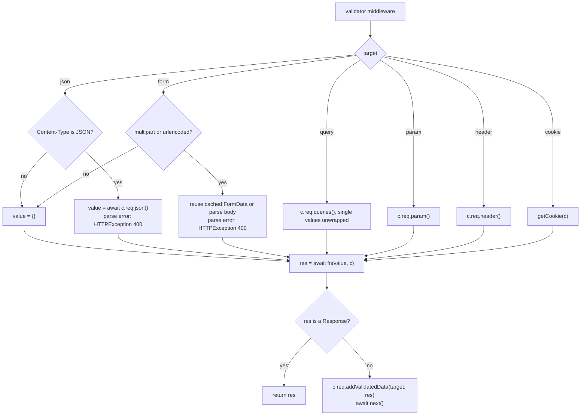

## Overview

`validator(target, fn)` from `hono/validator` is a middleware that pulls one part of the request out as a plain value, hands it to a validation function, and either answers with the function's error response or stores its result for the handler. It serves two purposes at once: at run time it guards the handler, and at the type level it adds the target's input and output types to the route, so `c.req.valid(target)` is typed in the handler and the [[RPC Client]] knows what to send.

Sources: [src/validator/validator.ts:46-88](repo://src/validator/validator.ts#L46-L88), [src/validator/index.ts:1-8](repo://src/validator/index.ts#L1-L8)

The core validator is library-agnostic: it knows nothing about Zod, Valibot or any schema. Schema-specific validators such as `@hono/zod-validator` live outside this repository and wrap `validator`, which is why its types are exported in detail.

Sources: [src/validator/utils.ts:47-69](repo://src/validator/utils.ts#L47-L69)

## Usage

```ts
import { validator } from 'hono/validator'

app.post(
  '/posts',
  validator('json', (value, c) => {
    const title = value['title']
    if (!title || typeof title !== 'string') {
      return c.text('Invalid!', 400)
    }
    return { title }
  }),
  (c) => {
    const { title } = c.req.valid('json')
    return c.json({ title }, 201)
  }
)
```

Sources: [src/validator/validator.ts:162-170](repo://src/validator/validator.ts#L162-L170)

The validation function receives the extracted value and the context. Whatever it returns becomes the validated data, unless it returns a `Response`, which ends the request. It may be async.

Sources: [src/validator/validator.ts:14-22](repo://src/validator/validator.ts#L14-L22)

## Extracting each target

### The extraction flow



Sources: [src/validator/validator.ts:89-171](repo://src/validator/validator.ts#L89-L171)

| Target | Value passed to the function |
| --- | --- |
| `json` | The parsed body, read through the cached `c.req.json()` |
| `form` | An object where repeated keys and keys ending in `[]` become arrays |
| `query` | Every key; a key that appears once is a string, otherwise an array |
| `param` | The decoded path parameters |
| `header` | All headers with lower-case names |
| `cookie` | All cookies, parsed by the cookie helper |

Sources: [src/validator/validator.ts:93-160](repo://src/validator/validator.ts#L93-L160)

### Content types

For `json` the `Content-Type` must match `application/json` or a `+json` suffix type such as `application/vnd.api+json`, with optional parameters. For `form` it must be `multipart/form-data` (with an optional boundary) or `application/x-www-form-urlencoded`.

Sources: [src/validator/validator.ts:24-26](repo://src/validator/validator.ts#L24-L26)

> [!WARNING]
> A missing or different `Content-Type` is not an error: the validator calls your function with `{}`. A function that checks for required fields rejects such a request, but one that accepts an empty object lets it through with no data.

Sources: [src/validator/validator.ts:94-111](repo://src/validator/validator.ts#L94-L111)

A body that claims to be JSON but does not parse throws `HTTPException(400)` with `Malformed JSON in request body`; a form that cannot be parsed throws `HTTPException(400)` with `Malformed FormData request.` and the parser's message. Both go through the app's error handler (see [[Middleware Composition and Error Handling]]).

Sources: [src/validator/validator.ts:98-127](repo://src/validator/validator.ts#L98-L127)

### Body reuse

The validator reads bodies through `HonoRequest`'s cache, so the handler can still call `c.req.json()` or `c.req.text()` afterwards. For forms it first checks `c.req.bodyCache.formData` and stores the parsed `FormData` back there, which lets several form validators, or a validator followed by `c.req.parseBody()`, share one parse. [[Reading Requests]] explains the cache.

Sources: [src/validator/validator.ts:113-127](repo://src/validator/validator.ts#L113-L127), [src/request.ts:220-239](repo://src/request.ts#L220-L239)

## Several validators on one route

Each validator stores its result under its own target, so a route can validate `param`, `query` and `json` with three validators. `c.req.valid` returns each separately. Validating the same target twice keeps the later result.

Sources: [src/request.ts:339-354](repo://src/request.ts#L339-L354)

## Types

### Inputs and outputs

`validator` returns `MiddlewareHandler<E, P, V, ExtractValidationResponse<VF>>`, where `V` is an `Input` with:

Sources: [src/validator/validator.ts:64-88](repo://src/validator/validator.ts#L64-L88)

- `out[target]`: the function's return type with any `Response` or `TypedResponse` removed (`ExtractValidatorOutput`). This is what `c.req.valid(target)` returns.
- `in[target]`: what the client must send. For `json` it is the output type, or the explicit `InputType` generic. For other targets it is `InferInput`, which keeps literal unions and optional fields from the output but widens everything else to the raw type of the target: `string | string[]` for `query`, `string` for `param`, `header` and `cookie`, and `File | string` or arrays for `form`.

Sources: [src/validator/validator.ts:175-185](repo://src/validator/validator.ts#L175-L185), [src/validator/utils.ts:25-69](repo://src/validator/utils.ts#L25-L69)

The widening exists because a schema may coerce: a query validator that outputs `{ page: number }` still needs the client to send `page` as a string.

Sources: [src/validator/utils.ts:47-58](repo://src/validator/utils.ts#L47-L58)

### Error responses

`ExtractValidationResponse` keeps any `TypedResponse` the function can return, for example `c.json({ error }, 400)`. Because the middleware's response type flows into the route's schema (see [[Type System: Env, Schema and Handlers]]), the client sees both the handler's success response and the validator's error response, each with its status.

Sources: [src/validator/validator.ts:28-44](repo://src/validator/validator.ts#L28-L44)

### Targets per method

`ValidationTargetByMethod` excludes `json` and `form` when the route method is `get` or `head`, so a body validator on a GET route is a type error.

Sources: [src/validator/validator.ts:9-12](repo://src/validator/validator.ts#L9-L12)

## Writing a schema validator

A third-party validator calls `validator(target, async (value, c) => { ... })`, runs its schema, and returns either the parsed data or an error response. To type the client side correctly, it passes `InferInput<SchemaInput, target>` as `InputType` so the request type reflects the schema's input rather than its output.

Sources: [src/validator/utils.ts:47-69](repo://src/validator/utils.ts#L47-L69), [src/validator/validator.ts:46-63](repo://src/validator/validator.ts#L46-L63)
