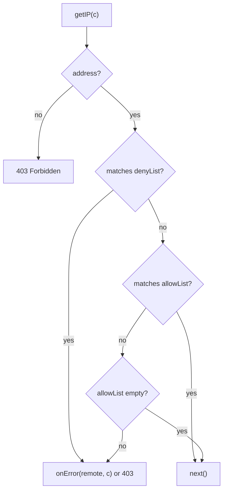

## Overview

The Web Standard `Request` carries no client address, so every runtime exposes it differently: a header added by the platform, a server method, or a field of the event. Hono defines one shape for it, `ConnInfo`, and each adapter exports a `getConnInfo(c)` that fills it. The `ipRestriction` middleware is built on that function, so the same allow and deny rules work on any runtime once the right `getConnInfo` is passed in.

Sources: [src/helper/conninfo/types.ts:1-45](repo://src/helper/conninfo/types.ts#L1-L45), [src/middleware/ip-restriction/index.ts:218-279](repo://src/middleware/ip-restriction/index.ts#L218-L279)

```ts
import { getConnInfo } from 'hono/cloudflare-workers'
import { ipRestriction } from 'hono/ip-restriction'

app.get('/info', (c) => c.text(`Your IP is ${getConnInfo(c).remote.address}`))

app.use(
  '/admin/*',
  ipRestriction(getConnInfo, {
    denyList: ['192.168.2.0/24'],
    allowList: ['127.0.0.1', '::1', '10.0.0.0/8'],
  })
)
```

Sources: [src/adapter/cloudflare-workers/conninfo.ts:1-7](repo://src/adapter/cloudflare-workers/conninfo.ts#L1-L7), [src/middleware/ip-restriction/index.ts:218-225](repo://src/middleware/ip-restriction/index.ts#L218-L225)

## The ConnInfo type

`hono/conninfo` exports only types. `ConnInfo` has a single `remote: NetAddrInfo` field with optional `address`, `addressType` (`IPv4`, `IPv6` or `undefined`), `port` and `transport` (`tcp` or `udp`). `GetConnInfo` is `(c: Context) => ConnInfo`.

Sources: [src/helper/conninfo/types.ts:1-45](repo://src/helper/conninfo/types.ts#L1-L45), [src/helper/conninfo/index.ts:1-6](repo://src/helper/conninfo/index.ts#L1-L6)

## Where each adapter finds the address

| Adapter | Source of `remote.address` | Also fills |
| --- | --- | --- |
| `hono/cloudflare-workers`, `hono/cloudflare-pages` | `cf-connecting-ip` header | |
| `hono/bun` | `server.requestIP(c.req.raw)`, with the Bun server passed as `env` | `addressType`, `port` |
| `hono/deno` | `c.env.remoteAddr` from `Deno.serve`'s handler info | `port`, `transport` |
| `hono/vercel` | `x-real-ip` header | |
| `hono/netlify` | `c.env.context.ip` | |
| `hono/aws-lambda` | API Gateway v1 `identity.sourceIp`, v2 `http.sourceIp`, or the last `X-Forwarded-For` entry behind ALB | |
| `hono/lambda-edge` | `event.Records[0].cf.request.clientIp` | |

Sources: [src/adapter/cloudflare-pages/conninfo.ts:22-26](repo://src/adapter/cloudflare-pages/conninfo.ts#L22-L26), [src/adapter/bun/conninfo.ts:10-43](repo://src/adapter/bun/conninfo.ts#L10-L43), [src/adapter/deno/conninfo.ts:8-17](repo://src/adapter/deno/conninfo.ts#L8-L17), [src/adapter/vercel/conninfo.ts:3-8](repo://src/adapter/vercel/conninfo.ts#L3-L8), [src/adapter/netlify/conninfo.ts:53-57](repo://src/adapter/netlify/conninfo.ts#L53-L57), [src/adapter/aws-lambda/conninfo.ts:45-73](repo://src/adapter/aws-lambda/conninfo.ts#L45-L73), [src/adapter/lambda-edge/conninfo.ts:11-15](repo://src/adapter/lambda-edge/conninfo.ts#L11-L15)

The Bun version throws `TypeError` when `env` is missing (the app was called without Bun's server as the second `fetch` argument) and returns an empty `remote` for closed requests or Unix sockets. On ALB the last `X-Forwarded-For` value is used because ALB appends the address it saw; earlier entries come from the client and can be forged. How `env` reaches the context for each runtime is described in [[Cloudflare, Deno, Bun, Vercel, Netlify and Service Worker Adapters]] and [[AWS Lambda and Lambda@Edge]].

Sources: [src/adapter/bun/conninfo.ts:10-43](repo://src/adapter/bun/conninfo.ts#L10-L43), [src/adapter/aws-lambda/conninfo.ts:58-66](repo://src/adapter/aws-lambda/conninfo.ts#L58-L66)

## ipRestriction

### Arguments

`ipRestriction(getIP, { denyList, allowList }, onError?)` takes a `GetConnInfo` or any `(c) => string`, two rule lists and an optional handler for denied requests. A rule takes one of four forms.

Sources: [src/middleware/ip-restriction/index.ts:37-38](repo://src/middleware/ip-restriction/index.ts#L37-L38)

- `*`: matches every address;
- a static IPv4 or IPv6 address;
- a CIDR range such as `192.168.0.0/16` or `2001:db8::/32`;
- a function `({ addr, type }) => boolean`.

Sources: [src/middleware/ip-restriction/index.ts:23-38](repo://src/middleware/ip-restriction/index.ts#L23-L38), [src/middleware/ip-restriction/index.ts:172-175](repo://src/middleware/ip-restriction/index.ts#L172-L175)

### Decision order



Sources: [src/middleware/ip-restriction/index.ts:238-278](repo://src/middleware/ip-restriction/index.ts#L238-L278)

Deny wins over allow. An empty `allowList` means "allow everything not denied"; a non-empty one means "deny everything not allowed". A missing address and an address that fails to parse (an `InvalidIPAddressError` from the parser) are both blocked rather than let through. The default rejection is an `HTTPException(403)` with the text `Forbidden`.

Sources: [src/middleware/ip-restriction/index.ts:231-278](repo://src/middleware/ip-restriction/index.ts#L231-L278)

### Compiling the rules

`buildMatcher` runs once per list when the middleware is created, so per-request matching is cheap.

Sources: [src/middleware/ip-restriction/index.ts:51-58](repo://src/middleware/ip-restriction/index.ts#L51-L58)

1. `*` short-circuits to a matcher that always returns `true`.
2. CIDR rules are parsed into `[isIPv4, network, mask]` with `bigint` arithmetic. A `/32` or `/128` becomes a static rule, and an IPv4-mapped IPv6 range of `/96` or more is converted to an IPv4 range.
3. Static rules go into string sets (both `1.2.3.4` and `::ffff:1.2.3.4` for IPv4) and binary sets, so an address matches regardless of the notation it arrives in.
4. A malformed rule throws `TypeError: Invalid rule: ...` at setup time.

Sources: [src/middleware/ip-restriction/index.ts:40-120](repo://src/middleware/ip-restriction/index.ts#L40-L120)

At request time the matcher checks the string set, then converts the address to a `bigint` once and checks the binary sets and each CIDR rule, comparing IPv4 rules against IPv4 and IPv4-mapped addresses, and finally calls the function rules.

Sources: [src/middleware/ip-restriction/index.ts:122-167](repo://src/middleware/ip-restriction/index.ts#L122-L167)

## IP address utilities

`src/utils/ipaddr.ts` holds the parsing the middleware relies on: `distinctRemoteAddr` classifies a string as `IPv4`, `IPv6` or `undefined`; `convertIPv4ToBinary` and `convertIPv6ToBinary` produce `bigint`s (expanding `::` with `expandIPv6`); `isIPv4MappedIPv6` and `convertIPv4MappedIPv6ToIPv4` handle `::ffff:a.b.c.d`; and `convertIPv6BinaryToString` produces the canonical compressed form used for static-rule lookups.

Sources: [src/utils/ipaddr.ts:13-60](repo://src/utils/ipaddr.ts#L13-L60), [src/utils/ipaddr.ts:148-160](repo://src/utils/ipaddr.ts#L148-L160), [src/utils/ipaddr.ts:300-330](repo://src/utils/ipaddr.ts#L300-L330)

> [!WARNING]
> A header-based `getConnInfo` is only as trustworthy as the platform that sets the header. When the app is reachable directly, bypassing Cloudflare or Vercel, a client can send its own `cf-connecting-ip` or `x-real-ip`; restrict access at the network level in that case.

Sources: [src/adapter/cloudflare-workers/conninfo.ts:1-7](repo://src/adapter/cloudflare-workers/conninfo.ts#L1-L7), [src/adapter/vercel/conninfo.ts:1-8](repo://src/adapter/vercel/conninfo.ts#L1-L8)
