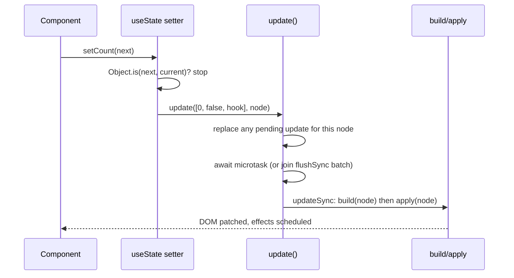

## Overview

`hono/jsx/dom` renders the same JSX components in the browser, with a React-compatible hooks API, in a few kilobytes. It keeps a lightweight virtual tree, diffs it against the previous render when state changes, and applies the differences to the real DOM. Components written for [[JSX Server Rendering]] work unchanged: function components, context, `Suspense`, `ErrorBoundary`, and the CSS helper ([[JSX Renderer Middleware and CSS Helper]]). The hooks live in `src/jsx/hooks` and are also exported from `hono/jsx`, where on the server they return initial values.

Sources: [src/jsx/dom/index.ts:1-40](repo://src/jsx/dom/index.ts#L1-L40), [src/jsx/dom/render.ts:783-800](repo://src/jsx/dom/render.ts#L783-L800)

```tsx
/** @jsxImportSource hono/jsx/dom */
import { useState } from 'hono/jsx'
import { render } from 'hono/jsx/dom'

const Counter = () => {
  const [count, setCount] = useState(0)
  return <button onClick={() => setCount((c) => c + 1)}>{count}</button>
}

render(<Counter />, document.getElementById('root')!)
```

Sources: [src/jsx/hooks/index.ts:182-243](repo://src/jsx/hooks/index.ts#L182-L243), [src/jsx/dom/render.ts:796-799](repo://src/jsx/dom/render.ts#L796-L799)

## Entry points

| Export | Behaviour |
| --- | --- |
| `render(element, container)` | Builds the tree and replaces the container's children |
| `createRoot(container)` | Returns `{ render, unmount }`; later `render` calls update the existing tree through an internal `useState` |
| `hydrateRoot(container, element)` | `createRoot` then `render`; it re-renders rather than attaching to existing markup |
| `flushSync(fn)` | Runs `fn` and applies the updates it caused synchronously |
| `createPortal(children, element)` | Renders children into another DOM element |

Sources: [src/jsx/dom/client.ts:23-89](repo://src/jsx/dom/client.ts#L23-L89), [src/jsx/dom/render.ts:796-825](repo://src/jsx/dom/render.ts#L796-L825)

`hono/jsx/dom/server` offers `renderToString` and `renderToReadableStream` with React DOM server's names, for libraries that import them.

Sources: [src/jsx/dom/server.ts:1-70](repo://src/jsx/dom/server.ts#L1-L70)

## The virtual tree

### Node objects

Each element becomes a `NodeObject`: the JSX node plus short-named fields for its previous props (`pP`), virtual children (`vC`), previous children (`pC`), children to remove (`vR`), container (`c`), real element (`e`), and the hook stash `[DOM_STASH]`, which holds the current hook index, per-hook-type state arrays, local context values, and the nearest error boundary. Text becomes a `NodeString` with its text and a dirty flag. The short names keep the bundle small.

Sources: [src/jsx/dom/render.ts:41-80](repo://src/jsx/dom/render.ts#L41-L80)

### build and apply

`build(context, node)` runs the component (through `invokeTag`, which pushes `[context, node]` onto `buildDataStack` so hooks know which node they belong to), flattens its children, turns each into a node with `buildNode`, and matches them against the previous children by `key` and tag so state survives re-renders. `apply` then walks the tree, creating or reusing elements, setting attributes and event listeners with `applyProps`, moving nodes into place, removing unmatched ones, and finally running effects.

Sources: [src/jsx/dom/render.ts:274-292](repo://src/jsx/dom/render.ts#L274-L292), [src/jsx/dom/render.ts:364-482](repo://src/jsx/dom/render.ts#L364-L482), [src/jsx/dom/render.ts:497-530](repo://src/jsx/dom/render.ts#L497-L530)

`renderNode` performs the first render into a `DocumentFragment`, then swaps the fragment into the container in one operation, so the page sees a single DOM mutation.

Sources: [src/jsx/dom/render.ts:783-794](repo://src/jsx/dom/render.ts#L783-L794)

### Events and attributes

Props named `onClick`, `onKeyDownCapture` and so on become `addEventListener` calls with the event name lower-cased and capture mode when the `Capture` suffix is present. Attribute names are converted for SVG and MathML, and `value`/`checked` on form controls are set as properties so they stay in sync with user input.

Sources: [src/jsx/dom/render.ts:119-164](repo://src/jsx/dom/render.ts#L119-L164)

## Updates



Sources: [src/jsx/hooks/index.ts:197-243](repo://src/jsx/hooks/index.ts#L197-L243), [src/jsx/dom/render.ts:713-781](repo://src/jsx/dom/render.ts#L713-L781)

`update(context, node)` keeps at most one pending update per node in a `WeakMap`: a newer call cancels the older, and the work runs after a microtask, so several state changes in one event handler cause one re-render of that component. Only the component whose state changed is rebuilt, together with its subtree, not the whole application.

Sources: [src/jsx/dom/render.ts:734-781](repo://src/jsx/dom/render.ts#L734-L781)

## Hooks

### State and effects

Hooks store their data in the current node's stash, indexed by call order, which is why they must be called unconditionally, as in React.

Sources: [src/jsx/hooks/index.ts:8-12](repo://src/jsx/hooks/index.ts#L8-L12), [src/jsx/hooks/index.ts:182-196](repo://src/jsx/hooks/index.ts#L182-L196)

| Hook | Notes |
| --- | --- |
| `useState`, `useReducer` | Setter compares with `Object.is` and schedules `update`; `useReducer` is built on `useState` |
| `useEffect` | Runs in `requestAnimationFrame` after the DOM is updated; the previous cleanup runs when deps change |
| `useLayoutEffect` | Runs synchronously after `apply`, before paint |
| `useInsertionEffect` | Runs before layout effects |
| `useMemo`, `useCallback`, `useRef`, `useId` | Stored per node; `useId` produces `:r<n>:` |
| `useContext`, `createContext` | Shared with the server implementation; providers push values during `build` |
| `use(promise)` | Throws the promise until it settles, which a surrounding `Suspense` catches |
| `useSyncExternalStore`, `useImperativeHandle`, `forwardRef`, `memo` | React-compatible equivalents |

Sources: [src/jsx/hooks/index.ts:245-299](repo://src/jsx/hooks/index.ts#L245-L299), [src/jsx/hooks/index.ts:299-366](repo://src/jsx/hooks/index.ts#L299-L366), [src/jsx/hooks/index.ts:371-425](repo://src/jsx/hooks/index.ts#L371-L425), [src/jsx/dom/render.ts:459-481](repo://src/jsx/dom/render.ts#L459-L481)

### Transitions and view transitions

`startTransition` and `useTransition` run state changes as low-priority updates: setters called inside them are queued on a pending stack and applied after the transition's promise and an animation frame, while `isPending` reflects progress. `useDeferredValue` returns a value that lags behind during transitions. `startViewTransition` and `useViewTransition` wrap the update in `document.startViewTransition` when the browser supports it, and fall back to a plain update otherwise.

Sources: [src/jsx/hooks/index.ts:43-126](repo://src/jsx/hooks/index.ts#L43-L126), [src/jsx/hooks/index.ts:127-180](repo://src/jsx/hooks/index.ts#L127-L180)

### Forms

`useActionState`, `useFormStatus` and `useOptimistic` from `src/jsx/dom/hooks` mirror React 19's form APIs for `<form action={fn}>`.

Sources: [src/jsx/dom/index.ts:30-31](repo://src/jsx/dom/index.ts#L30-L31)

## Server and client differences

On the server there is no `buildDataStack` entry, so `useState` returns the initial value with a no-op setter and `useEffect` does nothing. A component can therefore render on the server and become interactive when rendered again on the client. Since `hydrateRoot` re-renders, the client output replaces the server HTML rather than reusing it; components should produce the same markup in both places to avoid a visible change.

Sources: [src/jsx/hooks/index.ts:188-191](repo://src/jsx/hooks/index.ts#L188-L191), [src/jsx/hooks/index.ts:265-268](repo://src/jsx/hooks/index.ts#L265-L268), [src/jsx/dom/client.ts:76-84](repo://src/jsx/dom/client.ts#L76-L84)

`Suspense` and `ErrorBoundary` have separate DOM implementations attached to the shared components through a `DOM_RENDERER` symbol, which `invokeTag` prefers when present. The same mechanism lets the CSS helper's `Style` component and intrinsic elements such as `title` behave correctly in the browser.

Sources: [src/jsx/dom/render.ts:274-280](repo://src/jsx/dom/render.ts#L274-L280), [src/jsx/streaming.ts:138-138](repo://src/jsx/streaming.ts#L138-L138)
