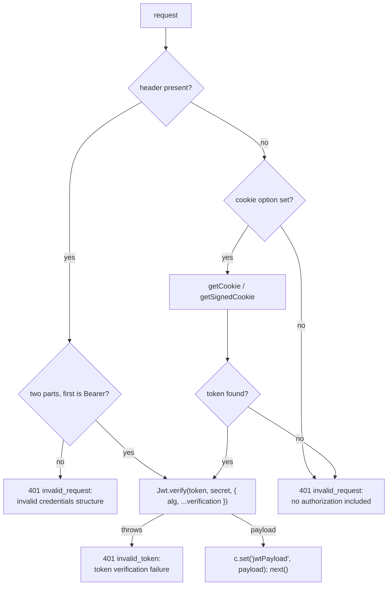

## Overview

Two middleware verify JSON Web Tokens: `jwt` (`hono/jwt`) checks tokens signed with one known secret or key, and `jwk` (`hono/jwk`) checks tokens against a set of public keys, given inline or fetched from a JWKS endpoint, selected by the token's `kid`. Both read the token from the `Authorization: Bearer` header or a cookie, verify it with the JWT library in `src/utils/jwt`, store the payload as `c.get('jwtPayload')`, and answer failures with a `401` `HTTPException`. Everything runs on Web Crypto (`crypto.subtle`), so it works on every runtime without dependencies.

Sources: [src/middleware/jwt/jwt.ts:53-158](repo://src/middleware/jwt/jwt.ts#L53-L158), [src/middleware/jwk/jwk.ts:48-167](repo://src/middleware/jwk/jwk.ts#L48-L167)

Simpler shared-secret schemes are covered in [[Basic and Bearer Auth]]; signed cookies used to carry tokens are covered in [[Cookies]].

Sources: [src/middleware/jwt/jwt.ts:96-117](repo://src/middleware/jwt/jwt.ts#L96-L117)

```ts
import { jwt, sign } from 'hono/jwt'

app.use('/api/*', jwt({ secret: 'my-secret', alg: 'HS256' }))
app.get('/api/me', (c) => c.json(c.get('jwtPayload')))

const token = await sign({ sub: 'user1', exp: Math.floor(Date.now() / 1000) + 3600 }, 'my-secret')
```

Sources: [src/middleware/jwt/jwt.ts:53-61](repo://src/middleware/jwt/jwt.ts#L53-L61), [src/utils/jwt/jwt.ts:56-76](repo://src/utils/jwt/jwt.ts#L56-L76)

## The jwt middleware

### Options

| Option | Required | Effect |
| --- | --- | --- |
| `secret` | yes | A string (HMAC secret or PEM key), a JWK object, or a `CryptoKey` |
| `alg` | yes | The only algorithm accepted; tokens whose header names another one fail |
| `headerName` | no | Header to read instead of `Authorization` |
| `cookie` | no | Cookie name, or `{ key, secret?, prefixOptions? }` to read a signed or prefixed cookie |
| `verification` | no | Claim checks: `iss`, `aud`, and switches for `exp`, `nbf`, `iat` |

Sources: [src/middleware/jwt/jwt.ts:53-74](repo://src/middleware/jwt/jwt.ts#L53-L74)

Requiring `alg` prevents algorithm confusion: the token header cannot choose a weaker algorithm or `none`. The factory also throws at setup if `crypto.subtle.importKey` is missing.

Sources: [src/middleware/jwt/jwt.ts:64-74](repo://src/middleware/jwt/jwt.ts#L64-L74), [src/utils/jwt/jwt.ts:123-129](repo://src/utils/jwt/jwt.ts#L123-L129)

### Request flow



Sources: [src/middleware/jwt/jwt.ts:76-157](repo://src/middleware/jwt/jwt.ts#L76-L157)

The header takes precedence: when it is present the cookie is not read, and a malformed header fails even if a valid cookie exists. Every failure response carries `WWW-Authenticate: Bearer realm="<url>",error="...",error_description="..."`; the verification error is attached as the `HTTPException`'s `cause` for logging.

Sources: [src/middleware/jwt/jwt.ts:141-173](repo://src/middleware/jwt/jwt.ts#L141-L173)

`hono/jwt` also re-exports `sign`, `verify`, `decode`, `verifyWithJwks` and `AlgorithmTypes`, and declares `jwtPayload` in `ContextVariableMap`.

Sources: [src/middleware/jwt/index.ts:1-9](repo://src/middleware/jwt/index.ts#L1-L9), [src/middleware/jwt/jwt.ts:175-178](repo://src/middleware/jwt/jwt.ts#L175-L178)

## The jwk middleware

`jwk` accepts the same `headerName` and `cookie` options and two key sources, `keys` (an array of JWKs, or a function of `c` returning one) and `jwks_uri` (a URL, or a function of `c`). At least one is required. `alg` is a list of allowed asymmetric algorithms, and the optional second argument is a `RequestInit` for the JWKS fetch.

Sources: [src/middleware/jwk/jwk.ts:48-73](repo://src/middleware/jwk/jwk.ts#L48-L73)

Two behaviours differ from `jwt`. With `allow_anon: true`, a request without any token passes through to `next()` with no payload set, so a route can serve both anonymous and signed-in users. And when verification fails with a plain `Error` (such as a failed JWKS fetch or an invalid JWKS response) rather than a JWT error class, the error is rethrown instead of turned into a `401`, so infrastructure failures surface as `500`s.

Sources: [src/middleware/jwk/jwk.ts:118-162](repo://src/middleware/jwk/jwk.ts#L118-L162)

Keys are resolved on every request; the middleware does not cache the JWKS response. Caching belongs in the `keys` function or in the `RequestInit` (`cf: { cacheTtl }` on Cloudflare, for example).

Sources: [src/middleware/jwk/jwk.ts:133-146](repo://src/middleware/jwk/jwk.ts#L133-L146), [src/utils/jwt/jwt.ts:230-246](repo://src/utils/jwt/jwt.ts#L230-L246)

## The JWT library

### sign and decode

`sign(payload, key, alg = 'HS256')` JSON-encodes header and payload as base64url, signs `header.payload` with `signing`, and appends the signature. When the key is a JWK with an `alg`, that algorithm and the key's `kid` go into the header. `decode(token)` splits and parses the three parts without verifying anything, throwing `JwtTokenInvalid` for anything that is not three base64url JSON parts.

Sources: [src/utils/jwt/jwt.ts:31-76](repo://src/utils/jwt/jwt.ts#L31-L76), [src/utils/jwt/jwt.ts:264-291](repo://src/utils/jwt/jwt.ts#L264-L291)

### verify

`verify(token, key, algOrOptions)` checks in this order, throwing a specific error class at the first failure.

Sources: [src/utils/jwt/jwt.ts:96-100](repo://src/utils/jwt/jwt.ts#L96-L100)

1. An algorithm was given (`JwtAlgorithmRequired`), and the token has three parts (`JwtTokenInvalid`).
2. The header is valid, its `alg` is a known algorithm and `typ` is absent or `JWT` (`JwtHeaderInvalid`); its `alg` equals the expected one (`JwtAlgorithmMismatch`).
3. Time claims against `now` in seconds: `nbf` must not be in the future (`JwtTokenNotBefore`), `exp` must be in the future (`JwtTokenExpired`), `iat` must not be in the future (`JwtTokenIssuedAt`). Each check runs only when the claim is present and its switch is not `false`; a non-numeric claim fails.
4. `iss`, when configured, must equal the string or match the `RegExp` (`JwtTokenIssuer`).
5. `aud`, when configured, must be present (`JwtPayloadRequiresAud`) and one of the token's audiences must match the string, array or `RegExp` (`JwtTokenAudience`).
6. The signature verifies (`JwtTokenSignatureMismatched`).

Sources: [src/utils/jwt/jwt.ts:96-188](repo://src/utils/jwt/jwt.ts#L96-L188)

Claims are checked before the signature, so an expired token is reported as expired even if it was also forged; either way the middleware answers the same `401`.

Sources: [src/utils/jwt/jwt.ts:130-185](repo://src/utils/jwt/jwt.ts#L130-L185)

### verifyWithJwks

`verifyWithJwks(token, { keys, jwks_uri, verification, allowedAlgorithms }, init)` reads the header without verifying, requires a `kid` (`JwtHeaderRequiresKid`), rejects HMAC algorithms outright (`JwtSymmetricAlgorithmNotAllowed`) and any algorithm not in `allowedAlgorithms` (`JwtAlgorithmNotAllowed`). It then merges inline keys with keys fetched from `jwks_uri`, picks the key whose `kid` matches, checks that the key's own `alg` (if set) matches the header, and calls `verify` with the header's algorithm.

Sources: [src/utils/jwt/jwt.ts:190-262](repo://src/utils/jwt/jwt.ts#L190-L262)

Rejecting HS256/384/512 here closes the classic attack where a token signed with HMAC uses a public key as its secret.

Sources: [src/utils/jwt/jwt.ts:218-221](repo://src/utils/jwt/jwt.ts#L218-L221)

## Algorithms and keys

`AlgorithmTypes` lists the supported algorithms: HS256/384/512, RS256/384/512, PS256/384/512, ES256/384/512 and EdDSA. `getKeyAlgorithm` in `jws.ts` maps each to its Web Crypto parameters; anything else throws `JwtAlgorithmNotImplemented`.

Sources: [src/utils/jwt/jwa.ts:7-37](repo://src/utils/jwt/jwa.ts#L7-L37), [src/utils/jwt/jws.ts:122-224](repo://src/utils/jwt/jws.ts#L122-L224)

| Key given as | Imported as |
| --- | --- |
| `CryptoKey` | Used directly after checking its type (`private`/`secret` to sign, `public`/`secret` to verify) |
| JWK object | `importKey('jwk', ...)` |
| PEM string containing `PRIVATE` | `pkcs8`; for verification the public part is derived from it |
| Other PEM string | `spki` public key |
| Plain string | `raw` HMAC secret |

Sources: [src/utils/jwt/jws.ts:54-105](repo://src/utils/jwt/jws.ts#L54-L105)

## Errors

Every failure inside the library is a dedicated subclass of `Error` exported from `src/utils/jwt/types.ts`, from `JwtAlgorithmNotImplemented` to `JwtTokenAudience`. Code calling `verify` directly can branch on them; the middleware collapse them into one `401` so a client cannot probe which check failed.

Sources: [src/utils/jwt/types.ts:6-112](repo://src/utils/jwt/types.ts#L6-L112)
