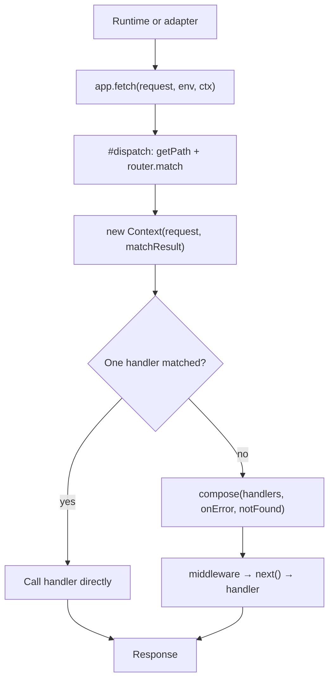

## Overview

Hono is a small web framework built only on the Web Standard `Request` and `Response` APIs. Because it never touches a runtime-specific server object, the same application runs on Cloudflare Workers, Fastly Compute, Deno, Bun, Vercel, AWS Lambda, Lambda@Edge and Node.js. An application is an object with a `fetch(request, env, executionCtx)` method: every runtime that can call a fetch handler can serve it.

Sources: [README.md:22-33](repo://README.md#L22-L33)

The package's main entry exports the `Hono` class, the `Context` class and the public types; every other feature (middleware, helpers, JSX, adapters, the RPC client) is a separate subpath export so an application only bundles what it imports.

Sources: [src/index.ts:1-53](repo://src/index.ts#L1-L53)

## Parts of the framework

| Area | What it does | Page |
| --- | --- | --- |
| Application | The `Hono` class: route registration, sub-apps, `basePath`, `mount`, `fetch` | [[Hono App and Route Registration]] |
| Dispatch | Matches a request, builds the `Context`, runs the middleware chain, handles errors and 404 | [[Request Dispatch and Middleware Composition]] |
| Context | The `c` object: variables, headers, response helpers | [[Context and Responses]] |
| Request | `c.req`: params, query, headers, cached body parsing | [[HonoRequest: Params, Query, Headers and Body]] |
| Routers | Pluggable route matchers and the presets that choose them | [[Routers and Presets]], [[RegExpRouter]], [[TrieRouter, LinearRouter and PatternRouter]] |
| Types | `Env`, handler and schema types that carry route shapes into the client | [[Env, Handler and Schema Types]] |
| Validation and RPC | `validator()` and the typed `hc` client | [[Validator]], [[RPC Client]] |
| Middleware | Auth, security headers, caching, logging, static files and more | [[Basic and Bearer Auth]], [[CORS, CSRF and Secure Headers]], [[Serving Static Files]] |
| Helpers | Cookies, streaming, WebSockets, SSG, proxy, testing | [[Cookies]], [[Streaming and Server-Sent Events]], [[WebSockets]] |
| JSX | Server rendering, page renderer middleware, client-side DOM rendering | [[JSX Server Rendering]], [[Client-Side JSX and Hooks]] |
| Adapters | Glue for each runtime's event format | [[Cloudflare, Deno, Bun, Vercel, Netlify and Service Worker Adapters]], [[AWS Lambda and Lambda@Edge]] |

Sources: [src/index.ts:1-53](repo://src/index.ts#L1-L53), [package.json:38-120](repo://package.json#L38-L120)

## Main request flow

Sources: [src/hono-base.ts:406-485](repo://src/hono-base.ts#L406-L485), [src/compose.ts:14-73](repo://src/compose.ts#L14-L73)

1. A runtime calls `app.fetch` directly (Workers, Deno, Bun) or through an adapter that first converts its own event into a `Request` ([[Cloudflare, Deno, Bun, Vercel, Netlify and Service Worker Adapters]], [[AWS Lambda and Lambda@Edge]]).
2. `#dispatch` extracts the path with `getPath` and asks the router for every handler that matches the method and path ([[Request Dispatch and Middleware Composition]], [[Routers and Presets]]).
3. A `Context` is created around the raw request and the match result; it is what handlers receive as `c` ([[Context and Responses]]).
4. When exactly one handler matched, it is called without building a middleware chain; otherwise `compose` runs middleware and handlers in registration order, each awaiting `next()` ([[Request Dispatch and Middleware Composition]]).
5. The handler returns a `Response`, usually built with `c.text`, `c.json` or `c.html`; errors go to the app's `onError` handler and unmatched requests to `notFound`.

Sources: [src/hono-base.ts:406-466](repo://src/hono-base.ts#L406-L466)

## Design decisions

### Web Standards only

Handlers receive a standard `Request` (as `c.req.raw`) and must produce a standard `Response`. There is no Node-style `req`/`res` pair to adapt; adapters exist only for platforms whose entry point is not a fetch handler, such as AWS Lambda events. `app.request()` builds a `Request` from a path, which is why tests need no server.

Sources: [src/hono-base.ts:479-517](repo://src/hono-base.ts#L479-L517)

### Zero runtime dependencies

`package.json` declares only `devDependencies`: cryptography uses Web Crypto, compression uses `CompressionStream`, and JSX rendering is implemented in `src/jsx`. This keeps the `hono/tiny` preset small and lets the code run unchanged on edge runtimes.

Sources: [package.json:668-698](repo://package.json#L668-L698)

### Pluggable routers chosen at the first request

`HonoBase` has no router of its own; subclasses assign one. The default `Hono` uses a `SmartRouter` over `RegExpRouter` and `TrieRouter`. `SmartRouter` only records routes; at the first `match` it hands them to each candidate in turn, keeps the first one that does not throw `UnsupportedPathError`, and replaces its own `match` with that router's. The fast regular-expression router is used whenever the app's paths allow it, with no cost after the first request.

Sources: [src/hono.ts:16-34](repo://src/hono.ts#L16-L34), [src/router/smart-router/router.ts:21-61](repo://src/router/smart-router/router.ts#L21-L61)

### Work is deferred until it is needed

`Context` creates its `HonoRequest` only when `c.req` is first read, response headers are allocated only when a handler sets one, and `c.text` returns a bare `new Response(text)` when nothing else was set. The single-handler path in `#dispatch` skips `compose` entirely. These shortcuts matter on edge runtimes where each request starts cold.

Sources: [src/context.ts:366-368](repo://src/context.ts#L366-L368), [src/context.ts:682-694](repo://src/context.ts#L682-L694), [src/hono-base.ts:429-448](repo://src/hono-base.ts#L429-L448)

### Types first

Every `app.get(...)` call returns the app with a widened `Schema` type that records the path, method, validated input and response type of the route. `route()` merges a sub-app's schema under its prefix. The [[RPC Client]] reads that schema to build a typed client, so the server's routes are the API contract ([[Env, Handler and Schema Types]]).

Sources: [src/hono-base.ts:98-118](repo://src/hono-base.ts#L98-L118), [src/hono-base.ts:208-232](repo://src/hono-base.ts#L208-L232)
