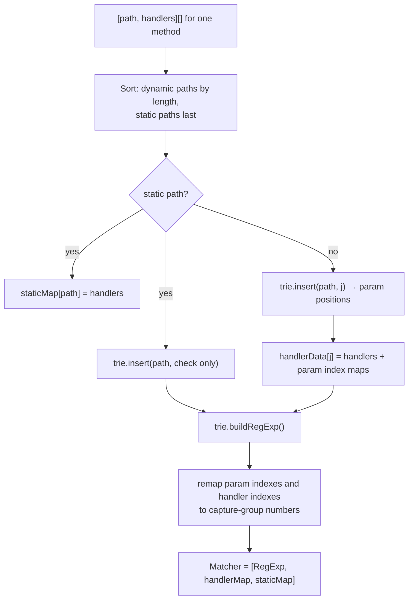

## Overview

`RegExpRouter` is the router the default `Hono` tries first. Instead of walking a tree or looping over routes for every request, it compiles all routes of a method into a single regular expression the first time `match` runs, so a request is resolved by one static-map lookup or one `RegExp` execution. It returns parameters in the index-map-plus-stash shape described in [[Routers and Presets]], reusing the array that `String.prototype.match` returns.

Sources: [src/router/reg-exp-router/router.ts:122-130](repo://src/router/reg-exp-router/router.ts#L122-L130), [src/router/reg-exp-router/matcher.ts:10-33](repo://src/router/reg-exp-router/matcher.ts#L10-L33)

It cannot represent every route set. When two non-wildcard routes would match the same path, or a pattern cannot be expressed in its combined expression, it throws `UnsupportedPathError` and `SmartRouter` falls back to `TrieRouter` ([[TrieRouter, LinearRouter and PatternRouter]]).

Sources: [src/router/reg-exp-router/router.ts:60-65](repo://src/router/reg-exp-router/router.ts#L60-L65)

## Registration: add()

### Two maps

`add` does not build anything; it sorts handlers into two maps keyed by method then path, `#middleware` for wildcard paths and `#routes` for the rest. Each entry is a list of `[handler, paramCount]`.

Sources: [src/router/reg-exp-router/router.ts:132-204](repo://src/router/reg-exp-router/router.ts#L132-L204)

### Copying ALL into new methods

The first time a method appears, both maps get a copy of everything registered under `ALL`, so a method-specific matcher already contains the global middleware and `ALL` routes registered before it.

Sources: [src/router/reg-exp-router/router.ts:140-147](repo://src/router/reg-exp-router/router.ts#L140-L147)

### Wildcard paths

A path ending in `*` (with `/*` normalised to `*`) is converted to a regular expression by `buildWildcardRegExp`, which escapes metacharacters and turns a trailing `/*` into `(?:|/.*)` so `/posts/*` also matches `/posts`. The handler is then appended to every existing middleware and route entry whose path the expression matches, for its method or for all methods when registered under `ALL`. A new wildcard entry first inherits the handlers of the longest existing wildcard that covers it (`findMiddleware`).

Sources: [src/router/reg-exp-router/router.ts:19-32](repo://src/router/reg-exp-router/router.ts#L19-L32), [src/router/reg-exp-router/router.ts:105-120](repo://src/router/reg-exp-router/router.ts#L105-L120), [src/router/reg-exp-router/router.ts:149-187](repo://src/router/reg-exp-router/router.ts#L149-L187)

### Normal paths

Other paths are expanded by `checkOptionalParameter`, then each variant gets an entry that starts with the middleware covering it, followed by the handler. The parameter count stored with the handler is reduced for the shorter variants of an optional path, so the handler only reads the parameters that exist.

Sources: [src/router/reg-exp-router/router.ts:189-204](repo://src/router/reg-exp-router/router.ts#L189-L204)

Because middleware is copied into each route entry at registration, the list a route matches is already complete and ordered by registration: matching returns it as is, without merging lists per request.

Sources: [src/router/reg-exp-router/router.ts:193-201](repo://src/router/reg-exp-router/router.ts#L193-L201)

## Building the matchers

### First match

`match` is the shared function in `matcher.ts`. On its first call it runs `buildAllMatchers()`, then replaces itself on the instance with a closure over the built matchers. `buildAllMatchers` builds one matcher per method, then sets both maps to `undefined` (which is what makes a later `add` throw "matcher is already built") and clears the wildcard cache.

Sources: [src/router/reg-exp-router/matcher.ts:10-33](repo://src/router/reg-exp-router/matcher.ts#L10-L33), [src/router/reg-exp-router/router.ts:206-222](repo://src/router/reg-exp-router/router.ts#L206-L222)

`#buildMatcher(method)` collects the method's own middleware and routes, falling back to the `ALL` lists for a map that has none for this method. A method with no routes of its own gets `null`, and lookups for it use the `ALL` matcher.

Sources: [src/router/reg-exp-router/router.ts:224-251](repo://src/router/reg-exp-router/router.ts#L224-L251)

### From routes to one expression



Sources: [src/router/reg-exp-router/router.ts:34-103](repo://src/router/reg-exp-router/router.ts#L34-L103)

Static paths (no `*` and no `/:`) go into `staticMap` with an empty parameter list, so the most common lookups never run a regular expression. They are still inserted into the trie in check-only mode, which detects a static path that would conflict with a dynamic one without adding it to the expression.

Sources: [src/router/reg-exp-router/router.ts:43-69](repo://src/router/reg-exp-router/router.ts#L43-L69)

### The trie and its nodes

`Trie.insert` tokenises the path into single characters, `:name` or `:name{regexp}` labels, and a trailing `/*`, protecting `{...}` groups so a `/` inside a custom pattern does not split it. Each `Node` maps a token to a child. Labels become children keyed by their regular expression (`[^/]+` by default) and receive a variable index from a shared counter.

Sources: [src/router/reg-exp-router/trie.ts:10-47](repo://src/router/reg-exp-router/trie.ts#L10-L47), [src/router/reg-exp-router/node.ts:50-133](repo://src/router/reg-exp-router/node.ts#L50-L133)

`buildRegExpStr` serialises the tree depth-first. Children are sorted literals first, then custom patterns, then plain labels, then wildcards, so the expression tries the most specific alternative first. A node where a route ends emits a marker `#<index>`; a label emits `(<pattern>)@<varIndex>`.

Sources: [src/router/reg-exp-router/node.ts:13-43](repo://src/router/reg-exp-router/node.ts#L13-L43), [src/router/reg-exp-router/node.ts:135-161](repo://src/router/reg-exp-router/node.ts#L135-L161)

`Trie.buildRegExp` then replaces each `#<index>` with an empty capture group `$()` and records which capture number it got, and removes each `@<varIndex>` while recording the capture number of the label before it. Those two replacement maps rewrite the handler data so parameter maps point straight at capture-group numbers.

Sources: [src/router/reg-exp-router/trie.ts:49-73](repo://src/router/reg-exp-router/trie.ts#L49-L73), [src/router/reg-exp-router/router.ts:82-100](repo://src/router/reg-exp-router/router.ts#L82-L100)

## Matching a request

```ts
const match = ((method, path) => {
  const matcher = (matchers[method] || matchers[METHOD_NAME_ALL]) as Matcher<T>

  const staticMatch = matcher[2][path]
  if (staticMatch) {
    return staticMatch
  }

  const match = path.match(matcher[0])
  if (!match) {
    return [[], emptyParam]
  }

  const index = match.indexOf('', 1)
  return [matcher[1][index], match]
}) as Router<T>['match']
```

Sources: [src/router/reg-exp-router/matcher.ts:14-29](repo://src/router/reg-exp-router/matcher.ts#L14-L29)

The empty capture `$()` placed at the end of each route is the trick that identifies the route: only the alternative that matched has its empty group set to `''`, and every other group is `undefined` or a non-empty parameter value. `match.indexOf('', 1)` finds that group's number, `handlerMap` gives the handlers for it, and the match array itself becomes the parameter stash.

Sources: [src/router/reg-exp-router/matcher.ts:22-28](repo://src/router/reg-exp-router/matcher.ts#L22-L28), [src/router/reg-exp-router/trie.ts:59-62](repo://src/router/reg-exp-router/trie.ts#L59-L62)

## Unsupported paths

`Node.insert` throws its private `PATH_ERROR`, which the builder converts to `UnsupportedPathError`, in these cases.

Sources: [src/router/reg-exp-router/router.ts:60-65](repo://src/router/reg-exp-router/router.ts#L60-L65)

| Case | Example |
| --- | --- |
| Two routes end at the same node | `/users/:id` and `/users/:name` |
| A new label next to an existing non-wildcard sibling | `/users/:id{[0-9]+}` and `/users/:name` |
| A literal next to an existing label | `/users/:id` and `/users/me` |
| A named label whose pattern is `.*` | `/files/:path{.*}` |
| A capturing group in a custom pattern | `/:id{prefix(a\|b)}`; a pattern that is wholly `(a\|b)` is rewritten to `(?:a\|b)` and accepted |

Sources: [src/router/reg-exp-router/node.ts:57-130](repo://src/router/reg-exp-router/node.ts#L57-L130)

In each case one regular expression cannot return two routes for the same path, or the capture-group numbering would break. The default `Hono` then runs on `TrieRouter`; an app built with `new Hono({ router: new RegExpRouter() })` gets the error on its first request.

Sources: [src/router/reg-exp-router/router.ts:60-65](repo://src/router/reg-exp-router/router.ts#L60-L65)

## PreparedRegExpRouter

`PreparedRegExpRouter` removes even the first-request compile, for platforms where every cold start counts. At build time, `buildInitParams({ paths })` runs a `RegExpRouter` over the app's paths, exports its matchers, and records for each path where its handlers belong (`relocateMap`); `serializeInitParams` turns both into JavaScript source with the regular expressions inlined. At run time the app constructs `new PreparedRegExpRouter(...params)` and its `add` calls only push handlers into the prepared slots; a path that was not prepared throws `Path ... is not registered`.

Sources: [src/router/reg-exp-router/prepared-router.ts:9-93](repo://src/router/reg-exp-router/prepared-router.ts#L9-L93), [src/router/reg-exp-router/prepared-router.ts:95-165](repo://src/router/reg-exp-router/prepared-router.ts#L95-L165)

Wildcard paths `*` and `/*` are not prepared: `add` appends their handler to every slot of the method's matcher, matching what `RegExpRouter` would have built. All three are exported from `hono/router/reg-exp-router`.

Sources: [src/router/reg-exp-router/prepared-router.ts:19-23](repo://src/router/reg-exp-router/prepared-router.ts#L19-L23), [src/router/reg-exp-router/index.ts:1-7](repo://src/router/reg-exp-router/index.ts#L1-L7)
