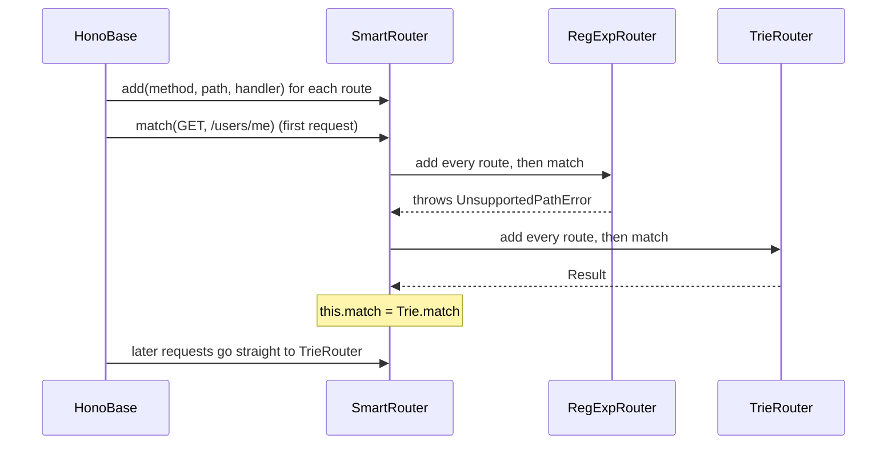

## Overview

A router is the component that stores routes and, for each request, returns every handler whose method and path match. Hono separates it from the application behind a two-method interface so different matching algorithms can trade start-up cost, matching speed, path features and bundle size. The application only calls `router.add` at registration and `router.match` once per request ([[Hono App and Route Registration]], [[Request Dispatch and Middleware Composition]]).

Sources: [src/router.ts:24-52](repo://src/router.ts#L24-L52)

Five routers ship with Hono. This page covers the shared contract, the path syntax, `SmartRouter` and the presets; the algorithms are covered in [[RegExpRouter]] and [[TrieRouter, LinearRouter and PatternRouter]].

Sources: [src/hono.ts:1-34](repo://src/hono.ts#L1-L34)

## The Router interface

### add and match

```ts
export interface Router<T> {
  name: string
  add(method: string, path: string, handler: T): void
  match(method: string, path: string): Result<T>
}
```

Sources: [src/router.ts:29-52](repo://src/router.ts#L29-L52)

`T` is opaque to the router. The application stores the tuple `[handler, RouterRoute]`, so the match result carries both the function and its route record. Methods are upper-case strings, with `ALL` (`METHOD_NAME_ALL`) meaning any method; `app.use` registers under `ALL`.

Sources: [src/router.ts:6-17](repo://src/router.ts#L6-L17), [src/hono-base.ts:385-397](repo://src/hono-base.ts#L385-L397)

### The two Result shapes

`match` returns every matching handler in registration order, each with its parameters, in one of two shapes.

Sources: [src/router.ts:66-98](repo://src/router.ts#L66-L98)

| Shape | Form | Used by |
| --- | --- | --- |
| Index map plus stash | `[[handler, { id: 0 }][], ['123']]`: each map holds an index into one shared array of captured strings | `RegExpRouter`, `PreparedRegExpRouter` |
| Direct params | `[[handler, { id: '123' }][]]`: each map holds the values | `TrieRouter`, `LinearRouter`, `PatternRouter` |

Sources: [src/router.ts:66-98](repo://src/router.ts#L66-L98)

The stash form lets `RegExpRouter` hand back the array that `String.prototype.match` already produced, with no per-request object building. `HonoRequest` resolves both shapes when a parameter is read ([[HonoRequest: Params, Query, Headers and Body]]).

Sources: [src/router/reg-exp-router/matcher.ts:10-33](repo://src/router/reg-exp-router/matcher.ts#L10-L33), [src/request.ts:126-128](repo://src/request.ts#L126-L128)

### Errors routers raise

| Error | Meaning |
| --- | --- |
| `UnsupportedPathError` | This router cannot represent the set of routes. `SmartRouter` catches it and tries the next router |
| `Can not add a route since the matcher is already built.` | `add` was called after the first `match`; routers that compile on first match refuse later routes |

Sources: [src/router.ts:18-22](repo://src/router.ts#L18-L22), [src/router.ts:100-103](repo://src/router.ts#L100-L103)

## Path syntax

| Pattern | Matches |
| --- | --- |
| `/posts/:id` | One segment, captured as `id` |
| `/posts/:id{[0-9]+}` | A segment matching the regular expression |
| `/api/animals/:type?` | `/api/animals` and `/api/animals/:type` (expanded by `checkOptionalParameter`) |
| `/posts/*` | `/posts` and anything below it |
| `*` or `/*` | Every path |
| `/posts/:file{.+\\.png}` | A custom pattern that may span segments (not supported by `RegExpRouter`) |

Sources: [src/utils/url.ts:50-78](repo://src/utils/url.ts#L50-L78), [src/utils/url.ts:171-206](repo://src/utils/url.ts#L171-L206)

`{...}` groups in a path are replaced by placeholders before the path is split on `/` and restored afterwards, so a regular expression may itself contain `/`.

Sources: [src/utils/url.ts:16-48](repo://src/utils/url.ts#L16-L48)

## SmartRouter

`SmartRouter` wraps a list of candidate routers. `add` only appends to a list. On the first `match` it replays every stored route into the first candidate and calls its `match`; if that throws `UnsupportedPathError`, it moves to the next. The first router that succeeds becomes permanent: `SmartRouter` replaces its own `match` with the winner's bound `match`, drops the others and the stored routes, and sets its name to `SmartRouter + <winner>`. If every candidate fails it throws `Fatal error`.

Sources: [src/router/smart-router/router.ts:1-61](repo://src/router/smart-router/router.ts#L1-L61)



Sources: [src/router/smart-router/router.ts:21-61](repo://src/router/smart-router/router.ts#L21-L61)

`activeRouter` returns the chosen router after the first match and throws `No active router has been determined yet.` before it. Because selection happens on the first request, any route added after that throws the "matcher is already built" error.

Sources: [src/router/smart-router/router.ts:63-70](repo://src/router/smart-router/router.ts#L63-L70), [src/router/smart-router/router.ts:13-19](repo://src/router/smart-router/router.ts#L13-L19)

## Presets

| Import | Router | Trade-off |
| --- | --- | --- |
| `hono` | `SmartRouter` over `RegExpRouter`, `TrieRouter` | Fastest matching; one compile on the first request |
| `hono/quick` | `SmartRouter` over `LinearRouter`, `TrieRouter` | No compile step; suited to environments that build the app on every request |
| `hono/tiny` | `PatternRouter` | Smallest bundle |

Sources: [src/hono.ts:16-34](repo://src/hono.ts#L16-L34), [src/preset/quick.ts:1-24](repo://src/preset/quick.ts#L1-L24), [src/preset/tiny.ts:1-20](repo://src/preset/tiny.ts#L1-L20)

`RegExpRouter` cannot represent route sets where two non-wildcard routes match the same path. Registering `/users/:id` together with `/users/me` is the common example: the default `Hono` then runs on `TrieRouter`. Running the dispatch on a second router keeps every path pattern working, at a cost only for apps that need it.

Sources: [src/router/reg-exp-router/node.ts:94-130](repo://src/router/reg-exp-router/node.ts#L94-L130)

A specific router can be passed to the default class.

Sources: [src/hono.ts:26-33](repo://src/hono.ts#L26-L33)

```ts
import { Hono } from 'hono'
import { RegExpRouter } from 'hono/router/reg-exp-router'

const app = new Hono({ router: new RegExpRouter() })
```

Sources: [src/hono-base.ts:55-65](repo://src/hono-base.ts#L55-L65)

## Finding out which router is used

`getRouterName(app)` from `hono/dev` calls `app.router.match('GET', '/')` to force selection and returns `app.router.name`, for example `SmartRouter + RegExpRouter`. The presets' tests use it to check which router each preset installs ([[Testing, Route and Dev Helpers]]).

Sources: [src/helper/dev/index.ts:76-79](repo://src/helper/dev/index.ts#L76-L79), [src/preset/quick.test.ts:1-9](repo://src/preset/quick.test.ts#L1-L9)
