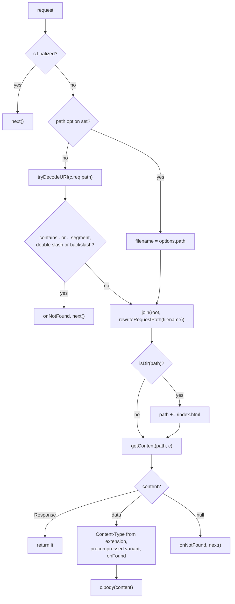

## Overview

Reading a file is runtime-specific, but deciding which file a request maps to, whether that path is safe, which `Content-Type` and encoding to send, and what to do when nothing is found is not. Hono splits the two. `serveStatic` in `src/middleware/serve-static` (exported as `hono/serve-static`) is the runtime-neutral core and takes a `getContent(path, c)` function; the Bun, Deno and Cloudflare Workers adapters each export a `serveStatic` that supplies one. Node.js uses the equivalent from `@hono/node-server`.

Sources: [src/middleware/serve-static/index.ts:35-126](repo://src/middleware/serve-static/index.ts#L35-L126), [src/adapter/bun/serve-static.ts:8-32](repo://src/adapter/bun/serve-static.ts#L8-L32)

```ts
import { serveStatic } from 'hono/bun' // or 'hono/deno'

app.use('/static/*', serveStatic({ root: './' }))
app.get('/favicon.ico', serveStatic({ path: './public/favicon.ico' }))
app.get('*', serveStatic({ path: './public/index.html' })) // SPA fallback
```

Sources: [src/middleware/serve-static/index.ts:13-21](repo://src/middleware/serve-static/index.ts#L13-L21)

## Options

| Option | Default | Effect |
| --- | --- | --- |
| `root` | `./` | Directory the request path is joined to |
| `path` | | Serve this one file for every matching request, ignoring the URL |
| `rewriteRequestPath(path)` | | Map the URL path before joining, for example to strip `/static` |
| `precompressed` | `false` | Look for `.br`, `.zst` and `.gz` siblings the client accepts |
| `mimes` | | Extra extension-to-MIME mappings, consulted first |
| `onFound(path, c)` | | Called before the response is built, for example to set `Cache-Control` |
| `onNotFound(path, c)` | | Called when the file is missing or the path is rejected |

Sources: [src/middleware/serve-static/index.ts:13-21](repo://src/middleware/serve-static/index.ts#L13-L21)

The core also takes adapter hooks: `getContent` (required), `join` (defaults to a POSIX-style `defaultJoin`), and `isDir` for directory detection.

Sources: [src/middleware/serve-static/index.ts:35-49](repo://src/middleware/serve-static/index.ts#L35-L49)

## Request flow



Sources: [src/middleware/serve-static/index.ts:54-125](repo://src/middleware/serve-static/index.ts#L54-L125)

A missing file is not an error: the middleware calls `next()`, so a later route or the not-found handler answers. That is what lets `app.use('/static/*', serveStatic(...))` coexist with dynamic routes under the same prefix. The middleware also skips work when an earlier handler already produced a response.

Sources: [src/middleware/serve-static/index.ts:56-58](repo://src/middleware/serve-static/index.ts#L56-L58), [src/middleware/serve-static/index.ts:122-124](repo://src/middleware/serve-static/index.ts#L122-L124)

## Path safety

The decoded request path is rejected before any join if it contains a `.` or `..` segment, two consecutive slashes or backslashes, or any backslash. Checking after decoding catches `%2e%2e` as well as literal dots. `defaultJoin` also collapses duplicate slashes and resolves `.` and `..` segments, but the earlier check means request paths never depend on it.

Sources: [src/middleware/serve-static/index.ts:60-74](repo://src/middleware/serve-static/index.ts#L60-L74), [src/middleware/serve-static/path.ts:5-25](repo://src/middleware/serve-static/path.ts#L5-L25)

`src/utils/filepath.ts` keeps an older, separate path helper (`getFilePath`, `getFilePathWithoutDefaultDocument`) with the same `..` rejection, exported through `hono/utils/*` for third-party adapters; the middleware itself no longer uses it.

Sources: [src/utils/filepath.ts:12-60](repo://src/utils/filepath.ts#L12-L60)

## Content type and precompressed files

The MIME type comes from the file extension through `getMimeType`, with the `mimes` option taking precedence; unknown extensions get `application/octet-stream`.

Sources: [src/middleware/serve-static/index.ts:92-95](repo://src/middleware/serve-static/index.ts#L92-L95), [src/utils/mime.ts:6-16](repo://src/utils/mime.ts#L6-L16)

With `precompressed: true` and a compressible MIME type, the middleware splits `Accept-Encoding` on commas and tries `br`, then `zstd`, then `gzip`, calling `getContent(path + '.br' | '.zst' | '.gz')` for each encoding the client listed. The first that exists replaces the content, and the response gets `Content-Encoding` and `Vary: Accept-Encoding`. The build step that produces those files is up to the project.

Sources: [src/middleware/serve-static/index.ts:23-28](repo://src/middleware/serve-static/index.ts#L23-L28), [src/middleware/serve-static/index.ts:96-117](repo://src/middleware/serve-static/index.ts#L96-L117)

`getContent` may return a full `Response` instead of data; the middleware then returns it as is, which lets an adapter handle ranges or its own headers.

Sources: [src/middleware/serve-static/index.ts:85-90](repo://src/middleware/serve-static/index.ts#L85-L90)

## Runtime adapters

| Adapter | `getContent` | Directories |
| --- | --- | --- |
| `hono/bun` | `Bun.file(path)` if it exists | `stat` from `node:fs/promises`; directories serve `index.html` |
| `hono/deno` | `Deno.open(path).readable`; warns on errors other than `NotFound` | `Deno.lstatSync` |
| `hono/cloudflare-workers` | Workers Sites KV: looks the path up in the asset manifest, then reads the key from the `__STATIC_CONTENT` namespace as a stream | none |

Sources: [src/adapter/bun/serve-static.ts:8-32](repo://src/adapter/bun/serve-static.ts#L8-L32), [src/adapter/deno/serve-static.ts:1-42](repo://src/adapter/deno/serve-static.ts#L1-L42), [src/adapter/cloudflare-workers/utils.ts:11-50](repo://src/adapter/cloudflare-workers/utils.ts#L11-L50)

Both Bun and Deno adapters pass `node:path`'s `join`, so paths follow the platform's rules there. The Cloudflare Workers adapter takes `manifest` and `namespace` options and is deprecated in favour of Cloudflare's Static Assets, which serve files before the Worker runs; the module-worker export omits `namespace` and reads `c.env.__STATIC_CONTENT`.

Sources: [src/adapter/cloudflare-workers/serve-static.ts:1-42](repo://src/adapter/cloudflare-workers/serve-static.ts#L1-L42), [src/adapter/cloudflare-workers/serve-static-module.ts:1-12](repo://src/adapter/cloudflare-workers/serve-static-module.ts#L1-L12)

Static site generation, which renders routes to files rather than serving files, is covered in [[Static Site Generation]]; how each runtime runs the app is covered in [[Cloudflare, Deno, Bun, Vercel, Netlify and Service Worker Adapters]].

Sources: [src/adapter/bun/index.ts:1-11](repo://src/adapter/bun/index.ts#L1-L11)
