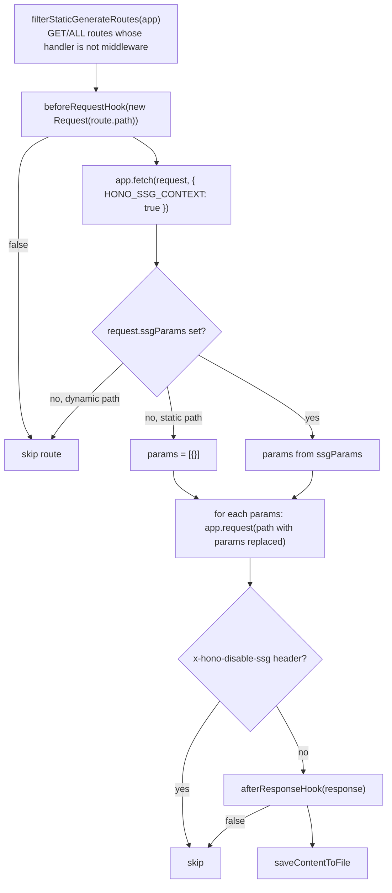

## Overview

`toSSG` (`hono/ssg`) renders a Hono app to files. It walks the app's registered `GET` routes, requests each one through the app itself, and writes every successful response to an output directory with an extension chosen from its `Content-Type`. Because pages are produced by the same handlers that serve them at run time, a site can be developed as a normal app and exported as static files. The helper is file-system agnostic: it writes through a `FileSystemModule`, and `hono/bun` and `hono/deno` export a `toSSG` already bound to their runtime's file API.

Sources: [src/helper/ssg/ssg.ts:368-470](repo://src/helper/ssg/ssg.ts#L368-L470), [src/adapter/bun/ssg.ts:1-27](repo://src/adapter/bun/ssg.ts#L1-L27)

```ts
import fs from 'node:fs/promises'
import { toSSG, ssgParams } from 'hono/ssg'

app.get('/', (c) => c.html('<h1>Home</h1>'))
app.get(
  '/posts/:id',
  ssgParams(async () => (await listPosts()).map((p) => ({ id: p.id }))),
  (c) => c.html(`<h1>Post ${c.req.param('id')}</h1>`)
)

const result = await toSSG(app, fs, { dir: './dist' })
```

Sources: [src/helper/ssg/ssg.ts:368-372](repo://src/helper/ssg/ssg.ts#L368-L372), [src/helper/ssg/middleware.ts:43-49](repo://src/helper/ssg/middleware.ts#L43-L49)

## Generation flow

### Pipeline



Sources: [src/helper/ssg/ssg.ts:205-302](repo://src/helper/ssg/ssg.ts#L205-L302)

### Route discovery

`filterStaticGenerateRoutes` reads `app.routes` and keeps routes registered for `GET` or `ALL` whose real handler (after `findTargetHandler` unwraps sub-app wrappers) takes fewer than two parameters, the same heuristic `isMiddleware` uses ([[Request Dispatch and Middleware Composition]]). A handler written as `(c, next) => ...` is therefore treated as middleware and not generated.

Sources: [src/helper/ssg/utils.ts:61-71](repo://src/helper/ssg/utils.ts#L61-L71)

### Parameters for dynamic routes

The first request for each route uses the route pattern itself as the URL, such as `http://localhost/posts/:id`, with `env` marked as an SSG context. `ssgParams(params)` placed on that route sees a dynamic path, stores the parameter list (an array, or the result of a function of `c`) on the raw request, and returns `c.notFound()` so the real handler does not run during the probe. `toSSG` then reads `ssgParams` back from the request object. A dynamic route without `ssgParams` is skipped; a static one is generated once.

Sources: [src/helper/ssg/middleware.ts:5-49](repo://src/helper/ssg/middleware.ts#L5-L49), [src/helper/ssg/ssg.ts:225-251](repo://src/helper/ssg/ssg.ts#L225-L251), [src/helper/ssg/utils.ts:73-75](repo://src/helper/ssg/utils.ts#L73-L75)

Each parameter set is substituted into the path with the RPC client's `replaceUrlParam` and requested with `app.request`, again with the SSG context in `env` ([[Hono App and Route Registration]]).

Sources: [src/helper/ssg/ssg.ts:258-289](repo://src/helper/ssg/ssg.ts#L258-L289)

### Concurrency

All app calls go through a pool from `src/utils/concurrent.ts` limited to `concurrency` (default 2). `fetchRoutesContent` is a generator of promises that themselves resolve to generators, so discovery of one route and rendering of another overlap without unbounded parallelism.

Sources: [src/helper/ssg/ssg.ts:17-17](repo://src/helper/ssg/ssg.ts#L17-L17), [src/helper/ssg/ssg.ts:205-224](repo://src/helper/ssg/ssg.ts#L205-L224)

## Controlling what is generated

| Helper | Use |
| --- | --- |
| `ssgParams(listOrFn)` | Supplies parameter sets for a dynamic route |
| `isSSGContext(c)` | `true` while `toSSG` is rendering, read from `c.env` |
| `disableSSG()` | Middleware that answers SSG requests with a 404 marked by `x-hono-disable-ssg`, so the route is skipped |
| `onlySSG()` | Middleware that answers non-SSG requests with a 404, for pages that exist only in the export |

Sources: [src/helper/ssg/middleware.ts:43-83](repo://src/helper/ssg/middleware.ts#L43-L83)

## Hooks and plugins

`toSSG` options accept `beforeRequestHook`, `afterResponseHook` and `afterGenerateHook` (each a function or an array), and `plugins`, objects carrying the same three hooks. Hooks from options run first, then plugin hooks in order. Request and response hooks are chained: returning `false` skips the route, and returning a new `Request` or `Response` replaces it for the next hook.

Sources: [src/helper/ssg/ssg.ts:110-198](repo://src/helper/ssg/ssg.ts#L110-L198), [src/helper/ssg/ssg.ts:368-419](repo://src/helper/ssg/ssg.ts#L368-L419)

`plugins` defaults to `[defaultPlugin()]`, whose `afterResponseHook` drops every response that is not `200`. Passing a custom `plugins` list replaces it, so it must be included again to keep error pages out of the output. `redirectPlugin()` turns 301, 302, 303, 307 and 308 responses into a small HTML page with a meta refresh and a canonical link, built with the `html` helper so the location is escaped ([[JSX Server Rendering]]).

Sources: [src/helper/ssg/plugins.ts:11-72](repo://src/helper/ssg/plugins.ts#L11-L72)

`afterGenerateHook(result, fs, options)` runs once at the end with the result, even when generation failed, which makes it the place to write a sitemap or report errors.

Sources: [src/helper/ssg/ssg.ts:465-469](repo://src/helper/ssg/ssg.ts#L465-L469)

## Writing files

`saveContentToFile` reads text and JSON responses as strings and everything else as bytes, then picks the file path.

Sources: [src/helper/ssg/ssg.ts:74-88](repo://src/helper/ssg/ssg.ts#L74-L88)

| Route path | MIME type | File |
| --- | --- | --- |
| `/` | `text/html` | `<dir>/index.html` |
| `/about` | `text/html` | `<dir>/about.html` |
| `/docs/` | `text/html` | `<dir>/docs/index.html` |
| `/feed.xml` | `application/rss+xml` | `<dir>/feed.xml` |
| `/data` | `application/json` | `<dir>/data.json` |

Sources: [src/helper/ssg/ssg.ts:50-108](repo://src/helper/ssg/ssg.ts#L50-L108), [src/helper/ssg/ssg.ts:310-334](repo://src/helper/ssg/ssg.ts#L310-L334)

The extension comes from `extensionMap` (default: HTML, XML variants and YAML) or else from the MIME table, falling back to `html`. Every path is checked by `ensureWithinOutDir`, which throws `Path traversal detected` if a parameter such as `../../etc` would place a file outside the output directory. Directories are created once each with `mkdir({ recursive: true })`.

Sources: [src/helper/ssg/ssg.ts:90-108](repo://src/helper/ssg/ssg.ts#L90-L108), [src/helper/ssg/utils.ts:77-87](repo://src/helper/ssg/utils.ts#L77-L87), [src/helper/ssg/ssg.ts:309-327](repo://src/helper/ssg/ssg.ts#L309-L327)

## Result and runtime adapters

`toSSG` resolves to `{ success, files, error? }` and never rejects: any error from fetching or writing produces `success: false` with that error. The default output directory is `./static`.

Sources: [src/helper/ssg/ssg.ts:27-48](repo://src/helper/ssg/ssg.ts#L27-L48), [src/helper/ssg/ssg.ts:420-464](repo://src/helper/ssg/ssg.ts#L420-L464)

`hono/bun` exports `toSSG(app, options)` using `Bun.write`, which creates directories itself, and `hono/deno` does the same with Deno's file API. On Node.js, `node:fs/promises` already matches `FileSystemModule` and is passed directly.

Sources: [src/adapter/bun/ssg.ts:13-27](repo://src/adapter/bun/ssg.ts#L13-L27), [src/adapter/deno/ssg.ts:1-27](repo://src/adapter/deno/ssg.ts#L1-L27)
