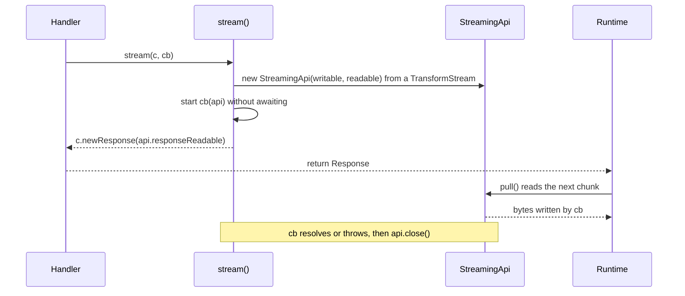

## Overview

The streaming helper (`hono/streaming`) returns a response whose body is written over time instead of all at once: `stream` for arbitrary bytes, `streamText` for plain text, and `streamSSE` for Server-Sent Events. Each returns a `Response` immediately and runs a callback in the background that writes to the body through a `StreamingApi` object. Because the response is built from a Web Standard `ReadableStream`, the same code streams on every runtime.

Sources: [src/helper/streaming/index.ts:6-9](repo://src/helper/streaming/index.ts#L6-L9), [src/helper/streaming/stream.ts:7-45](repo://src/helper/streaming/stream.ts#L7-L45)

```ts
import { streamSSE, streamText } from 'hono/streaming'

app.get('/text', (c) =>
  streamText(c, async (stream) => {
    await stream.writeln('Hello')
    await stream.sleep(1000)
    await stream.write('World')
  })
)

app.get('/events', (c) =>
  streamSSE(c, async (stream) => {
    let id = 0
    while (!stream.aborted) {
      await stream.writeSSE({ event: 'tick', data: new Date().toISOString(), id: String(id++) })
      await stream.sleep(1000)
    }
  })
)
```

Sources: [src/helper/streaming/text.ts:6-15](repo://src/helper/streaming/text.ts#L6-L15), [src/helper/streaming/sse.ts:72-100](repo://src/helper/streaming/sse.ts#L72-L100)

## How a stream is wired



Sources: [src/helper/streaming/stream.ts:7-45](repo://src/helper/streaming/stream.ts#L7-L45), [src/utils/stream.ts:21-46](repo://src/utils/stream.ts#L21-L46)

`stream` creates a `TransformStream`, hands its writable side to a `StreamingApi`, starts the callback in an async function it does not await, and returns `c.newResponse(stream.responseReadable)`, so headers set earlier with `c.header` are kept. When the callback finishes, successfully or not, the stream is closed.

Sources: [src/helper/streaming/stream.ts:12-44](repo://src/helper/streaming/stream.ts#L12-L44)

`responseReadable` is not the transform's readable side directly but a `ReadableStream` that pulls from it. Its `cancel` callback, which the runtime calls when the client disconnects, triggers `abort()`. That indirection is how a disconnect reaches the writer.

Sources: [src/utils/stream.ts:26-45](repo://src/utils/stream.ts#L26-L45)

The `Context` is kept in a `WeakMap` keyed by the readable stream for the stream's lifetime, because Bun releases the context once the handler returns.

Sources: [src/helper/streaming/stream.ts:5-5](repo://src/helper/streaming/stream.ts#L5-L5), [src/helper/streaming/stream.ts:24-25](repo://src/helper/streaming/stream.ts#L24-L25)

## The StreamingApi

| Member | Behaviour |
| --- | --- |
| `write(data)` | Encodes strings as UTF-8 and writes; write errors (a closed stream) are swallowed |
| `writeln(text)` | `write(text + '\n')` |
| `sleep(ms)` | A `setTimeout` promise |
| `pipe(readable)` | Pipes another stream into the body without closing it, then resumes writing |
| `onAbort(fn)` | Registers a listener for client disconnects |
| `abort()` | Marks the stream `aborted` and calls the listeners once |
| `close()` | Marks it `closed` and closes the writer |
| `aborted`, `closed` | Flags a loop can check |

Sources: [src/utils/stream.ts:6-98](repo://src/utils/stream.ts#L6-L98)

Write errors are ignored on purpose: once the client has gone, every later write would throw, and a streaming loop is expected to stop by checking `aborted` or an `onAbort` listener. The first abort subscriber, installed in the constructor, cancels the internal reader so a pending write does not block forever.

Sources: [src/utils/stream.ts:28-33](repo://src/utils/stream.ts#L28-L33), [src/utils/stream.ts:48-58](repo://src/utils/stream.ts#L48-L58)

## Errors

The optional third argument `onError(err, stream)` receives any `Error` the callback throws; without it the error is logged. A rejection with `undefined`, which happens when `pipe` is cancelled, is ignored because the stream is already closed. Since the response has already been returned, errors cannot change the status; they can only write a final message and close.

Sources: [src/helper/streaming/stream.ts:26-42](repo://src/helper/streaming/stream.ts#L26-L42)

For `streamSSE`, after `onError` runs the helper also sends an `event: error` message whose data is the error message, so the browser's `EventSource` sees the failure.

Sources: [src/helper/streaming/sse.ts:47-68](repo://src/helper/streaming/sse.ts#L47-L68)

## Text and SSE variants

`streamText` sets `Content-Type: text/plain; charset=UTF-8`, `X-Content-Type-Options: nosniff` and `Transfer-Encoding: chunked`, then calls `stream`. The `nosniff` header stops browsers from buffering the start of the body to guess its type, which would delay the first chunks.

Sources: [src/helper/streaming/text.ts:6-15](repo://src/helper/streaming/text.ts#L6-L15)

`streamSSE` sets `Content-Type: text/event-stream`, `Cache-Control: no-cache`, `Connection: keep-alive` and `Transfer-Encoding: chunked`, and passes an `SSEStreamingApi`, which adds `writeSSE(message)`.

Sources: [src/helper/streaming/sse.ts:13-18](repo://src/helper/streaming/sse.ts#L13-L18)

1. `data` may be a string or a promise (including JSX output); it is resolved through the HTML escaping callbacks, then split on any line ending, and each line becomes a `data:` line.
2. `event`, `id` and `retry` are checked for CR and LF, so a value cannot inject extra fields, and an error is thrown if they contain one.
3. The fields are written in the order `event`, `data`, `id`, `retry`, followed by a blank line.

Sources: [src/helper/streaming/sse.ts:6-45](repo://src/helper/streaming/sse.ts#L6-L45), [src/helper/streaming/sse.ts:92-95](repo://src/helper/streaming/sse.ts#L92-L95)

The default compression filter excludes `text/event-stream`, so SSE responses are not buffered by the compress middleware ([[Cache, ETag, Compression and Pretty JSON]]).

Sources: [src/utils/compress.ts:9-10](repo://src/utils/compress.ts#L9-L10)

## Runtime notes

Bun before 1.1.27 did not cancel a response's stream when the client disconnected. `isOldBunVersion` detects Bun 0.x, 1.0 and 1.1 once and caches the answer; on those versions the helpers also listen to `c.req.raw.signal` and call `abort()` when it fires.

Sources: [src/helper/streaming/utils.ts:1-11](repo://src/helper/streaming/utils.ts#L1-L11), [src/helper/streaming/stream.ts:15-22](repo://src/helper/streaming/stream.ts#L15-L22)

On Cloudflare Workers and similar platforms the stream keeps running only while the client is connected; work that must finish regardless belongs in `c.executionCtx.waitUntil` ([[Context and Responses]]). Streaming JSX with `Suspense` uses its own renderer, described in [[JSX Server Rendering]].

Sources: [src/context.ts:31-52](repo://src/context.ts#L31-L52)
