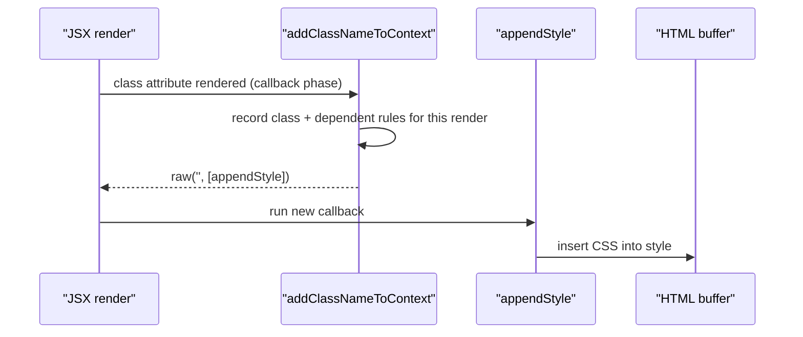

## Overview

`hono/css` writes CSS next to JSX components. A `css` tagged template turns a block of declarations into a hashed class name; the stylesheet itself is assembled while the page renders and lands in a `<style>` element emitted by the `Style` component. Only the classes a page actually uses are sent. The same API exists in the browser runtime, where rules are inserted into the live stylesheet instead. It builds on the escaped-string callbacks described in [[JSX Server Rendering]] and works with the renderer in [[JSX DOM Runtime and Hooks]].

Sources: [src/helper/css/index.ts:72-104](repo://src/helper/css/index.ts#L72-L104), [src/helper/css/index.ts:192-215](repo://src/helper/css/index.ts#L192-L215), [src/jsx/dom/css.ts:77-143](repo://src/jsx/dom/css.ts#L77-L143)

```tsx
import { css, cx, keyframes, Style } from 'hono/css'

const fadeIn = keyframes`from { opacity: 0 } to { opacity: 1 }`
const title = css`
  /* page-title */
  font-size: 2rem;
  animation: ${fadeIn} 1s;
  &:hover { color: red; }
`

app.get('/', (c) =>
  c.html(
    <html>
      <head><Style /></head>
      <body><h1 class={title}>Hello</h1></body>
    </html>
  )
)
```

Sources: [src/helper/css/index.ts:169-215](repo://src/helper/css/index.ts#L169-L215)

## Building a class

### From template to style string

`buildStyleString(strings, values)` concatenates the template and its values. A leading `/* comment */` becomes the class label. Values are handled by type:

Sources: [src/helper/css/common.ts:139-199](repo://src/helper/css/common.ts#L139-L199)

| Value | Inserted as |
| --- | --- |
| `null`, `undefined`, boolean | Nothing (allows `${cond && css...}`) |
| string | Text, with quotes and backslashes escaped and `</` broken so it cannot close the `<style>` element |
| number | Text |
| `rawCssString(s)` | `s` unescaped |
| a `keyframes` object | Its animation name, and the keyframes join the class's dependent rules |
| a `css` class followed by `{` | `.className` as a selector, and that class joins the dependent rules |
| a `css` class elsewhere | Its declarations inlined, so classes compose |

Sources: [src/helper/css/common.ts:148-196](repo://src/helper/css/common.ts#L148-L196), [src/helper/css/common.ts:32-36](repo://src/helper/css/common.ts#L32-L36)

The result is minified with one regular expression that keeps quoted strings, drops comments and edge whitespace, removes the last semicolon before `}`, and collapses whitespace around punctuation.

Sources: [src/helper/css/common.ts:79-106](repo://src/helper/css/common.ts#L79-L106)

### Class names

`cssCommon` hashes the label plus the minified style with a small multiplicative hash and names the class `css-<number>`, so identical styles always produce the same class and can be cached or shared across requests. An optional `classNameSlug(hash, label, style)` can choose a readable name; a slug that is not a valid class name is rejected with a warning (or `onInvalidSlug`) and the hash is used. A style written as `:-hono-global { ... }` is not scoped to a class and is emitted as global CSS.

Sources: [src/helper/css/common.ts:43-56](repo://src/helper/css/common.ts#L43-L56), [src/helper/css/common.ts:201-238](repo://src/helper/css/common.ts#L201-L238)

The returned object carries, under symbol keys, the selector, the class attribute value, the style string, the dependent rules (`SELECTORS`) and plain class names merged in through `cx`.

Sources: [src/helper/css/common.ts:6-19](repo://src/helper/css/common.ts#L6-L19)

## The API

| Function | Returns | Purpose |
| --- | --- | --- |
| `css` | A promise-like class name | Scoped class from declarations, nesting with `&` allowed |
| `cx(...classes)` | A class name | Combines `css` classes and plain strings, skipping falsy values |
| `keyframes` | A keyframes object | `@keyframes css-<hash>` rule used inside `css` |
| `viewTransition` | A class name | Sets a unique `view-transition-name` and fills `::view-transition-*()` selectors with it |
| `Style` | An element | The `<style>` element that receives the rules; accepts a CSP `nonce` |
| `createCssContext({ id, classNameSlug })` | All of the above | An independent set with its own `<style id>` |

Sources: [src/helper/css/index.ts:169-262](repo://src/helper/css/index.ts#L169-L262), [src/helper/css/common.ts:240-333](repo://src/helper/css/common.ts#L240-L333)

`cx` turns each plain string into an object holding only an external class name, then calls `css` with empty template parts, so the combined class is the hash of the merged styles plus the external names. A string containing `<`, `{` or `}` is dropped, because external names can end up in a selector.

Sources: [src/helper/css/index.ts:173-178](repo://src/helper/css/index.ts#L173-L178), [src/helper/css/common.ts:56-60](repo://src/helper/css/common.ts#L56-L60), [src/helper/css/common.ts:240-258](repo://src/helper/css/common.ts#L240-L258)

## Collecting styles on the server

On the server `css` returns a resolved promise whose value is an escaped `String` holding the class attribute (HTML-escaped if a `cx` name needs it) with one callback, `addClassNameToContext`. Rendering a `class={title}` attribute therefore registers the class with the current render: the callback records the class and its dependent rules in a `WeakMap` keyed by the render's context object, skipping those already emitted, and adds a second callback, `appendStyle`.

Sources: [src/helper/css/index.ts:88-167](repo://src/helper/css/index.ts#L88-L167)

`appendStyle` turns the pending rules into CSS text and places it according to the rendering mode:

Sources: [src/helper/css/index.ts:89-122](repo://src/helper/css/index.ts#L89-L122)

1. When the whole page is in one buffer (`c.html`, the `Stringify` phase), it inserts the CSS into the existing `<style id="hono-css">` element with a regular expression.
2. When the `<style>` element is not in the buffer, it prepends a script that appends the CSS to the element's `textContent`.
3. When there is no buffer (content streamed after `Suspense`), it returns that script as the next chunk, with the nonce `Style` stored for the render.

Sources: [src/helper/css/index.ts:106-121](repo://src/helper/css/index.ts#L106-L121), [src/helper/css/index.ts:192-203](repo://src/helper/css/index.ts#L192-L203)



Sources: [src/helper/css/index.ts:88-147](repo://src/helper/css/index.ts#L88-L147)

Because the bookkeeping is per render context, each response contains exactly the rules its own markup uses, and a class used many times is emitted once. `Style` must be rendered somewhere in the page for the first path to apply; with a `children` class it also includes that class's declarations directly.

Sources: [src/helper/css/index.ts:83-104](repo://src/helper/css/index.ts#L83-L104), [src/helper/css/index.ts:192-203](repo://src/helper/css/index.ts#L192-L203)

## In the browser

`src/jsx/dom/css.ts` exports the same functions for `hono/jsx/dom`. There a class name object's `toString()` inserts its rule and its dependent rules into the `CSSStyleSheet` of `style#hono-css` with `insertRule`, remembering inserted classes in a set on the sheet so each is added once, and returns the class name. Global styles are split into separate rules first. If the sheet does not exist yet, the insertion is retried after a microtask and throws `style sheet not found` if it is still missing. `Style` renders a plain `<style>` element with that id.

Sources: [src/jsx/dom/css.ts:27-143](repo://src/jsx/dom/css.ts#L27-L143)

On the server, `Style` carries a `DOM_RENDERER` pointing to the browser version and the class-name promise's `toString` is the browser `toString`, so a component that uses `css` renders correctly in either runtime without changes.

Sources: [src/helper/css/index.ts:81-81](repo://src/helper/css/index.ts#L81-L81), [src/helper/css/index.ts:162-166](repo://src/helper/css/index.ts#L162-L166), [src/helper/css/index.ts:204-206](repo://src/helper/css/index.ts#L204-L206)
