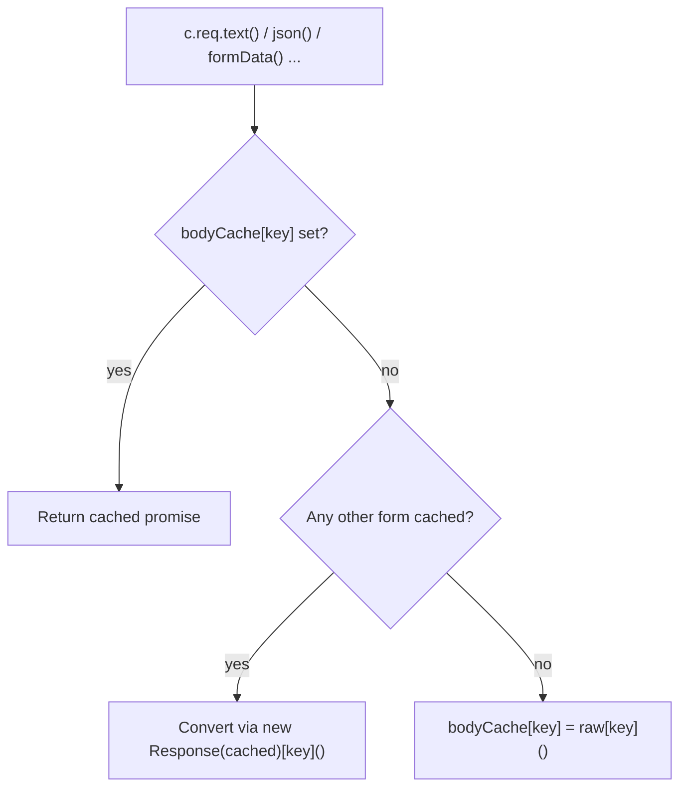

## Overview

`HonoRequest` is the object behind `c.req`. It wraps the standard `Request` (kept as `c.req.raw`) and adds what the standard type lacks: route parameters from the router's match result, fast query-string parsing, a body cache so the body can be read more than once, and storage for data that the [[Validator]] has checked. The [[Context]] creates it lazily the first time a handler reads `c.req`.

Sources: [src/request.ts:36-80](repo://src/request.ts#L36-L80), [src/context.ts:363-369](repo://src/context.ts#L363-L369)

The constructor takes the raw request, the routed path and the router's `Result`. Two fields are public and mutable: `routeIndex`, which `compose` updates before each handler runs, and `bodyCache`, which body readers and validators share.

Sources: [src/request.ts:51-80](repo://src/request.ts#L51-L80), [src/compose.ts:42-45](repo://src/compose.ts#L42-L45)

## Request metadata

| Member | Returns |
| --- | --- |
| `raw` | The original `Request` |
| `url` | `raw.url` |
| `method` | `raw.method` |
| `path` | The path the app routed on (the output of `getPath`, not re-derived from `url`) |
| `header(name)` | `raw.headers.get(name)`, or `undefined` when absent |
| `header()` | Every header as a plain object with lower-case keys |

Sources: [src/request.ts:185-198](repo://src/request.ts#L185-L198), [src/request.ts:369-387](repo://src/request.ts#L369-L387)

## Route parameters

`param(key)` reads one parameter and `param()` returns all of them as an object. Both read the parameter map of the entry at `routeIndex` in the match result, so a middleware registered on `/users/*` and a handler on `/users/:id` each see their own parameters even though they run for the same request.

Sources: [src/request.ts:94-128](repo://src/request.ts#L94-L128)

The router returns one of two shapes (see [[Routers]]). With a parameter stash, as `RegExpRouter` produces, the map holds indexes into one shared array of captured values; without it, as `TrieRouter` produces, the map holds the values directly. `#getParamValue` hides the difference. A value is decoded with `decodeURIComponent` only when it contains `%`, and a malformed escape is left as is by `tryDecode` rather than throwing.

Sources: [src/request.ts:106-128](repo://src/request.ts#L106-L128), [src/router.ts:58-98](repo://src/router.ts#L58-L98)

The type parameter `P` is the route's path string, so `c.req.param('id')` is checked against the `:id` names in the path, and an optional `:id?` parameter is typed `string | undefined`. How those names are extracted is described in [[Typed Routes and Schemas]].

Sources: [src/request.ts:94-101](repo://src/request.ts#L94-L101)

## Query strings

`query(key)` returns the first value of a key, `query()` an object of first values, `queries(key)` every value of a key as an array and `queries()` an object of arrays. They parse `c.req.url` directly with `getQueryParam` and `getQueryParams` instead of building a `URL` and `URLSearchParams`.

Sources: [src/request.ts:148-171](repo://src/request.ts#L148-L171), [src/utils/url.ts:302-315](repo://src/utils/url.ts#L302-L315)

For a single key without `%` or `+`, `_getQueryParam` searches for `?key` or `&key` with `indexOf` and slices out the value, decoding it only if needed; a key present without `=` yields an empty string. Only when that fails and the URL holds encoded characters does it fall back to the general loop, which walks every `&`-separated pair, decodes `+` as a space and percent escapes, skips empty names and keeps the first value per key unless all values were requested.

Sources: [src/utils/url.ts:208-300](repo://src/utils/url.ts#L208-L300)

## Reading the body

### Body methods and the cache

`json()`, `text()`, `arrayBuffer()`, `bytes()`, `blob()` and `formData()` mirror the methods of `Request`, but all go through `#cachedBody`, so the body can be read any number of times and in different forms. `json()` reads the cached text and calls `JSON.parse`, and `bytes()` wraps the cached `ArrayBuffer`.

Sources: [src/request.ts:253-331](repo://src/request.ts#L253-L331)

`#cachedBody(key)` returns the cached promise for that form if there is one. If the body was cached in another form, it takes that first cached value and converts it by passing it through `new Response(body)[key]()` (stringifying a cached `json` value first). Only when nothing is cached does it call `raw[key]()` and store the promise. Because promises are cached, two concurrent reads share one underlying read.

Sources: [src/request.ts:220-239](repo://src/request.ts#L220-L239)

Sources: [src/request.ts:220-239](repo://src/request.ts#L220-L239)

> [!WARNING]
> Reading `c.req.raw` directly (for example `c.req.raw.json()`) consumes the stream without filling the cache, and later `c.req` reads will fail on a used body.

Sources: [src/request.ts:476-487](repo://src/request.ts#L476-L487)

### `parseBody`

`parseBody(options)` returns form fields as an object. It looks only at the media type: for `multipart/form-data` and `application/x-www-form-urlencoded` it reads the body as an `ArrayBuffer` (through the cache), turns it into `FormData` with `bufferToFormData`, and stores that promise in `bodyCache.formData` so a later `c.req.formData()` reuses it. Any other content type, JSON included, yields `{}`.

Sources: [src/utils/body.ts:97-141](repo://src/utils/body.ts#L97-L141)

| Option | Default | Effect |
| --- | --- | --- |
| `all` | `false` | Keep every value of a repeated field as an array; without it only the last value is kept. Keys ending in `[]` always become arrays |
| `dot` | `false` | Turn `a.b.c` keys into nested objects; keys containing `__proto__.` are dropped |

Sources: [src/utils/body.ts:151-242](repo://src/utils/body.ts#L151-L242)

The return type follows the options: with `all: true` a value may be `(string | File)[]`, and with `dot: true` it may be a nested object.

Sources: [src/utils/body.ts:23-41](repo://src/utils/body.ts#L23-L41)

### Cloning after the body was read

`cloneRawRequest(c.req)`, exported from `hono/request`, builds a fresh `Request` for forwarding. If the raw body is unused it simply clones it; otherwise it rebuilds the request from the first cached body form and the raw request's properties. If the body was consumed without being cached, it throws an `HTTPException` 500 explaining that `c.req` methods should be used instead of `c.req.raw`.

Sources: [src/request.ts:476-505](repo://src/request.ts#L476-L505)

## Validated data

`addValidatedData(target, data)` stores the output of a validator under its target (`json`, `form`, `query`, `param`, `header` or `cookie`), and `valid(target)` returns it. The return type of `valid` comes from the `I` type parameter, the route's input type, so after `validator('json', ...)` the handler's `c.req.valid('json')` has the validator's output type. [[Validator]] traces how the middleware fills it.

Sources: [src/request.ts:339-354](repo://src/request.ts#L339-L354)

## Matched routes

`matchedRoutes` lists the `RouterRoute` record of every handler matched for the request, and `routePath` the path pattern of the one running now, read at `routeIndex`. Both getters are deprecated in favour of the `matchedRoutes` and `routePath` functions in `hono/route`, which read the same match result through the `GET_MATCH_RESULT` symbol getter; see [[Helper Catalogue]].

Sources: [src/request.ts:389-442](repo://src/request.ts#L389-L442), [src/request/constants.ts:1-1](repo://src/request/constants.ts#L1-L1), [src/helper/route/index.ts:30-35](repo://src/helper/route/index.ts#L30-L35)
