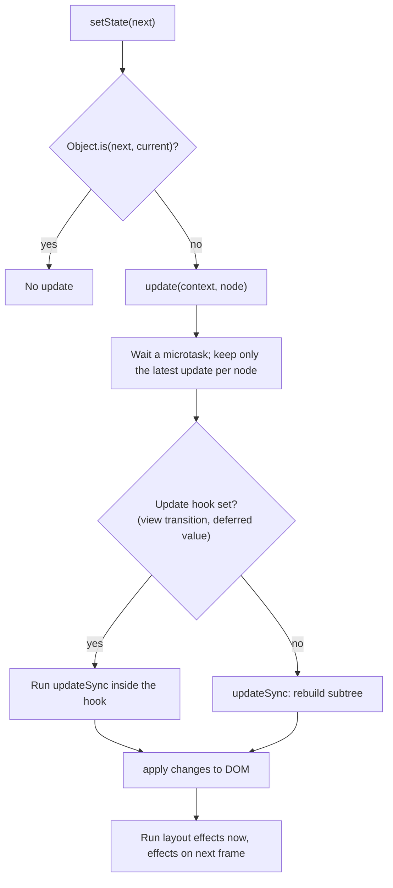

## Overview

`hono/jsx/dom` is a small client-side renderer for the same JSX components that render on the server. It keeps a virtual tree of nodes, re-runs components when their state changes, diffs the new children against the old ones and applies the changes to the DOM. The hooks (`useState`, `useEffect`, `useMemo`, `use`, `useTransition` and the rest) live in `src/jsx/hooks` and are shared with server rendering, where most of them return their initial value. Its exports mirror React's names so code and libraries written for React can run with `hono/jsx/dom` as the JSX import source. Server rendering itself is covered in [[JSX Server Rendering]].

Sources: [src/jsx/dom/index.ts:6-125](repo://src/jsx/dom/index.ts#L6-L125), [src/jsx/hooks/index.ts:182-243](repo://src/jsx/hooks/index.ts#L182-L243)

## Mounting

`render(jsx, container)` wraps the JSX in a root fragment node and calls `renderNode`, which builds the whole tree, applies it into a detached `DocumentFragment`, and then swaps the fragment in with `container.replaceChildren`. The page sees a single DOM change for the first render.

Sources: [src/jsx/dom/render.ts:783-799](repo://src/jsx/dom/render.ts#L783-L799)

`createRoot(element)` from `hono/jsx/dom/client` gives the React 18 style API. Its first `render` mounts an internal component that holds the JSX in `useState`; later `render` calls just set that state, so they go through the normal update path. `unmount` renders `null` and makes further `render` calls throw. `hydrateRoot` is `createRoot` followed by `render`: it re-renders the server HTML rather than attaching to it.

Sources: [src/jsx/dom/client.ts:23-84](repo://src/jsx/dom/client.ts#L23-L84)

```tsx
import { createRoot } from 'hono/jsx/dom/client'
import { useState } from 'hono/jsx'

const Counter = () => {
  const [count, setCount] = useState(0)
  return <button onClick={() => setCount(count + 1)}>{count}</button>
}

createRoot(document.getElementById('root')!).render(<Counter />)
```

Sources: [src/jsx/dom/client.ts:23-66](repo://src/jsx/dom/client.ts#L23-L66)

## The node tree

A rendered element is a `NodeObject`: the JSX node plus the fields the renderer needs, kept short to save bytes. `vC` holds the virtual children, `vR` the children to remove, `pP` the previous props, `e` the DOM element, `c` the container, `nN` the next sibling node (used to find the insertion point), and flags such as `s` (skip, unchanged) and `f` (force rebuild). Text is a `NodeString` with `t` (text) and `d` (dirty). Each component node also carries a `DOM_STASH`: the current hook index, the hook state arrays, the context values it was built with, and the nearest error boundary.

Sources: [src/jsx/dom/render.ts:37-80](repo://src/jsx/dom/render.ts#L37-L80)

## Build and apply

### Build

`build(context, node)` computes a node's new children. For a component it calls `invokeTag`, which resets the hook index, pushes `[context, node]` on `buildDataStack` (the stack every hook reads to find its component) and calls the component (or its `DOM_RENDERER` variant). For an element it takes `props.children`.

Sources: [src/jsx/dom/render.ts:274-291](repo://src/jsx/dom/render.ts#L274-L291), [src/jsx/dom/render.ts:497-506](repo://src/jsx/dom/render.ts#L497-L506)

Each new child is matched against the old children: by `key` and tag when it has a key, otherwise by tag alone, and text with text. A matched child keeps its old node, DOM element and hook state, receives the new props, and is marked to skip rebuilding when it was memoized with `memo` (its `DOM_MEMO` comparison says the props are equal) and its context values did not change. Unmatched old children are queued in `vR` for removal. The builder then recurses into each child that is not skipped.

Sources: [src/jsx/dom/render.ts:518-606](repo://src/jsx/dom/render.ts#L518-L606)

### Apply

`applyNodeObject` walks the new children, removes the nodes in `vR`, creates elements (with `createElementNS` inside SVG or MathML), updates attributes with `applyProps`, updates dirty text, and moves or inserts elements only where the position changed; a swap is handled by moving the displaced element to the end. Effects collected during the walk run afterwards: `useInsertionEffect` and `useLayoutEffect` callbacks synchronously, `useEffect` callbacks in the next animation frame.

Sources: [src/jsx/dom/render.ts:387-481](repo://src/jsx/dom/render.ts#L387-L481)

### Updates

A state setter calls `update(context, node)` for its component. `update` records the latest request per node in a `WeakMap` and waits one microtask, so several `setState` calls in one event produce one rebuild, and a newer update cancels an older one. `updateSync` then re-pushes the node's saved context values, rebuilds only that subtree and applies it in place. Inside `flushSync(callback)` the updates queued by the callback run synchronously instead.

Sources: [src/jsx/dom/render.ts:713-813](repo://src/jsx/dom/render.ts#L713-L813)



Sources: [src/jsx/hooks/index.ts:199-241](repo://src/jsx/hooks/index.ts#L199-L241), [src/jsx/dom/render.ts:740-781](repo://src/jsx/dom/render.ts#L740-L781)

## Hooks

### How hook state is stored

Every hook reads `buildDataStack.at(-1)` to find the component being built, takes the next hook index from its stash, and keeps its data in the stash array for its kind (state, effect, callback, memo, ref). That is why hooks must be called in the same order on every render. When no component is being built, as during server rendering, the stack is empty and the hooks fall back: `useState` returns the initial value and a no-op setter, `useMemo` calls the factory, `useEffect` does nothing.

Sources: [src/jsx/hooks/index.ts:8-12](repo://src/jsx/hooks/index.ts#L8-L12), [src/jsx/hooks/index.ts:182-197](repo://src/jsx/hooks/index.ts#L182-L197), [src/jsx/hooks/index.ts:348-362](repo://src/jsx/hooks/index.ts#L348-L362)

| Hook | Behaviour |
| --- | --- |
| `useState`, `useReducer` | State per hook index; the setter skips the update when `Object.is` finds no change |
| `useEffect`, `useLayoutEffect`, `useInsertionEffect` | Store a runner when the deps changed, after calling the previous cleanup; run at apply time |
| `useMemo`, `useCallback`, `useRef`, `useId` | Memoized values per hook index |
| `use(promise)` | Returns a settled value from a cache, or throws the promise so `Suspense` can wait |
| `useTransition`, `startTransition` | Run updates at lower priority and report `isPending` |
| `useDeferredValue` | Returns the previous value first and re-renders with the new one afterwards |
| `useViewTransition`, `startViewTransition` | Run the update inside `document.startViewTransition` when the browser supports it |
| `useSyncExternalStore`, `useImperativeHandle`, `forwardRef`, `createRef` | React-compatible helpers |

Sources: [src/jsx/hooks/index.ts:79-176](repo://src/jsx/hooks/index.ts#L79-L176), [src/jsx/hooks/index.ts:245-346](repo://src/jsx/hooks/index.ts#L245-L346), [src/jsx/hooks/index.ts:366-397](repo://src/jsx/hooks/index.ts#L366-L397)

### Transitions

`startTransition` and the setter from `useTransition` run their callback with an entry on a pending stack. A state change made while the stack is not empty is applied with the pending type of the transition, and for `useTransition` a follow-up update is scheduled after the callback's promise settles, in the next animation frame, so the pending flag can be shown first and cleared later. An error thrown by an async transition callback is stored and rethrown during the next render, reaching the nearest error boundary.

Sources: [src/jsx/hooks/index.ts:101-155](repo://src/jsx/hooks/index.ts#L101-L155), [src/jsx/hooks/index.ts:206-239](repo://src/jsx/hooks/index.ts#L206-L239)

## Errors and Suspense in the browser

When building a subtree throws, `build` looks up the error boundary saved in the node's stash and calls its handler with the error and a retry function. If the handler returns a fallback, the boundary node is rebuilt with it and applied at once; a thrown promise works the same way for `Suspense`, whose retry runs when the promise settles. Without a boundary the error propagates.

Sources: [src/jsx/dom/render.ts:610-665](repo://src/jsx/dom/render.ts#L610-L665)

## Document metadata and forms

The DOM versions of `title`, `meta`, `link`, `script` and `style` hoist themselves into `document.head` instead of rendering in place, de-duplicating by key attributes such as `href` and ordering stylesheets by `precedence`. A `title` inside SVG and elements that do not qualify (a plain `script`, a `link` without precedence) render normally.

Sources: [src/jsx/dom/intrinsic-element/components.ts:59-125](repo://src/jsx/dom/intrinsic-element/components.ts#L59-L125), [src/jsx/dom/intrinsic-element/components.ts:257-316](repo://src/jsx/dom/intrinsic-element/components.ts#L257-L316)

A `form` whose `action` is a function becomes a form action: on submit the default is prevented, the function receives the `FormData`, and the form's status is published through `FormContext` for `useFormStatus`. `useActionState` and `useOptimistic` build on the same mechanism. On the server, a function action is replaced by its permalink, or dropped.

Sources: [src/jsx/dom/intrinsic-element/components.ts:319-378](repo://src/jsx/dom/intrinsic-element/components.ts#L319-L378), [src/jsx/dom/hooks/index.ts:24-79](repo://src/jsx/dom/hooks/index.ts#L24-L79), [src/jsx/intrinsic-element/components.ts:182-210](repo://src/jsx/intrinsic-element/components.ts#L182-L210)

## Context and portals

`createContext` in the DOM runtime keeps a stack of values per context. Each component node records the context values that applied when it was built, and `updateSync` pushes them again before rebuilding the subtree, so an isolated update sees the same values as the original render. `createPortal(children, container)` renders children into another DOM element while keeping them in the virtual tree of their parent.

Sources: [src/jsx/dom/context.ts:7-52](repo://src/jsx/dom/context.ts#L7-L52), [src/jsx/dom/render.ts:713-732](repo://src/jsx/dom/render.ts#L713-L732), [src/jsx/dom/render.ts:815-825](repo://src/jsx/dom/render.ts#L815-L825)
