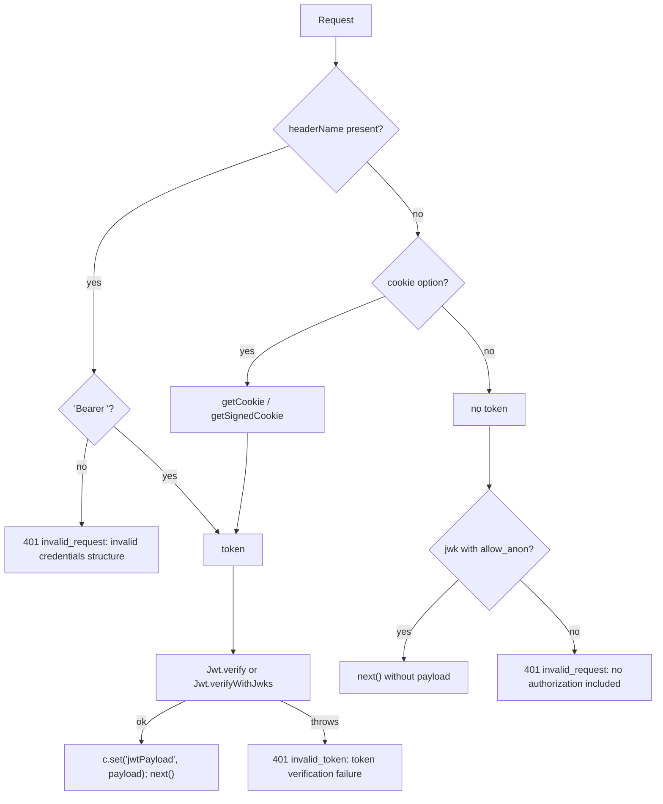

## Overview

Hono verifies JSON Web Tokens with its own small implementation on top of WebCrypto (`crypto.subtle`), so it works on every runtime without a dependency. Two middleware use it: `jwt` from `hono/jwt` checks tokens signed with a key the app knows, and `jwk` from `hono/jwk` checks tokens against a JSON Web Key Set, typically published by an identity provider. Both take the token from the `Authorization` header or a cookie, store the verified payload with `c.set('jwtPayload', payload)`, and refuse with a 401 `HTTPException`. Simpler credential checks are in [[Access Control Middleware]].

Sources: [src/middleware/jwt/jwt.ts:53-158](repo://src/middleware/jwt/jwt.ts#L53-L158), [src/middleware/jwk/jwk.ts:48-167](repo://src/middleware/jwk/jwk.ts#L48-L167), [src/utils/jwt/index.ts:1-7](repo://src/utils/jwt/index.ts#L1-L7)

```ts
import { jwt, sign } from 'hono/jwt'

app.use('/api/*', jwt({ secret: 'it-is-very-secret', alg: 'HS256' }))
app.get('/api/me', (c) => c.json(c.get('jwtPayload')))

const token = await sign({ sub: 'user1', exp: Math.floor(Date.now() / 1000) + 300 }, 'it-is-very-secret')
```

Sources: [src/middleware/jwt/jwt.ts:154-178](repo://src/middleware/jwt/jwt.ts#L154-L178), [src/utils/jwt/jwt.ts:56-76](repo://src/utils/jwt/jwt.ts#L56-L76)

## The middleware flow



Sources: [src/middleware/jwt/jwt.ts:76-157](repo://src/middleware/jwt/jwt.ts#L76-L157), [src/middleware/jwk/jwk.ts:75-167](repo://src/middleware/jwk/jwk.ts#L75-L167)

1. The header named by `headerName` (default `Authorization`) must be exactly two whitespace-separated parts with `bearer` (any case) first; anything else is refused at once rather than falling back to the cookie.
2. Without the header, `cookie` may name a cookie, or give `{ key, secret, prefixOptions }` to read a signed or `__Secure-`/`__Host-` prefixed cookie with the helpers in [[Cookies]].
3. Every refusal is a 401 whose `WWW-Authenticate` is `Bearer realm="<request URL>",error="...",error_description="..."`. The verification error is attached as the exception's `cause`, so an `onError` handler can log why a token failed.

Sources: [src/middleware/jwt/jwt.ts:77-130](repo://src/middleware/jwt/jwt.ts#L77-L130), [src/middleware/jwt/jwt.ts:141-173](repo://src/middleware/jwt/jwt.ts#L141-L173)

The payload type is declared through `JwtVariables<T>`, which an app adds to its `Variables` so `c.get('jwtPayload')` is typed (see [[Typed Routes and Schemas]]).

Sources: [src/middleware/jwt/jwt.ts:18-20](repo://src/middleware/jwt/jwt.ts#L18-L20)

## jwt options

| Option | Required | Meaning |
| --- | --- | --- |
| `secret` | yes | A string secret, a PEM key, a JWK object or a `CryptoKey` |
| `alg` | yes | The one algorithm accepted; the token header must match it |
| `cookie` | no | Cookie name, or `{ key, secret, prefixOptions }` |
| `headerName` | no | Header to read instead of `Authorization` |
| `verification` | no | Claim checks: `iss`, `aud`, and switches for `exp`, `nbf`, `iat` |

Sources: [src/middleware/jwt/jwt.ts:53-74](repo://src/middleware/jwt/jwt.ts#L53-L74)

Creating the middleware throws if `secret` or `alg` is missing, or if the runtime lacks `crypto.subtle.importKey`, so configuration errors surface at start-up. Requiring `alg` prevents algorithm confusion: a token cannot choose a weaker or different algorithm than the app expects.

Sources: [src/middleware/jwt/jwt.ts:62-74](repo://src/middleware/jwt/jwt.ts#L62-L74), [src/utils/jwt/jwt.ts:127-129](repo://src/utils/jwt/jwt.ts#L127-L129)

## Verifying a token

`Jwt.verify(token, key, { alg, ...verification })` performs the checks in this order, throwing a specific error class from `utils/jwt/types` at the first failure:

Sources: [src/utils/jwt/jwt.ts:96-188](repo://src/utils/jwt/jwt.ts#L96-L188), [src/utils/jwt/types.ts:6-110](repo://src/utils/jwt/types.ts#L6-L110)

| Check | Error |
| --- | --- |
| An algorithm was given | `JwtAlgorithmRequired` |
| Three dot-separated parts that decode as base64url JSON | `JwtTokenInvalid` |
| Header has a known `alg` and `typ` absent or `JWT` | `JwtHeaderInvalid` |
| Header `alg` equals the expected one | `JwtAlgorithmMismatch` |
| `nbf` is a finite number not in the future (if present, unless `nbf: false`) | `JwtTokenNotBefore` |
| `exp` is a finite number in the future (if present, unless `exp: false`) | `JwtTokenExpired` |
| `iat` is a finite number not in the future (if present, unless `iat: false`) | `JwtTokenIssuedAt` |
| `iss` equals or matches the expected string or `RegExp` (if configured) | `JwtTokenIssuer` |
| `aud` contains an expected audience (if configured) | `JwtPayloadRequiresAud`, `JwtTokenAudience` |
| The signature verifies over `header.payload` | `JwtTokenSignatureMismatched` |

Sources: [src/utils/jwt/jwt.ts:101-187](repo://src/utils/jwt/jwt.ts#L101-L187)

Time claims are compared with the current time in whole seconds and there is no clock-skew tolerance. Claims are checked before the signature, which only affects which error is reported: an unsigned or tampered token never passes.

Sources: [src/utils/jwt/jwt.ts:130-145](repo://src/utils/jwt/jwt.ts#L130-L145), [src/utils/jwt/jwt.ts:176-185](repo://src/utils/jwt/jwt.ts#L176-L185)

## Keys and algorithms

`utils/jwt/jws.ts` maps each algorithm to WebCrypto parameters: `HS*` to HMAC, `RS*` to RSASSA-PKCS1-v1_5, `PS*` to RSA-PSS, `ES*` to ECDSA on the matching curve, and `EdDSA` to Ed25519. Keys are imported according to their form:

Sources: [src/utils/jwt/jws.ts:122-226](repo://src/utils/jwt/jws.ts#L122-L226), [src/utils/jwt/jwa.ts:7-37](repo://src/utils/jwt/jwa.ts#L7-L37)

| Key | Imported as |
| --- | --- |
| `CryptoKey` | Used directly; for verification a private key is converted to its public JWK |
| JWK object | `importKey('jwk', ...)` |
| PEM string containing `PRIVATE` | `pkcs8`; for verification the public part is derived |
| PEM string containing `PUBLIC` | `spki` |
| Any other string | Raw bytes, for HMAC secrets |

Sources: [src/utils/jwt/jws.ts:54-120](repo://src/utils/jwt/jws.ts#L54-L120)

`sign(payload, key, alg = 'HS256')` encodes the header and payload as unpadded base64url JSON, signs `header.payload` and appends the signature. When the key is a JWK with an `alg`, that algorithm and the key's `kid` go into the header. `decode(token)` returns the header and payload without verifying anything.

Sources: [src/utils/jwt/jwt.ts:31-76](repo://src/utils/jwt/jwt.ts#L31-L76), [src/utils/jwt/jwt.ts:264-291](repo://src/utils/jwt/jwt.ts#L264-L291)

## jwk and key sets

`jwk(options, init)` takes `keys` (an array or a function of `c`), `jwks_uri` (a URL or a function of `c`), or both, plus `alg`, a required list of allowed asymmetric algorithms. `allow_anon: true` lets requests without any token through without a payload, for routes that work for both guests and users. `init` is passed to the `fetch` of the key set.

Sources: [src/middleware/jwk/jwk.ts:48-73](repo://src/middleware/jwk/jwk.ts#L48-L73), [src/middleware/jwk/jwk.ts:118-121](repo://src/middleware/jwk/jwk.ts#L118-L121)

`verifyWithJwks` decodes the header first and requires a `kid`. It rejects `HS256`, `HS384` and `HS512` outright, since a public key set must never be usable as an HMAC secret, and rejects any algorithm not in the allowed list. It then fetches `jwks_uri` on every call (failing on a non-OK response or a body without a `keys` array), appends those keys to the static ones, picks the key whose `kid` matches, checks that the key's own `alg` (if any) equals the header's, and runs `verify` with that key.

Sources: [src/utils/jwt/jwt.ts:190-262](repo://src/utils/jwt/jwt.ts#L190-L262)

> [!NOTE]
> The key set is fetched on every verification. Pass `keys` as a function that caches the set, or use `init` with a caching `fetch` setup, when the provider rate-limits or latency matters.

Sources: [src/utils/jwt/jwt.ts:230-243](repo://src/utils/jwt/jwt.ts#L230-L243), [src/middleware/jwk/jwk.ts:136-143](repo://src/middleware/jwk/jwk.ts#L136-L143)

Failures follow the `jwt` middleware's 401 responses, with one difference: a plain `Error` (as thrown for a failed key-set fetch or invalid response) is rethrown as is, so an outage at the identity provider reaches the error handler as a server error instead of looking like a bad token.

Sources: [src/middleware/jwk/jwk.ts:148-162](repo://src/middleware/jwk/jwk.ts#L148-L162)
