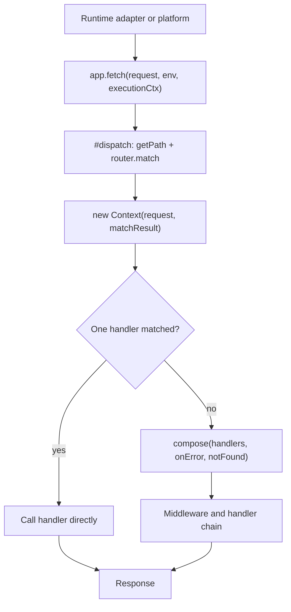

## Overview

Hono is a small web framework built only on Web Standards: an application takes a standard `Request` and returns a standard `Response`. Because nothing in the core depends on Node.js, Bun or a cloud SDK, the same application runs on Cloudflare Workers, Fastly Compute, Deno, Bun, Vercel, AWS Lambda, Lambda@Edge and Node.js. The package ships with no runtime dependencies; middleware, helpers, JSX and runtime adapters live in the same repository and are published as separate subpath exports of the `hono` package.

Sources: [README.md:22-47](repo://README.md#L22-L47), [package.json:1-10](repo://package.json#L1-L10)

The smallest application creates a `Hono` instance, registers a handler and exports the app. The exported object has a `fetch` method, which is the contract most runtimes call directly.

Sources: [src/hono-base.ts:479-485](repo://src/hono-base.ts#L479-L485)

```ts
import { Hono } from 'hono'
const app = new Hono()

app.get('/', (c) => c.text('Hono!'))

export default app
```

Sources: [src/index.ts:1-14](repo://src/index.ts#L1-L14)

## Parts of the framework

| Area | What it does | Page |
| --- | --- | --- |
| Application | Registers routes and middleware, groups sub-apps, exposes `fetch` | [[The Hono Application]] |
| Request lifecycle | Matches a request, builds the `Context`, runs the middleware chain, handles errors | [[Request Lifecycle and Middleware Composition]] |
| Context | The `c` object: response builders, headers, variables, env | [[Context]] |
| Request | `c.req`: params, query, headers, body parsing, validated data | [[HonoRequest]] |
| Routers | Pluggable route matching: SmartRouter, RegExpRouter, TrieRouter and others | [[Routers]], [[RegExpRouter]], [[TrieRouter]] |
| Types | Env, Schema and path-parameter inference that follow each route | [[Typed Routes and Schemas]] |
| Validation | `validator()` middleware that checks input and types it | [[Validator]] |
| RPC client | `hc`, a typed fetch client built from an app's type | [[RPC Client]] |
| JSX | Server-side HTML rendering, streaming, a browser runtime and CSS-in-JS | [[JSX Server Rendering]], [[JSX DOM Runtime and Hooks]], [[CSS Helper]] |
| Middleware | Built-in auth, CORS, CSRF, compression, logging and more | [[Access Control Middleware]], [[JWT and JWK Authentication]], [[Response Middleware]], [[Request Utility Middleware]] |
| Helpers | Streaming, WebSockets, static site generation, cookies and small utilities | [[Streaming and Server-Sent Events]], [[WebSockets]], [[Static Site Generation]], [[Cookies]], [[Helper Catalogue]] |
| Runtimes | Adapters that connect a platform's entry point to `app.fetch` | [[Runtime Adapters]], [[AWS Lambda and Lambda@Edge]], [[Serving Static Files]] |
| Project | Build, tests across runtimes, release | [[Build, Test and Release]] |

Sources: [package.json:38-120](repo://package.json#L38-L120)

## How a request flows

Every request, whatever the runtime, takes the same path through the core, from `fetch` through the router to the handler chain.

Sources: [src/hono-base.ts:479-485](repo://src/hono-base.ts#L479-L485)



Sources: [src/hono-base.ts:406-485](repo://src/hono-base.ts#L406-L485)

1. A platform hands a `Request` to the app. On Workers, Bun and Deno the exported app is called as is; on Lambda, Vercel, Netlify or Pages a small `handle` function converts the platform's event first, as described in [[Runtime Adapters]] and [[AWS Lambda and Lambda@Edge]].
2. `app.fetch` passes the request, the env bindings and the execution context to the private `#dispatch` method. Route registration and the entry points are covered in [[The Hono Application]].
3. `#dispatch` computes the path with `getPath` and asks the router for every handler and middleware whose pattern matches. How routers store and match patterns is covered in [[Routers]].
4. A `Context` is created around the request and the match result; it is the `c` that handlers receive, described in [[Context]] and [[HonoRequest]].
5. When only one handler matched, it is called directly; otherwise `compose` runs the chain in onion order. Both paths, with not-found and error handling, are traced in [[Request Lifecycle and Middleware Composition]].
6. The handler returns a `Response`, which the adapter hands back to the platform.

Sources: [src/hono-base.ts:406-466](repo://src/hono-base.ts#L406-L466), [src/compose.ts:1-73](repo://src/compose.ts#L1-L73)

## Design decisions

### Web Standards only

The core deals only in `Request`, `Response`, `Headers`, `URL`, `ReadableStream` and WebCrypto. `fetch` takes a `Request` and returns a `Response` or a promise of one, and `request()` builds a `Request` for tests. This is what lets one app run on every runtime: adapters exist only for platforms whose entry point is not already a `fetch` function, and the Vercel adapter, for example, is a one-line call to `app.fetch`.

Sources: [src/hono-base.ts:479-517](repo://src/hono-base.ts#L479-L517), [src/adapter/vercel/handler.ts:1-8](repo://src/adapter/vercel/handler.ts#L1-L8)

### Pluggable routers

`HonoBase` has no router of its own; subclasses assign one. The default `Hono` class installs a `SmartRouter` that tries `RegExpRouter` (one compiled regular expression, fastest) and falls back to `TrieRouter` (supports every pattern) on the first request. The `hono/quick` and `hono/tiny` presets pick different routers for startup time and bundle size, and any router can be passed through the `router` option.

Sources: [src/hono.ts:1-34](repo://src/hono.ts#L1-L34), [src/hono-base.ts:114-118](repo://src/hono-base.ts#L114-L118), [src/router.ts:29-56](repo://src/router.ts#L29-L56)

### Types follow the routes

`Hono` carries four type parameters: the `Env` (bindings and variables), the `Schema` built from every registered route, the base path and the current path. Each `get`, `post` or `route` call returns the app with a widened schema, so chaining route definitions records each route's input and output types. The RPC client `hc` reads that schema from `typeof app` to type its calls without code generation.

Sources: [src/hono-base.ts:98-112](repo://src/hono-base.ts#L98-L112), [src/types.ts:2500-2535](repo://src/types.ts#L2500-L2535), [src/client/client.ts:133-137](repo://src/client/client.ts#L133-L137)

### One subpath per feature

Every middleware, helper, adapter and preset is its own entry in the package `exports` map (`hono/cors`, `hono/jwt`, `hono/cloudflare-workers`, `hono/tiny` and so on). An application imports only what it uses, so bundlers ship only that code, and the root `hono` entry stays limited to `Hono`, `Context` and the shared types.

Sources: [package.json:38-120](repo://package.json#L38-L120), [src/index.ts:16-53](repo://src/index.ts#L16-L53)
