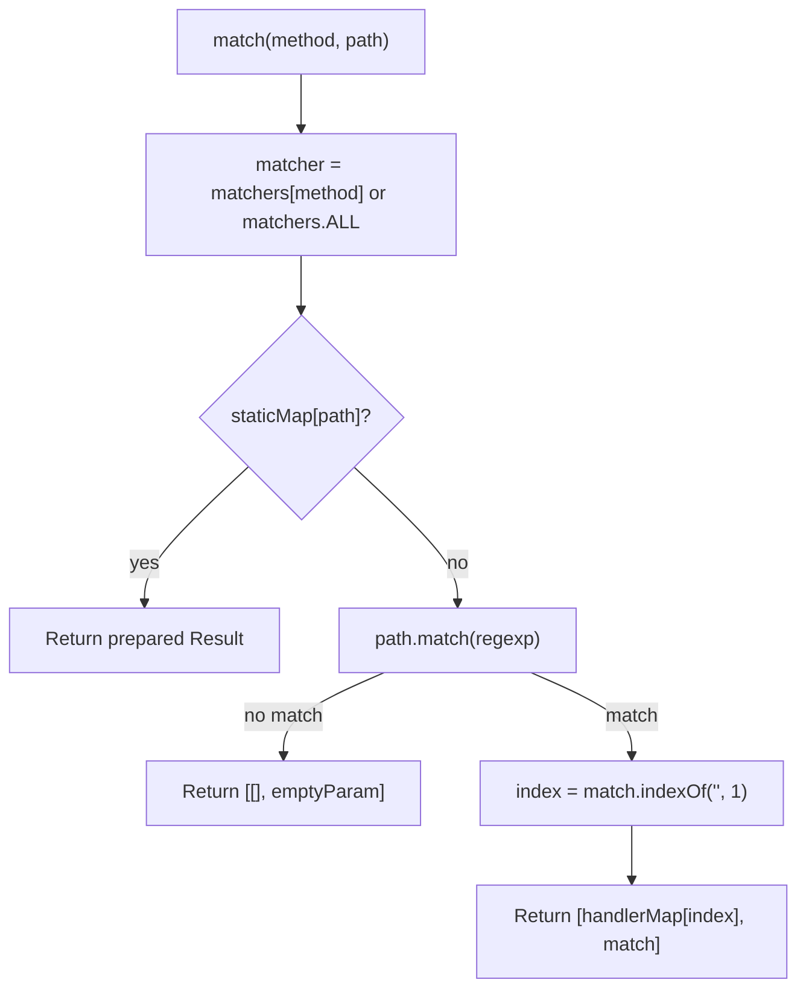

## Overview

`RegExpRouter` is the first router the default `SmartRouter` tries, and the fastest one in Hono. Instead of walking a tree or scanning a list per request, it compiles every route of a method into one regular expression the first time `match` is called. A request then costs a lookup in a map of static paths, or a single `RegExp` execution whose captures identify both the matching route and its parameters. The price is that it accepts only route sets that one expression can answer unambiguously; for the rest it throws `UnsupportedPathError` and `SmartRouter` falls back to [[TrieRouter]], as [[Routers]] describes.

Sources: [src/router/reg-exp-router/router.ts:122-206](repo://src/router/reg-exp-router/router.ts#L122-L206), [src/router/reg-exp-router/matcher.ts:10-33](repo://src/router/reg-exp-router/matcher.ts#L10-L33)

## Registration

`add` does no compiling. It keeps two maps per method, `#middleware` for paths ending in `*` and `#routes` for every other path, each mapping a path to a list of `[handler, paramCount]`. The first time a method appears, both maps for it are seeded with copies of the `ALL` entries, so `ALL` handlers registered earlier are also listed under `GET`, `POST` and the rest. Registering the same path twice simply appends to its list.

Sources: [src/router/reg-exp-router/router.ts:132-153](repo://src/router/reg-exp-router/router.ts#L132-L153)

The key idea is that each route's handler list is complete at registration: it already contains every middleware that applies to that path, in registration order.

Sources: [src/router/reg-exp-router/router.ts:189-204](repo://src/router/reg-exp-router/router.ts#L189-L204)

- A wildcard path (`/api/*`, `*`) is turned into a regular expression with `buildWildcardRegExp`. Its entry starts with the handlers of the longest earlier wildcard that covers it (`findMiddleware`), and the new handler is pushed onto every existing middleware and route entry whose path the wildcard matches.
- A plain path is expanded for optional parameters. Its entry starts with a copy of the middleware that covers it, and then gets its own handler.

Sources: [src/router/reg-exp-router/router.ts:155-204](repo://src/router/reg-exp-router/router.ts#L155-L204), [src/router/reg-exp-router/router.ts:105-120](repo://src/router/reg-exp-router/router.ts#L105-L120)

Because the merge happens at registration, matching never has to combine middleware lists: one match returns one ready list. The trade-off is that registration is quadratic in the number of wildcard and plain paths, which is acceptable because it happens once.

Sources: [src/router/reg-exp-router/router.ts:170-184](repo://src/router/reg-exp-router/router.ts#L170-L184)

## Building the matcher

### When it is built

`match` starts as the shared function from `matcher.ts`. On its first call it runs `buildAllMatchers`, which builds one `Matcher` per method that has its own routes (other methods fall back to the `ALL` matcher), then frees the registration maps and the wildcard cache. It then replaces `this.match` with a closure over the built matchers, so the build runs once and later `add` calls throw `Can not add a route since the matcher is already built.`

Sources: [src/router/reg-exp-router/matcher.ts:10-33](repo://src/router/reg-exp-router/matcher.ts#L10-L33), [src/router/reg-exp-router/router.ts:206-251](repo://src/router/reg-exp-router/router.ts#L206-L251)

### Static routes first

`buildMatcherFromPreprocessedRoutes` sorts the routes so that dynamic paths come first, shorter before longer, and static paths last. Each static path goes into a `staticMap` as a ready `Result` with empty parameters; it is still inserted into the trie, but only to check for conflicts. Each dynamic path gets an index `j` and is inserted into the trie for real.

Sources: [src/router/reg-exp-router/router.ts:34-80](repo://src/router/reg-exp-router/router.ts#L34-L80)

### The trie and the expression

`Trie.insert` tokenizes a path into single characters, `:name` or `:name{pattern}` labels, and a trailing `/*`. `Node.insert` walks those tokens, creating a child per literal character or per label pattern; a label child receives a variable index from a shared counter, and the route's parameter names are recorded against those indexes. At the end of the tokens the node stores the route's index.

Sources: [src/router/reg-exp-router/trie.ts:10-47](repo://src/router/reg-exp-router/trie.ts#L10-L47), [src/router/reg-exp-router/node.ts:50-133](repo://src/router/reg-exp-router/node.ts#L50-L133)

`buildRegExpStr` turns the tree into alternations, ordering children as literal characters, then labels with custom patterns, then plain labels, then wildcards, so the most specific branch is tried first. Labels become `([^/]+)@n` and terminal nodes emit a `#index` marker. `Trie.buildRegExp` then replaces every `#index` with an empty capture group `$()` and records which capture number corresponds to which route index, and strips every `@n` while recording which capture number holds variable `n`.

Sources: [src/router/reg-exp-router/node.ts:20-43](repo://src/router/reg-exp-router/node.ts#L20-L43), [src/router/reg-exp-router/node.ts:135-161](repo://src/router/reg-exp-router/node.ts#L135-L161), [src/router/reg-exp-router/trie.ts:49-73](repo://src/router/reg-exp-router/trie.ts#L49-L73)

Finally each route's parameter map is rewritten from variable indexes to capture numbers, and the handler lists are re-indexed by the capture number of their terminal group. The `Matcher` is the tuple `[regexp, handlerMap, staticMap]`.

Sources: [src/router/reg-exp-router/router.ts:82-103](repo://src/router/reg-exp-router/router.ts#L82-L103), [src/router/reg-exp-router/matcher.ts:1-6](repo://src/router/reg-exp-router/matcher.ts#L1-L6)

## Matching a request

Sources: [src/router/reg-exp-router/matcher.ts:14-29](repo://src/router/reg-exp-router/matcher.ts#L14-L29)

The terminal groups are empty captures, while every label capture is at least one character, so the first empty string after index 0 in the match array is the terminal group of the route that matched. Its position selects the handler list directly. The match array itself is returned as the parameter stash: each handler's parameter map holds capture numbers, so [[HonoRequest]] reads `match[n]` for each parameter without any copying.

Sources: [src/router/reg-exp-router/matcher.ts:22-29](repo://src/router/reg-exp-router/matcher.ts#L22-L29), [src/router/reg-exp-router/node.ts:1-4](repo://src/router/reg-exp-router/node.ts#L1-L4)

## Unsupported route sets

A single expression can report only one terminal per match, so `Node.insert` throws `PATH_ERROR` whenever two routes could match the same path through different branches, and the builder converts it to `UnsupportedPathError`.

Sources: [src/router/reg-exp-router/router.ts:60-65](repo://src/router/reg-exp-router/router.ts#L60-L65)

| Situation | Example |
| --- | --- |
| A static segment and a label at the same position | `/users/me` and `/users/:id` |
| Two different label patterns at the same position | `/:type/:id` and `/:class/:id`, or `/:id` and `/:id{[0-9]+}` |
| Two paths that differ only in parameter names | `/posts/:id` and `/posts/:slug` |
| A label pattern of `.*` | `/files/:path{.*}` |
| A capturing group inside a label pattern | `/:id{(a\|b)c}`; `(?:...)` is fine and a whole-pattern group is rewritten to `(?:...)` |

Sources: [src/router/reg-exp-router/node.ts:57-60](repo://src/router/reg-exp-router/node.ts#L57-L60), [src/router/reg-exp-router/node.ts:82-102](repo://src/router/reg-exp-router/node.ts#L82-L102), [src/router/reg-exp-router/node.ts:114-124](repo://src/router/reg-exp-router/node.ts#L114-L124), [src/router/reg-exp-router/router.ts:60-65](repo://src/router/reg-exp-router/router.ts#L60-L65)

Wildcard branches are exempt from the sibling checks, which is why middleware on `/users/*` coexists with `/users/:id`. The error is raised at build time, so with `SmartRouter` the fallback to [[TrieRouter]] happens on the first request and is permanent; using `RegExpRouter` directly with such routes makes that first request throw.

Sources: [src/router/reg-exp-router/node.ts:96-102](repo://src/router/reg-exp-router/node.ts#L96-L102), [src/router/smart-router/router.ts:32-50](repo://src/router/smart-router/router.ts#L32-L50)

## PreparedRegExpRouter

`PreparedRegExpRouter` moves the build to compile time. `buildInitParams({ paths })` registers every path under `ALL` in a `RegExpRouter` subclass that exposes `buildAllMatchers`, then records for each path where its handler sits in the built handler lists and static map (the "relocate map"), and empties those lists. `serializeInitParams` prints the matchers and relocate map as JavaScript source, embedding each `RegExp` literally so a build step can write it into a module.

Sources: [src/router/reg-exp-router/prepared-router.ts:95-165](repo://src/router/reg-exp-router/prepared-router.ts#L95-L165)

At run time `new PreparedRegExpRouter(matchers, relocateMap)` receives those values. Its `add` places each handler into the precomputed slots: wildcards `*` and `/*` are appended to every list, and other paths go to the slots the relocate map names. A path missing from the map throws `Path ... is not registered`. `buildAllMatchers` returns the prepared matchers, so the shared `match` function works unchanged and no expression is compiled at start-up.

Sources: [src/router/reg-exp-router/prepared-router.ts:9-93](repo://src/router/reg-exp-router/prepared-router.ts#L9-L93), [src/router/reg-exp-router/index.ts:1-7](repo://src/router/reg-exp-router/index.ts#L1-L7)
