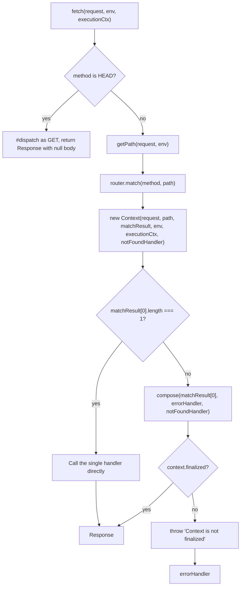
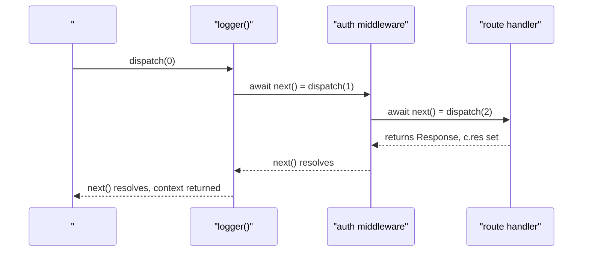

## Overview

Every request runs through one private method, `#dispatch` in `HonoBase`. It asks the router for every handler that matches, wraps the request in a `Context`, and runs those handlers either directly or through `compose`, a Koa-style middleware runner. Not-found and error handling are folded into that same path, so the app's `notFound` and `onError` handlers see every failure. This page follows one request from `fetch` to the returned `Response`; registering routes is covered in [[The Hono Application]] and the `c` object in [[Context]].

Sources: [src/hono-base.ts:406-485](repo://src/hono-base.ts#L406-L485), [src/compose.ts:1-73](repo://src/compose.ts#L1-L73)

## From fetch to handlers



Sources: [src/hono-base.ts:406-466](repo://src/hono-base.ts#L406-L466)

1. `fetch(request, env, executionCtx)` calls `#dispatch` with `request.method`. The adapter for each runtime decides what `env` and `executionCtx` are (see [[Runtime Adapters]]).
2. A `HEAD` request is dispatched again as `GET`, and the resulting response is copied into `new Response(null, res)`. Routes therefore never need a `HEAD` registration, and the body is dropped while status and headers stay.
3. `this.getPath(request, { env })` extracts the path; [[The Hono Application]] describes the default and the `strict` option.
4. `this.router.match(method, path)` returns every handler and middleware whose method and pattern match, in registration order, along with their parameters. The two shapes of the result are described in [[Routers]].
5. A `Context` is built with the raw request, the path, the match result, the env, the execution context and the app's not-found handler. Its `HonoRequest` (`c.req`) is created lazily on first access, so a handler that never reads the request never pays for it.

Sources: [src/hono-base.ts:412-427](repo://src/hono-base.ts#L412-L427), [src/context.ts:352-369](repo://src/context.ts#L352-L369)

## The single-handler fast path

Most requests in a small app hit exactly one handler and no middleware. For that case `#dispatch` skips `compose` and calls the handler itself, `matchResult[0][0][0][0](c, next)`, with a `next` that sets `c.res` to the not-found response. Avoiding `compose` saves a closure, an async function and a promise per request.

Sources: [src/hono-base.ts:429-448](repo://src/hono-base.ts#L429-L448)

The return value decides the response:

Sources: [src/hono-base.ts:440-447](repo://src/hono-base.ts#L440-L447)

| Handler returns | Result |
| --- | --- |
| a `Response` | that response |
| `undefined` synchronously | the not-found handler's response |
| a promise resolving to a `Response` | that response |
| a promise resolving to nothing, after `c.res` was set (the context is finalized) | `c.res` |
| a promise resolving to nothing, context not finalized | the not-found handler's response |
| a synchronous throw or a rejected promise | `#handleError` |

Sources: [src/hono-base.ts:432-447](repo://src/hono-base.ts#L432-L447)

## Composition and the onion model

### How `compose` runs the chain

`compose(middleware, onError, onNotFound)` returns a function of `(context, next)` that calls `dispatch(0)`. Each `dispatch(i)` takes the handler at `middleware[i][0][0]`, records `context.req.routeIndex = i` so `c.req.param()` reads the parameters of the route that is running, and calls `handler(context, () => dispatch(i + 1))`. A handler that awaits `next()` therefore runs the rest of the chain, then resumes: code before `await next()` runs in registration order and code after it in reverse.

Sources: [src/compose.ts:15-51](repo://src/compose.ts#L15-L51)



Sources: [src/compose.ts:32-71](repo://src/compose.ts#L32-L71)

### Guarantees

- `next()` may be called once per middleware. A second call reaches `dispatch(i)` with `i <= index` and throws `next() called multiple times`.
- When the index passes the last middleware, `dispatch` uses the outer `next` given to the composed function, if any. `route()` relies on this to nest a sub-app's composed error handler inside the parent chain (see [[The Hono Application]]).
- A handler's return value becomes `context.res` only if the context is not yet finalized, or if the value came from the error handler. A middleware that returns a response after another layer already finalized the context does not overwrite it.
- When the chain runs out of handlers and the context is still not finalized, `onNotFound` produces the response.

Sources: [src/compose.ts:32-70](repo://src/compose.ts#L32-L70)

Setting `c.res` is the second way to finalize. The setter marks the context finalized and, when a response already existed, copies its headers onto the new one (except `Content-Type`, and appending every `Set-Cookie`). That is why `c.header()` calls made by middleware before the handler survive when the handler returns a fresh `Response`. [[Context]] covers the setter in detail.

Sources: [src/context.ts:403-434](repo://src/context.ts#L403-L434)

### The "Context is not finalized" error

After the composed chain resolves, `#dispatch` checks `context.finalized`. If no layer returned or set a response, which usually means a middleware forgot `await next()` or a handler forgot `return`, it throws `Context is not finalized. Did you forget to return a Response object or \`await next()\`?`. The throw happens inside the same `try`, so it reaches the error handler and becomes a 500 by default.

Sources: [src/hono-base.ts:450-465](repo://src/hono-base.ts#L450-L465)

## Errors

### Where errors are caught

An error thrown by a handler inside `compose` is caught by the `dispatch` frame that called it. If it is an `Error` and an `onError` is present, the frame stores it on `context.error`, calls `onError(err, context)` and treats the result as the response. The error never propagates up through the outer middleware: their `await next()` resolves normally, and they can inspect `c.error` and the error response afterwards. Values thrown that are not `Error` instances are rethrown untouched.

Sources: [src/compose.ts:49-69](repo://src/compose.ts#L49-L69), [src/context.ts:318-333](repo://src/context.ts#L318-L333)

At the app level, `#handleError` sends `Error` instances to the app's error handler and rethrows anything else, so a thrown string or plain object surfaces to the runtime. It covers the fast path, errors from `compose` itself (such as the not-finalized error) and errors thrown by the error handler path in a sub-app wrapper.

Sources: [src/hono-base.ts:399-404](repo://src/hono-base.ts#L399-L404)

### HTTPException

`HTTPException` (from `hono/http-exception`) is the way for middleware to stop a request with a specific status. It extends `Error` with a `status` (default 500) and an optional prepared `res`. `getResponse()` returns a copy of `res` with the exception's status, or a plain response whose body is the message.

Sources: [src/http-exception.ts:46-78](repo://src/http-exception.ts#L46-L78)

```ts
import { HTTPException } from 'hono/http-exception'

app.post('/auth', async (c, next) => {
  if (authorized === false) {
    throw new HTTPException(401, { message: 'Custom error message' })
  }
  await next()
})
```

Sources: [src/http-exception.ts:31-44](repo://src/http-exception.ts#L31-L44)

The default error handler checks for a `getResponse` method rather than `instanceof HTTPException`, so any error class with that method is turned into its own response, and only other errors are logged with `console.error` and answered with `500 Internal Server Error`. A custom `onError` should do the same check if it wants to keep the statuses built-in middleware such as [[Access Control Middleware]] and [[JWT and JWK Authentication]] throw.

Sources: [src/hono-base.ts:35-42](repo://src/hono-base.ts#L35-L42)

```ts
app.onError((err, c) => {
  if (err instanceof HTTPException) {
    return err.getResponse()
  }
  console.error(err)
  return c.text('Internal Server Error', 500)
})
```

Sources: [src/hono-base.ts:255-274](repo://src/hono-base.ts#L255-L274), [src/http-exception.ts:66-77](repo://src/http-exception.ts#L66-L77)

## Not found

A request is "not found" when no layer produces a response, not when the router finds nothing: a `*` middleware such as a logger always matches. The not-found handler runs in three places: the `next` passed to a lone handler, the end of a composed chain that is not finalized, and a lone async handler that resolves to nothing without finalizing. `c.notFound()` calls the same handler from inside a route, which [[Context]] describes.

Sources: [src/hono-base.ts:433-447](repo://src/hono-base.ts#L433-L447), [src/compose.ts:61-65](repo://src/compose.ts#L61-L65)
