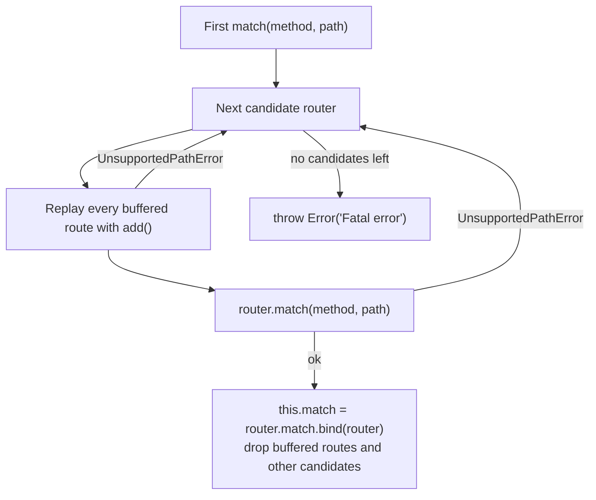

## Overview

A router answers one question for every request: given a method and a path, which registered handlers apply, in which order, and with which parameters. Hono keeps that job behind a two-method `Router` interface so the matching algorithm can be swapped without touching the app. Five routers ship with Hono; the default app uses `SmartRouter`, which picks between two of them on the first request. This page covers the interface, the path syntax every router accepts, `SmartRouter`, the two simple routers and how to choose one; [[RegExpRouter]] and [[TrieRouter]] describe the two default routers in depth.

Sources: [src/router.ts:29-56](repo://src/router.ts#L29-L56), [src/hono.ts:16-34](repo://src/hono.ts#L16-L34)

## The Router interface

A router has a `name`, an `add(method, path, handler)` called once per registration, and a `match(method, path)` called once per request. The app always registers the method in upper case, uses `ALL` for `use()` and `all()`, and stores a `[handler, RouterRoute]` pair as the router's `T`, as [[The Hono Application]] describes.

Sources: [src/router.ts:5-52](repo://src/router.ts#L5-L52)

`match` returns a `Result`, which has one of two shapes. Both list the matching handlers in registration order, each with its parameters; they differ in how the parameters are stored.

Sources: [src/router.ts:54-98](repo://src/router.ts#L54-L98)

| Shape | Parameters | Produced by |
| --- | --- | --- |
| `[[handler, paramIndexMap][], paramStash]` | Each map holds indexes into one shared `paramStash` array of captured strings | `RegExpRouter`, `PreparedRegExpRouter` |
| `[[handler, params][]]` | Each entry holds its own `{ name: value }` object | `TrieRouter`, `LinearRouter`, `PatternRouter` |

Sources: [src/router.ts:66-98](repo://src/router.ts#L66-L98)

The stash shape lets a single regular-expression match fill the parameters of every matching route at once, without allocating an object per route. [[HonoRequest]] reads either shape through one lookup that checks whether a stash is present.

Sources: [src/router.ts:66-98](repo://src/router.ts#L66-L98), [src/request.ts:106-128](repo://src/request.ts#L106-L128)

A router that cannot represent a path throws `UnsupportedPathError`. That error is the signal `SmartRouter` uses to move on to the next candidate; any other error is a real failure. `MESSAGE_MATCHER_IS_ALREADY_BUILT` is the message routers throw when a route is added after matching started.

Sources: [src/router.ts:19-27](repo://src/router.ts#L19-L27), [src/router.ts:100-103](repo://src/router.ts#L100-L103)

## Path syntax

All routers accept the same patterns, though not every router accepts every combination.

Sources: [src/router/linear-router/router.ts:9-10](repo://src/router/linear-router/router.ts#L9-L10)

| Pattern | Matches | Parameters |
| --- | --- | --- |
| `/posts` | Exactly `/posts` (and `/posts/` in some routers when not strict) | none |
| `/posts/:id` | One segment after `/posts/` | `id` |
| `/posts/:id?` | `/posts` and `/posts/:id` | `id` may be undefined |
| `/posts/:id{[0-9]+}` | A segment matching the regular expression | `id` |
| `/posts/*` | `/posts` followed by anything | none |
| `/files/:path{.+}` | Everything after `/files/`, slashes included | `path` |
| `*` | Every path (used by `app.use()` without a path) | none |

Sources: [src/utils/url.ts:171-206](repo://src/utils/url.ts#L171-L206), [src/router/linear-router/router.ts:9-23](repo://src/router/linear-router/router.ts#L9-L23), [src/router/pattern-router/router.ts:12-42](repo://src/router/pattern-router/router.ts#L12-L42)

Optional parameters are not handled by the routers' matching code. `checkOptionalParameter` expands a path ending in `:name?` into every prefix path, so `/api/animals/:type?` is registered as both `/api/animals` and `/api/animals/:type`, and the routers see only plain patterns.

Sources: [src/utils/url.ts:171-206](repo://src/utils/url.ts#L171-L206)

## SmartRouter

`SmartRouter` is not a matching algorithm. It holds a list of candidate routers and buffers every `add` call in an array. On the first `match` it replays all buffered routes into the first candidate and tries the match. If the candidate throws `UnsupportedPathError` while adding or matching, it moves to the next candidate; the first one that succeeds wins.

Sources: [src/router/smart-router/router.ts:4-61](repo://src/router/smart-router/router.ts#L4-L61)

Sources: [src/router/smart-router/router.ts:21-61](repo://src/router/smart-router/router.ts#L21-L61)

Once a router wins, `SmartRouter` replaces its own `match` with the winner's bound `match`, so later requests pay no indirection, and sets its name to `SmartRouter + RegExpRouter` (or whichever won). `activeRouter` returns the winner and throws before one has been chosen.

Sources: [src/router/smart-router/router.ts:46-69](repo://src/router/smart-router/router.ts#L46-L69)

> [!IMPORTANT]
> After the first request, the buffered route list is gone and `add` throws `Can not add a route since the matcher is already built.` Register every route before the app serves traffic.

Sources: [src/router/smart-router/router.ts:13-19](repo://src/router/smart-router/router.ts#L13-L19), [src/router.ts:19-27](repo://src/router.ts#L19-L27)

## LinearRouter

`LinearRouter` stores routes in an array and, on every match, walks the whole array comparing each route to the path with string operations. Adding a route is a push, so registration costs almost nothing; matching costs time proportional to the number of routes. It has four code paths: `*` and `/*` always match, static paths compare by equality (also accepting one trailing slash), wildcard paths compare the pieces around each `*` with `indexOf`, and parameter paths walk the segments, running a regular expression only for `:name{pattern}` segments.

Sources: [src/router/linear-router/router.ts:11-41](repo://src/router/linear-router/router.ts#L11-L41), [src/router/linear-router/router.ts:70-135](repo://src/router/linear-router/router.ts#L70-L135)

A path that combines a `:param` and a `*` throws `UnsupportedPathError` at match time. That is why `hono/quick` pairs it with `TrieRouter` in a `SmartRouter`.

Sources: [src/router/linear-router/router.ts:136-138](repo://src/router/linear-router/router.ts#L136-L138), [src/preset/quick.ts:13-24](repo://src/preset/quick.ts#L13-L24)

## PatternRouter

`PatternRouter` turns each route into its own regular expression when it is added: `:name` becomes a named group `(?<name>[^/]+)`, `:name{re}` a named group with that expression, literal characters are escaped, and a path that does not end with `*` gets `/?$`. Matching runs every route's expression against the path and returns `match.groups` as the parameters. An optional parameter is handled by also registering the path without its last segment.

Sources: [src/router/pattern-router/router.ts:8-59](repo://src/router/pattern-router/router.ts#L8-L59)

It is the smallest router, which is why `hono/tiny` uses it alone. A pattern that is not a valid regular expression throws `UnsupportedPathError`, which is fatal since no fallback exists in that preset.

Sources: [src/router/pattern-router/router.ts:33-41](repo://src/router/pattern-router/router.ts#L33-L41), [src/preset/tiny.ts:11-20](repo://src/preset/tiny.ts#L11-L20)

## Choosing a router

| Router | Build | Match | Supports every pattern | Typical use |
| --- | --- | --- | --- | --- |
| `SmartRouter` [`RegExpRouter`, `TrieRouter`] | On first request | One regular expression per method, or tree walk | Yes, through the fallback | The default `hono` import |
| `RegExpRouter` | On first request, compiles everything | One `RegExp` exec | No: ambiguous patterns throw | Long-running servers with many routes |
| `TrieRouter` | Incremental | Walks segments | Yes | Fallback; apps with unusual patterns |
| `SmartRouter` [`LinearRouter`, `TrieRouter`] | None | Linear scan | Yes, through the fallback | `hono/quick`: short-lived processes where each request may be the first |
| `PatternRouter` | One `RegExp` per route | Linear scan | Mostly | `hono/tiny`: smallest bundle |
| `PreparedRegExpRouter` | Ahead of time | One `RegExp` exec | As `RegExpRouter` | Precompiled matchers, see [[RegExpRouter]] |

Sources: [src/hono.ts:22-33](repo://src/hono.ts#L22-L33), [src/preset/quick.ts:13-24](repo://src/preset/quick.ts#L13-L24), [src/preset/tiny.ts:11-20](repo://src/preset/tiny.ts#L11-L20)

To use a specific router, pass it as the `router` option of the default `Hono` class, for example `new Hono({ router: new RegExpRouter() })`. The presets ignore that option, as [[The Hono Application]] notes.

Sources: [src/hono-base.ts:55-65](repo://src/hono-base.ts#L55-L65), [src/hono.ts:22-33](repo://src/hono.ts#L22-L33)
