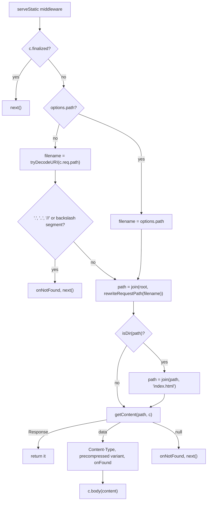

## Overview

Serving files from disk is the one job a Web-Standards framework cannot do alone, because reading a file is runtime-specific. Hono splits it in two. The generic `serveStatic` in `src/middleware/serve-static` handles everything that is the same everywhere: mapping the URL to a path, refusing traversal, choosing the content type, serving precompressed variants and calling hooks. Each runtime adapter wraps it and supplies a `getContent(path)` function (and optionally `join` and `isDir`) that actually reads the file. Applications import the wrapper from their runtime: `hono/bun`, `hono/deno`, or the deprecated one in `hono/cloudflare-workers`; Cloudflare Pages has its own asset-binding version described in [[Runtime Adapters]].

Sources: [src/middleware/serve-static/index.ts:35-126](repo://src/middleware/serve-static/index.ts#L35-L126), [src/adapter/bun/serve-static.ts:8-32](repo://src/adapter/bun/serve-static.ts#L8-L32)

```ts
import { serveStatic } from 'hono/bun'

app.use('/static/*', serveStatic({ root: './' }))
app.get('/favicon.ico', serveStatic({ path: './public/favicon.ico' }))
app.get('*', serveStatic({ path: './public/index.html' })) // SPA fallback
```

Sources: [src/middleware/serve-static/index.ts:13-21](repo://src/middleware/serve-static/index.ts#L13-L21)

## Options

| Option | Default | Effect |
| --- | --- | --- |
| `root` | `./` | Directory the request path is joined to |
| `path` | | Serve this fixed file for every request the middleware sees, ignoring the URL |
| `rewriteRequestPath(path)` | | Map the URL path before joining, for example to strip a `/static` prefix |
| `mimes` | | Extra extension-to-type entries, checked before the built-in table |
| `precompressed` | `false` | Serve `.br`, `.zst` or `.gz` siblings when the client accepts them |
| `onFound(path, c)` | | Called before a file is sent, for example to set `Cache-Control` |
| `onNotFound(path, c)` | | Called when nothing was served |

Sources: [src/middleware/serve-static/index.ts:13-21](repo://src/middleware/serve-static/index.ts#L13-L21)

## Request flow



Sources: [src/middleware/serve-static/index.ts:54-125](repo://src/middleware/serve-static/index.ts#L54-L125)

1. If a previous layer already produced a response, the middleware steps aside.
2. The request path is URI-decoded. Any segment equal to `.` or `..`, a doubled slash or a backslash makes it give up: it calls `onNotFound` and passes to the next handler. Checking after decoding means `%2e%2e` cannot slip through.
3. The path is joined to `root` with the runtime's `join`, or `defaultJoin`, which collapses repeated slashes and resolves `.` and `..` lexically. A directory, when the runtime reports one through `isDir`, gets `index.html` appended.
4. `getContent` returns file data, a ready `Response` (used as is), or `null`.

Sources: [src/middleware/serve-static/index.ts:54-91](repo://src/middleware/serve-static/index.ts#L54-L91), [src/middleware/serve-static/path.ts:5-25](repo://src/middleware/serve-static/path.ts#L5-L25)

A file that is not found is not an error: the middleware calls `next()`, so later routes (or the app's not-found handler, see [[Request Lifecycle and Middleware Composition]]) decide the response. That is what makes the SPA fallback pattern above work.

Sources: [src/middleware/serve-static/index.ts:122-124](repo://src/middleware/serve-static/index.ts#L122-L124)

## Content type and precompressed files

The content type comes from the file extension, looked up first in `mimes` and then in the built-in table from `utils/mime`, defaulting to `application/octet-stream`.

Sources: [src/middleware/serve-static/index.ts:92-94](repo://src/middleware/serve-static/index.ts#L92-L94), [src/utils/mime.ts:6-16](repo://src/utils/mime.ts#L6-L16)

With `precompressed: true`, and when the type is compressible (the same list the `compress` middleware uses, see [[Response Middleware]]), the middleware tries Brotli, then Zstandard, then gzip, keeping only encodings named in `Accept-Encoding`. For the first one whose sibling file (`app.js.br`, `app.js.zst`, `app.js.gz`) exists, it serves that file with `Content-Encoding` set and `Vary: Accept-Encoding` appended, while keeping the original content type. Build tools can therefore compress assets ahead of time at maximum level instead of compressing on every request.

Sources: [src/middleware/serve-static/index.ts:23-28](repo://src/middleware/serve-static/index.ts#L23-L28), [src/middleware/serve-static/index.ts:96-117](repo://src/middleware/serve-static/index.ts#L96-L117)

## Runtime implementations

### Bun

`getContent` returns `Bun.file(path)` when the file exists, which Bun can stream efficiently as a response body. `isDir` uses `stat` from `node:fs/promises`, and `join` is `node:path`'s.

Sources: [src/adapter/bun/serve-static.ts:8-32](repo://src/adapter/bun/serve-static.ts#L8-L32)

### Deno

`getContent` opens the file with `Deno.open` and returns its `readable` stream, returning `null` for directories and for missing files; other errors (such as permission denied) are logged with a warning and also yield `null`. `isDir` uses `Deno.lstatSync`, and `join` comes from `node:path`.

Sources: [src/adapter/deno/serve-static.ts:6-42](repo://src/adapter/deno/serve-static.ts#L6-L42)

### Cloudflare Workers (deprecated)

The Workers version reads from Workers Sites: `getContentFromKVAsset` looks the path up in the asset manifest (`__STATIC_CONTENT_MANIFEST`, or the `manifest` option) and fetches the hashed key from the KV namespace (`__STATIC_CONTENT` from the env, or the `namespace` option) as a stream. It is deprecated in favour of Cloudflare Static Assets, which serve files before the Worker runs. The module-worker export omits the `namespace` option.

Sources: [src/adapter/cloudflare-workers/serve-static.ts:21-42](repo://src/adapter/cloudflare-workers/serve-static.ts#L21-L42), [src/adapter/cloudflare-workers/utils.ts:11-50](repo://src/adapter/cloudflare-workers/utils.ts#L11-L50), [src/adapter/cloudflare-workers/serve-static-module.ts:1-12](repo://src/adapter/cloudflare-workers/serve-static-module.ts#L1-L12)

### Writing one for another runtime

A runtime wrapper passes the user's options plus `getContent(path, c)`. Returning a `Response` gives full control (headers, status, range support), returning `Data` (a string, buffer or stream) lets the generic middleware set the headers, and returning `null` means not found. `src/utils/filepath.ts` keeps the older `getFilePath` helpers, which map a URL to a relative path and refuse `..` segments, for wrappers outside this repository that still use them.

Sources: [src/middleware/serve-static/index.ts:35-48](repo://src/middleware/serve-static/index.ts#L35-L48), [src/utils/filepath.ts:12-60](repo://src/utils/filepath.ts#L12-L60)
