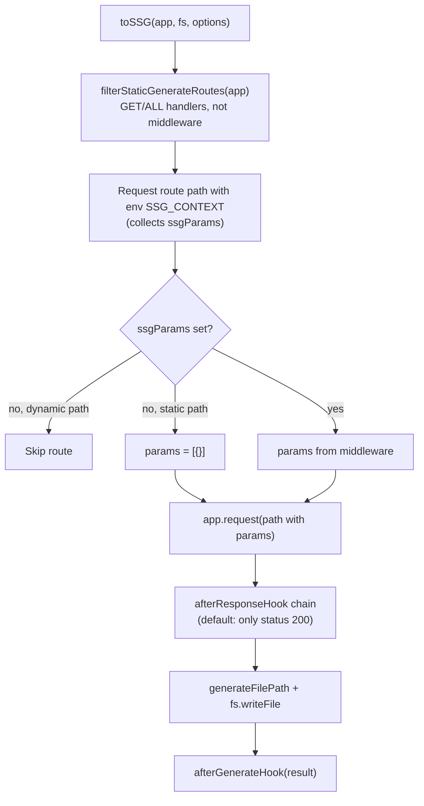

## Overview

`toSSG` from `hono/ssg` renders a Hono app to files. It walks the app's registered `GET` routes, requests each one through the app itself (so middleware, JSX rendering and the [[CSS Helper]] all run as they would for a real visitor), and writes every successful response to a file named after its path and content type. Routes with parameters are generated once per parameter set that an `ssgParams` middleware supplies. File access goes through a small `FileSystemModule` interface, so the same code runs on Node.js, Bun and Deno.

Sources: [src/helper/ssg/ssg.ts:368-470](repo://src/helper/ssg/ssg.ts#L368-L470), [src/helper/ssg/ssg.ts:34-37](repo://src/helper/ssg/ssg.ts#L34-L37)

```ts
import fs from 'node:fs/promises'
import { toSSG, ssgParams } from 'hono/ssg'

app.get('/', (c) => c.html('<h1>Home</h1>'))
app.get('/posts/:id', ssgParams([{ id: '1' }, { id: '2' }]), (c) =>
  c.html(`<h1>Post ${c.req.param('id')}</h1>`)
)

const result = await toSSG(app, fs, { dir: './static' })
// result.files: ['static/index.html', 'static/posts/1.html', 'static/posts/2.html']
```

Sources: [src/helper/ssg/middleware.ts:43-49](repo://src/helper/ssg/middleware.ts#L43-L49), [src/helper/ssg/ssg.ts:50-72](repo://src/helper/ssg/ssg.ts#L50-L72)

## The generation flow

### Steps at a glance



Sources: [src/helper/ssg/ssg.ts:205-302](repo://src/helper/ssg/ssg.ts#L205-L302), [src/helper/ssg/ssg.ts:420-468](repo://src/helper/ssg/ssg.ts#L420-L468)

### Finding routes

`filterStaticGenerateRoutes` reads `app.routes` (described in [[The Hono Application]]) and keeps the paths whose method is `GET` or `ALL` and whose handler is not middleware. A handler counts as middleware when it declares two or more parameters (`(c, next)`), after unwrapping the `COMPOSED_HANDLER` wrapper that `route()` adds for sub-apps with their own error handler.

Sources: [src/helper/ssg/utils.ts:57-75](repo://src/helper/ssg/utils.ts#L57-L75), [src/utils/handler.ts:8-15](repo://src/utils/handler.ts#L8-L15)

### Collecting parameters

For each route, `fetchRoutesContent` first sends a request for the raw route path (for example `/posts/:id`) through `app.fetch`, with `{ HONO_SSG_CONTEXT: true }` as the env. On that request the `ssgParams(params)` middleware sees a dynamic path, stores the parameter list (an array, or the result of a function of `c`) on the raw request object, and stops the chain with `c.notFound()`. If no list was stored, a dynamic route (one with `:param` or `*`) is skipped and a static route gets one empty parameter set.

Sources: [src/helper/ssg/ssg.ts:225-251](repo://src/helper/ssg/ssg.ts#L225-L251), [src/helper/ssg/middleware.ts:36-49](repo://src/helper/ssg/middleware.ts#L36-L49)

### Rendering and writing

For each parameter set the path's placeholders are filled in with the client's `replaceUrlParam`, and the page is fetched with `app.request`, again with the SSG env. A response carrying `x-hono-disable-ssg` is dropped. The body is read as text for text and JSON types and as bytes otherwise, then `saveContentToFile` creates the directory (once per directory) and writes the file.

Sources: [src/helper/ssg/ssg.ts:253-296](repo://src/helper/ssg/ssg.ts#L253-L296), [src/helper/ssg/ssg.ts:74-88](repo://src/helper/ssg/ssg.ts#L74-L88), [src/helper/ssg/ssg.ts:309-334](repo://src/helper/ssg/ssg.ts#L309-L334)

Requests run through a pool limited to `concurrency` (default 2), which queues extra work with `setTimeout`, so large sites do not open thousands of renders at once. `toSSG` waits for all writes; if any failed it returns `{ success: false, files: [], error }` instead of throwing, and the after-generate hooks still run.

Sources: [src/helper/ssg/ssg.ts:17-17](repo://src/helper/ssg/ssg.ts#L17-L17), [src/utils/concurrent.ts:12-55](repo://src/utils/concurrent.ts#L12-L55), [src/helper/ssg/ssg.ts:450-469](repo://src/helper/ssg/ssg.ts#L450-L469)

## File names

`generateFilePath` maps the request path and the response's media type (without parameters; `text/plain` when absent) to a file:

Sources: [src/helper/ssg/ssg.ts:50-72](repo://src/helper/ssg/ssg.ts#L50-L72)

| Route path | Media type | File |
| --- | --- | --- |
| `/` | `text/html` | `static/index.html` |
| `/about` | `text/html` | `static/about.html` |
| `/blog/` | `text/html` | `static/blog/index.html` |
| `/feed.xml` | `application/rss+xml` | `static/feed.xml` (already has the extension) |
| `/data` | `application/json` | `static/data.json` |

Sources: [src/helper/ssg/ssg.ts:56-67](repo://src/helper/ssg/ssg.ts#L56-L67), [src/helper/ssg/ssg.ts:90-108](repo://src/helper/ssg/ssg.ts#L90-L108)

The extension comes from `extensionMap` (default: HTML, the XML feed types and YAML), then from the MIME table in `utils/mime`, then `html`. `ensureWithinOutDir` normalizes both paths and throws `Path traversal detected` when a file would land outside the output directory, which protects against parameter values containing `..`.

Sources: [src/helper/ssg/ssg.ts:90-108](repo://src/helper/ssg/ssg.ts#L90-L108), [src/helper/ssg/utils.ts:50-55](repo://src/helper/ssg/utils.ts#L50-L55), [src/helper/ssg/utils.ts:77-87](repo://src/helper/ssg/utils.ts#L77-L87)

## Controlling generation from the app

| Export | Effect |
| --- | --- |
| `ssgParams(list or fn)` | Supplies parameter sets for a dynamic route |
| `isSSGContext(c)` | True while `toSSG` is rendering (the env carries the SSG flag) |
| `disableSSG()` | During generation, answers 404 with `x-hono-disable-ssg` so the route is skipped; normal requests pass |
| `onlySSG()` | Answers 404 to normal requests, so the route exists only in the static output |

Sources: [src/helper/ssg/middleware.ts:5-83](repo://src/helper/ssg/middleware.ts#L5-L83)

## Hooks and plugins

`toSSGOptions` accepts `beforeRequestHook` (change or veto each request; `false` skips it), `afterResponseHook` (change or veto each response) and `afterGenerateHook` (receives the result, the file system module and the options), each as one function or a list. `plugins` bundle hooks; option hooks run before plugin hooks, and each list stops at the first `false`.

Sources: [src/helper/ssg/ssg.ts:110-198](repo://src/helper/ssg/ssg.ts#L110-L198), [src/helper/ssg/ssg.ts:368-419](repo://src/helper/ssg/ssg.ts#L368-L419)

When `plugins` is not given, `defaultPlugin()` is used, which drops every response whose status is not 200. Passing `plugins` replaces it, so include `defaultPlugin()` again to keep that filter. `redirectPlugin()` turns 301, 302, 303, 307 and 308 responses into small HTML pages with a meta refresh and canonical link, so redirects survive on static hosting.

Sources: [src/helper/ssg/plugins.ts:11-72](repo://src/helper/ssg/plugins.ts#L11-L72), [src/helper/ssg/ssg.ts:372-372](repo://src/helper/ssg/ssg.ts#L372-L372)

## Runtime wrappers

`hono/bun` exports `toSSG(app, options)` with `bunFileSystemModule`, which writes with `Bun.write` (creating directories itself, so `mkdir` is a no-op). `hono/deno` exports the same shape with `denoFileSystemModule`, built on `Deno.writeFile` and `Deno.mkdir`, marked experimental. On Node.js, pass `node:fs/promises` as the module.

Sources: [src/adapter/bun/ssg.ts:2-27](repo://src/adapter/bun/ssg.ts#L2-L27), [src/adapter/deno/ssg.ts:1-27](repo://src/adapter/deno/ssg.ts#L1-L27)
