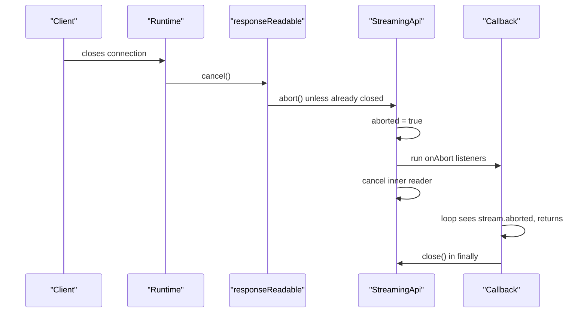

## Overview

`hono/streaming` returns a response whose body is written while the handler keeps running: progress output, large exports, LLM token streams, or a live event feed. Each of the three helpers, `stream`, `streamText` and `streamSSE`, creates a `TransformStream`, returns a `Response` over its readable side at once, and runs a callback in the background that writes to the writable side through a `StreamingApi` object. Streaming HTML rendered from JSX with `Suspense` uses a different mechanism, covered in [[JSX Server Rendering]].

Sources: [src/helper/streaming/index.ts:6-9](repo://src/helper/streaming/index.ts#L6-L9), [src/helper/streaming/stream.ts:7-45](repo://src/helper/streaming/stream.ts#L7-L45)

```ts
import { streamSSE } from 'hono/streaming'

app.get('/events', (c) =>
  streamSSE(c, async (stream) => {
    let id = 0
    while (!stream.aborted) {
      await stream.writeSSE({ event: 'tick', data: new Date().toISOString(), id: String(id++) })
      await stream.sleep(1000)
    }
  })
)
```

Sources: [src/helper/streaming/sse.ts:72-100](repo://src/helper/streaming/sse.ts#L72-L100), [src/utils/stream.ts:65-67](repo://src/utils/stream.ts#L65-L67)

## The three helpers

| Helper | Headers it sets | Writer |
| --- | --- | --- |
| `stream(c, cb, onError?)` | none (set them with `c.header` before calling) | `StreamingApi` |
| `streamText(c, cb, onError?)` | `Content-Type: text/plain; charset=UTF-8`, `X-Content-Type-Options: nosniff`, `Transfer-Encoding: chunked` | `StreamingApi` |
| `streamSSE(c, cb, onError?)` | `Content-Type: text/event-stream`, `Cache-Control: no-cache`, `Connection: keep-alive`, `Transfer-Encoding: chunked` | `SSEStreamingApi` |

Sources: [src/helper/streaming/text.ts:6-15](repo://src/helper/streaming/text.ts#L6-L15), [src/helper/streaming/sse.ts:92-95](repo://src/helper/streaming/sse.ts#L92-L95)

All three return `c.newResponse(stream.responseReadable)`, so headers set earlier with `c.header` and the status from `c.status` apply, and response middleware still sees the response object. The callback is started without being awaited: the handler returns the response immediately and the runtime begins sending it while the callback writes.

Sources: [src/helper/streaming/stream.ts:26-44](repo://src/helper/streaming/stream.ts#L26-L44), [src/helper/streaming/sse.ts:97-99](repo://src/helper/streaming/sse.ts#L97-L99), [src/context.ts:641-641](repo://src/context.ts#L641-L641)

## StreamingApi

`StreamingApi` (in `src/utils/stream.ts`) wraps the writable side of the transform stream with a writer and a `TextEncoder`, and exposes a `responseReadable` that pulls from the readable side.

Sources: [src/utils/stream.ts:6-46](repo://src/utils/stream.ts#L6-L46)

| Member | Behaviour |
| --- | --- |
| `write(data)` | Encodes strings to UTF-8 and writes; write errors are swallowed |
| `writeln(text)` | `write(text + '\n')` |
| `sleep(ms)` | A promise resolved after `ms` |
| `pipe(readable)` | Releases the writer, pipes another stream in without closing, then takes a new writer |
| `onAbort(fn)` | Registers a callback for client disconnects |
| `abort()` | Marks `aborted` and runs the abort callbacks once |
| `close()` | Marks `closed` and closes the writer; errors are swallowed |
| `aborted`, `closed` | Flags to check in loops |

Sources: [src/utils/stream.ts:48-97](repo://src/utils/stream.ts#L48-L97)

Writes are awaited against the transform stream's backpressure, so a fast producer waits for a slow client instead of buffering without bound. Write and close errors are ignored on purpose: once the client is gone, writes fail, and the callback is expected to notice through `aborted` or `onAbort` rather than through exceptions.

Sources: [src/utils/stream.ts:48-76](repo://src/utils/stream.ts#L48-L76)

## Client disconnects



Sources: [src/utils/stream.ts:26-45](repo://src/utils/stream.ts#L26-L45), [src/utils/stream.ts:84-97](repo://src/utils/stream.ts#L84-L97)

When the client disconnects, the runtime cancels the response body. `responseReadable`'s `cancel` calls `abort()` (unless the stream was already closed normally), which runs the abort listeners. The first listener, registered in the constructor, cancels the reader of the transform stream, so pending writes stop blocking instead of waiting forever for a reader that will never come.

Sources: [src/utils/stream.ts:28-45](repo://src/utils/stream.ts#L28-L45)

Bun before 1.1.27 did not cancel response bodies, so on those versions the helpers also listen to the request's `abort` signal; `isOldBunVersion` checks `Bun.version` once and caches the answer. On Bun the context would also be released when the handler returns, so each helper keeps `c` alive in a `WeakMap` keyed by the response stream until streaming ends.

Sources: [src/helper/streaming/stream.ts:15-25](repo://src/helper/streaming/stream.ts#L15-L25), [src/helper/streaming/utils.ts:1-11](repo://src/helper/streaming/utils.ts#L1-L11)

## Errors

The callback runs inside `try`/`finally`, and the stream is always closed at the end. What happens to an error depends on the helper:

Sources: [src/helper/streaming/stream.ts:26-42](repo://src/helper/streaming/stream.ts#L26-L42)

- **`stream` and `streamText`**: an `Error` goes to `onError(error, stream)` if given, which may still write a final message; otherwise it is logged with `console.error`. A rejection with `undefined`, which is what `pipe` produces when the reader was cancelled, is ignored because the stream is already shut.
- **`streamSSE`**: after `onError` runs, an `event: error` message with the error's message is written to the client, so `EventSource` listeners can react. Without `onError` the error is only logged.

Sources: [src/helper/streaming/stream.ts:29-41](repo://src/helper/streaming/stream.ts#L29-L41), [src/helper/streaming/sse.ts:47-68](repo://src/helper/streaming/sse.ts#L47-L68)

Because the response has already been sent by the time the callback fails, the app's `onError` handler is not involved: its status and headers are fixed. Errors must be reported inside the stream.

Sources: [src/helper/streaming/stream.ts:26-44](repo://src/helper/streaming/stream.ts#L26-L44)

## SSE message format

`SSEStreamingApi.writeSSE({ data, event, id, retry })` builds one event. `data` may be a string, a promise or an escaped HTML string from JSX (its callbacks are resolved first); it is split on any line ending and every line is prefixed with `data: `, so multi-line payloads survive. `event`, `id` and `retry` are written as their own fields and are rejected with an error if they contain a line break, which would otherwise let data inject extra fields. The event ends with a blank line.

Sources: [src/helper/streaming/sse.ts:6-45](repo://src/helper/streaming/sse.ts#L6-L45)

```text
event: tick
data: 2026-11-15T10:00:00.000Z
id: 3

```

Sources: [src/helper/streaming/sse.ts:33-43](repo://src/helper/streaming/sse.ts#L33-L43)

SSE suits one-way server pushes over plain HTTP and passes through most proxies; for messages in both directions, use the helper in [[WebSockets]].

Sources: [src/helper/streaming/sse.ts:72-100](repo://src/helper/streaming/sse.ts#L72-L100)
