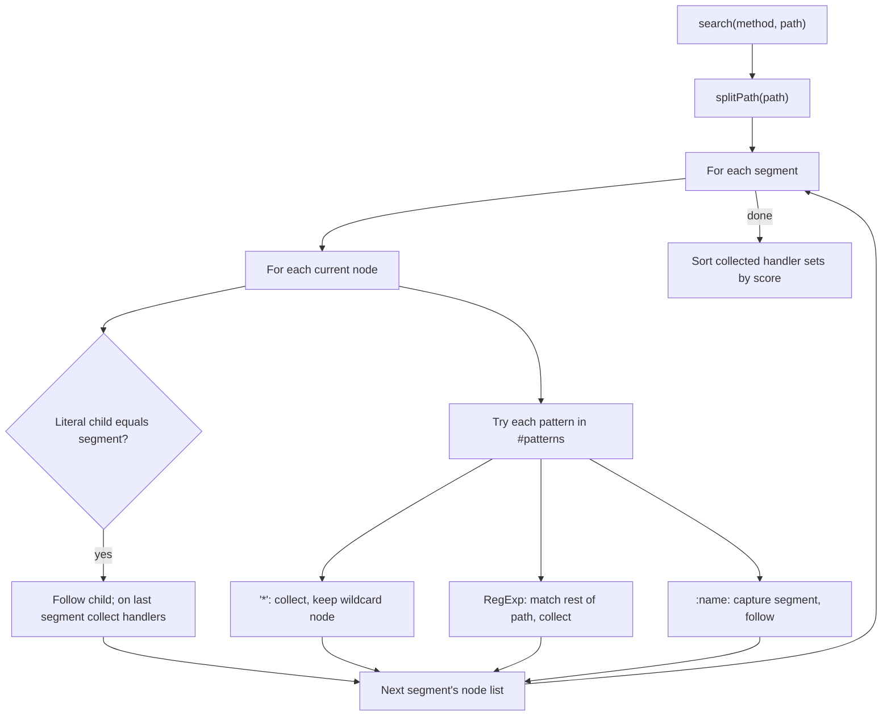

## Overview

`TrieRouter` stores routes in a tree with one level per path segment and matches a request by walking that tree segment by segment, following every branch that fits. It is slower per request than [[RegExpRouter]], but it accepts every pattern Hono supports, including static and dynamic segments at the same position and parameters with custom expressions that span slashes. That is why the default `SmartRouter` lists it second: when `RegExpRouter` refuses a route set, `TrieRouter` takes over (see [[Routers]]). It builds incrementally, so it also needs no compile step.

Sources: [src/router/trie-router/router.ts:5-28](repo://src/router/trie-router/router.ts#L5-L28), [src/hono.ts:22-33](repo://src/hono.ts#L22-L33)

The router class is a thin wrapper: `add` expands optional parameters with `checkOptionalParameter` and inserts each resulting path into the root `Node`; `match` calls `search` on it. All the logic lives in `Node`.

Sources: [src/router/trie-router/router.ts:13-27](repo://src/router/trie-router/router.ts#L13-L27)

## Node structure

Each `Node` holds five fields.

Sources: [src/router/trie-router/node.ts:25-42](repo://src/router/trie-router/node.ts#L25-L42)

| Field | Purpose |
| --- | --- |
| `#children` | Child nodes keyed by literal segment, by the label (`:id`, `:id{[0-9]+}`) or by `*` |
| `#patterns` | The dynamic children of this node, as parsed patterns, tried on every request |
| `#methods` | Handler sets registered on this exact node, one record per registration, keyed by method |
| `#params` | Parameters collected on the way to this node during the current search |
| `#order` | On the root only: a counter incremented on every insert |

Sources: [src/router/trie-router/node.ts:6-42](repo://src/router/trie-router/node.ts#L6-L42)

## Inserting a route

`insert` splits the route path with `splitRoutingPath`, which first hides `{...}` groups behind marks so slashes inside a custom pattern do not split it, then restores them in the right segment. For each segment it asks `getPattern(segment, nextSegment)`:

Sources: [src/router/trie-router/node.ts:44-85](repo://src/router/trie-router/node.ts#L44-L85), [src/utils/url.ts:16-48](repo://src/utils/url.ts#L16-L48)

| Segment | Pattern |
| --- | --- |
| `*` | `'*'` |
| `:name` | `[label, name, true]`: matches any one segment |
| `:name{re}` followed by a literal segment | `[cacheKey, name, /^re(?=\/next)/]`: may span slashes, but must stop before the next literal |
| `:name{re}` otherwise | `[label, name, /^re$/]` |
| literal | `null` |

Sources: [src/utils/url.ts:50-78](repo://src/utils/url.ts#L50-L78)

An existing child with the same key is reused; otherwise a new child is created and, for dynamic segments, the pattern is appended to the parent's `#patterns`. The parameter names met on the way become the route's `possibleKeys`. At the last node the route is stored as `{ [method]: { handler, possibleKeys, score } }`, where `score` is the root's insert counter. That score is what restores registration order at match time, since a search collects handlers from many branches in tree order.

Sources: [src/router/trie-router/node.ts:44-85](repo://src/router/trie-router/node.ts#L44-L85)

## Searching

### The walk

`search` splits the request path on `/` and keeps a list of current nodes, starting with the root. For each segment it builds the next list from every current node:

Sources: [src/router/trie-router/node.ts:114-158](repo://src/router/trie-router/node.ts#L114-L158)

1. A literal child equal to the segment is followed. On the last segment its handlers are collected, together with those of a `*` child below it, so `/hello/*` also matches `/hello`.
2. A `*` pattern collects the handlers of the `*` child immediately and keeps it in the list, so the wildcard can absorb any number of further segments.
3. A `:name{re}` pattern runs its expression against the rest of the path from this segment on. On a match the parameter takes the matched text, the child's handlers are collected, and if the child has children the walk resumes at the segment after the matched text.
4. A plain `:name` pattern (or a custom one that matches only this segment) records the segment as the parameter. On the last segment the child's handlers are collected; otherwise the child joins the next list.

Sources: [src/router/trie-router/node.ts:132-235](repo://src/router/trie-router/node.ts#L132-L235)

Sources: [src/router/trie-router/node.ts:114-158](repo://src/router/trie-router/node.ts#L114-L158), [src/router/trie-router/node.ts:174-243](repo://src/router/trie-router/node.ts#L174-L243)

### Collecting handlers and parameters

`#pushHandlerSets` takes every record on a node whose method matches the request or is `ALL`, and fills its `params` from the parameters gathered along the branch, restricted to the route's `possibleKeys`. When the same name was captured by two paths of the walk, the value from the branch being processed wins for the first key of each record. Records whose branch captured no parameters share the frozen `emptyParams` object instead of allocating.

Sources: [src/router/trie-router/node.ts:87-112](repo://src/router/trie-router/node.ts#L87-L112)

### Ordering

Because several branches can match at once (a static route, a parameter route and wildcard middleware for the same path), the collected handler sets are sorted by `score` when there is more than one. The result is the second `Result` shape from [[Routers]], `[[handler, params][]]`, with handlers in the order they were registered, which is the order [[Request Lifecycle and Middleware Composition]] runs them in.

Sources: [src/router/trie-router/node.ts:237-243](repo://src/router/trie-router/node.ts#L237-L243)

## What it supports that RegExpRouter does not

| Route set | `RegExpRouter` | `TrieRouter` |
| --- | --- | --- |
| `/users/me` and `/users/:id` | `UnsupportedPathError` | Both match `/users/me`, in registration order |
| `/posts/:id` and `/posts/:slug` | `UnsupportedPathError` | Both match, each with its own name |
| `/:type/:id` and `/:class/:id` | `UnsupportedPathError` | Both match |
| `/files/:path{.+}` across slashes | Supported | Supported, by matching against the rest of the path |

Sources: [src/router/reg-exp-router/node.ts:82-102](repo://src/router/reg-exp-router/node.ts#L82-L102), [src/router/trie-router/node.ts:174-229](repo://src/router/trie-router/node.ts#L174-L229)

The cost of that generality is that every request walks the tree and tries every pattern at each visited node, and every matched record gets a fresh `params` object. For most apps the difference is small; route sets that `RegExpRouter` can compile still use it under the default `SmartRouter`.

Sources: [src/router/trie-router/node.ts:87-112](repo://src/router/trie-router/node.ts#L87-L112), [src/router/smart-router/router.ts:21-61](repo://src/router/smart-router/router.ts#L21-L61)
