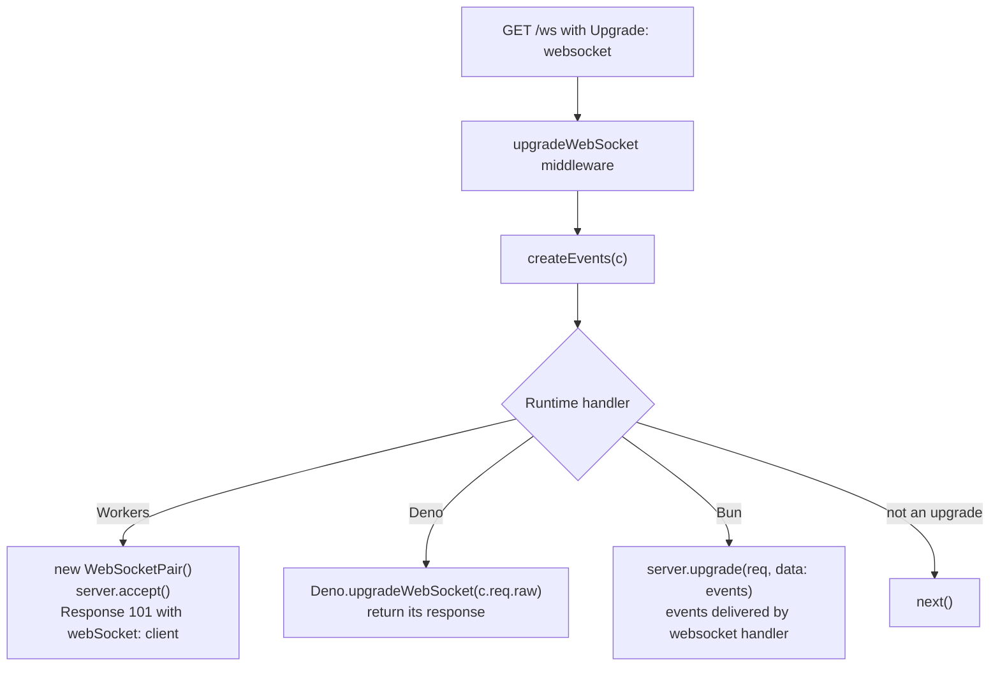

## Overview

Every runtime upgrades an HTTP request to a WebSocket in its own way: Cloudflare Workers create a `WebSocketPair`, Deno calls `Deno.upgradeWebSocket`, Bun asks its server object to upgrade and delivers events to a separate handler. Hono hides the difference behind one function, `upgradeWebSocket`, imported from the runtime's adapter. Its signature, the event callbacks and the `WSContext` object handed to them are the same everywhere; only the upgrade itself is runtime-specific. The common part is `src/helper/websocket`, and each adapter builds its `upgradeWebSocket` with `defineWebSocketHelper`.

Sources: [src/helper/websocket/index.ts:111-140](repo://src/helper/websocket/index.ts#L111-L140), [src/adapter/cloudflare-workers/websocket.ts:5-10](repo://src/adapter/cloudflare-workers/websocket.ts#L5-L10)

```ts
import { upgradeWebSocket } from 'hono/cloudflare-workers' // or 'hono/deno', 'hono/bun'

app.get(
  '/ws',
  upgradeWebSocket((c) => ({
    onMessage(event, ws) {
      ws.send(`echo: ${event.data}`)
    },
    onClose() {
      console.log('closed')
    },
  }))
)
```

Sources: [src/helper/websocket/index.ts:14-40](repo://src/helper/websocket/index.ts#L14-L40)

## The shared API

### Events

`createEvents(c)` runs per request and returns the callbacks, so they can close over request data such as the user from an auth middleware or a route parameter. Each callback receives the event and a `WSContext`:

Sources: [src/helper/websocket/index.ts:14-19](repo://src/helper/websocket/index.ts#L14-L19), [src/helper/websocket/index.ts:119-128](repo://src/helper/websocket/index.ts#L119-L128)

| Callback | Event |
| --- | --- |
| `onOpen` | The connection is open (not on Cloudflare Workers, which has no open event) |
| `onMessage` | A `MessageEvent` whose `data` is a string, `Blob` or `ArrayBuffer` |
| `onClose` | A `CloseEvent` with `code` and `reason` |
| `onError` | An error on the socket |

Sources: [src/helper/websocket/index.ts:14-19](repo://src/helper/websocket/index.ts#L14-L19), [src/adapter/cloudflare-workers/websocket.ts:34-44](repo://src/adapter/cloudflare-workers/websocket.ts#L34-L44)

### WSContext

`WSContext` wraps the runtime socket behind a fixed interface: `send(data, { compress })`, `close(code, reason)`, a live `readyState`, `url`, `protocol` (the negotiated subprotocol), `binaryType` and `raw` (the runtime's own socket object, for features outside the common interface). It is built from a `WSContextInit` the adapter supplies, with getters so `readyState` and `protocol` reflect the socket's current values.

Sources: [src/helper/websocket/index.ts:45-91](repo://src/helper/websocket/index.ts#L45-L91)

### Two call forms

`defineWebSocketHelper(handler)` returns a function that accepts two forms:

Sources: [src/helper/websocket/index.ts:111-118](repo://src/helper/websocket/index.ts#L111-L118)

1. `upgradeWebSocket(createEvents, options)` returns middleware. It builds the events, calls the runtime handler, and returns the handler's response; if the handler returns nothing (the request was not an upgrade request) it calls `next()`, so the same path can also serve ordinary HTTP.
2. `upgradeWebSocket(c, events, options)` is called inside a handler and returns a promise of the response, throwing `Failed to upgrade WebSocket` when the request could not be upgraded. This form lets a handler decide whether to upgrade after checking the request.

Sources: [src/helper/websocket/index.ts:119-139](repo://src/helper/websocket/index.ts#L119-L139)

The middleware form is typed with `outputFormat: 'ws'`, which the [[RPC Client]] uses to expose `$ws()` on that route, returning a `WebSocket` to the URL with `http` replaced by `ws`.

Sources: [src/helper/websocket/index.ts:24-40](repo://src/helper/websocket/index.ts#L24-L40), [src/client/types.ts:111-117](repo://src/client/types.ts#L111-L117)

## Runtime implementations

### Upgrade paths by runtime



Sources: [src/adapter/cloudflare-workers/websocket.ts:10-53](repo://src/adapter/cloudflare-workers/websocket.ts#L10-L53), [src/adapter/deno/websocket.ts:4-38](repo://src/adapter/deno/websocket.ts#L4-L38), [src/adapter/bun/websocket.ts:48-74](repo://src/adapter/bun/websocket.ts#L48-L74)

### Cloudflare Workers

The handler checks `Upgrade: websocket`, creates a `WebSocketPair`, wraps the server end in a `WSContext`, attaches `close`, `message` and `error` listeners, calls `server.accept()`, and returns a 101 response carrying the client end in its `webSocket` field. Workers have no open event, so `onOpen` is excluded from the type.

Sources: [src/adapter/cloudflare-workers/websocket.ts:5-53](repo://src/adapter/cloudflare-workers/websocket.ts#L5-L53)

### Deno

The handler checks the header, then calls `Deno.upgradeWebSocket(c.req.raw, options)`, passing through Deno's own options. It echoes the first requested subprotocol back, because browsers reject a connection that asked for a subprotocol and got no `Sec-WebSocket-Protocol` in the answer. The four socket callbacks are wired to the events and Deno's response is returned.

Sources: [src/adapter/deno/websocket.ts:4-38](repo://src/adapter/deno/websocket.ts#L4-L38)

### Bun

Bun splits the work. `upgradeWebSocket` finds the Bun server with `getBunServer(c)` (from `c.env`, or `c.env.server`), throwing a `TypeError` if the app was not given the server as the second argument of `fetch`. It calls `server.upgrade(req, { data })`, storing the events, URL and first subprotocol in the socket's `data`, and returns an empty response on success. Bun then reports socket activity to the `websocket` handler object passed to `Bun.serve`, whose `open`, `message` and `close` methods read the events from `ws.data` and call them with a fresh `WSContext` and standard `Event`, `MessageEvent` or `CloseEvent` objects.

Sources: [src/adapter/bun/websocket.ts:33-104](repo://src/adapter/bun/websocket.ts#L33-L104), [src/adapter/bun/server.ts:13-14](repo://src/adapter/bun/server.ts#L13-L14)

```ts
import { upgradeWebSocket, websocket } from 'hono/bun'

export default {
  fetch: app.fetch,
  websocket,
}
```

Sources: [src/adapter/bun/websocket.ts:76-113](repo://src/adapter/bun/websocket.ts#L76-L113)

`createBunWebSocket()` returns the same `upgradeWebSocket` and `websocket` pair and remains for older code. Node.js support lives outside this repository, in the Node.js server package.

Sources: [src/adapter/bun/websocket.ts:110-113](repo://src/adapter/bun/websocket.ts#L110-L113)

## Writing a new runtime adapter

A runtime adapter is a function passed to `defineWebSocketHelper` that receives `(c, events, options)`. It should return nothing for requests that are not upgrades, perform the runtime's upgrade, build a `WSContext` from a `WSContextInit` whose `send`, `close`, `readyState`, `url` and `protocol` delegate to the runtime socket, call the event callbacks from the runtime's socket events, and return the upgrade response. `createWSMessageEvent` builds a standard `MessageEvent` when the runtime hands over raw data.

Sources: [src/helper/websocket/index.ts:93-113](repo://src/helper/websocket/index.ts#L93-L113)
