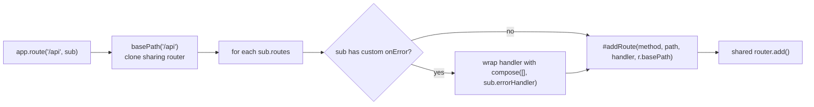

## Overview

An application is an instance of `Hono`. Building one means choosing a router, then calling registration methods (`get`, `post`, `use`, `on`, `route`, `mount`) that each turn into one or more `#addRoute` calls. `#addRoute` hands the handler to the router and appends a `RouterRoute` record to `app.routes`; nothing is compiled until the first request, when the router builds its matcher. What happens on each request is described in [[Request Lifecycle and Middleware Composition]], and how routers match paths in [[Routers and Route Syntax]].

Sources: [src/hono-base.ts:98-173](repo://src/hono-base.ts#L98-L173), [src/hono-base.ts:385-397](repo://src/hono-base.ts#L385-L397)

## HonoBase and the presets

`HonoBase` (exported from `hono/hono-base`) holds every registration and dispatch method but declares `router` without assigning it. Each preset is a subclass whose constructor assigns a router, so the preset decides the trade-off between startup cost and matching speed.

Sources: [src/hono-base.ts:114-119](repo://src/hono-base.ts#L114-L119)

| Import | Router | When to use it |
| --- | --- | --- |
| `hono` | `options.router`, or `SmartRouter` over `RegExpRouter` and `TrieRouter` | The default: fastest matching for long-lived processes |
| `hono/quick` | `SmartRouter` over `LinearRouter` and `TrieRouter` | Environments that start a process per request, where building a matcher costs more than it saves |
| `hono/tiny` | `PatternRouter` | Smallest bundle size |

Sources: [src/hono.ts:16-34](repo://src/hono.ts#L16-L34), [src/preset/quick.ts:13-24](repo://src/preset/quick.ts#L13-L24), [src/preset/tiny.ts:10-20](repo://src/preset/tiny.ts#L10-L20)

Only the default `Hono` reads `options.router`; the presets ignore it and always install their own router.

Sources: [src/hono.ts:26-33](repo://src/hono.ts#L26-L33), [src/preset/quick.ts:18-23](repo://src/preset/quick.ts#L18-L23)

## Options

`HonoOptions` has three fields. The constructor copies every option except `strict` onto the instance, then decides `getPath`.

Sources: [src/hono-base.ts:46-87](repo://src/hono-base.ts#L46-L87), [src/hono-base.ts:170-172](repo://src/hono-base.ts#L170-L172)

| Option | Default | Effect |
| --- | --- | --- |
| `strict` | `true` | When `false`, a trailing slash is removed before matching, so `/hello/` and `/hello` hit the same route |
| `router` | `SmartRouter` (in `hono`) | Any object implementing the `Router` interface |
| `getPath` | `getPath` from `utils/url` | Computes the path the router sees from the `Request` and the bindings; used for host-based routing |

Sources: [src/hono-base.ts:46-87](repo://src/hono-base.ts#L46-L87)

> [!WARNING]
> `strict: false` replaces `getPath` with `getPathNoStrict`, which ignores a custom `getPath` option. Pass one or the other.

Sources: [src/hono-base.ts:172-172](repo://src/hono-base.ts#L172-L172), [src/utils/url.ts:141-146](repo://src/utils/url.ts#L141-L146)

The default `getPath` scans the URL from the first `/` after the scheme up to `?` or `#`. It only decodes when it meets a `%`, through `tryDecodeURI`, and protects an encoded `%25` so that decoding cannot create new escape sequences. Paths without percent-encoding are sliced without allocating a `URL` object.

Sources: [src/utils/url.ts:106-134](repo://src/utils/url.ts#L106-L134)

## Registering handlers

### Method handlers

The constructor generates `get`, `post`, `put`, `delete`, `options`, `patch` and `all` from `METHODS` plus `all`. Each accepts an optional path followed by handlers. A string first argument sets the private `#path`; otherwise every argument is a handler registered on the current `#path`. This makes chaining work: `app.get('/post', list).post(create)` registers `create` on `/post` because `#path` is still `/post`.

Sources: [src/hono-base.ts:127-141](repo://src/hono-base.ts#L127-L141), [src/router.ts:9-17](repo://src/router.ts#L9-L17)

### on()

`on(method, path, ...handlers)` takes a method or array of methods and a path or array of paths, upper-cases each method, and registers every handler for every pair. It is how routes are added for methods without a shortcut, such as `PURGE`.

Sources: [src/hono-base.ts:143-154](repo://src/hono-base.ts#L143-L154)

### use()

`use([path], ...middleware)` registers handlers under the method `ALL`. Without a path the path is `*`, which matches every request. Middleware and handlers are stored the same way; the only difference is that middleware is expected to call `await next()`, which [[Request Lifecycle and Middleware Composition]] explains.

Sources: [src/hono-base.ts:156-168](repo://src/hono-base.ts#L156-L168)

## The route record

`#addRoute` upper-cases the method, prefixes the path with the app's `_basePath` through `mergePath`, and builds a `RouterRoute` of `basePath`, `path`, `method` and `handler`. The router receives the pair `[handler, route]`, so a match result carries both the function to call and the metadata the route helpers read. The same record is pushed to `app.routes`, the list `showRoutes` and `route()` read.

Sources: [src/hono-base.ts:385-397](repo://src/hono-base.ts#L385-L397)

`mergePath` joins paths with exactly one slash between them, adds a leading slash when the base has none, and drops a sub-path of `/`, so `mergePath('/api', '/')` is `/api`.

Sources: [src/utils/url.ts:148-169](repo://src/utils/url.ts#L148-L169)

Routes must all be registered before the first request. Routers build their matcher on the first `match` and then refuse `add` with `Can not add a route since the matcher is already built.`

Sources: [src/router.ts:21-22](repo://src/router.ts#L21-L22), [src/router/smart-router/router.ts:13-19](repo://src/router/smart-router/router.ts#L13-L19)

## Grouping applications

### basePath()

`basePath(path)` returns a clone, not the same app. `#clone` creates a new `Hono` that shares the original's `router`, `getPath`, error handler, not-found handler and the `routes` array, and the clone's `_basePath` is the merged path. Routes added to the clone land in the shared router with the prefix, so `new Hono().basePath('/api')` is an app whose routes all start with `/api`.

Sources: [src/hono-base.ts:175-184](repo://src/hono-base.ts#L175-L184), [src/hono-base.ts:247-253](repo://src/hono-base.ts#L247-L253)

### route()

`route(path, subApp)` copies the sub-app's routes into the parent at the time of the call. It creates a prefixed clone with `basePath(path)` and re-adds each of `subApp.routes`, passing the original `r.basePath` so the route keeps its own base under the new prefix. Routes added to the sub-app after `route()` is called are not copied.

Sources: [src/hono-base.ts:208-232](repo://src/hono-base.ts#L208-L232)

When the sub-app has its own `onError`, each copied handler is wrapped: the wrapper runs the original handler through `compose([], subApp.errorHandler)`, so an error thrown inside the sub-app's routes is handled by the sub-app's handler, not the parent's. The original is kept under the `COMPOSED_HANDLER` symbol so tools such as `showRoutes` can find the real function. A sub-app's `notFound` handler is not copied; the parent's applies.

Sources: [src/hono-base.ts:219-229](repo://src/hono-base.ts#L219-L229), [src/utils/constants.ts:1-4](repo://src/utils/constants.ts#L1-L4)

Sources: [src/hono-base.ts:208-232](repo://src/hono-base.ts#L208-L232), [src/hono-base.ts:385-397](repo://src/hono-base.ts#L385-L397)

The return type of `route()` merges the sub-app's schema under the prefix, which is how a client built from the parent sees every sub-app route; see [[Type System and Route Schemas]].

Sources: [src/hono-base.ts:214-217](repo://src/hono-base.ts#L214-L217)

## Mounting other applications

`mount(path, handler, options)` registers a middleware on `ALL` and `path/*` that calls any function of the shape `(request, ...args) => Response`, which is how apps written for other Web-Standard frameworks run inside Hono. By default the request is rebuilt with the mount prefix stripped from its pathname, and the handler receives `c.env` and `c.executionCtx` (or `undefined` when the runtime has none) as extra arguments.

Sources: [src/hono-base.ts:328-383](repo://src/hono-base.ts#L328-L383)

| Option | Effect |
| --- | --- |
| a function | Shorthand for `optionHandler` |
| `optionHandler(c)` | Returns the extra arguments for the mounted handler; an array is spread |
| `replaceRequest(req)` | Builds the request the mounted app sees; `false` passes the original request unchanged |

Sources: [src/hono-base.ts:89-96](repo://src/hono-base.ts#L89-L96), [src/hono-base.ts:334-370](repo://src/hono-base.ts#L334-L370)

If the mounted handler returns a falsy value, the middleware calls `next()`, so later Hono routes still get the request.

Sources: [src/hono-base.ts:372-380](repo://src/hono-base.ts#L372-L380)

## Error and not-found handlers

`onError(handler)` and `notFound(handler)` replace the app's handlers and return the app for chaining. The defaults answer `404 Not Found` as text, and for errors either the response of an error with `getResponse()` (such as `HTTPException`) or `Internal Server Error` with status 500 after logging. How they are invoked is part of [[Request Lifecycle and Middleware Composition]].

Sources: [src/hono-base.ts:31-42](repo://src/hono-base.ts#L31-L42), [src/hono-base.ts:271-294](repo://src/hono-base.ts#L271-L294)
