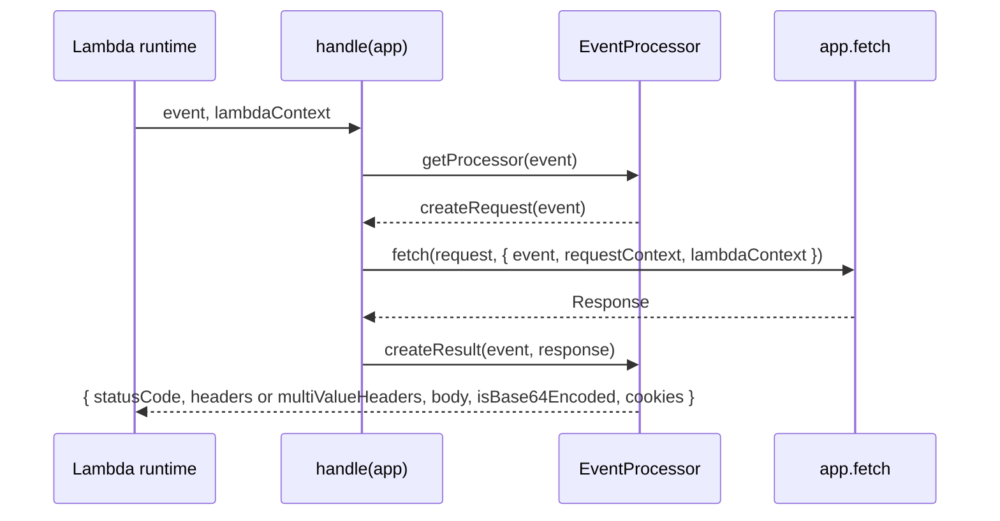

## Overview

AWS Lambda does not speak `Request` and `Response`. Each trigger delivers a JSON event in its own format and expects a JSON result back, so `hono/aws-lambda` translates both ways around `app.fetch`. `handle(app)` covers API Gateway REST APIs (payload v1), HTTP APIs and Lambda Function URLs (payload v2), Application Load Balancers and VPC Lattice, and returns a buffered result. `streamHandle(app)` uses Lambda response streaming instead. `hono/lambda-edge` does the same for CloudFront events. The general adapter model is on [[Runtime Adapters]].

Sources: [src/adapter/aws-lambda/handler.ts:23-27](repo://src/adapter/aws-lambda/handler.ts#L23-L27), [src/adapter/aws-lambda/handler.ts:239-276](repo://src/adapter/aws-lambda/handler.ts#L239-L276), [src/adapter/aws-lambda/index.ts:1-14](repo://src/adapter/aws-lambda/index.ts#L1-L14)

```ts
import { Hono } from 'hono'
import { handle } from 'hono/aws-lambda'

const app = new Hono()
app.get('/hello', (c) => c.json({ path: c.req.path, requestId: c.env.lambdaContext?.awsRequestId }))

export const handler = handle(app)
```

Sources: [src/adapter/aws-lambda/handler.ts:239-276](repo://src/adapter/aws-lambda/handler.ts#L239-L276)

## handle()



Sources: [src/adapter/aws-lambda/handler.ts:239-276](repo://src/adapter/aws-lambda/handler.ts#L239-L276)

The bindings passed to the app are `{ event, requestContext, lambdaContext }`, so handlers read authorizer claims from `c.env.requestContext` or the raw event from `c.env.event`. If building the `Request` fails (for example a malformed URL), the handler does not call the app: it answers 400 `Invalid request` for a `TypeError` and 500 otherwise, formatted for the event type.

Sources: [src/adapter/aws-lambda/handler.ts:252-275](repo://src/adapter/aws-lambda/handler.ts#L252-L275)

## Event processors

### Choosing a processor

`getProcessor(event)` inspects the request context: `elb` means ALB, `serviceArn` means VPC Lattice, and an event with `rawPath` plus `requestContext.http` means payload v2. Everything else is treated as API Gateway v1. Checking `http` matters because a v1 event behind a custom-domain base path mapping also carries `rawPath`.

Sources: [src/adapter/aws-lambda/handler.ts:625-664](repo://src/adapter/aws-lambda/handler.ts#L625-L664)

The shared base class `EventProcessor` builds the request the same way for every source, and each subclass supplies the event-specific parts:

Sources: [src/adapter/aws-lambda/handler.ts:278-293](repo://src/adapter/aws-lambda/handler.ts#L278-L293)

| Processor | Path, method | Query string | Request headers and cookies | Response cookies |
| --- | --- | --- | --- | --- |
| `EventV2Processor` | `rawPath`, `requestContext.http.method` | `rawQueryString` as sent | `headers`; `event.cookies` joined into `Cookie` | `result.cookies` array |
| `EventV1Processor` | `path`, `httpMethod` | Rebuilt from `multiValueQueryStringParameters` (or the single-value form), re-encoded | `multiValueHeaders` appended, then `headers` | `multiValueHeaders['set-cookie']` |
| `ALBProcessor` | `path`, `httpMethod` | Rebuilt from the multi-value form when present | `multiValueHeaders` joined, or `headers` | Multi-value list, or only the first cookie in single-value mode |
| `LatticeV2Processor` | `path`, `method` | none | Multi-value `headers` | `headers['set-cookie']` list |

Sources: [src/adapter/aws-lambda/handler.ts:404-501](repo://src/adapter/aws-lambda/handler.ts#L404-L501), [src/adapter/aws-lambda/handler.ts:503-582](repo://src/adapter/aws-lambda/handler.ts#L503-L582), [src/adapter/aws-lambda/handler.ts:584-623](repo://src/adapter/aws-lambda/handler.ts#L584-L623)

API Gateway v1 passes decoded query values, so the v1 processor encodes them again to reproduce a valid URL. Non-ASCII header values, which the `Headers` constructor rejects, are percent-encoded by `sanitizeHeaderValue`.

Sources: [src/adapter/aws-lambda/handler.ts:13-21](repo://src/adapter/aws-lambda/handler.ts#L13-L21), [src/adapter/aws-lambda/handler.ts:447-467](repo://src/adapter/aws-lambda/handler.ts#L447-L467)

### Building the Request

`createRequest` assembles `https://{domain}{path}?{query}`, taking the domain from `requestContext.domainName` or the `Host` header. A body flagged `isBase64Encoded` is decoded to bytes; otherwise it is UTF-8 encoded. `Content-Length` is set to the byte length either way.

Sources: [src/adapter/aws-lambda/handler.ts:295-341](repo://src/adapter/aws-lambda/handler.ts#L295-L341)

### Building the result

`createResult` decides whether the body must be base64: when `isContentTypeBinary(contentType)` says so, or when the response has a `Content-Encoding` other than `identity` (a compressed body is binary). The default `defaultIsContentTypeBinary` treats everything as binary except `text/plain`, `text/html`, `text/css`, `text/javascript`, `text/csv` and JSON or XML types; `handle(app, { isContentTypeBinary })` overrides it. The result uses `multiValueHeaders` when the event did, plain `headers` otherwise, and `Set-Cookie` headers are moved to the processor's cookie field so several cookies survive.

Sources: [src/adapter/aws-lambda/handler.ts:343-401](repo://src/adapter/aws-lambda/handler.ts#L343-L401), [src/adapter/aws-lambda/handler.ts:666-674](repo://src/adapter/aws-lambda/handler.ts#L666-L674)

> [!NOTE]
> The whole body is read into memory and, for binary types, base64-encoded, so responses are limited by Lambda's payload size. Use `streamHandle` for large or long-running responses.

Sources: [src/adapter/aws-lambda/handler.ts:352-358](repo://src/adapter/aws-lambda/handler.ts#L352-L358)

## streamHandle()

`streamHandle(app)` wraps the app with `awslambda.streamifyResponse`, available in the Lambda Node.js runtime when the function URL or invoke mode uses response streaming. The request is built by the same processors and the bindings are `{ event, requestContext, context }`. The status, headers and cookies are written first through `awslambda.HttpResponseStream.from`, then the response body is copied chunk by chunk to the Node.js stream as the app produces it, so `streamText` and `streamSSE` (see [[Streaming Responses]]) reach the client incrementally. An error writes `Internal Server Error` to the stream, and the stream is always ended.

Sources: [src/adapter/aws-lambda/handler.ts:126-193](repo://src/adapter/aws-lambda/handler.ts#L126-L193)

## Connection info

`getConnInfo` from `hono/aws-lambda` reads `c.env.requestContext`: `identity.sourceIp` for API Gateway v1, `http.sourceIp` for v2, and for ALB the last entry of `X-Forwarded-For`, which is the address the load balancer appended.

Sources: [src/adapter/aws-lambda/conninfo.ts:45-73](repo://src/adapter/aws-lambda/conninfo.ts#L45-L73)

## Lambda@Edge

### Request and bindings

`handle(app)` from `hono/lambda-edge` receives a CloudFront event and uses its first record. It builds the URL from the `Host` header (or the distribution domain), `uri` and `querystring`, appends every header from CloudFront's `{ key, value }` lists, and decodes a base64 body for methods other than GET and HEAD. The app's bindings include the event, `config`, `request`, `response` (for origin-response triggers) and a `callback`.

Sources: [src/adapter/lambda-edge/handler.ts:116-147](repo://src/adapter/lambda-edge/handler.ts#L116-L147), [src/adapter/lambda-edge/handler.ts:164-212](repo://src/adapter/lambda-edge/handler.ts#L164-L212)

### Result

There are two ways to answer. Normally the app's `Response` becomes a CloudFront result: status as a string, headers converted back to lower-case `{ key, value }` lists, and the body base64-encoded with `bodyEncoding: 'base64'` when its type is binary (SVG, JSON and XML count as text here) or it is compressed. Alternatively a handler calls `c.env.callback(null, c.env.request)` to let CloudFront continue to the origin, possibly with a modified request; the first callback result wins over the app's response, and a callback error is thrown.

Sources: [src/adapter/lambda-edge/handler.ts:124-162](repo://src/adapter/lambda-edge/handler.ts#L124-L162), [src/adapter/lambda-edge/handler.ts:214-218](repo://src/adapter/lambda-edge/handler.ts#L214-L218)

The module sets `globalThis.crypto` from `node:crypto` when it is missing, because older Lambda@Edge Node.js runtimes lack the global Web Crypto that middleware such as JWT relies on.

Sources: [src/adapter/lambda-edge/handler.ts:1-8](repo://src/adapter/lambda-edge/handler.ts#L1-L8)
