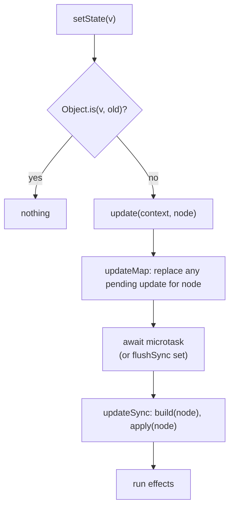

## Overview

`hono/jsx/dom` runs the same JSX components in the browser. Where the server renderer on [[JSX Server Rendering]] turns a tree into a string once, the DOM renderer keeps a virtual tree of `NodeObject`s, renders it into real elements, and re-renders a component when its state changes, touching only the DOM nodes that differ. It implements the React hooks API, so it can serve as a small React replacement through `hono/jsx/dom/client` (`createRoot`) and `hono/jsx/dom/server` (`renderToString`).

Sources: [src/jsx/dom/render.ts:41-80](repo://src/jsx/dom/render.ts#L41-L80), [src/jsx/dom/index.ts:39-127](repo://src/jsx/dom/index.ts#L39-L127)

To use it, set `jsxImportSource` to `hono/jsx/dom` for client bundles; components written against `hono/jsx` work unchanged because each JSX export can carry a `DOM_RENDERER` variant (`Suspense`, `ErrorBoundary`, context providers, `memo`, and the `title`/`link`/`form` elements) that the DOM renderer calls instead of the server version.

Sources: [src/jsx/dom/render.ts:274-291](repo://src/jsx/dom/render.ts#L274-L291), [src/jsx/streaming.ts:138-138](repo://src/jsx/streaming.ts#L138-L138), [src/jsx/base.ts:319-327](repo://src/jsx/base.ts#L319-L327)

## Entry points

| Function | From | Does |
| --- | --- | --- |
| `render(jsx, container)` | `hono/jsx/dom` | Builds the tree and replaces the container's children with it |
| `createRoot(el).render(jsx)` | `hono/jsx/dom/client` | Renders once; later `render` calls set state on a root component so the tree updates in place; `unmount()` renders `null` |
| `hydrateRoot(el, jsx)` | `hono/jsx/dom/client` | Same as `createRoot(el).render(jsx)`: the existing server HTML is replaced, not hydrated |
| `renderToString`, `renderToReadableStream` | `hono/jsx/dom/server` | React-DOM-compatible wrappers over the server renderer; async components are refused by `renderToString` |
| `createPortal(children, el)` | `hono/jsx/dom` | Renders children into another element |
| `flushSync(fn)` | `hono/jsx/dom` | Applies the state updates made inside `fn` synchronously |

Sources: [src/jsx/dom/render.ts:783-825](repo://src/jsx/dom/render.ts#L783-L825), [src/jsx/dom/client.ts:23-89](repo://src/jsx/dom/client.ts#L23-L89), [src/jsx/dom/server.ts:11-65](repo://src/jsx/dom/server.ts#L11-L65)

## The virtual tree

A `NodeObject` is a JSX node plus rendering state in short field names: `vC` the current virtual children, `vR` children to remove, `e` the real element, `c` the container, `pP` the previous props, `nN` the next sibling (for insertion position), `n` the namespace (SVG, MathML), and flags `f` (force rebuild) and `s` (skip: unchanged). Text is a `NodeString` with `t` (text) and `d` (dirty). Each function component's node has a `DOM_STASH`: the hook index, the hook state arrays, the context values it was built with, and the nearest error handler.

Sources: [src/jsx/dom/render.ts:37-80](repo://src/jsx/dom/render.ts#L37-L80)

## Build and apply

### Build: reconcile virtual children

`build(context, node)` computes a node's new children: a function component is called through `invokeTag`, which pushes `[context, node]` on `buildDataStack` so hooks know which component is rendering; an element uses its `children` prop. Each child is matched against the old children by `key` and tag when it has a key, otherwise by tag alone, in order. A matched old node is reused with the new props; a text node with new text is marked dirty. A function component whose props are unchanged under `memo`'s comparison and whose context values are the same is flagged `s` and not rebuilt. Unmatched old children go to `vR`.

Sources: [src/jsx/dom/render.ts:274-291](repo://src/jsx/dom/render.ts#L274-L291), [src/jsx/dom/render.ts:497-606](repo://src/jsx/dom/render.ts#L497-L606)

### Apply: patch the DOM

`apply` walks the rebuilt tree. `getNextChildren` flattens function components and fragments, which have no element of their own, into the list of real children for the container, collecting removals and effect callbacks on the way. Removed nodes are detached (running ref cleanups). Each child then gets its element: reused when skipped, created with `createElement` or `createElementNS` otherwise, its props diffed by `applyProps`, and its own children applied recursively. Elements are inserted or moved only when they are not already at the right position.

Sources: [src/jsx/dom/render.ts:293-332](repo://src/jsx/dom/render.ts#L293-L332), [src/jsx/dom/render.ts:364-462](repo://src/jsx/dom/render.ts#L364-L462)

`applyProps` compares each prop with its previous value: `on*` props become `addEventListener`/`removeEventListener` pairs (with `Capture` suffixes for the capture phase), `ref` is called or assigned with a cleanup registered, `style` objects are diffed per property, `dangerouslySetInnerHTML` sets `innerHTML`, and other values become properties or attributes.

Sources: [src/jsx/dom/render.ts:164-272](repo://src/jsx/dom/render.ts#L164-L272)

### Effects

After a container is patched, effects run in React's order: insertion effects immediately, layout effects synchronously, and `useEffect` callbacks in the next animation frame.

Sources: [src/jsx/dom/render.ts:463-481](repo://src/jsx/dom/render.ts#L463-L481)

## Updates

Sources: [src/jsx/hooks/index.ts:182-243](repo://src/jsx/hooks/index.ts#L182-L243), [src/jsx/dom/render.ts:713-781](repo://src/jsx/dom/render.ts#L713-L781)

A state setter stores the new value and calls `update` for the component's node, which rebuilds only that subtree. Updates are batched per node: `update` records the latest request in `updateMap`, waits a microtask, and runs only the last one, so several `setState` calls in one event cause one render. Inside `flushSync`, updates are collected in a set and run when the callback returns. `updateSync` restores the context values the node was built with before rebuilding, then applies the result to the node's existing container.

Sources: [src/jsx/dom/render.ts:713-781](repo://src/jsx/dom/render.ts#L713-L781), [src/jsx/dom/render.ts:801-813](repo://src/jsx/dom/render.ts#L801-L813)

## Hooks

Hooks live in `src/jsx/hooks` and store their data in the rendering node's `DOM_STASH`, indexed by call order, as in React. Outside a DOM render (`buildDataStack` empty, as on the server), `useState` returns the initial value and a no-op setter, so components that use hooks still render to strings.

Sources: [src/jsx/hooks/index.ts:8-20](repo://src/jsx/hooks/index.ts#L8-L20), [src/jsx/hooks/index.ts:182-196](repo://src/jsx/hooks/index.ts#L182-L196)

| Hooks | Notes |
| --- | --- |
| `useState`, `useReducer` | State per hook index; setters schedule `update` |
| `useEffect`, `useLayoutEffect`, `useInsertionEffect` | Run when dependencies change, with cleanup |
| `useMemo`, `useCallback`, `useRef`, `useId`, `useImperativeHandle`, `forwardRef`, `createRef` | Same semantics as React |
| `useTransition`, `startTransition`, `useDeferredValue` | Lower-priority updates tracked on a pending stack |
| `useViewTransition`, `startViewTransition` | Wrap updates in `document.startViewTransition` when the browser supports it |
| `use(promise)` | Throws the promise until it settles, then returns the cached value or throws the error; `Suspense` catches the throw |
| `useSyncExternalStore`, `useDebugValue` | React-compatible |
| `useActionState`, `useOptimistic`, `useFormStatus` | Form actions, below |

Sources: [src/jsx/hooks/index.ts:79-180](repo://src/jsx/hooks/index.ts#L79-L180), [src/jsx/hooks/index.ts:182-300](repo://src/jsx/hooks/index.ts#L182-L300), [src/jsx/hooks/index.ts:319-425](repo://src/jsx/hooks/index.ts#L319-L425), [src/jsx/dom/hooks/index.ts:24-91](repo://src/jsx/dom/hooks/index.ts#L24-L91)

## Forms and actions

In the DOM build, `<form action={fn}>` attaches a `submit` listener: it prevents the default submission, builds `FormData`, and calls `fn(formData)`. While the returned promise is pending, a `FormContext` provider around the form exposes `{ pending, data, method, action }` to `useFormStatus()` in its descendants. A `<button formAction={fn}>` or `<input formAction={fn}>` dispatches a synthetic submit carrying its own action. `useActionState(fn, initial)` returns the current state and an action that stores `await fn(state, formData)` as the new state.

Sources: [src/jsx/dom/intrinsic-element/components.ts:319-427](repo://src/jsx/dom/intrinsic-element/components.ts#L319-L427), [src/jsx/dom/hooks/index.ts:79-91](repo://src/jsx/dom/hooks/index.ts#L79-L91)

The DOM `title`, `meta`, `link`, `style` and `script` components insert into `document.head` and de-duplicate by key, the browser-side counterpart of the hoisting the server renderer does.

Sources: [src/jsx/dom/intrinsic-element/components.ts:58-120](repo://src/jsx/dom/intrinsic-element/components.ts#L58-L120), [src/jsx/dom/intrinsic-element/components.ts:257-316](repo://src/jsx/dom/intrinsic-element/components.ts#L257-L316)

## Errors and suspense in the browser

When a component throws during `build`, the renderer looks up the nearest error handler recorded in the node's stash (an `ErrorBoundary` or `Suspense` DOM renderer). The handler receives the error and a `retry` function and returns fallback content, which is built and applied in place of the boundary's children. A thrown promise from `use()` reaches `Suspense` this way, and `retry` re-renders the boundary when the promise settles.

Sources: [src/jsx/dom/render.ts:607-665](repo://src/jsx/dom/render.ts#L607-L665), [src/jsx/dom/components.ts:1-39](repo://src/jsx/dom/components.ts#L1-L39)

Scoped styles for client components come from the [[CSS Helper]], whose `hono/jsx/dom/css` variant injects rules into the document at runtime.

Sources: [src/jsx/dom/css.ts:1-60](repo://src/jsx/dom/css.ts#L1-L60)
