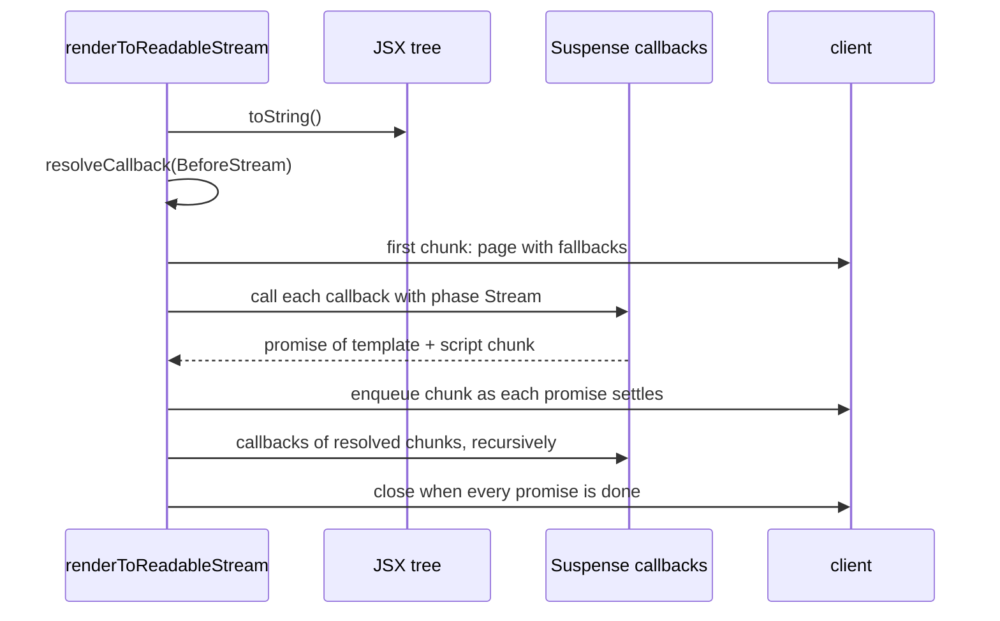

## Overview

Server-side JSX in Hono can contain async components: a component may be an `async` function that awaits data. [[JSX Server Rendering]] explains how such a tree renders to a `Promise<string>` that `c.html()` awaits, sending nothing until every component has finished. `Suspense` and `ErrorBoundary` change that. With `renderToReadableStream`, the page is sent at once with fallbacks in place, and each suspended part follows later in the same response as a small chunk that swaps itself in. Both components work in plain `c.html()` rendering too, where the final document simply contains the resolved content.

Sources: [src/jsx/streaming.ts:42-137](repo://src/jsx/streaming.ts#L42-L137), [src/jsx/streaming.ts:146-220](repo://src/jsx/streaming.ts#L146-L220)

Both components are marked experimental in the source.

Sources: [src/jsx/streaming.ts:36-41](repo://src/jsx/streaming.ts#L36-L41), [src/jsx/components.ts:51-54](repo://src/jsx/components.ts#L51-L54)

```tsx
import { Suspense, renderToReadableStream } from 'hono/jsx/streaming'

const Posts = async () => {
  const posts = await fetchPosts()
  return <ul>{posts.map((p) => <li>{p.title}</li>)}</ul>
}

app.get('/', (c) =>
  c.body(
    renderToReadableStream(
      <html>
        <body>
          <Suspense fallback={<p>Loading...</p>}>
            <Posts />
          </Suspense>
        </body>
      </html>
    ),
    { headers: { 'Content-Type': 'text/html; charset=UTF-8', 'Transfer-Encoding': 'chunked' } }
  )
)
```

Sources: [src/jsx/streaming.ts:42-50](repo://src/jsx/streaming.ts#L42-L50), [src/jsx/streaming.ts:146-149](repo://src/jsx/streaming.ts#L146-L149)

## Callbacks and phases

Streaming is built on the callbacks an `HtmlEscapedString` can carry (see [[JSX Server Rendering]]). A callback receives `{ phase, buffer, context }` and may return a promise of more HTML. `context` is an object unique to the render, used as a `WeakMap` key by callbacks that need per-document state. The phase tells it how the output is being produced:

Sources: [src/utils/html.ts:6-21](repo://src/utils/html.ts#L6-L21)

| Phase | Used by | Callback's job |
| --- | --- | --- |
| `Stringify` | `c.html()` and `toString()` on a finished tree | Rewrite `buffer[0]`, the whole document, in place |
| `BeforeStream` | The first chunk of `renderToReadableStream` | Usually nothing: leave placeholders in the first chunk |
| `Stream` | Later chunks of `renderToReadableStream` | Return a chunk of HTML to append to the stream |

Sources: [src/utils/html.ts:6-10](repo://src/utils/html.ts#L6-L10), [src/utils/html.ts:142-182](repo://src/utils/html.ts#L142-L182)

`resolveCallback(str, phase, preserveCallbacks, context, buffer)` awaits the string, runs its callbacks with the phase, and recursively resolves whatever they return into the same buffer. `c.html()` calls it with `Stringify`.

Sources: [src/utils/html.ts:142-182](repo://src/utils/html.ts#L142-L182), [src/context.ts:723-733](repo://src/context.ts#L723-L733)

## Suspense

### Rendering the children

`Suspense({ children, fallback })` renders its children with `toString()`. Two things can make them asynchronous: a child returns a promise (an async component), or a child throws a promise. The second is how the `use()` hook suspends, and `Suspense` catches it, captures the render context, and re-renders the children once the promise settles. A stack entry is pushed on `buildDataStack` around the render so `use()` has a place to store its state.

Sources: [src/jsx/streaming.ts:46-85](repo://src/jsx/streaming.ts#L46-L85), [src/jsx/components.ts:14-30](repo://src/jsx/components.ts#L14-L30)

If nothing is asynchronous, `Suspense` returns the children's HTML directly and the fallback is never rendered.

Sources: [src/jsx/streaming.ts:134-136](repo://src/jsx/streaming.ts#L134-L136)

### The placeholder

Otherwise it takes a number from a module-wide counter and returns the fallback wrapped in markers, with a callback attached:

Sources: [src/jsx/streaming.ts:87-91](repo://src/jsx/streaming.ts#L87-L91)

```html
<template id="H:0"></template><p>Loading...</p><!--/$-->
```

Sources: [src/jsx/streaming.ts:88-90](repo://src/jsx/streaming.ts#L88-L90)

The callback does nothing in `BeforeStream`. In the other phases it waits for the children and then either rewrites the buffer (`Stringify`: a regular expression replaces everything from `<template id="H:0">` to `<!--/$-->` with the content) or returns a streaming chunk:

Sources: [src/jsx/streaming.ts:92-118](repo://src/jsx/streaming.ts#L92-L118)

```html
<template data-hono-target="H:0"><ul>...</ul></template><script>
((d,c,n) => {
c=d.currentScript.previousSibling
d=d.getElementById('H:0')
if(!d)return
do{n=d.nextSibling;n.remove()}while(n.nodeType!=8||n.nodeValue!='/$')
d.replaceWith(c.content)
})(document)
</script>
```

Sources: [src/jsx/streaming.ts:105-117](repo://src/jsx/streaming.ts#L105-L117)

The inline script finds the placeholder, removes every node up to the `/$` comment (the fallback), and replaces the placeholder with the template's content. When the resolved children carry callbacks of their own (a nested `Suspense`), those are resolved for `BeforeStream` and passed along, so nested boundaries stream in their own chunks.

Sources: [src/jsx/streaming.ts:119-131](repo://src/jsx/streaming.ts#L119-L131)

### Script nonces

Pages served with a Content Security Policy need a nonce on these inline scripts. Wrapping the tree in `<StreamingContext.Provider value={{ scriptNonce }}>` adds `nonce="..."` to every script `Suspense` and `ErrorBoundary` emit; the nonce can come from `c.get('secureHeadersNonce')` set by the `NONCE` helper on [[Security Middleware]].

Sources: [src/jsx/streaming.ts:18-32](repo://src/jsx/streaming.ts#L18-L32), [src/middleware/secure-headers/secure-headers.ts:137-145](repo://src/middleware/secure-headers/secure-headers.ts#L137-L145)

## renderToReadableStream

`renderToReadableStream(content, onError = console.trace)` returns a `ReadableStream` of UTF-8 bytes:

Sources: [src/jsx/streaming.ts:146-220](repo://src/jsx/streaming.ts#L146-L220)



Sources: [src/jsx/streaming.ts:150-217](repo://src/jsx/streaming.ts#L150-L217)

The first chunk is the whole document with placeholders, so the browser starts rendering immediately. Each `Stream` callback's promise is enqueued as soon as it settles, in completion order, not document order; the scripts locate their placeholder by id, so order does not matter. The loop keeps waiting until the number of resolved chunks equals the number of callbacks registered, because resolved chunks can register new ones. A rejected chunk is logged and passed to `onError`, and its placeholder keeps its fallback. When the client disconnects, `cancel()` stops further enqueues.

Sources: [src/jsx/streaming.ts:165-217](repo://src/jsx/streaming.ts#L165-L217)

The `jsxRenderer` middleware's `stream` option wires this up: `stream: true` sets `Transfer-Encoding: chunked`, `Content-Type: text/html; charset=UTF-8` and `Content-Encoding: Identity` (so intermediaries do not buffer the response to compress it) and returns `c.body(renderToReadableStream(body))`; an object sets custom headers instead.

Sources: [src/middleware/jsx-renderer/index.ts:66-79](repo://src/middleware/jsx-renderer/index.ts#L66-L79)

## ErrorBoundary

### Synchronous errors

`ErrorBoundary({ fallback, fallbackRender, onError, children })` renders its children eagerly. A synchronous throw renders the fallback in their place: `fallback` as given, or `fallbackRender(error)`, after calling `onError(error)`. A thrown promise is treated like `Suspense` treats it, waiting and re-rendering, with a rejection rendering the fallback.

Sources: [src/jsx/components.ts:55-126](repo://src/jsx/components.ts#L55-L126)

### Asynchronous errors

When some children are asynchronous, it emits `<template id="E:n"></template><!--E:n-->` with a callback. In `Stringify` mode the callback replaces the markers with the content, or with the fallback if any child rejected. In `Stream` mode it emits a chunk whose script inserts the content after the placeholder. If an error surfaces later, including inside a nested `Suspense` whose stream callback rejects, `catchCallback` renders the fallback once and emits a script that removes everything between the markers and replaces it with the fallback. When all nested callbacks have resolved, a final script removes the markers.

Sources: [src/jsx/components.ts:128-200](repo://src/jsx/components.ts#L128-L200), [src/jsx/components.ts:216-257](repo://src/jsx/components.ts#L216-L257)

An `ErrorBoundary` around a `Suspense` therefore catches data-loading failures that happen after the first chunk was sent, which the HTTP status can no longer report.

Sources: [src/jsx/components.ts:216-255](repo://src/jsx/components.ts#L216-L255)

## Context across suspension

An async component that resumes after `await`, or a subtree re-rendered after a thrown promise, must see the same context values as when it started. `captureRenderContext()` records the current values of every context and returns a function that re-establishes them around the deferred render. `Suspense`, `ErrorBoundary` and `JSXFunctionNode` call it at each suspension point. With `AsyncLocalStorage` the per-render store follows the `await` on its own; without it, the captured values are what keep `useContext` correct in resumed subtrees.

Sources: [src/jsx/context.ts:191-200](repo://src/jsx/context.ts#L191-L200), [src/jsx/streaming.ts:66-79](repo://src/jsx/streaming.ts#L66-L79), [src/jsx/base.ts:268-283](repo://src/jsx/base.ts#L268-L283)

In the browser, the same `Suspense` and `ErrorBoundary` exports carry a `DOM_RENDERER` that `hono/jsx/dom` uses instead; see [[Client-side JSX (hono/jsx/dom)]].

Sources: [src/jsx/streaming.ts:138-138](repo://src/jsx/streaming.ts#L138-L138), [src/jsx/components.ts:262-262](repo://src/jsx/components.ts#L262-L262)
