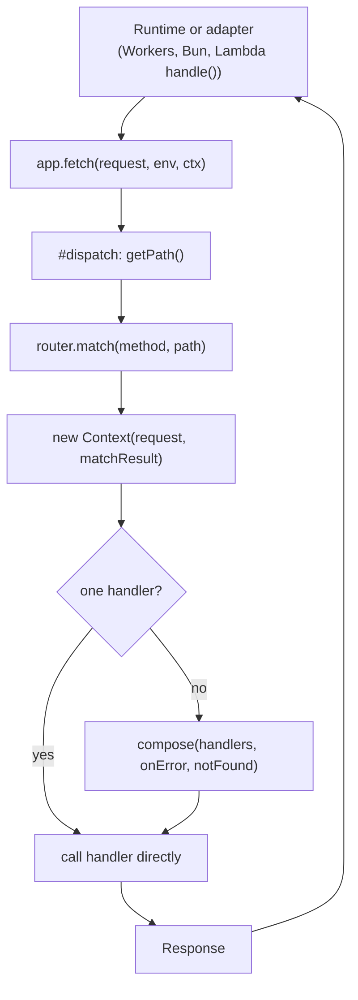

## Overview

Hono is a small web framework built only on Web Standards: an application is an object with a `fetch(request, env, executionCtx)` method that takes a `Request` and returns a `Response`. Because nothing in the core depends on Node.js, Deno or Bun APIs, the same application runs on Cloudflare Workers, Fastly Compute, Deno, Bun, Vercel, AWS Lambda, Lambda@Edge and Node.js, and the package ships with zero runtime dependencies.

Sources: [README.md:22-47](repo://README.md#L22-L47)

The package entry point exports the `Hono` class, the `Context` class and the types an application needs (`Env`, `Handler`, `MiddlewareHandler`, `Schema`, `TypedResponse`, the client's `InferRequestType` and `InferResponseType`). Every other feature (middleware, helpers, adapters, JSX, the RPC client) is a separate subpath export such as `hono/cors` or `hono/client`, so an application only bundles what it imports.

Sources: [src/index.ts:1-53](repo://src/index.ts#L1-L53), [package.json:41-60](repo://package.json#L41-L60)

## Parts of the framework

| Area | What it does | Page |
| --- | --- | --- |
| Application | The `Hono` class, presets, route registration, grouping and mounting | [[Application and Route Registration]] |
| Dispatch | From `app.fetch` to a `Response`: matching, composing middleware, errors, 404 | [[Request Lifecycle and Middleware Composition]] |
| Context | The `c` object: variables, headers, `c.json`, `c.html`, renderers | [[Context and Response Building]] |
| Request | `c.req`: params, query, headers, cached body readers, validated data | [[HonoRequest]] |
| Routers | The `Router` interface, route syntax, `SmartRouter`, `LinearRouter`, `PatternRouter` | [[Routers and Route Syntax]] |
| Fast router | One compiled regular expression per method | [[RegExpRouter]] |
| Tree router | Segment tree that accepts every route pattern | [[TrieRouter]] |
| Validation | The `validator` middleware and `c.req.valid` | [[Validation]] |
| Types | `Env`, handler overloads, the per-route `Schema` | [[Type System and Route Schemas]] |
| RPC client | `hc`, a typed `fetch` client built from the app's type | [[RPC Client]] |
| Middleware authoring | `createMiddleware`, `createFactory`, `combine` | [[Writing Middleware and Factories]] |
| Auth middleware | Basic, Bearer, JWT and JWK authentication | [[Authentication Middleware]] |
| JWT | Signing and verifying tokens with Web Crypto | [[JWT Utilities]] |
| Security middleware | CORS, CSRF, secure headers, IP restriction, body limit | [[Security Middleware]] |
| Response middleware | Compression, ETag, cache, pretty JSON, trailing slash, timeout | [[Response Processing Middleware]] |
| Observability middleware | Logger, Server-Timing, request ID, context storage, language | [[Logging, Timing and Request Context Middleware]] |
| JSX on the server | JSX to HTML strings, escaping, `html` helper, `jsxRenderer` | [[JSX Server Rendering]] |
| Async JSX | `Suspense`, `ErrorBoundary`, streamed HTML | [[Streaming JSX and Suspense]] |
| JSX in the browser | `hono/jsx/dom` rendering and hooks | [[Client-side JSX (hono/jsx/dom)]] |
| CSS | Scoped class names from tagged templates | [[CSS Helper]] |
| Streaming | `stream`, `streamText`, `streamSSE` | [[Streaming Responses]] |
| WebSockets | `upgradeWebSocket` per runtime | [[WebSockets]] |
| SSG | Render every route to files with `toSSG` | [[Static Site Generation]] |
| Cookies | Plain and signed cookies | [[Cookies]] |
| Other helpers | accepts, adapter, dev, proxy, route, testing | [[Helpers Catalogue]] |
| Runtimes | Adapters per platform and connection info | [[Runtime Adapters]] |
| AWS | Lambda and Lambda@Edge event conversion | [[AWS Lambda and Lambda@Edge]] |
| Static files | The shared `serveStatic` middleware | [[Serving Static Files]] |
| Contributing | Build, tests per runtime, benchmarks | [[Building and Testing Hono]] |

Sources: [package.json:41-60](repo://package.json#L41-L60), [src/index.ts:51-53](repo://src/index.ts#L51-L53)

## Main request flow

Sources: [src/hono-base.ts:406-485](repo://src/hono-base.ts#L406-L485)

1. A runtime calls `app.fetch` directly (Cloudflare Workers, Bun and Deno accept an object with `fetch`), or an adapter converts the platform's event into a `Request` first; see [[Runtime Adapters]] and [[AWS Lambda and Lambda@Edge]].
2. `#dispatch` computes the path with `getPath` and asks the router for every handler whose method and path match; registration is covered in [[Application and Route Registration]] and matching in [[Routers and Route Syntax]].
3. A `Context` wraps the request, the match result, the bindings and the execution context, as [[Context and Response Building]] describes; `c.req` is built from the same match result, see [[HonoRequest]].
4. When exactly one handler matched it is called without composition; otherwise `compose` runs middleware and handlers as an onion, as [[Request Lifecycle and Middleware Composition]] explains.
5. The handler returns a `Response`, usually through `c.json`, `c.text` or `c.html`, and errors become responses through `onError`.

Sources: [src/hono-base.ts:418-465](repo://src/hono-base.ts#L418-L465), [src/compose.ts:15-73](repo://src/compose.ts#L15-L73)

## Design decisions

### Web Standards only

The application's only contract with the outside world is `fetch: (request, Env?, executionCtx?) => Response | Promise<Response>`. The context builds responses with the global `Response` constructor and reads requests through the standard `Request`, so an adapter's whole job is converting a platform event to a `Request` and a `Response` back. Testing needs no server: `app.request()` builds a `Request` from a path and calls `fetch`.

Sources: [src/hono-base.ts:479-517](repo://src/hono-base.ts#L479-L517), [src/context.ts:288-291](repo://src/context.ts#L288-L291)

### Routers are pluggable and chosen lazily

`HonoBase` has no router of its own; each preset assigns one in its constructor. The default `Hono` uses a `SmartRouter` over `RegExpRouter` and `TrieRouter`. `SmartRouter` only stores routes until the first `match`, then tries each router in order, keeps the first that accepts every route without throwing `UnsupportedPathError`, and replaces its own `match` with that router's. Fast startup presets swap the routers: `hono/quick` uses `LinearRouter`, `hono/tiny` uses `PatternRouter`.

Sources: [src/hono.ts:16-34](repo://src/hono.ts#L16-L34), [src/router/smart-router/router.ts:21-61](repo://src/router/smart-router/router.ts#L21-L61), [src/preset/quick.ts:13-24](repo://src/preset/quick.ts#L13-L24), [src/preset/tiny.ts:10-20](repo://src/preset/tiny.ts#L10-L20)

### Do as little as possible per request

The hot path avoids work a handler may not need. `Context.req` creates the `HonoRequest` on first access, `c.res` creates an empty response only when read, and `c.text()` returns a bare `new Response(text)` when no header or status was set. When the router matched a single handler, `#dispatch` calls it without building a composed chain.

Sources: [src/context.ts:366-369](repo://src/context.ts#L366-L369), [src/context.ts:682-694](repo://src/context.ts#L682-L694), [src/hono-base.ts:429-448](repo://src/hono-base.ts#L429-L448)

### Types carry the API to the client

Each `app.get(path, ...handlers)` call returns the app with a wider `Schema` type that records the path, method, validated input and typed response. `route()` merges a sub-app's schema under its prefix. The RPC client `hc<typeof app>()` reads that type, so client calls are checked against the server without code generation; see [[Type System and Route Schemas]] and [[RPC Client]].

Sources: [src/hono-base.ts:208-232](repo://src/hono-base.ts#L208-L232), [src/types.ts:2500-2560](repo://src/types.ts#L2500-L2560), [src/client/client.ts:133-140](repo://src/client/client.ts#L133-L140)
