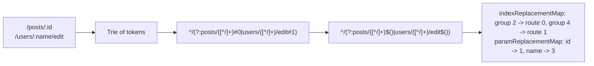

## Overview

`RegExpRouter` is the first router the default `Hono` tries. Instead of walking a tree or looping over routes, it compiles every route of a method into one regular expression, so a request costs one `RegExp` execution (or one object lookup for a static path) no matter how many routes exist. The price is a build step on the first request and a set of route combinations it refuses with `UnsupportedPathError`, which make `SmartRouter` fall back to [[TrieRouter]]. The `Router` interface and the selection logic are on [[Routers and Route Syntax]].

Sources: [src/router/reg-exp-router/router.ts:122-130](repo://src/router/reg-exp-router/router.ts#L122-L130), [src/router/reg-exp-router/matcher.ts:10-33](repo://src/router/reg-exp-router/matcher.ts#L10-L33)

The router works in two phases. `add` precomputes, for every route path, the full ordered list of handlers (middleware included) that should run for it. The first `match` turns those lists into a `Matcher` per method and replaces itself with a closure over them.

Sources: [src/router/reg-exp-router/router.ts:132-222](repo://src/router/reg-exp-router/router.ts#L132-L222)

## Phase 1: add() precomputes handler lists

### Two maps per method

The router keeps two maps, `#middleware` and `#routes`, each `method -> path -> [handler, paramCount][]`. `#middleware` holds wildcard paths (ending in `*`), `#routes` everything else. The first time a method is seen, both maps get an entry for it, seeded with copies of the `ALL` entries, so a method-specific table already contains the handlers registered for every method.

Sources: [src/router/reg-exp-router/router.ts:122-147](repo://src/router/reg-exp-router/router.ts#L122-L147)

`paramCount` is the number of `/:` in the path. It is stored with each handler because a handler registered on a short path (a middleware on `/posts/:id/*`) must only read the first parameters of a longer route that also matches.

Sources: [src/router/reg-exp-router/router.ts:153-153](repo://src/router/reg-exp-router/router.ts#L153-L153)

### Wildcard handlers

For a path ending in `*`, `add` first creates the middleware entry for that path by copying the list of the longest existing wildcard that covers it (`findMiddleware`), so earlier, broader middleware stays in front. Then it appends the handler to every middleware entry and every route entry whose path matches the wildcard's regular expression, for the given method or for all of them when the method is `ALL`.

Sources: [src/router/reg-exp-router/router.ts:105-120](repo://src/router/reg-exp-router/router.ts#L105-L120), [src/router/reg-exp-router/router.ts:155-187](repo://src/router/reg-exp-router/router.ts#L155-L187)

### Normal routes

For any other path, optional parameters are expanded into their variants. Each variant's list starts as a copy of the matching middleware list, and the handler is appended. Registration order is therefore baked into each list: a middleware added before a route runs before it, and a middleware added after a route is appended to that route's list by the wildcard branch.

Sources: [src/router/reg-exp-router/router.ts:189-204](repo://src/router/reg-exp-router/router.ts#L189-L204)

## Phase 2: building the matcher

### Per method

The first `match` call runs the `match` function from `matcher.ts`, which calls `buildAllMatchers`. That builds one `Matcher` for each method that has routes, then releases both maps and the wildcard cache: after this the router is immutable and `add` throws. A method with no routes of its own gets `null` and falls back to the `ALL` matcher at match time.

Sources: [src/router/reg-exp-router/router.ts:208-251](repo://src/router/reg-exp-router/router.ts#L208-L251)

A `Matcher` is a tuple `[regexp, handlerData[], staticMap]`.

Sources: [src/router/reg-exp-router/matcher.ts:1-7](repo://src/router/reg-exp-router/matcher.ts#L1-L7)

### Static and dynamic routes

`buildMatcherFromPreprocessedRoutes` marks each path as static when it contains neither `*` nor `/:`. Static paths go straight into `staticMap` as ready-made results. They are still inserted into the trie, in check-only mode, so a static path that conflicts with a dynamic one is detected. Dynamic paths, sorted shortest first, get an index `j` and are inserted into the `Trie`, which returns the parameter variables they bind. For each handler, the last `paramCount` of those bindings become its `paramIndexMap`.

Sources: [src/router/reg-exp-router/router.ts:34-80](repo://src/router/reg-exp-router/router.ts#L34-L80)

### From trie to one regular expression

`Trie.insert` tokenises a path into single characters, `:name` or `:name{regex}` patterns, and a trailing `/*`. It protects `{...}` groups first so slashes inside a parameter's expression do not split it. Each token becomes a child `Node`; a pattern child gets a variable index from a shared counter.

Sources: [src/router/reg-exp-router/trie.ts:6-47](repo://src/router/reg-exp-router/trie.ts#L6-L47), [src/router/reg-exp-router/node.ts:50-133](repo://src/router/reg-exp-router/node.ts#L50-L133)

`Node.buildRegExpStr` emits the tree as nested alternations, ordering children literal first, then custom patterns, then plain `[^/]+` labels, then wildcards. A capturing pattern is written `(regex)@varIndex`, and a node where a route ends is written `#routeIndex`.

Sources: [src/router/reg-exp-router/node.ts:13-43](repo://src/router/reg-exp-router/node.ts#L13-L43), [src/router/reg-exp-router/node.ts:135-161](repo://src/router/reg-exp-router/node.ts#L135-L161)

`Trie.buildRegExp` then rewrites the markers while counting capture groups. Each `@varIndex` is removed and the variable is mapped to its capture-group number (`paramReplacementMap`). Each `#routeIndex` becomes `$()`: an end-of-path anchor followed by an empty capture group, and that group's number is mapped to the route (`indexReplacementMap`). Finally `buildMatcherFromPreprocessedRoutes` renumbers each handler's `paramIndexMap` to capture-group numbers and reorders `handlerData` by capture group.

Sources: [src/router/reg-exp-router/trie.ts:49-73](repo://src/router/reg-exp-router/trie.ts#L49-L73), [src/router/reg-exp-router/router.ts:82-102](repo://src/router/reg-exp-router/router.ts#L82-L102)



Sources: [src/router/reg-exp-router/trie.ts:49-73](repo://src/router/reg-exp-router/trie.ts#L49-L73), [src/router/reg-exp-router/node.ts:135-161](repo://src/router/reg-exp-router/node.ts#L135-L161)

## Matching a request

```ts
const staticMatch = matcher[2][path]
if (staticMatch) {
  return staticMatch
}

const match = path.match(matcher[0])
if (!match) {
  return [[], emptyParam]
}

const index = match.indexOf('', 1)
return [matcher[1][index], match]
```

Sources: [src/router/reg-exp-router/matcher.ts:18-29](repo://src/router/reg-exp-router/matcher.ts#L18-L29)

A static path is a single property lookup. Otherwise the method's expression runs once. Parameter groups capture non-empty strings, so the first empty string after index 0 in the match array is the `$()` group of the route that matched, and its index selects the precomputed handler list. The match array itself is returned as the parameter stash, which is why [[HonoRequest]] reads parameters by index.

Sources: [src/router/reg-exp-router/matcher.ts:10-33](repo://src/router/reg-exp-router/matcher.ts#L10-L33), [src/request.ts:126-128](repo://src/request.ts#L126-L128)

## When it throws UnsupportedPathError

`Node.insert` throws an internal `PATH_ERROR`, turned into `UnsupportedPathError`, whenever a single regular expression could not keep registration order or tell routes apart. The default app then runs on `TrieRouter`.

Sources: [src/router/reg-exp-router/node.ts:57-130](repo://src/router/reg-exp-router/node.ts#L57-L130), [src/router/reg-exp-router/router.ts:60-65](repo://src/router/reg-exp-router/router.ts#L60-L65)

| Routes | Why |
| --- | --- |
| `/posts/:id` and `/posts/new` | A literal and a parameter at the same position: which one wins would depend on alternation order, not registration order |
| `/a/:id` and `/a/:name` | Two routes end on the same node |
| `/a/:id` and `/a/:id{[0-9]+}` | Two different patterns at the same position |
| `/:x/b` and `/a/:y` | A parameter and a literal overlap at the first segment |
| `/:path{.*}` | A named `.*` pattern is rejected |
| `/:id{(a|b)c}` | A capturing group inside a pattern would shift the group numbering; `(?:...)` is allowed and a whole-pattern `(a|b)` is rewritten to `(?:a|b)` |

Sources: [src/router/reg-exp-router/node.ts:57-130](repo://src/router/reg-exp-router/node.ts#L57-L130)

> [!NOTE]
> Many real applications mix `/posts/new` with `/posts/:id`, so they run on `TrieRouter`. `getRouterName(app)` from `hono/dev` shows which router `SmartRouter` picked after the first request.

Sources: [src/router/smart-router/router.ts:57-58](repo://src/router/smart-router/router.ts#L57-L58), [src/helper/dev/index.ts:1-79](repo://src/helper/dev/index.ts#L1-L79)

## PreparedRegExpRouter

`PreparedRegExpRouter` (exported with `buildInitParams` and `serializeInitParams` from `hono/router/reg-exp-router`) moves the build step to build time. `buildInitParams({ paths })` runs a `RegExpRouter` over the route paths, exports its matchers with the handler lists emptied, and records in a `relocateMap` which handler slots and static entries each path occupies. `serializeInitParams` turns that into JavaScript source, writing each `RegExp` as a literal.

Sources: [src/router/reg-exp-router/prepared-router.ts:95-165](repo://src/router/reg-exp-router/prepared-router.ts#L95-L165)

At runtime the router is constructed from those parameters. Its `add` does not compile anything: it looks the path up in the `relocateMap` and pushes the handler into the recorded slots, or into every slot for `*`. `buildAllMatchers` returns the prebuilt matchers, so the shared `match` function runs without a build. An app on a cold-start platform pays neither the regular-expression build nor the trie.

Sources: [src/router/reg-exp-router/prepared-router.ts:9-93](repo://src/router/reg-exp-router/prepared-router.ts#L9-L93)
