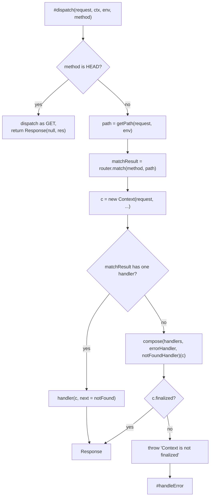
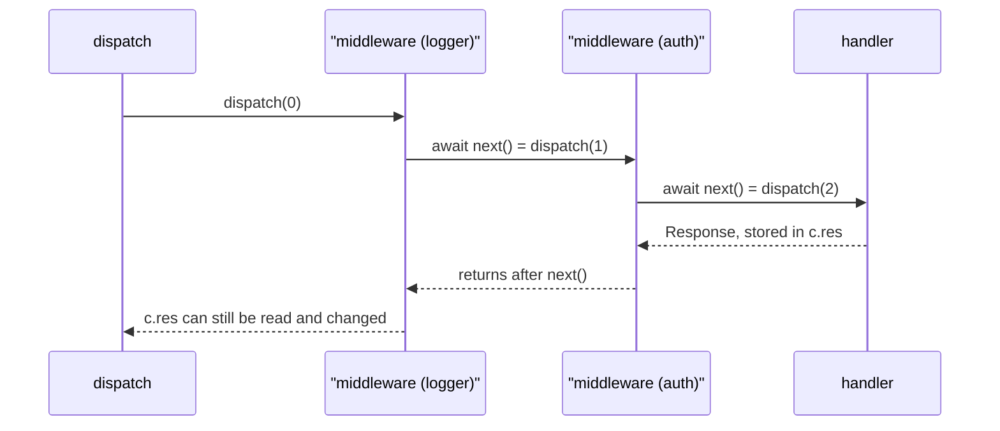

## Overview

Every request enters an application through `app.fetch(request, env, executionCtx)` and leaves as one `Response`. In between, the private `#dispatch` method computes the path, asks the router for every matching handler, wraps the request in a `Context`, and runs the handlers either directly (one match) or through `compose` (several). Errors and unmatched requests are turned into responses by the app's `onError` and `notFound` handlers. Registration of the handlers is covered in [[Application and Route Registration]]; the `Context` API the handlers use is in [[Context and Response Building]].

Sources: [src/hono-base.ts:406-485](repo://src/hono-base.ts#L406-L485)

## Entry points

`fetch` is the entry runtimes call; it passes the method from `request.method`, the bindings as `env` and the execution context to `#dispatch`. `request()` is a convenience for tests that builds a `Request` from a path or URL and calls `fetch`. The deprecated `fire()` registers a global `fetch` event listener for Service Worker style runtimes and passes the event itself as the execution context; `hono/service-worker` now provides the same thing.

Sources: [src/hono-base.ts:479-542](repo://src/hono-base.ts#L479-L542)

## Dispatch step by step



Sources: [src/hono-base.ts:406-466](repo://src/hono-base.ts#L406-L466)

1. A `HEAD` request is dispatched as `GET`, and the result is copied into `new Response(null, res)`, so every `GET` route answers `HEAD` with the same status and headers and no body.
2. `getPath` turns the URL into the routing path (see the `strict` and `getPath` options in [[Application and Route Registration]]).
3. `router.match(method, path)` returns every handler whose route matches, in registration order, middleware included. The shape of that result is described in [[Routers and Route Syntax]].
4. The `Context` receives the request, path, match result, bindings, execution context and the not-found handler. It does not build `c.req` yet; [[HonoRequest]] is created on first access.
5. The handlers run, through the fast path or through `compose`.

Sources: [src/hono-base.ts:412-427](repo://src/hono-base.ts#L412-L427)

## The single-handler fast path

When the router returns exactly one handler, `#dispatch` calls it directly and skips building a composed chain. The `next` it receives sets `c.res` to the not-found response, so a lone middleware that calls `next()` still produces a 404. The result is then resolved without an extra `async` wrapper when the handler is synchronous:

Sources: [src/hono-base.ts:429-448](repo://src/hono-base.ts#L429-L448)

```ts
return res instanceof Promise
  ? res
      .then(
        (resolved: Response | undefined) =>
          resolved || (c.finalized ? c.res : this.#notFoundHandler(c))
      )
      .catch((err: Error) => this.#handleError(err, c))
  : (res ?? this.#notFoundHandler(c))
```

Sources: [src/hono-base.ts:440-447](repo://src/hono-base.ts#L440-L447)

A synchronous throw is caught around the call and a rejected promise in `.catch`; both go to `#handleError`. Unlike the composed path, this path does not set `c.error`, because no middleware runs after the handler to read it.

Sources: [src/hono-base.ts:431-438](repo://src/hono-base.ts#L431-L438)

## compose and the onion model

`compose(middleware, onError, onNotFound)` is adapted from `koa-compose`. It returns a function that runs `dispatch(0)`; each handler receives `next = () => dispatch(i + 1)`, so code before `await next()` runs on the way in and code after it runs on the way out.

Sources: [src/compose.ts:4-24](repo://src/compose.ts#L4-L24)



Sources: [src/compose.ts:32-71](repo://src/compose.ts#L32-L71)

- **One call per step.** A shared `index` records the last step run; calling `next()` twice from the same handler throws `next() called multiple times`.
- **Param context.** Before running handler `i`, it sets `c.req.routeIndex = i`, so `c.req.param()` reads the parameters of the route that registered that handler, not of the final route.
- **End of the chain.** Past the last handler it calls the outer `next` when one was given (this is how a sub-app wrapper chains into its parent), otherwise the not-found handler if the context has no response yet.
- **Storing the response.** A handler's return value becomes `c.res` only when the context is not yet finalized, or when the value came from the error handler. A middleware that returns nothing after `await next()` leaves the handler's response in place.

Sources: [src/compose.ts:32-71](repo://src/compose.ts#L32-L71)

Assigning `c.res` sets `c.finalized = true`. After the chain resolves, `#dispatch` checks that flag and throws `Context is not finalized. Did you forget to return a Response object or await next()?` when no handler produced a response, typically a middleware that forgot to `await next()` or a handler that returned nothing. That error goes to `onError` like any other.

Sources: [src/context.ts:414-434](repo://src/context.ts#L414-L434), [src/hono-base.ts:450-465](repo://src/hono-base.ts#L450-L465)

## Not-found handling

A request is "not found" when the chain runs out without a response. With no matching route, the router returns an empty handler list and `compose` reaches the end at `dispatch(0)`, calling the not-found handler. Middleware registered with `use('*')` still runs first, because it matched, and its `next()` reaches the not-found handler. Handlers can also return `c.notFound()` explicitly. The default answers `404 Not Found` as text; `app.notFound()` replaces it.

Sources: [src/compose.ts:42-65](repo://src/compose.ts#L42-L65), [src/hono-base.ts:31-33](repo://src/hono-base.ts#L31-L33), [src/context.ts:776-779](repo://src/context.ts#L776-L779)

## Error handling

### Where errors are caught

Inside `compose`, an `Error` thrown by any handler is caught at that step: `c.error` is set, `onError(err, c)` produces the response, and the step returns normally, so outer middleware continues after its `await next()` and can inspect `c.error` and `c.res`. A thrown value that is not an `Error` is re-thrown. At the top, `#handleError` sends `Error` instances to the app's error handler and re-throws anything else to the runtime.

Sources: [src/compose.ts:49-60](repo://src/compose.ts#L49-L60), [src/hono-base.ts:399-404](repo://src/hono-base.ts#L399-L404)

### The default handler and HTTPException

The default error handler checks for a `getResponse` method. If the error has one, its response is passed through `c.newResponse(res.body, res)`, which keeps headers middleware already set on the context; otherwise it logs the error and answers `Internal Server Error` with status 500.

Sources: [src/hono-base.ts:35-42](repo://src/hono-base.ts#L35-L42)

`HTTPException` is the error with that method. Its constructor takes a status (default 500) and an optional `message`, `cause` and `res`. `getResponse()` returns a copy of `res` with the exception's status when `res` was given, or a text response with the message and status otherwise. Throwing it is how middleware such as authentication stops a request with a specific status; [[Authentication Middleware]] uses it with a `WWW-Authenticate` response.

Sources: [src/http-exception.ts:44-78](repo://src/http-exception.ts#L44-L78)

```ts
app.onError((err, c) => {
  if (err instanceof HTTPException) {
    return err.getResponse()
  }
  return c.json({ message: 'unexpected' }, 500)
})
```

Sources: [src/hono-base.ts:271-274](repo://src/hono-base.ts#L271-L274), [src/http-exception.ts:66-77](repo://src/http-exception.ts#L66-L77)

### Sub-app error handlers

A sub-app attached with `route()` keeps its own `onError`: each of its handlers is wrapped in `compose([], subApp.errorHandler)`, so errors thrown in the sub-app's routes are handled there before the parent sees them. Middleware registered on the parent still runs around the wrapped handler.

Sources: [src/hono-base.ts:219-229](repo://src/hono-base.ts#L219-L229)

## Handler types

A handler is `(c, next) => Response | TypedResponse | Promise<...>`; a middleware is `(c, next) => Promise<Response | void>`. The router stores both as `H`, and `compose` does not tell them apart: the difference is only whether the function calls `next`. `NotFoundHandler` and `ErrorHandler` return a `Response`; the `NotFoundResponse` interface can be augmented to give `c.notFound()` a typed response. [[Type System and Route Schemas]] explains how these types carry route information.

Sources: [src/types.ts:69-118](repo://src/types.ts#L69-L118)
