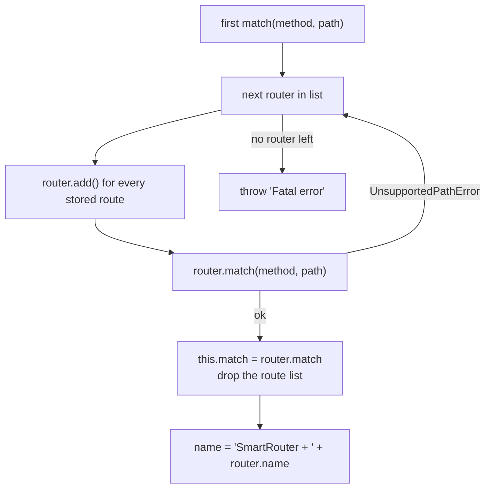

## Overview

A router answers one question per request: which registered handlers match this method and path, and what are their parameters. Hono keeps that question behind a two-method `Router` interface so the matching strategy can be swapped without touching the rest of the framework. Five implementations ship with it: `RegExpRouter`, `TrieRouter`, `SmartRouter`, `LinearRouter` and `PatternRouter`. The app feeds the router from `#addRoute` and reads it in `#dispatch` (see [[Application and Route Registration]] and [[Request Lifecycle and Middleware Composition]]).

Sources: [src/router.ts:29-52](repo://src/router.ts#L29-L52), [src/hono-base.ts:385-397](repo://src/hono-base.ts#L385-L397), [src/hono-base.ts:418-419](repo://src/hono-base.ts#L418-L419)

## The Router interface

### add and match

```ts
export interface Router<T> {
  name: string
  add(method: string, path: string, handler: T): void
  match(method: string, path: string): Result<T>
}
```

Sources: [src/router.ts:29-52](repo://src/router.ts#L29-L52)

`T` is the pair `[handler, RouterRoute]` the app stores. `method` is upper case, or `ALL` for handlers registered with `use`, `all` or `mount`, which every router must return for any method. `match` returns every matching handler in registration order, middleware and final handler alike, because the app composes them all.

Sources: [src/router.ts:9-17](repo://src/router.ts#L9-L17), [src/hono-base.ts:156-168](repo://src/hono-base.ts#L156-L168)

### The two result shapes

`Result<T>` has two forms, and consumers such as [[HonoRequest]] accept both:

Sources: [src/router.ts:66-98](repo://src/router.ts#L66-L98)

| Shape | Used by | Parameters |
| --- | --- | --- |
| `[[handler, paramIndexMap][], paramStash]` | `RegExpRouter` | Each handler maps a name to an index into one shared array of captured strings |
| `[[handler, params][]]` | `TrieRouter`, `LinearRouter`, `PatternRouter` | Each handler carries its own `name -> value` object |

Sources: [src/router.ts:66-98](repo://src/router.ts#L66-L98)

The index form lets `RegExpRouter` return the regular expression's match array as the stash without copying values into per-handler objects.

Sources: [src/router/reg-exp-router/matcher.ts:10-33](repo://src/router/reg-exp-router/matcher.ts#L10-L33)

### Errors

A router that cannot represent a route throws `UnsupportedPathError`. That error is a signal for `SmartRouter`, not a failure for the user: it moves on to the next router. A router that has already built its matcher throws `Can not add a route since the matcher is already built.` from `add`.

Sources: [src/router.ts:18-22](repo://src/router.ts#L18-L22), [src/router.ts:100-103](repo://src/router.ts#L100-L103)

## Route path syntax

| Pattern | Matches | Parameters |
| --- | --- | --- |
| `/posts` | exactly `/posts` | none |
| `/posts/:id` | `/posts/1`, one segment | `id` |
| `/posts/:id{[0-9]+}` | a segment matching the regular expression | `id` |
| `/posts/:file{.+\\.png}` | a regular expression may span `/` | `file` |
| `/animals/:type?` | `/animals` and `/animals/cat` | `type` when present |
| `/wild/*/card` | any single segment in place of `*` | none |
| `/posts/*` | `/posts`, `/posts/` and everything below | none |
| `*` | every path | none |

Sources: [src/utils/url.ts:51-79](repo://src/utils/url.ts#L51-L79), [src/utils/url.ts:171-206](repo://src/utils/url.ts#L171-L206), [src/router/reg-exp-router/node.ts:69-77](repo://src/router/reg-exp-router/node.ts#L69-L77)

Optional parameters are expanded at registration. `checkOptionalParameter('/api/animals/:type?')` returns `['/api/animals', '/api/animals/:type']`, and `RegExpRouter`, `TrieRouter` and `LinearRouter` register one route per variant.

Sources: [src/utils/url.ts:171-206](repo://src/utils/url.ts#L171-L206), [src/router/linear-router/router.ts:15-23](repo://src/router/linear-router/router.ts#L15-L23)

Regular-expression parameters are parsed by `getPattern`, which turns `:name{regex}` into a cached `RegExp`. When the next segment is a literal, the expression gets a lookahead for it so a greedy pattern stops before the literal segment.

Sources: [src/utils/url.ts:51-79](repo://src/utils/url.ts#L51-L79)

A trailing `/*` also matches the bare prefix: `RegExpRouter` compiles it to `(?:|/.*)`, so middleware on `/api/*` runs for `/api` too.

Sources: [src/router/reg-exp-router/node.ts:1-3](repo://src/router/reg-exp-router/node.ts#L1-L3), [src/router/reg-exp-router/router.ts:20-28](repo://src/router/reg-exp-router/router.ts#L20-L28)

## SmartRouter

`SmartRouter` is not a matcher itself. `add` only appends `[method, path, handler]` to a list. On the first `match`, it tries its routers in order: it replays every route into the router and calls `match`. If the router throws `UnsupportedPathError` while adding or matching, it moves to the next one; any other error propagates.

Sources: [src/router/smart-router/router.ts:13-50](repo://src/router/smart-router/router.ts#L13-L50)



Sources: [src/router/smart-router/router.ts:21-61](repo://src/router/smart-router/router.ts#L21-L61)

Once a router accepts the routes, `SmartRouter` replaces its own `match` with that router's bound `match`, keeps only that router, and frees the stored list, so later requests go straight to the chosen router. `activeRouter` exposes it, and `getRouterName` from `hono/dev` reports names such as `SmartRouter + RegExpRouter`.

Sources: [src/router/smart-router/router.ts:46-69](repo://src/router/smart-router/router.ts#L46-L69)

In the default `Hono`, the list is `[RegExpRouter, TrieRouter]`: the regular-expression router is used unless a route is ambiguous for it, in which case the tree router takes over. [[RegExpRouter]] lists the paths that cause the switch.

Sources: [src/hono.ts:26-33](repo://src/hono.ts#L26-L33)

## LinearRouter

`LinearRouter` stores routes in an array and does all the work in `match`, so adding routes costs nothing and there is no build step. For each route of the right method it picks one of four strategies: `*` matches everything; a literal path is compared with and without a trailing slash; a path with `*` but no parameters is matched piece by piece with `indexOf`; a path with parameters is split into segments and each `:name` or `:name{regex}` is captured. A route with both `*` and parameters throws `UnsupportedPathError`, which in the `hono/quick` preset sends `SmartRouter` to `TrieRouter`.

Sources: [src/router/linear-router/router.ts:25-143](repo://src/router/linear-router/router.ts#L25-L143)

Its cost per request grows with the number of routes, but nothing is compiled at startup, which suits runtimes that start a fresh isolate for each request.

Sources: [src/preset/quick.ts:13-24](repo://src/preset/quick.ts#L13-L24)

## PatternRouter

`PatternRouter` converts each route to its own `RegExp` with named groups at `add` time, then tests every route in `match`. A trailing `*` drops the end anchor, a trailing `?` registers the route both with and without the last segment, and `:name{regex}` becomes `(?<name>regex)`. An expression the engine rejects throws `UnsupportedPathError`. It is the smallest router and the only one in `hono/tiny`.

Sources: [src/router/pattern-router/router.ts:12-59](repo://src/router/pattern-router/router.ts#L12-L59), [src/preset/tiny.ts:10-20](repo://src/preset/tiny.ts#L10-L20)

## Choosing a router

| Router | Startup | Per request | Accepts every pattern | Use it when |
| --- | --- | --- | --- | --- |
| `SmartRouter` (RegExp + Trie) | Builds one regular expression on the first request | One regex match, static paths from a map | Yes, through the fallback | Default; long-lived servers and workers |
| `RegExpRouter` | Same | Same | No | Routes are known to be compatible and the fallback is not wanted |
| `TrieRouter` | Inserts into a tree as routes are added | Walks the tree | Yes | Many ambiguous patterns |
| `LinearRouter` | None | Loops over all routes | No (`*` with params) | A process per request, `hono/quick` |
| `PatternRouter` | One `RegExp` per route | Tests every route | Nearly | Smallest bundle, `hono/tiny` |

Sources: [src/hono.ts:26-33](repo://src/hono.ts#L26-L33), [src/router/reg-exp-router/matcher.ts:10-33](repo://src/router/reg-exp-router/matcher.ts#L10-L33), [src/router/linear-router/router.ts:25-29](repo://src/router/linear-router/router.ts#L25-L29), [src/router/pattern-router/router.ts:44-58](repo://src/router/pattern-router/router.ts#L44-L58)

Pass a router to the default class with `new Hono({ router: new TrieRouter() })`; each router is also exported on its own subpath such as `hono/router/trie-router`. The internals of the two main matchers are on [[RegExpRouter]] and [[TrieRouter]].

Sources: [src/hono-base.ts:55-65](repo://src/hono-base.ts#L55-L65), [package.json:41-60](repo://package.json#L41-L60)
