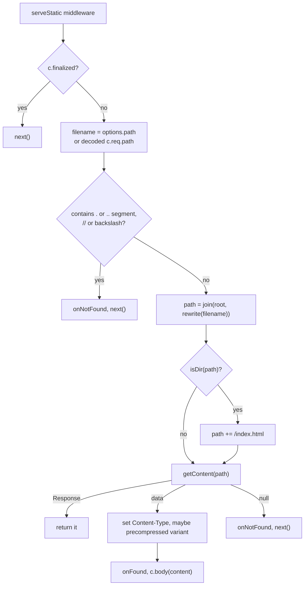

## Overview

Serving files needs file-system access, which differs on every runtime, but the rest of the job (mapping a URL to a path safely, choosing a MIME type, serving a precompressed variant) does not. Hono therefore has one shared middleware, `serveStatic` in `middleware/serve-static`, that takes a `getContent(path, c)` function, and each runtime module exports a `serveStatic` that supplies it: Bun reads with `Bun.file`, Deno with `Deno.open`, Cloudflare Workers from the Workers Sites KV namespace. Applications import the runtime's version (see [[Runtime Adapters]]).

Sources: [src/middleware/serve-static/index.ts:35-126](repo://src/middleware/serve-static/index.ts#L35-L126), [src/adapter/bun/serve-static.ts:8-32](repo://src/adapter/bun/serve-static.ts#L8-L32), [src/adapter/deno/serve-static.ts:8-42](repo://src/adapter/deno/serve-static.ts#L8-L42), [src/adapter/cloudflare-workers/serve-static.ts:21-42](repo://src/adapter/cloudflare-workers/serve-static.ts#L21-L42)

```ts
import { serveStatic } from 'hono/bun' // or 'hono/deno', 'hono/cloudflare-workers'

app.use('/static/*', serveStatic({ root: './' }))
app.get('/favicon.ico', serveStatic({ path: './favicon.ico' }))
app.get('*', serveStatic({ path: './public/index.html' })) // SPA fallback
```

Sources: [src/middleware/serve-static/index.ts:13-21](repo://src/middleware/serve-static/index.ts#L13-L21)

## Options

| Option | Default | Effect |
| --- | --- | --- |
| `root` | `./` | Directory joined in front of the request path |
| `path` | none | Serve this one file for every matching request, ignoring the URL |
| `rewriteRequestPath(path)` | none | Change the URL path before joining, for example strip a `/static` prefix |
| `mimes` | none | Extra extension-to-MIME mappings, checked before the built-in table |
| `precompressed` | `false` | Look for `.br`, `.zst` and `.gz` siblings the client accepts |
| `onFound(path, c)` | none | Called before a found file is returned, typically to set `Cache-Control` |
| `onNotFound(path, c)` | none | Called when nothing is served |

Sources: [src/middleware/serve-static/index.ts:13-31](repo://src/middleware/serve-static/index.ts#L13-L31)

## How a request is served

### Request flow



Sources: [src/middleware/serve-static/index.ts:54-125](repo://src/middleware/serve-static/index.ts#L54-L125)

### Path safety

The request path is percent-decoded with `tryDecodeURI`, then rejected when any segment is `.` or `..`, when it contains repeated slashes, or when it contains a backslash. Rejection is checked after decoding, so encoded forms such as `%2e%2e` are caught too. A rejected path is treated as not found: `onNotFound` runs and the request continues to the next handler.

Sources: [src/middleware/serve-static/index.ts:60-74](repo://src/middleware/serve-static/index.ts#L60-L74)

The default `join` filters empty parts, collapses slashes and resolves `.` and `..`; the Bun and Deno adapters pass `node:path`'s `join` instead.

Sources: [src/middleware/serve-static/path.ts:5-25](repo://src/middleware/serve-static/path.ts#L5-L25), [src/adapter/bun/serve-static.ts:2-3](repo://src/adapter/bun/serve-static.ts#L2-L3)

### Directories and content

When the adapter provides `isDir` and the path is a directory, `index.html` is appended. `getContent` may return file data (a `ReadableStream`, `Blob`-like file or bytes), `null` when there is no file, or a complete `Response`, which is returned as is. The middleware does nothing when an earlier handler already produced a response (`c.finalized`), so it can sit after dynamic routes.

Sources: [src/middleware/serve-static/index.ts:55-58](repo://src/middleware/serve-static/index.ts#L55-L58), [src/middleware/serve-static/index.ts:81-90](repo://src/middleware/serve-static/index.ts#L81-L90)

### MIME types and compression

For found content, `Content-Type` comes from the `mimes` option, then the built-in table in `utils/mime`, then `application/octet-stream`. `getMimeType` looks only at the final extension, lower-cased.

Sources: [src/middleware/serve-static/index.ts:92-94](repo://src/middleware/serve-static/index.ts#L92-L94), [src/utils/mime.ts:6-28](repo://src/utils/mime.ts#L6-L28)

With `precompressed`, and only for compressible types (the same `COMPRESSIBLE_CONTENT_TYPE_REGEX` the `compress` middleware uses), the middleware checks the client's `Accept-Encoding` and tries `path.br`, `path.zst` and `path.gz` in that order. The first that exists replaces the content, `Content-Encoding` is set, and `Vary: Accept-Encoding` is appended so caches keep variants apart. Serving prebuilt Brotli files avoids compressing on every request; see [[Response Processing Middleware]] for runtime compression.

Sources: [src/middleware/serve-static/index.ts:23-28](repo://src/middleware/serve-static/index.ts#L23-L28), [src/middleware/serve-static/index.ts:96-119](repo://src/middleware/serve-static/index.ts#L96-L119), [src/utils/compress.ts:1-10](repo://src/utils/compress.ts#L1-L10)

## Runtime implementations

| Runtime | `getContent` | `isDir` |
| --- | --- | --- |
| Bun | `Bun.file(path)` if it exists | `fs.stat(path).isDirectory()` |
| Deno | `Deno.open(path).readable`; directories and missing files give `null`, other errors are logged | `Deno.lstatSync(path).isDirectory` |
| Cloudflare Workers | The KV key from the asset manifest, read as a stream from `namespace` or `c.env.__STATIC_CONTENT` | none |
| Cloudflare Pages | `env.ASSETS.fetch(request)`, its own small middleware | n/a |

Sources: [src/adapter/bun/serve-static.ts:11-31](repo://src/adapter/bun/serve-static.ts#L11-L31), [src/adapter/deno/serve-static.ts:11-41](repo://src/adapter/deno/serve-static.ts#L11-L41), [src/adapter/cloudflare-workers/utils.ts:11-50](repo://src/adapter/cloudflare-workers/utils.ts#L11-L50), [src/adapter/cloudflare-pages/handler.ts:114-123](repo://src/adapter/cloudflare-pages/handler.ts#L114-L123)

The Workers version reads the Workers Sites manifest from the `manifest` option or the global `__STATIC_CONTENT_MANIFEST`, parsing it when it is a JSON string. The version exported from `hono/cloudflare-workers` is the ES-module variant, which drops the `namespace` option and relies on the binding.

Sources: [src/adapter/cloudflare-workers/utils.ts:11-50](repo://src/adapter/cloudflare-workers/utils.ts#L11-L50), [src/adapter/cloudflare-workers/serve-static-module.ts:1-12](repo://src/adapter/cloudflare-workers/serve-static-module.ts#L1-L12)

## Writing an adapter

A runtime without a built-in version (for example a custom server) can call the shared middleware directly with its own `getContent`, `join` and `isDir`. `utils/filepath`, exported as `hono/utils/filepath`, provides `getFilePath` and `getFilePathWithoutDefaultDocument` for adapters that prefer to map a URL to a relative file path themselves: they append `index.html` to directory-like paths, normalise backslashes and return `undefined` for paths containing `..`.

Sources: [src/middleware/serve-static/index.ts:35-49](repo://src/middleware/serve-static/index.ts#L35-L49), [src/utils/filepath.ts:6-60](repo://src/utils/filepath.ts#L6-L60)
