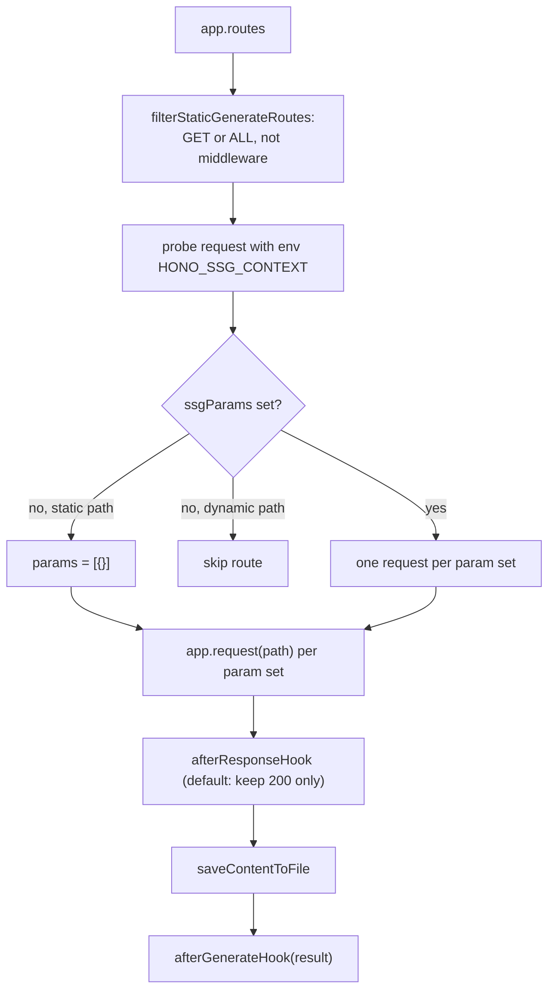

## Overview

`toSSG` from `hono/ssg` renders a Hono application to files. It needs no separate build system: it walks the app's registered GET routes, sends each one a `Request` through `app.fetch`, and writes each `Response` body to a file whose name comes from the route path and the content type. The app is the same one that serves requests, so pages built with [[JSX Server Rendering]] or `c.json` become HTML or JSON files without changes. The whole API is marked experimental.

Sources: [src/helper/ssg/ssg.ts:368-470](repo://src/helper/ssg/ssg.ts#L368-L470), [src/helper/ssg/ssg.ts:205-302](repo://src/helper/ssg/ssg.ts#L205-L302)

```ts
import fs from 'node:fs/promises'
import { toSSG } from 'hono/ssg'
import app from './app'

const result = await toSSG(app, fs, { dir: './static' })
if (!result.success) throw result.error
console.log(result.files)
```

Sources: [src/helper/ssg/ssg.ts:34-48](repo://src/helper/ssg/ssg.ts#L34-L48), [src/helper/ssg/ssg.ts:341-348](repo://src/helper/ssg/ssg.ts#L341-L348)

The second argument is a `FileSystemModule` with `writeFile` and `mkdir`; Node's `fs/promises` fits. The Bun and Deno adapters export `toSSG(app, options)` with the file system already bound: Bun's writes with `Bun.write` (which creates directories itself, so its `mkdir` is a no-op), Deno's with `Deno.writeFile` and `Deno.mkdir`.

Sources: [src/helper/ssg/ssg.ts:34-37](repo://src/helper/ssg/ssg.ts#L34-L37), [src/adapter/bun/ssg.ts:1-27](repo://src/adapter/bun/ssg.ts#L1-L27), [src/adapter/deno/ssg.ts:1-27](repo://src/adapter/deno/ssg.ts#L1-L27)

## Generation flow

### Pipeline



Sources: [src/helper/ssg/ssg.ts:205-302](repo://src/helper/ssg/ssg.ts#L205-L302), [src/helper/ssg/utils.ts:61-75](repo://src/helper/ssg/utils.ts#L61-L75)

### Selecting routes

`filterStaticGenerateRoutes` reads `app.routes` (the list described on [[Application and Route Registration]]) and keeps routes registered for `GET` or `ALL` whose handler is not a middleware, unwrapping handlers wrapped by `route()` first. Middleware is recognised by declaring a second `next` parameter.

Sources: [src/helper/ssg/utils.ts:61-71](repo://src/helper/ssg/utils.ts#L61-L71), [src/utils/handler.ts:1-15](repo://src/utils/handler.ts#L1-L15)

### Expanding dynamic routes

For each route, a first request is sent to its pattern path (for example `http://localhost/posts/:id`) with the bindings `{ HONO_SSG_CONTEXT: true }`. A route that should produce several pages registers the `ssgParams` middleware before its handler:

Sources: [src/helper/ssg/ssg.ts:222-251](repo://src/helper/ssg/ssg.ts#L222-L251)

```ts
app.get(
  '/posts/:id',
  ssgParams(async () => (await getPosts()).map((p) => ({ id: p.id }))),
  (c) => c.html(<Post id={c.req.param('id')} />)
)
```

Sources: [src/helper/ssg/middleware.ts:43-49](repo://src/helper/ssg/middleware.ts#L43-L49)

When the request path still contains `:` or `*` (the probe), `ssgParams` stores the list of parameter objects on the raw request and returns `c.notFound()` so the handler does not run. Real requests, whose paths are concrete, pass straight through. After the probe, a dynamic route without `ssgParams` is skipped; a static route gets a single empty parameter set.

Sources: [src/helper/ssg/middleware.ts:36-49](repo://src/helper/ssg/middleware.ts#L36-L49), [src/helper/ssg/ssg.ts:243-251](repo://src/helper/ssg/ssg.ts#L243-L251)

### Rendering

For each parameter set, the parameters are substituted into the path with the client's `replaceUrlParam`, and the page is requested through `app.request` with the same method, headers and SSG bindings. All probe and page requests share a pool from `utils/concurrent` limited to `concurrency` (default 2), so a large site does not start thousands of renders at once.

Sources: [src/helper/ssg/ssg.ts:253-296](repo://src/helper/ssg/ssg.ts#L253-L296), [src/utils/concurrent.ts:1-55](repo://src/utils/concurrent.ts#L1-L55)

A response with the `x-hono-disable-ssg` header is dropped. The body is read as text when the content type contains `text` or `json`, and as an `ArrayBuffer` otherwise, so images and other binary routes are written byte for byte.

Sources: [src/helper/ssg/ssg.ts:270-289](repo://src/helper/ssg/ssg.ts#L270-L289), [src/helper/ssg/ssg.ts:74-88](repo://src/helper/ssg/ssg.ts#L74-L88)

### Writing files

`saveContentToFile` derives the file path from the route path and MIME type:

Sources: [src/helper/ssg/ssg.ts:310-334](repo://src/helper/ssg/ssg.ts#L310-L334)

| Route path | Content type | File |
| --- | --- | --- |
| `/` | `text/html` | `static/index.html` |
| `/about` | `text/html` | `static/about.html` |
| `/blog/` | `text/html` | `static/blog/index.html` |
| `/feed.xml` | `application/rss+xml` | `static/feed.xml` (extension already present) |
| `/api/data` | `application/json` | `static/api/data.json` |

Sources: [src/helper/ssg/ssg.ts:50-72](repo://src/helper/ssg/ssg.ts#L50-L72), [src/helper/ssg/ssg.ts:90-108](repo://src/helper/ssg/ssg.ts#L90-L108)

The extension comes from `extensionMap` (defaults map HTML, XML feeds and YAML), then from the MIME table in `utils/mime`, then falls back to `html`. A response without `Content-Type` is treated as `text/plain`, because Bun omits the header for plain text. Every path is checked with `ensureWithinOutDir`, which throws on a path that would escape the output directory, since parameter values can come from data. Directories are created once per run.

Sources: [src/helper/ssg/ssg.ts:19-27](repo://src/helper/ssg/ssg.ts#L19-L27), [src/helper/ssg/utils.ts:50-55](repo://src/helper/ssg/utils.ts#L50-L55), [src/helper/ssg/utils.ts:77-87](repo://src/helper/ssg/utils.ts#L77-L87), [src/utils/mime.ts:6-27](repo://src/utils/mime.ts#L6-L27)

### Result

`toSSG` resolves to `{ success, files, error }`: it never rejects, so callers must check `success`. Any write error makes the whole result unsuccessful with that error.

Sources: [src/helper/ssg/ssg.ts:436-469](repo://src/helper/ssg/ssg.ts#L436-L469)

## Hooks and plugins

Plugins are objects with any of three hooks, each a function or a list run in order:

Sources: [src/helper/ssg/ssg.ts:110-179](repo://src/helper/ssg/ssg.ts#L110-L179)

| Hook | Receives | Returning `false` |
| --- | --- | --- |
| `beforeRequestHook(req)` | The probe request | Skips the route |
| `afterResponseHook(res)` | Each page response | Skips the file; returning a new `Response` replaces it |
| `afterGenerateHook(result, fs, options)` | The final result | n/a; used for sitemaps or post-processing |

Sources: [src/helper/ssg/ssg.ts:110-173](repo://src/helper/ssg/ssg.ts#L110-L173)

Without `plugins`, `toSSG` uses `defaultPlugin()`, which keeps only 200 responses. Passing `plugins` replaces it, so include `defaultPlugin()` explicitly to keep that filter. `redirectPlugin()` turns 301, 302, 303, 307 and 308 responses into small HTML pages with a meta refresh and canonical link, so redirects survive on static hosting. The top-level `beforeRequestHook`, `afterResponseHook` and `afterGenerateHook` options still work but are deprecated in favour of plugins.

Sources: [src/helper/ssg/plugins.ts:11-72](repo://src/helper/ssg/plugins.ts#L11-L72), [src/helper/ssg/ssg.ts:368-419](repo://src/helper/ssg/ssg.ts#L368-L419)

## Routes that differ in SSG

`isSSGContext(c)` tells a handler whether it is being rendered for SSG (it checks the `HONO_SSG_CONTEXT` binding). Two middleware build on it: `disableSSG()` makes a route answer 404 with the `x-hono-disable-ssg` header during generation, so dynamic endpoints such as a search API are left out; `onlySSG()` makes a route answer 404 outside generation, for pages that should only exist as files.

Sources: [src/helper/ssg/middleware.ts:5-22](repo://src/helper/ssg/middleware.ts#L5-L22), [src/helper/ssg/middleware.ts:56-83](repo://src/helper/ssg/middleware.ts#L56-L83)
