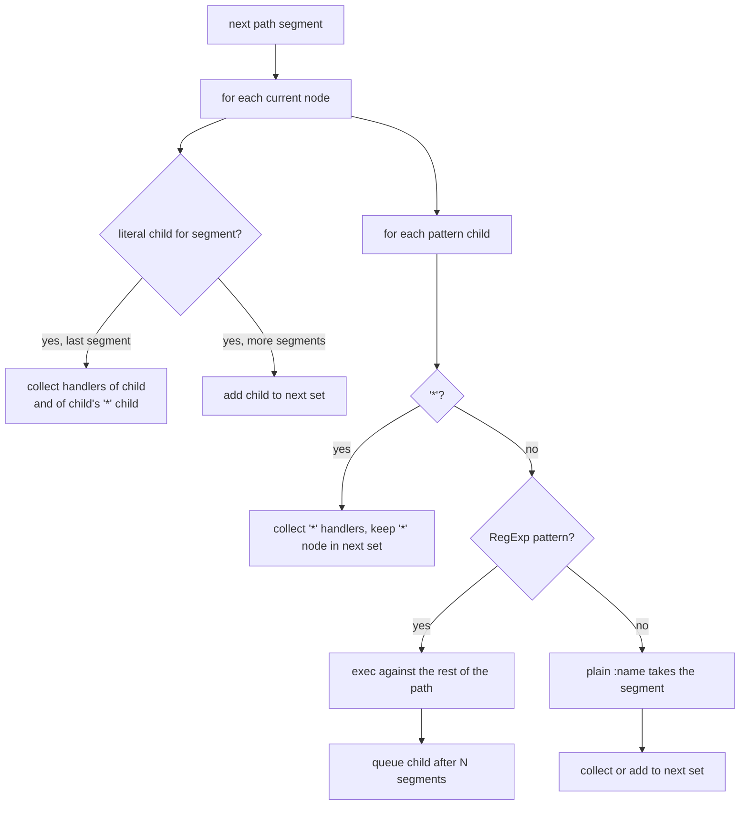

## Overview

`TrieRouter` stores routes in a tree with one level per path segment and walks that tree for every request. It accepts every pattern Hono's route syntax allows, including the ambiguous combinations [[RegExpRouter]] refuses, so it is the second router in the default `SmartRouter` and the one that serves any app mixing `/posts/new` with `/posts/:id`. It has no build step: each `add` inserts into the tree immediately, and routes can be added at any time. The route syntax and router selection are covered on [[Routers and Route Syntax]].

Sources: [src/router/trie-router/router.ts:1-28](repo://src/router/trie-router/router.ts#L1-L28), [src/hono.ts:26-33](repo://src/hono.ts#L26-L33)

`TrieRouter.add` expands optional parameters with `checkOptionalParameter` and inserts each variant into the root `Node`; `match` is `root.search(method, path)`. All the logic lives in `Node`.

Sources: [src/router/trie-router/router.ts:13-27](repo://src/router/trie-router/router.ts#L13-L27)

## The node structure

| Field | Holds |
| --- | --- |
| `#children` | Child nodes keyed by a literal segment, `*`, or a pattern key |
| `#patterns` | The non-literal children of this node, in insertion order, as `Pattern` tuples or `'*'` |
| `#methods` | Handlers that end at this node: a list of `{ [method]: { handler, possibleKeys, score } }` |

Sources: [src/router/trie-router/node.ts:6-42](repo://src/router/trie-router/node.ts#L6-L42)

A `Pattern` comes from `getPattern` in `utils/url`: `[key, name, true]` for a plain `:name`, `[key, name, RegExp]` for `:name{regex}`, or `'*'`. The key of a regular-expression parameter includes the following segment when that segment is a literal (`:id{[0-9]+}#edit`), because the compiled expression has a lookahead for it; two routes with the same parameter but different following segments therefore get different children.

Sources: [src/utils/url.ts:51-79](repo://src/utils/url.ts#L51-L79)

## Inserting a route

`insert` splits the path with `splitRoutingPath`, which splits on `/` but keeps `{...}` groups intact so a pattern like `:file{.+/.+}` stays one segment. For each segment it computes the pattern and the child key, follows an existing child or creates one, and records pattern children in `#patterns`. The names of every parameter met along the way are collected as `possibleKeys`.

Sources: [src/router/trie-router/node.ts:44-85](repo://src/router/trie-router/node.ts#L44-L85), [src/utils/url.ts:16-49](repo://src/utils/url.ts#L16-L49)

At the last node it appends `{ [method]: { handler, possibleKeys, score } }`. `score` is a counter on the root node incremented by every insert, so it is the handler's registration position across the whole router. Several handlers may end on the same node, each with its own score.

Sources: [src/router/trie-router/node.ts:72-85](repo://src/router/trie-router/node.ts#L72-L85)

## Searching

### Breadth-first walk

`search` splits the request path into segments and keeps a set of current nodes, starting with the root. For each segment it builds the next set from every current node, so several branches are followed at once: a literal child and a parameter child can both match the same segment, and both routes' handlers are collected.

Sources: [src/router/trie-router/node.ts:114-160](repo://src/router/trie-router/node.ts#L114-L160)

Sources: [src/router/trie-router/node.ts:132-234](repo://src/router/trie-router/node.ts#L132-L234)

### Matching rules

- **Literal segments.** A matching child is added to the next set. On the last segment its handlers are collected, together with those of its `*` child, so `/hello/*` matches `/hello`.
- **Wildcards.** A `*` child collects its handlers at every depth it is reached and stays in the next set, so it matches any number of further segments.
- **Plain parameters.** `:name` takes the whole segment; an empty segment (a trailing slash) does not match a plain parameter.
- **Regular-expression parameters.** The expression is run against the rest of the path from the current segment's offset, not just the segment, which lets a pattern such as `:file{.+\\.js}` span `/`. When the match covers several segments, the child is queued in `curNodesQueue` and rejoins the walk that many segments later.

Sources: [src/router/trie-router/node.ts:134-234](repo://src/router/trie-router/node.ts#L134-L234)

### Parameters

Parameters travel with the nodes: each node visited records the parameter object built so far (`#params`), copied before a pattern adds its own name. When handlers are collected, `#pushHandlerSets` fills each handler's `params` with only its `possibleKeys`, taking values from the current branch, so a middleware on `/posts/*` does not receive the `id` of `/posts/:id`.

Sources: [src/router/trie-router/node.ts:87-112](repo://src/router/trie-router/node.ts#L87-L112)

A handler is collected for the request's method or for `ALL`; a node with several handler entries contributes each of them.

Sources: [src/router/trie-router/node.ts:94-98](repo://src/router/trie-router/node.ts#L94-L98)

### Restoring registration order

Collection order follows the tree walk, not registration. Before returning, `search` sorts the collected handlers by `score`, which restores the order the app registered them in. That order is what [[Request Lifecycle and Middleware Composition]] relies on to run middleware before handlers. The result uses the inline-parameter shape `[[handler, params][]]`.

Sources: [src/router/trie-router/node.ts:237-243](repo://src/router/trie-router/node.ts#L237-L243)

## Trade-offs

Insertion is cheap and incremental, and every pattern is supported, so `TrieRouter` never throws `UnsupportedPathError`. Each request costs a walk proportional to the path's segment count times the number of branches alive at each step, plus a sort when more than one handler matched. That is slower than one regular expression for large route tables, which is why the default app tries [[RegExpRouter]] first.

Sources: [src/router/trie-router/node.ts:114-160](repo://src/router/trie-router/node.ts#L114-L160), [src/router/trie-router/node.ts:237-243](repo://src/router/trie-router/node.ts#L237-L243), [src/router/smart-router/router.ts:21-50](repo://src/router/smart-router/router.ts#L21-L50)
