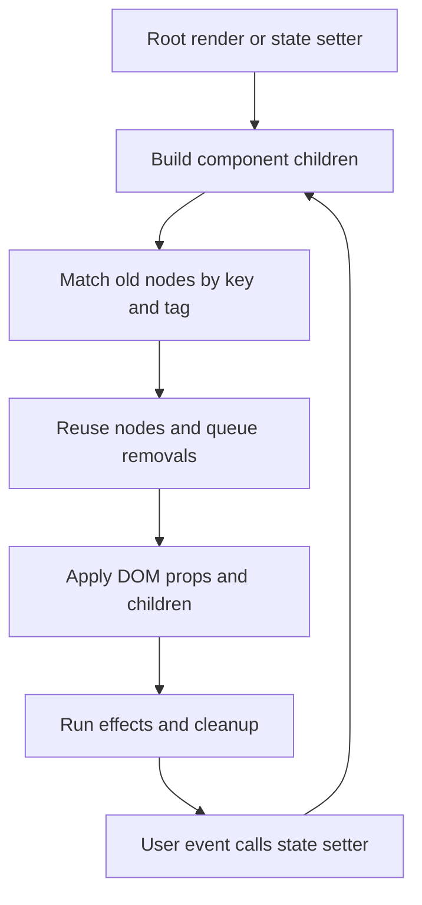

## Overview

Hono's DOM renderer builds a virtual node tree, applies it to browser elements, and updates affected component nodes when state changes. Its entry points include `render` from `hono/jsx/dom` and root objects from `hono/jsx/dom/client`. It shares component and hook machinery with JSX but produces live DOM operations; HTML serialization and HTTP layout middleware belong to [[Server Rendering]].

Sources: [src/jsx/dom/index.ts:11-39](repo://src/jsx/dom/index.ts#L11-L39), [src/jsx/dom/client.ts:23-65](repo://src/jsx/dom/client.ts#L23-L65), [src/jsx/dom/render.ts:783-799](repo://src/jsx/dom/render.ts#L783-L799)

## Create a root

`createRoot(element)` accepts an HTMLElement or DocumentFragment and returns `render` and `unmount`. The first render builds a wrapper component whose state contains the supplied JSX. Later calls update that state. `unmount` sets the wrapper content to null and marks the root unusable; attempting to render afterward throws `Cannot update an unmounted root`. Nonempty root options currently produce a warning instead of configuring behavior.

Sources: [src/jsx/dom/client.ts:11-65](repo://src/jsx/dom/client.ts#L11-L65)

`hydrateRoot` creates a root and immediately renders the supplied content. Its source explicitly defines hydration as equivalent to rendering. Initial `renderNode` builds into a new document fragment and replaces the container's children, so this API does not implement attachment to existing server DOM. When connecting a server page to this renderer, account for that replacement behavior rather than assuming preservation of existing nodes.

Sources: [src/jsx/dom/client.ts:68-84](repo://src/jsx/dom/client.ts#L68-L84), [src/jsx/dom/render.ts:783-794](repo://src/jsx/dom/render.ts#L783-L794)

## Build and reconcile children

`buildNode` ignores null, undefined and boolean children, converts strings and numbers to text nodes, and initializes function-node hook storage. `build` invokes function components or reads intrinsic children, flattens arrays, and compares new children with the previous child list. A keyed child matches by both key and tag; an unkeyed child matches by tag. Reused nodes retain their state storage while receiving new props, and unmatched old children are queued for removal.

Sources: [src/jsx/dom/render.ts:497-566](repo://src/jsx/dom/render.ts#L497-L566), [src/jsx/dom/render.ts:591-609](repo://src/jsx/dom/render.ts#L591-L609), [src/jsx/dom/render.ts:667-703](repo://src/jsx/dom/render.ts#L667-L703)

Memoized function nodes may skip rebuilding when their props comparator passes and captured context values are unchanged, unless a forced build is requested. DOM context providers push a value before children and pop it afterward, with error cleanup; component nodes capture context values for later updates. This gives state updates access to the provider values associated with their tree position.

Sources: [src/jsx/dom/index.ts:76-83](repo://src/jsx/dom/index.ts#L76-L83), [src/jsx/dom/render.ts:528-580](repo://src/jsx/dom/render.ts#L528-L580), [src/jsx/dom/context.ts:7-51](repo://src/jsx/dom/context.ts#L7-L51), [src/jsx/dom/render.ts:713-731](repo://src/jsx/dom/render.ts#L713-L731)

Sources: [src/jsx/dom/client.ts:38-58](repo://src/jsx/dom/client.ts#L38-L58), [src/jsx/dom/render.ts:541-609](repo://src/jsx/dom/render.ts#L541-L609), [src/jsx/dom/render.ts:341-361](repo://src/jsx/dom/render.ts#L341-L361), [src/jsx/dom/render.ts:417-495](repo://src/jsx/dom/render.ts#L417-L495), [src/jsx/hooks/index.ts:197-239](repo://src/jsx/hooks/index.ts#L197-L239)

## State and update scheduling

`useState` uses the current component and an incrementing hook index to find its stored value and setter. Functional updates receive the previous state; `Object.is` equality suppresses unchanged updates. Outside an active build it returns the initial state with a no-op setter. Hook identity therefore follows call order inside a component. `useReducer` combines a state hook with a callback that applies the reducer.

Sources: [src/jsx/hooks/index.ts:182-257](repo://src/jsx/hooks/index.ts#L182-L257)

Ordinary updates are scheduled through a promise turn. If a component already has a pending update, the prior promise resolves as canceled and only the latest callback is retained. `updateSync` rebuilds and applies the node, restoring captured contexts around the build. `flushSync` collects touched nodes and runs their latest callbacks before returning. Transition and view-transition hooks can supply different scheduling context through the same update entry point.

Sources: [src/jsx/dom/render.ts:713-780](repo://src/jsx/dom/render.ts#L713-L780), [src/jsx/dom/render.ts:801-813](repo://src/jsx/dom/render.ts#L801-L813), [src/jsx/hooks/index.ts:79-154](repo://src/jsx/hooks/index.ts#L79-L154)

## Props, events and references

Event props become native event listeners. The renderer recognizes capture suffixes and aliases Change to Input and DoubleClick to DblClick. Updating an event handler removes the old listener before adding the new function; non-function event values throw. Removed event props remove their listeners. Other props update attributes, style properties or special form-control properties, with invalid attribute-name DOM exceptions ignored.

Sources: [src/jsx/dom/render.ts:19-22](repo://src/jsx/dom/render.ts#L19-L22), [src/jsx/dom/render.ts:115-132](repo://src/jsx/dom/render.ts#L115-L132), [src/jsx/dom/render.ts:158-270](repo://src/jsx/dom/render.ts#L158-L270)

Object refs receive the element through `current`, and callback refs receive the element directly. The renderer remembers either a returned cleanup callback or a fallback that passes null; removal invokes that cleanup. `dangerouslySetInnerHTML` assigns `innerHTML` directly. Style strings assign cssText, while style objects clear it and set individual properties. Inputs, textareas, options and selects have value/selection handling beyond ordinary attribute updates.

Sources: [src/jsx/dom/render.ts:144-156](repo://src/jsx/dom/render.ts#L144-L156), [src/jsx/dom/render.ts:187-227](repo://src/jsx/dom/render.ts#L187-L227), [src/jsx/dom/render.ts:341-350](repo://src/jsx/dom/render.ts#L341-L350)

## Effects and asynchronous components

Effect hooks store dependencies and cleanup callbacks on the component. When dependencies change, the prior cleanup runs and a new effect runner is installed; layout, insertion and ordinary effects use different slots. Removing a node invokes effect cleanup recursively, clears ref state and cancels queued component updates. `useMemo` and `useCallback` also use dependency comparisons, while `useRef` preserves an object in hook storage.

Sources: [src/jsx/hooks/index.ts:260-329](repo://src/jsx/hooks/index.ts#L260-L329), [src/jsx/hooks/index.ts:348-362](repo://src/jsx/hooks/index.ts#L348-L362), [src/jsx/dom/render.ts:341-361](repo://src/jsx/dom/render.ts#L341-L361)

`use(promise)` returns a cached resolution, throws a cached rejection, or throws the still-pending promise after registering its handlers. DOM `Suspense` catches promises, returns fallback content and arranges a retry when they settle. DOM `ErrorBoundary` rethrows promises but handles other errors with `onError`, `fallbackRender` or fallback content. The renderer stores the nearest boundary on child nodes so later updates can reach it.

Sources: [src/jsx/hooks/index.ts:332-345](repo://src/jsx/hooks/index.ts#L332-L345), [src/jsx/dom/components.ts:7-38](repo://src/jsx/dom/components.ts#L7-L38), [src/jsx/dom/render.ts:528-538](repo://src/jsx/dom/render.ts#L528-L538), [src/jsx/dom/render.ts:620-652](repo://src/jsx/dom/render.ts#L620-L652)

## Form actions, styles and compatibility limits

`useFormStatus` reads the form context, whose default state is not pending. `useActionState` returns a state value and an async form action that passes the previous state and form data to the supplied function. `useOptimistic` maintains temporary state and resets it after registered actions settle. These are browser action-state helpers; server input extraction and rejection remain the responsibilities of [[Validation and Typed Clients]].

Sources: [src/jsx/dom/hooks/index.ts:11-90](repo://src/jsx/dom/hooks/index.ts#L11-L90), [src/validator/validator.ts:162-170](repo://src/validator/validator.ts#L162-L170)

DOM CSS integration locates a style element by ID and inserts rules into its stylesheet, tracking already inserted class names. It retries on a promise turn when the stylesheet is initially absent, then throws if it is still missing. The shared CSS generation API is covered in [[Server Rendering]]; the browser integration's additional requirement is an available stylesheet for insertion. Portals target an external HTMLElement and mark the container itself for preservation during removal.

Sources: [src/jsx/dom/css.ts:77-110](repo://src/jsx/dom/css.ts#L77-L110), [src/jsx/dom/render.ts:815-825](repo://src/jsx/dom/render.ts#L815-L825), [src/jsx/dom/render.ts:341-354](repo://src/jsx/dom/render.ts#L341-L354)

The API exports compatibility names but retains explicit limitations: `StrictMode` is an alias of Fragment, root options are unsupported, and the DOM server compatibility module's `renderToString` rejects asynchronous results. Its readable-stream wrapper only supports `onError` among the exposed options. Use the actual contracts here when integrating code written against those names; the full asynchronous HTML pipeline remains in [[Server Rendering]].

Sources: [src/jsx/dom/index.ts:119-124](repo://src/jsx/dom/index.ts#L119-L124), [src/jsx/dom/client.ts:33-35](repo://src/jsx/dom/client.ts#L33-L35), [src/jsx/dom/server.ts:21-30](repo://src/jsx/dom/server.ts#L21-L30), [src/jsx/dom/server.ts:50-63](repo://src/jsx/dom/server.ts#L50-L63)
