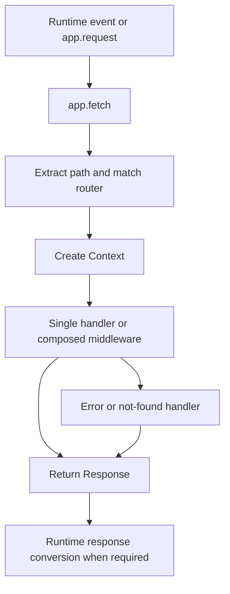

## Overview

Hono is a TypeScript web framework built around the Web Standards `Request` and `Response` interfaces. An application registers handlers, exposes a `fetch` entry point, and returns a response for each request. The repository includes the routing engine, request context, middleware, rendering tools, typed client, and runtime adapters. The same application interface also supports in-process requests, so a handler can be exercised without starting a listening server.

Sources: [README.md:22-47](repo://README.md#L22-L47), [src/hono-base.ts:479-517](repo://src/hono-base.ts#L479-L517)

The default `Hono` class extends `HonoBase` and supplies a `SmartRouter` containing `RegExpRouter` and `TrieRouter`. The base class owns route registration and dispatch; the router supplies matching. This separation is visible in the constructor's `router` option and in dispatch's call to `router.match`. Start with [[Quickstart]] to create an application, then use the system pages below to follow the behavior behind its public methods.

Sources: [src/hono.ts:16-33](repo://src/hono.ts#L16-L33), [src/hono-base.ts:406-427](repo://src/hono-base.ts#L406-L427), [README.md:26-39](repo://README.md#L26-L39)

## Parts of the system

| Area | What it does | Page |
| --- | --- | --- |
| Application setup | Creates an application and registers its first endpoint | [[Quickstart]] |
| Routing | Registers paths, groups applications, selects matching handlers | [[Routing]] |
| Request execution | Composes middleware and exposes request and response state | [[Request Context and Middleware]] |
| Input and RPC | Extracts validated input and constructs typed HTTP calls | [[Validation and Typed Clients]] |
| Access policy | Supplies authentication, CORS, CSRF and security headers | [[Security Middleware]] |
| HTTP processing | Supplies caching, compression, logging and timing | [[HTTP and Observability Middleware]] |

Sources: [README.md:26-39](repo://README.md#L26-L39), [src/hono-base.ts:126-173](repo://src/hono-base.ts#L126-L173), [src/compose.ts:32-70](repo://src/compose.ts#L32-L70), [src/validator/validator.ts:89-170](repo://src/validator/validator.ts#L89-L170), [src/client/client.ts:214-232](repo://src/client/client.ts#L214-L232), [package.json:79-178](repo://package.json#L79-L178), [package.json:259-288](repo://package.json#L259-L288)

| Area | What it does | Page |
| --- | --- | --- |
| Server output | Renders JSX through layouts into ordinary or streamed HTML | [[Server Rendering]] |
| Browser UI | Mounts JSX roots and updates DOM content | [[Browser Rendering]] |
| Long-lived output | Writes streams and exposes WebSocket event handlers | [[Streaming and WebSockets]] |
| Runtime integration | Connects platform handlers and static serving entry points | [[Runtime Adapters and Static Files]] |
| File generation | Fetches registered routes and writes static output | [[Static Site Generation]] |
| Verification | Runs application requests, tests and package builds | [[Testing and Development]] |

Sources: [src/middleware/jsx-renderer/index.ts:33-79](repo://src/middleware/jsx-renderer/index.ts#L33-L79), [src/jsx/dom/client.ts:23-84](repo://src/jsx/dom/client.ts#L23-L84), [src/helper/streaming/stream.ts:7-44](repo://src/helper/streaming/stream.ts#L7-L44), [src/helper/websocket/index.ts:14-39](repo://src/helper/websocket/index.ts#L14-L39), [package.json:409-468](repo://package.json#L409-L468), [src/helper/ssg/ssg.ts:34-47](repo://src/helper/ssg/ssg.ts#L34-L47), [src/helper/ssg/ssg.ts:205-240](repo://src/helper/ssg/ssg.ts#L205-L240), [package.json:13-36](repo://package.json#L13-L36)

## Main request flow

Sources: [src/hono-base.ts:406-485](repo://src/hono-base.ts#L406-L485), [src/hono-base.ts:499-517](repo://src/hono-base.ts#L499-L517), [src/adapter/aws-lambda/handler.ts:252-275](repo://src/adapter/aws-lambda/handler.ts#L252-L275)

[[Runtime Adapters and Static Files]] begins at the platform boundary: for example, Lambda selects an event processor, creates a standard request, and supplies event metadata to `app.fetch`. [[Routing]] then explains how the configured path extractor and router turn the method and URL into the handler list used for this request.

Sources: [src/adapter/aws-lambda/handler.ts:252-272](repo://src/adapter/aws-lambda/handler.ts#L252-L272), [src/hono-base.ts:418-427](repo://src/hono-base.ts#L418-L427)

[[Request Context and Middleware]] follows construction of the context, invocation of handlers, and final response selection. A single matching handler has a direct execution path; multiple handlers use `compose`. Errors enter the application's error handler, while reaching the end without a finalized response can invoke the not-found handler. [[Server Rendering]] describes an optional response-producing branch: the renderer converts a component tree into HTML or a readable stream before returning it through the same context.

Sources: [src/hono-base.ts:429-465](repo://src/hono-base.ts#L429-L465), [src/compose.ts:49-70](repo://src/compose.ts#L49-L70), [src/middleware/jsx-renderer/index.ts:60-79](repo://src/middleware/jsx-renderer/index.ts#L60-L79)

At the end, [[Runtime Adapters and Static Files]] resumes where a platform needs its own response shape. Lambda converts response bytes, headers and cookies into a proxy result. The in-process path in [[Testing and Development]] instead receives the `Response` directly from `app.request`, retaining the same application dispatch behavior.

Sources: [src/adapter/aws-lambda/handler.ts:344-400](repo://src/adapter/aws-lambda/handler.ts#L344-L400), [src/hono-base.ts:499-517](repo://src/hono-base.ts#L499-L517)

## Design choices across systems

The standard request/response boundary lets adapters concentrate on conversion. Lambda's processor constructs a `Request`, and its result processor consumes a `Response`; dispatch itself does not need the event's platform-specific shape. Platform bindings travel separately through the context's environment. This is the concrete boundary behind the repository's stated multi-runtime design.

Sources: [README.md:22-45](repo://README.md#L22-L45), [src/adapter/aws-lambda/handler.ts:268-274](repo://src/adapter/aws-lambda/handler.ts#L268-L274), [src/adapter/aws-lambda/handler.ts:318-359](repo://src/adapter/aws-lambda/handler.ts#L318-L359), [src/context.ts:352-360](repo://src/context.ts#L352-L360)

Router selection occurs on first matching, rather than on every request. `SmartRouter` tries candidates until one accepts the registered routes, then replaces its own matching method with that router's bound method and drops the buffered routes. The code therefore makes route registration a setup phase: adding routes after selection throws. [[Routing]] covers this lifecycle and the preset alternatives.

Sources: [src/router/smart-router/router.ts:13-60](repo://src/router/smart-router/router.ts#L13-L60)

Request processing avoids work when the selected path does not need it. Dispatch explicitly skips composition for one handler, and `Context.req` creates the request wrapper only when accessed. Response helpers also include specialized paths: `text` can construct a response directly when there are no prepared headers, status or other response options. These branches explain why extensions should use the context interfaces rather than assume internal objects already exist.

Sources: [src/hono-base.ts:429-450](repo://src/hono-base.ts#L429-L450), [src/context.ts:363-369](repo://src/context.ts#L363-L369), [src/context.ts:682-694](repo://src/context.ts#L682-L694)

Validation and execution remain connected through middleware. The validator can return a response immediately or store transformed data and continue; the client separately serializes arguments into HTTP requests. [[Validation and Typed Clients]] explains this distinction, including why a client type does not replace the server's validation callback.

Sources: [src/validator/validator.ts:162-170](repo://src/validator/validator.ts#L162-L170), [src/client/client.ts:53-128](repo://src/client/client.ts#L53-L128)
