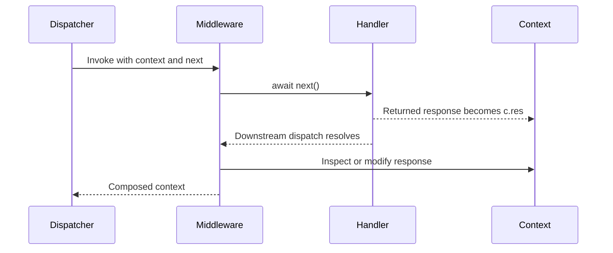

## Overview

Each dispatched request receives a `Context` containing the original request, matched routes, environment, execution context and not-found handler. It provides the shared state through which middleware and handlers cooperate. [[Routing]] ends at the match result; this page follows execution from that result to the returned `Response`, including input access, response preparation and errors.

Sources: [src/hono-base.ts:418-427](repo://src/hono-base.ts#L418-L427), [src/context.ts:352-368](repo://src/context.ts#L352-L368)

## Dispatch and middleware ordering

HEAD requests are dispatched as GET and wrapped in a response with a null body. For one matched handler, dispatch calls it directly with a `next` callback that installs the not-found response. A promise result falls back to an already finalized context or the not-found handler when it resolves without a response. Multiple-handler execution instead runs through `compose`, then verifies that the context was finalized.

Sources: [src/hono-base.ts:406-465](repo://src/hono-base.ts#L406-L465)

Composition calls each handler with the context and a callback that dispatches the next index. Code before `await next()` runs on the way in; code after it runs as downstream calls resolve. The composer updates `c.req.routeIndex` before each handler and rejects a repeated or backward dispatch with `next() called multiple times`. Returning a response without calling `next` ends that branch of the chain.

Sources: [src/compose.ts:20-70](repo://src/compose.ts#L20-L70)

Sources: [src/compose.ts:42-70](repo://src/compose.ts#L42-L70), [src/hono-base.ts:450-461](repo://src/hono-base.ts#L450-L461)

The composer installs a returned response when the context is not finalized, or when processing an error response. A middleware that awaits downstream execution can mutate `c.res` or call `c.header` afterward. Merely returning a different response after a downstream response has finalized the context does not replace it through the ordinary composer assignment condition.

Sources: [src/compose.ts:67-70](repo://src/compose.ts#L67-L70), [src/context.ts:414-434](repo://src/context.ts#L414-L434), [src/context.ts:515-527](repo://src/context.ts#L515-L527)

## Read request data

`c.req` lazily constructs a `HonoRequest` and retains the original Web `Request` as `raw`. `param` selects the parameter map for the current route index and decodes captured values. `query` returns single values; `queries` returns arrays for repeated keys. `header(name)` returns a value or `undefined`, while the no-argument form builds a record from all request headers. URL and method getters expose the original request's values.

Sources: [src/context.ts:363-369](repo://src/context.ts#L363-L369), [src/request.ts:71-127](repo://src/request.ts#L71-L127), [src/request.ts:148-198](repo://src/request.ts#L148-L198), [src/request.ts:369-387](repo://src/request.ts#L369-L387)

Body helpers cache reads through the wrapper. `json` parses cached text, `text` and `arrayBuffer` reuse their cached representation, and conversion from an already cached representation uses a temporary `Response`. `bytes` wraps an array buffer in a `Uint8Array`; `blob` and `formData` use the same cached-body helper. Reading `raw` directly bypasses that wrapper's cache, so the cache guarantee applies to the Hono request helpers.

Sources: [src/request.ts:220-286](repo://src/request.ts#L220-L286), [src/request.ts:301-330](repo://src/request.ts#L301-L330)

`parseBody` handles multipart and URL-encoded form media types and returns an empty object for other content types. By default, repeated ordinary fields retain their last value; `all: true` collects repeated values and names ending in `[]` collect arrays. `dot: true` constructs nested objects from dotted names. Form parsing also caches the `FormData` promise so a later wrapper read can reuse the consumed body. [[Validation and Typed Clients]] covers explicit validation and transformed outputs, which are separate from this parsing step.

Sources: [src/utils/body.ts:97-140](repo://src/utils/body.ts#L97-L140), [src/utils/body.ts:151-205](repo://src/utils/body.ts#L151-L205), [src/utils/body.ts:215-241](repo://src/utils/body.ts#L215-L241), [src/validator/validator.ts:162-170](repo://src/validator/validator.ts#L162-L170)

## Share state within a request

`c.env` receives bindings supplied to dispatch. Request-local variables use `c.set` and `c.get`, backed by a lazily created map; `c.var` exposes a read-only typed object snapshot of that map. These channels are distinct: bindings come from the caller, while variables are written during handler execution. Reading an unset variable returns `undefined`.

Sources: [src/context.ts:352-360](repo://src/context.ts#L352-L360), [src/context.ts:546-602](repo://src/context.ts#L546-L602)

`c.executionCtx` throws when no execution context was supplied, and `c.event` additionally requires an object exposing `respondWith`. Tests or adapters that do not provide these objects cannot assume those getters exist operationally. The environment remains available independently, as described in [[Runtime Adapters and Static Files]].

Sources: [src/context.ts:377-396](repo://src/context.ts#L377-L396), [src/context.ts:352-360](repo://src/context.ts#L352-L360)

## Build and finalize a response

`c.header` prepares headers before response construction and modifies a response afterward; it deletes on `undefined`, appends with the append option, and otherwise replaces. `c.status` prepares a status. `newResponse` combines existing or prepared headers with explicit response options and header arguments, then creates the response. An explicit numeric status wins over a response option's status, which in turn wins over the prepared status.

Sources: [src/context.ts:515-531](repo://src/context.ts#L515-L531), [src/context.ts:604-641](repo://src/context.ts#L604-L641)

`body` returns arbitrary response data. `text` has a direct fast path, `json` serializes with `JSON.stringify`, and `html` resolves escaped-string callbacks when necessary. `redirect` sets `Location` and defaults to 302; `notFound` calls the configured not-found handler. `render` delegates to the installed renderer, defaulting to HTML; layouts and renderers are expanded in [[Server Rendering]].

Sources: [src/context.ts:664-733](repo://src/context.ts#L664-L733), [src/context.ts:750-778](repo://src/context.ts#L750-L778), [src/context.ts:448-497](repo://src/context.ts#L448-L497)

Assigning `c.res` marks the context finalized. If a previous response exists, the setter carries its headers into the replacement except for content type; cookies are transferred as separate values. Reading `c.res` alone creates a default response if needed but does not run that finalizing setter. The dispatcher's finalization check therefore catches a composed chain that neither returned a response nor completed downstream response production.

Sources: [src/context.ts:403-434](repo://src/context.ts#L403-L434), [src/hono-base.ts:450-465](repo://src/hono-base.ts#L450-L465)

## Cookies

The cookie helper reads the request's `Cookie` header and supports ordinary or signed values. Named reads can select secure or host prefixes. `setCookie` and `setSignedCookie` append `Set-Cookie` headers; generated cookies default to `/`. The host prefix forces secure, root path and no domain, while the secure prefix forces secure. `deleteCookie` writes an empty value with `maxAge: 0` and returns the previous value.

Sources: [src/helper/cookie/index.ts:27-75](repo://src/helper/cookie/index.ts#L27-L75), [src/helper/cookie/index.ts:78-144](repo://src/helper/cookie/index.ts#L78-L144)

## Errors and extension points

The default not-found response is `404 Not Found`. The default error handler uses an error's `getResponse` when available; otherwise it logs and returns 500. `HTTPException` supplies this method, preserving its configured status and either a custom response body and headers or the exception message. `onError` and `notFound` replace application handlers. The composed path records an intercepted `Error` in `c.error`; non-`Error` thrown values are rethrown.

Sources: [src/hono-base.ts:31-42](repo://src/hono-base.ts#L31-L42), [src/hono-base.ts:271-294](repo://src/hono-base.ts#L271-L294), [src/http-exception.ts:55-77](repo://src/http-exception.ts#L55-L77), [src/compose.ts:49-59](repo://src/compose.ts#L49-L59)

For reusable typed middleware, `createMiddleware` preserves the handler while supplying its generic interface. `createFactory` can apply default application options and an `initApp` callback; its `createHandlers` returns the supplied handlers with undefined entries removed. These helpers package application setup without changing the execution contract. The built-in choices in [[Security Middleware]] and [[HTTP and Observability Middleware]] use that same handler-and-next model.

Sources: [src/helper/factory/index.ts:332-375](repo://src/helper/factory/index.ts#L332-L375), [src/compose.ts:49-51](repo://src/compose.ts#L49-L51)
