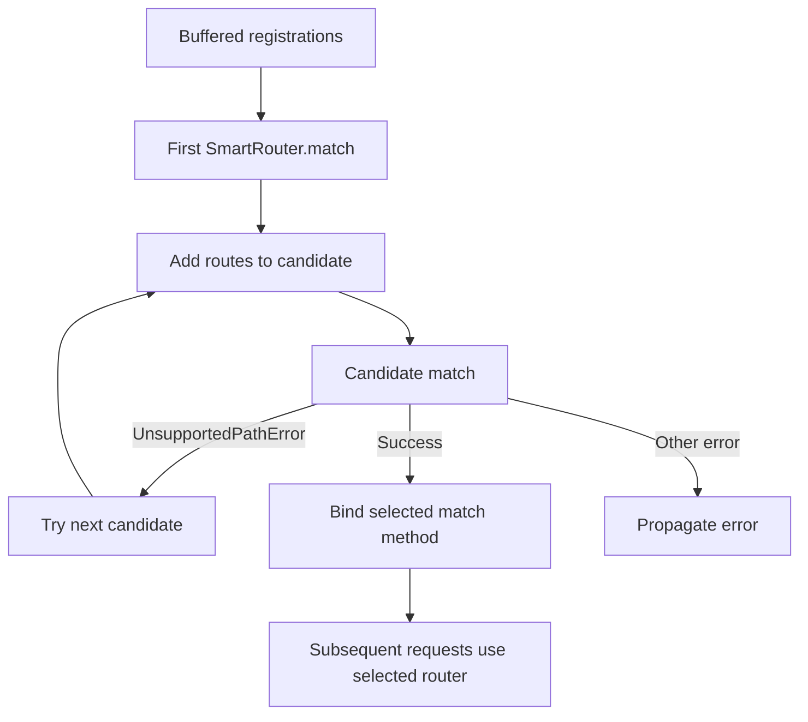

## Overview

Routing turns application declarations into an ordered collection of handlers and their path parameters. `HonoBase` records route metadata and calls a pluggable router; the selected router implements `add` and `match`. Matching does not execute handlers. The dispatcher passes its result to the context and execution machinery described in [[Request Context and Middleware]].

Sources: [src/router.ts:29-51](repo://src/router.ts#L29-L51), [src/hono-base.ts:385-427](repo://src/hono-base.ts#L385-L427)

## Register handlers

The constructor installs `get`, `post`, `put`, `delete`, `options`, `patch` and `all`. A string argument updates the current path; each following handler becomes a separate route entry. Supplying a handler without a new path uses the current one. `on` accepts method and path arrays and registers their combinations, uppercasing methods. `use` registers handlers with the `ALL` method; without a path argument it selects `*`.

Sources: [src/router.ts:9-17](repo://src/router.ts#L9-L17), [src/hono-base.ts:126-168](repo://src/hono-base.ts#L126-L168)

Every entry passes through `#addRoute`, which merges the application's base path, records `basePath`, `path`, `method` and `handler`, and sends the handler together with its metadata to the router. The public `routes` array therefore describes registration, including middleware. A route can contribute several handlers to one request; the result is not simply one winning callback.

Sources: [src/hono-base.ts:385-397](repo://src/hono-base.ts#L385-L397), [src/router.ts:67-98](repo://src/router.ts#L67-L98)

## Paths and parameters

The default path extractor reads the URL path while excluding query and fragment text. Percent-encoded paths take a decoding branch that preserves undecodable sequences as far as possible. Strict mode defaults to true; `strict: false` selects `getPathNoStrict`, which removes a trailing slash except at the root. In this constructor, non-strict mode selects that extractor directly, while strict mode can use a supplied `getPath` callback.

Sources: [src/utils/url.ts:81-133](repo://src/utils/url.ts#L81-L133), [src/utils/url.ts:141-146](repo://src/utils/url.ts#L141-L146), [src/hono-base.ts:170-173](repo://src/hono-base.ts#L170-L173)

| Pattern | Meaning in the routing implementation |
| --- | --- |
| `/users/:id` | Captures a named path segment |
| `/:id{[0-9]+}` | Adds a regular-expression constraint to a named parameter |
| `/api/animals/:type?` | Expands to routes with and without the optional parameter |
| `/hello/*` | Wildcard matching includes `/hello` in the trie implementation |
| `*` | Matches across paths and is used by pathless middleware |

Sources: [src/utils/url.ts:51-77](repo://src/utils/url.ts#L51-L77), [src/utils/url.ts:171-205](repo://src/utils/url.ts#L171-L205), [src/router/trie-router/node.ts:136-162](repo://src/router/trie-router/node.ts#L136-L162), [src/hono-base.ts:156-166](repo://src/hono-base.ts#L156-L166)

Router results either contain parameter values directly or contain parameter indexes plus a shared captured-value array. The request wrapper understands both representations. Trie insertion records a monotonically increasing score, and search sorts collected handlers by that score, preserving registration order across matches. Parameter extraction during execution belongs to [[Request Context and Middleware]], because the current middleware index determines which parameter map is read.

Sources: [src/router.ts:54-98](repo://src/router.ts#L54-L98), [src/router/trie-router/node.ts:44-82](repo://src/router/trie-router/node.ts#L44-L82), [src/router/trie-router/node.ts:237-243](repo://src/router/trie-router/node.ts#L237-L243), [src/request.ts:102-127](repo://src/request.ts#L102-L127)

## Router selection and presets

The default application tries `RegExpRouter` before `TrieRouter`. On the first `SmartRouter.match`, it copies every buffered registration into a candidate and asks it to match. Only `UnsupportedPathError` triggers the next candidate; other exceptions propagate. Once successful, `SmartRouter` binds its `match` method to the chosen implementation, releases the registration buffer and updates its name. Accessing `activeRouter` before selection throws.

Sources: [src/hono.ts:26-32](repo://src/hono.ts#L26-L32), [src/router/smart-router/router.ts:21-69](repo://src/router/smart-router/router.ts#L21-L69)

Sources: [src/router/smart-router/router.ts:21-60](repo://src/router/smart-router/router.ts#L21-L60)

| Implementation | Matching strategy and boundary |
| --- | --- |
| `RegExpRouter` | Builds method matchers, checks a static-path map, then matches a combined expression |
| `TrieRouter` | Inserts route segments into a trie and searches literal, wildcard and parameter branches |
| `LinearRouter` | Scans registrations; a path mixing labels and wildcards raises `UnsupportedPathError` |
| `PatternRouter` | Compiles an expression per route and scans matching method entries |
| `SmartRouter` | Chooses and binds the first candidate accepting the route collection |

Sources: [src/router/reg-exp-router/router.ts:34-102](repo://src/router/reg-exp-router/router.ts#L34-L102), [src/router/reg-exp-router/matcher.ts:10-32](repo://src/router/reg-exp-router/matcher.ts#L10-L32), [src/router/trie-router/router.ts:13-26](repo://src/router/trie-router/router.ts#L13-L26), [src/router/trie-router/node.ts:127-174](repo://src/router/trie-router/node.ts#L127-L174), [src/router/linear-router/router.ts:25-41](repo://src/router/linear-router/router.ts#L25-L41), [src/router/linear-router/router.ts:135-142](repo://src/router/linear-router/router.ts#L135-L142), [src/router/pattern-router/router.ts:12-58](repo://src/router/pattern-router/router.ts#L12-L58), [src/router/smart-router/router.ts:32-49](repo://src/router/smart-router/router.ts#L32-L49)

`hono/quick` constructs a `SmartRouter` with `LinearRouter` then `TrieRouter`; `hono/tiny` constructs `PatternRouter`. Their constructors assign these routers after calling the base constructor. The main `Hono` constructor instead honors `options.router` when supplied. These are concrete selection differences; the implementation does not promise identical path capabilities for every standalone router.

Sources: [src/preset/quick.ts:13-24](repo://src/preset/quick.ts#L13-L24), [src/preset/tiny.ts:11-20](repo://src/preset/tiny.ts#L11-L20), [src/hono.ts:26-32](repo://src/hono.ts#L26-L32), [src/router/linear-router/router.ts:135-138](repo://src/router/linear-router/router.ts#L135-L138)

## Group and mount applications

`basePath` returns a clone sharing the router and route array, with a merged prefix. `route(path, child)` iterates the child's existing routes and registers them under that prefix. If the child has a custom error handler, its handlers are wrapped to retain that error behavior. Because grouping copies the routes present at the call, define child routes before grouping them.

Sources: [src/hono-base.ts:175-183](repo://src/hono-base.ts#L175-L183), [src/hono-base.ts:217-252](repo://src/hono-base.ts#L217-L252)

`mount` connects a request-taking application handler under a wildcard prefix. By default it removes the mount prefix from the request path and passes the environment and available execution context. `optionHandler` changes those extra arguments; `replaceRequest` changes request rewriting, and `false` preserves the original request. A returned response ends the mounted handler; a falsy result continues with `next()`.

Sources: [src/hono-base.ts:328-382](repo://src/hono-base.ts#L328-L382)

## Inspect and diagnose routing

`inspectRoutes` returns registration data, while `showRoutes` prints grouped method/path entries and optionally middleware details. `getRouterName` forces a match before returning the name, so using it also triggers the default router's selection boundary. Adding routes afterward can raise the matcher-already-built error described in [[Quickstart]].

Sources: [src/helper/dev/index.ts:27-79](repo://src/helper/dev/index.ts#L27-L79), [src/router/smart-router/router.ts:13-18](repo://src/router/smart-router/router.ts#L13-L18)

Within a request, `matchedRoutes` exposes matched metadata, `routePath` selects a registered pattern, `baseRoutePath` selects its registered prefix, and the route helper's `basePath` resolves that prefix against the actual request path. Optional indexes support selecting a different matched entry; defaults follow the current request route index. These distinguish the registered pattern from the concrete URL when diagnosing nested or parameterized routes.

Sources: [src/helper/route/index.ts:32-34](repo://src/helper/route/index.ts#L32-L34), [src/helper/route/index.ts:58-83](repo://src/helper/route/index.ts#L58-L83), [src/helper/route/index.ts:106-140](repo://src/helper/route/index.ts#L106-L140)
