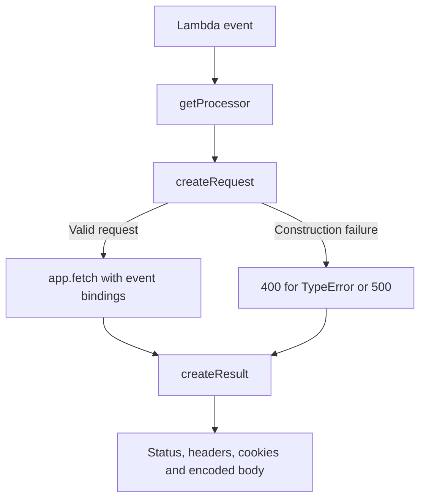

## Overview

Runtime adapters connect platform events and resources to Hono's Web `Request` and `Response` interface. The shared entry point is `app.fetch(request, env, executionCtx)`: adapters supply the arguments and, where necessary, translate the result. [[Request Context and Middleware]] explains the dispatch that follows. Static-file adapters similarly supply a resource reader to shared path and response middleware, keeping filesystem or KV access outside the common implementation.

Sources: [src/hono-base.ts:479-485](repo://src/hono-base.ts#L479-L485), [src/adapter/cloudflare-pages/handler.ts:32-46](repo://src/adapter/cloudflare-pages/handler.ts#L32-L46), [src/middleware/serve-static/index.ts:32-52](repo://src/middleware/serve-static/index.ts#L32-L52)

## Choose an event adapter

| Adapter | Incoming contract and application call |
| --- | --- |
| Vercel | Passes the incoming `Request` directly to `app.fetch` |
| Netlify | Passes the request and exposes the platform context through `c.env.context` |
| Cloudflare Pages | Passes the event request, spreads bindings into the environment, and adds `eventContext` and execution methods |
| Service Worker | Calls `respondWith` around application dispatch and optionally falls back to network fetch on 404 |
| AWS Lambda | Converts an event into a request and the response into the event processor's result format |
| Lambda@Edge | Converts the first CloudFront record and exposes event, context, callback, config, request and response bindings |

Sources: [src/adapter/vercel/handler.ts:4-8](repo://src/adapter/vercel/handler.ts#L4-L8), [src/adapter/netlify/handler.ts:4-10](repo://src/adapter/netlify/handler.ts#L4-L10), [src/adapter/cloudflare-pages/handler.ts:32-46](repo://src/adapter/cloudflare-pages/handler.ts#L32-L46), [src/adapter/service-worker/handler.ts:18-37](repo://src/adapter/service-worker/handler.ts#L18-L37), [src/adapter/aws-lambda/handler.ts:239-275](repo://src/adapter/aws-lambda/handler.ts#L239-L275), [src/adapter/lambda-edge/handler.ts:116-147](repo://src/adapter/lambda-edge/handler.ts#L116-L147)

Cloudflare Pages also offers `handleMiddleware`. It constructs a context whose downstream callback invokes the platform's `next`, then prefers a directly returned middleware response. An intercepted `HTTPException` becomes its response; another recorded error is rethrown. Service Worker `fire` registers the fetch listener. Its handler's default options contain a bound global fetch, but passing an options object without `fetch` disables that fallback because the default object is not merged with supplied options.

Sources: [src/adapter/cloudflare-pages/handler.ts:49-102](repo://src/adapter/cloudflare-pages/handler.ts#L49-L102), [src/adapter/service-worker/index.ts:28-36](repo://src/adapter/service-worker/index.ts#L28-L36), [src/adapter/service-worker/handler.ts:18-37](repo://src/adapter/service-worker/handler.ts#L18-L37)

## Follow a Lambda request

The Lambda adapter's documented entry point wraps an ordinary Hono app with `handle`:

Sources: [src/adapter/aws-lambda/handler.ts:199-221](repo://src/adapter/aws-lambda/handler.ts#L199-L221)

```js
import { Hono } from 'hono'
import { handle } from 'hono/aws-lambda'

const app = new Hono()

app.get('/', (c) => c.text('Hello from Lambda'))
app.get('/json', (c) => c.json({ message: 'Hello JSON' }))

export const handler = handle(app)
```

Sources: [src/adapter/aws-lambda/handler.ts:213-221](repo://src/adapter/aws-lambda/handler.ts#L213-L221)

`getProcessor` checks for ALB, API Gateway v2, and Lattice v2 before falling back to API Gateway v1. The v2 check requires both `rawPath` and a request-context `http` property: the comments explain that v1 events behind custom-domain base-path mappings can also carry `rawPath`. The selected processor supplies method, path, query and headers. Common request construction builds an HTTPS URL, decodes base64 bodies or UTF-8 encodes text, and sets the resulting content length.

Sources: [src/adapter/aws-lambda/handler.ts:625-658](repo://src/adapter/aws-lambda/handler.ts#L625-L658), [src/adapter/aws-lambda/handler.ts:301-342](repo://src/adapter/aws-lambda/handler.ts#L301-L342)



Sources: [src/adapter/aws-lambda/handler.ts:252-275](repo://src/adapter/aws-lambda/handler.ts#L252-L275), [src/adapter/aws-lambda/handler.ts:344-400](repo://src/adapter/aws-lambda/handler.ts#L344-L400)

The application receives `event`, `requestContext` and `lambdaContext` as bindings. Request-conversion failures are logged and converted before dispatch: a `TypeError` produces 400, other failures produce 500. Response conversion buffers the body as text or base64, returns the response status, and selects ordinary or multi-value headers according to the event. Cookies are extracted separately and delegated to the processor's output convention before other headers are copied.

Sources: [src/adapter/aws-lambda/handler.ts:252-275](repo://src/adapter/aws-lambda/handler.ts#L252-L275), [src/adapter/aws-lambda/handler.ts:344-400](repo://src/adapter/aws-lambda/handler.ts#L344-L400)

`isContentTypeBinary` overrides content-type classification. The default recognizes selected text types and JSON/XML suffixes as text; a non-identity content encoding also forces base64. `streamHandle` takes a separate path through the runtime's `streamifyResponse` and `HttpResponseStream`, transfers status, headers and cookies, and pipes response-body chunks to the Node writer. The HTTP producer APIs in [[Streaming and WebSockets]] supply that response body; this adapter supplies the Lambda transport.

Sources: [src/adapter/aws-lambda/handler.ts:126-193](repo://src/adapter/aws-lambda/handler.ts#L126-L193), [src/adapter/aws-lambda/handler.ts:349-359](repo://src/adapter/aws-lambda/handler.ts#L349-L359), [src/adapter/aws-lambda/handler.ts:660-674](repo://src/adapter/aws-lambda/handler.ts#L660-L674), [src/helper/streaming/stream.ts:12-44](repo://src/helper/streaming/stream.ts#L12-L44)

## Resolve environment values

The adapter helper's `env(c, runtime?)` selects the environment source by runtime. Node, Bun and edge-light use `process.env`; Deno uses `Deno.env.toObject`; workerd uses `c.env`; fastly and other return an empty object. Without an override, runtime detection checks known user-agent prefixes, then EdgeRuntime, Fastly and Node globals. This helper does not merge process variables with application bindings, so its selected source matters independently of values supplied to `app.fetch`.

Sources: [src/helper/adapter/index.ts:10-90](repo://src/helper/adapter/index.ts#L10-L90), [src/hono-base.ts:479-485](repo://src/hono-base.ts#L479-L485)

## Resolve static assets

Shared static middleware first skips resource handling when the context is finalized. Otherwise it takes a configured fixed `path`, or decodes the request path and rejects dot segments, backslashes and repeated separators. Invalid request paths invoke `onNotFound` and continue middleware execution. A request-path rewrite is applied only when no fixed path was supplied, then the result is joined with `root`, which defaults to `./`. Adapters with `isDir` support append `index.html` for directories.

Sources: [src/middleware/serve-static/index.ts:50-83](repo://src/middleware/serve-static/index.ts#L50-L83)

| Resource adapter | Reader and lookup behavior |
| --- | --- |
| Bun | Uses `Bun.file`, checks existence, and uses filesystem directory detection and `node:path` joining |
| Deno | Opens a readable file stream, uses directory detection, and returns null on failed opens |
| Cloudflare Workers | Resolves paths through a manifest and retrieves a stream from the selected KV namespace |
| Cloudflare Pages | Fetches the original request through `env.ASSETS`, converting a returned 404 to `c.notFound()` |

Sources: [src/adapter/bun/serve-static.ts:2-32](repo://src/adapter/bun/serve-static.ts#L2-L32), [src/adapter/deno/serve-static.ts:1-42](repo://src/adapter/deno/serve-static.ts#L1-L42), [src/adapter/cloudflare-workers/serve-static.ts:21-42](repo://src/adapter/cloudflare-workers/serve-static.ts#L21-L42), [src/adapter/cloudflare-workers/utils.ts:17-49](repo://src/adapter/cloudflare-workers/utils.ts#L17-L49), [src/adapter/cloudflare-pages/handler.ts:114-123](repo://src/adapter/cloudflare-pages/handler.ts#L114-L123)

For the shared middleware, a reader returning `Response` takes an immediate response-copy path. Other content receives a MIME type from custom mappings or built-in lookup, falling back to `application/octet-stream`; `onFound` runs before returning the body. Missing content invokes `onNotFound` and then `next`, allowing later handlers to answer. These readers serve existing resources. [[Static Site Generation]] describes the separate process that executes routes and writes their responses into output files.

Sources: [src/middleware/serve-static/index.ts:85-124](repo://src/middleware/serve-static/index.ts#L85-L124), [src/helper/ssg/ssg.ts:205-240](repo://src/helper/ssg/ssg.ts#L205-L240)

## Serve precompressed files

With `precompressed` enabled, shared static middleware considers compressed alternatives only after finding the original content and only for an unknown or compressible MIME type. It tries Brotli, Zstandard and gzip suffixes in that order, requiring the corresponding exact token in the comma-separated `Accept-Encoding` values. It does not parse quality parameters. A successful alternate sets Content-Encoding and appends `Vary: Accept-Encoding`; otherwise the original content remains. The `onFound` callback receives the original resource path even when the returned bytes came from a compressed sibling.

Sources: [src/middleware/serve-static/index.ts:23-30](repo://src/middleware/serve-static/index.ts#L23-L30), [src/middleware/serve-static/index.ts:92-119](repo://src/middleware/serve-static/index.ts#L92-L119)
