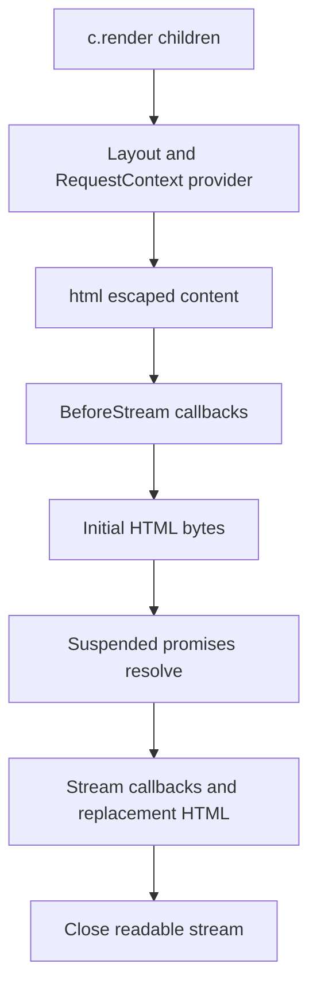

## Overview

Hono renders server HTML through escaped template values and JSX nodes, then returns it using the context response helpers. The `jsxRenderer` middleware adds document types, layouts, request-context access and optional streaming to that pipeline. [[Request Context and Middleware]] owns response headers and finalization; this page owns the conversion of content into the body. Browser DOM updates are described separately in [[Browser Rendering]].

Sources: [src/helper/html/index.ts:11-56](repo://src/helper/html/index.ts#L11-L56), [src/middleware/jsx-renderer/index.ts:33-79](repo://src/middleware/jsx-renderer/index.ts#L33-L79), [src/context.ts:723-733](repo://src/context.ts#L723-L733)

## Templates and escaping

The `html` tagged template appends literal template segments and escapes interpolated strings. It flattens interpolated arrays, emits numbers, and ignores booleans, null and undefined. Values marked `isEscaped` are incorporated without escaping again, with callbacks preserved; promises enter an asynchronous string buffer. Other objects are stringified and escaped. The result is either an escaped string or a promise resolving to one.

Sources: [src/helper/html/index.ts:11-56](repo://src/helper/html/index.ts#L11-L56)

`raw` creates a boxed string marked as escaped and can attach rendering callbacks. It does not inspect or sanitize the value. The escaping implementation converts ampersands, angle brackets and both quote characters. Use the distinction deliberately: interpolated ordinary strings go through that escape path, while raw values assert that the content is already suitable for direct HTML output. `c.html` itself accepts a complete HTML string and sets its content type; it is not the template interpolator.

Sources: [src/utils/html.ts:40-46](repo://src/utils/html.ts#L40-L46), [src/utils/html.ts:90-117](repo://src/utils/html.ts#L90-L117), [src/helper/html/index.ts:26-46](repo://src/helper/html/index.ts#L26-L46), [src/context.ts:723-733](repo://src/context.ts#L723-L733)

## JSX serialization

`jsx` creates nodes, moves the `key` out of ordinary props, and chooses intrinsic or function-node handling. Intrinsic nodes validate tag names, normalize attribute names, reject invalid attributes and escape string values. Style objects become escaped style strings; known boolean attributes are emitted only when true. Nullish attributes are omitted. Void tags without children use a self-closing representation.

Sources: [src/jsx/base.ts:147-154](repo://src/jsx/base.ts#L147-L154), [src/jsx/base.ts:179-250](repo://src/jsx/base.ts#L179-L250), [src/jsx/base.ts:304-350](repo://src/jsx/base.ts#L304-L350)

Children serialize recursively: strings are escaped, numbers and escaped values are appended, arrays recurse and promises enter the buffer. Function nodes receive props and children, invoke the component, and serialize the result according to its type. Event-handler functions and refs are omitted from server output, while other unsupported function props throw. `dangerouslySetInnerHTML` inserts raw content and throws if children were also supplied.

Sources: [src/jsx/base.ts:108-128](repo://src/jsx/base.ts#L108-L128), [src/jsx/base.ts:220-238](repo://src/jsx/base.ts#L220-L238), [src/jsx/base.ts:254-295](repo://src/jsx/base.ts#L254-L295)

The JSX runtime exports automatic-runtime entry points and template helpers. `Fragment` emits children without an enclosing tag, while `cloneElement` merges props and optionally replaces children. `memo` caches a component result using a props comparator, defaulting to shallow equality, and attaches metadata for the DOM renderer. These helpers work at the component layer rather than registering routes or selecting HTTP status codes.

Sources: [src/jsx/jsx-runtime.ts:6-14](repo://src/jsx/jsx-runtime.ts#L6-L14), [src/jsx/base.ts:353-441](repo://src/jsx/base.ts#L353-L441)

## Layouts and request-aware components

`jsxRenderer` reads the previously installed layout or uses `Fragment`. When a component is supplied, it installs a new layout that receives the previous `Layout`, then installs a renderer and continues downstream. A handler's `c.render` invokes that renderer with children and renderer props. The renderer resolves its options, prepends the default HTML doctype unless disabled or replaced, and wraps output in a `RequestContext.Provider`.

Sources: [src/middleware/jsx-renderer/index.ts:33-64](repo://src/middleware/jsx-renderer/index.ts#L33-L64), [src/middleware/jsx-renderer/index.ts:116-129](repo://src/middleware/jsx-renderer/index.ts#L116-L129), [src/context.ts:448-450](repo://src/context.ts#L448-L450)

`useRequestContext` reads that provider and throws if it is absent. This makes request access explicit in the renderer's component tree: a component can read the request URL or environment without receiving the HTTP context as a direct prop. The renderer component itself also receives the context as its second argument. Nested layouts can preserve and invoke the prior `Layout` when building their content.

Sources: [src/middleware/jsx-renderer/index.ts:23-31](repo://src/middleware/jsx-renderer/index.ts#L23-L31), [src/middleware/jsx-renderer/index.ts:49-64](repo://src/middleware/jsx-renderer/index.ts#L49-L64), [src/middleware/jsx-renderer/index.ts:120-128](repo://src/middleware/jsx-renderer/index.ts#L120-L128), [src/middleware/jsx-renderer/index.ts:155-165](repo://src/middleware/jsx-renderer/index.ts#L155-L165)

## Asynchronous context isolation

Server JSX context uses a per-render weak map when an AsyncLocalStorage implementation can be discovered through runtime process APIs. `runWithRenderContext` creates or resumes the store, and providers push and pop values in that store, including cleanup after promises. Function nodes capture the current render context when a component returns a promise, allowing the returned subtree to resume with its provider values.

Sources: [src/jsx/context.ts:34-70](repo://src/jsx/context.ts#L34-L70), [src/jsx/context.ts:161-199](repo://src/jsx/context.ts#L161-L199), [src/jsx/context.ts:213-250](repo://src/jsx/context.ts#L213-L250), [src/jsx/base.ts:268-282](repo://src/jsx/base.ts#L268-L282)

Without AsyncLocalStorage, the fallback store only surrounds synchronous execution. The code warns once when context is accessed without a store while asynchronous fallback renders are pending: `useContext` after an await can fall back to the default value. Captured subtree resumption restores known values, but that does not make arbitrary post-await reads inside an async component equivalent to the storage-backed path.

Sources: [src/jsx/context.ts:73-106](repo://src/jsx/context.ts#L73-L106), [src/jsx/context.ts:117-147](repo://src/jsx/context.ts#L117-L147), [src/jsx/context.ts:161-199](repo://src/jsx/context.ts#L161-L199)

## Stream HTML and suspended content

With streaming disabled, the renderer calls `c.html`. With `stream: true`, it sets HTML, chunked transfer and identity encoding headers and returns `c.body(renderToReadableStream(body))`. A header record instead supplies the custom streaming headers. The stream renderer resolves BeforeStream callbacks, emits initial UTF-8 bytes, then follows Stream callbacks and newly produced callbacks until all complete. Cancellation prevents later enqueue and close operations.

Sources: [src/middleware/jsx-renderer/index.ts:66-79](repo://src/middleware/jsx-renderer/index.ts#L66-L79), [src/jsx/streaming.ts:146-219](repo://src/jsx/streaming.ts#L146-L219)

Sources: [src/middleware/jsx-renderer/index.ts:40-79](repo://src/middleware/jsx-renderer/index.ts#L40-L79), [src/jsx/streaming.ts:87-136](repo://src/jsx/streaming.ts#L87-L136), [src/jsx/streaming.ts:146-219](repo://src/jsx/streaming.ts#L146-L219)

`Suspense` emits fallback markup when children require asynchronous work and later produces replacement templates and scripts. When rendering into a string buffer, its callback replaces the fallback in that buffer instead. `StreamingContext` supplies a script nonce for generated suspense scripts. These APIs are marked experimental. Generic byte streams and SSE in [[Streaming and WebSockets]] use a separate writer API rather than this JSX callback protocol.

Sources: [src/jsx/streaming.ts:18-42](repo://src/jsx/streaming.ts#L18-L42), [src/jsx/streaming.ts:87-143](repo://src/jsx/streaming.ts#L87-L143), [src/helper/streaming/stream.ts:7-14](repo://src/helper/streaming/stream.ts#L7-L14)

## CSS and rendering failures

The CSS helper exposes `css`, `cx`, `keyframes`, `viewTransition` and `Style` through a CSS context. It tracks used selectors per render, avoids emitting styles already added, and either updates the style element in the current buffer or emits a script appending later styles. `Style` accepts a nonce used by those later scripts. External class names combined by `cx` are escaped before being marked as safe HTML. The nonce production mechanism itself belongs to [[Security Middleware]].

Sources: [src/helper/css/index.ts:72-146](repo://src/helper/css/index.ts#L72-L146), [src/helper/css/index.ts:149-214](repo://src/helper/css/index.ts#L149-L214), [src/middleware/secure-headers/secure-headers.ts:131-145](repo://src/middleware/secure-headers/secure-headers.ts#L131-L145)

`ErrorBoundary` accepts fallback content, a fallback-render callback and an error callback; it captures context before deferred rendering so error fallback work can resume in that context. It is also experimental. Outside component boundaries, ordinary pre-response exceptions use the application error handler. The readable-stream renderer has its own `onError` callback because deferred rendering can fail after initial content has already been emitted.

Sources: [src/jsx/components.ts:50-125](repo://src/jsx/components.ts#L50-L125), [src/jsx/streaming.ts:146-219](repo://src/jsx/streaming.ts#L146-L219), [src/hono-base.ts:450-465](repo://src/hono-base.ts#L450-L465)
